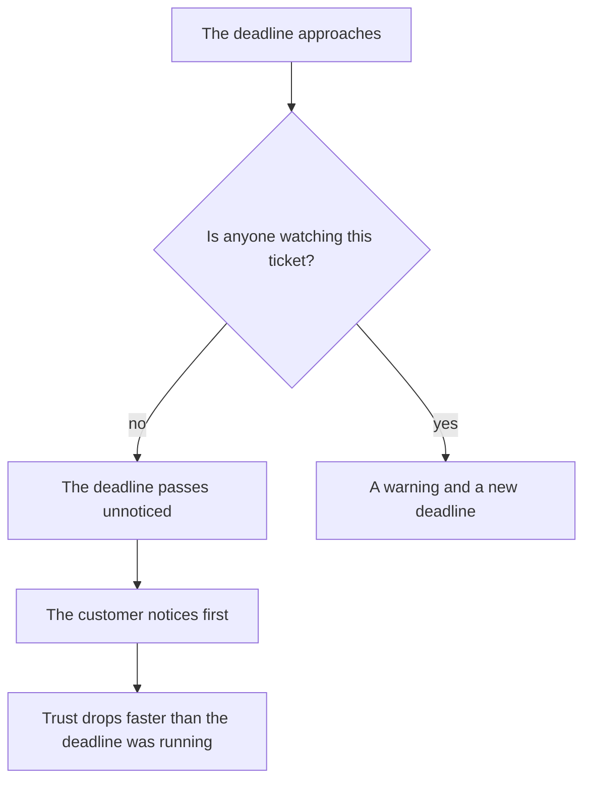

## Introduction

I learned about the first SLA (Service Level Agreement — the service commitment made to a customer) breach from a customer's email. Not from a report, not from the tracker, not from an engineer — from an email that said "you promised to reply yesterday". The ticket was in progress, the engineer was busy with something else, and the deadline had quietly passed.

That word — quietly — is the actual problem. A missed deadline is unpleasant but explainable: it happened, we reviewed it, we fixed it. A breach the customer notices first breaks something else: the belief that the service can see its own work. After that email, the customer starts checking for themselves, and every question of theirs sounds like distrust.

The previous article in the series — "Triage at first touch: category, priority, route" — was about every request getting a priority, a category, and an owner at entry. This article is about the next loop: regular control that spots a risk before it becomes a fact.

The thesis: a missed deadline is a manageable event if it's visible in advance. A silent breach isn't a team failure but a control failure: nobody looks at the queue at the moments when something could still be done.

## Why customers find the breaches

A silent breach always follows the same script.

Why this happens almost every time:

- **The tracker shows statuses, not risks.** A ticket "in progress" looks identical an hour before the deadline and a week after it.
- **People look at the report, not the queue.** Last month's report answers what already happened. Prevention needs the list of what will happen this week.
- **Everyone assumes someone else is watching.** The engineer thinks the lead owns the deadlines, the lead thinks the assigned engineer does, and the report generates itself and nobody reads it.
- **The urgent crowds out the important.** While one incident burns in the queue, every other deadline keeps running — but gets no attention.

<!-- вилка: собственный случай тихого нарушения — как обнаружилось и чем закончилось. -->

This script has an unpleasant property: it reproduces more often the better the team handles the current flow. The fewer fires, the fewer reasons to look at the queue as a whole.

## Three risk filters

Control that works is boringly simple: once a week the tracker export goes through three filters, and every ticket that lands in one gets an action.

**First filter — the deadline is close.** Not "breached" but "will be breached unless something changes". This catches tickets with roughly a quarter of the time budget left or less. It's the most important filter: it's the only place where you can still make it without consequences.

**Second filter — no reply for several days.** The ticket is open but nothing happens: no answer to the customer, no movement inside. The threshold depends on your standards, but the fact of silence matters more than the exact number: silence in a ticket always means the owner lost sight of it.

**Third filter — a reopen.** The ticket was closed and opened again. That's not a new ticket but a message that the previous solution didn't work — and on this request the clock has usually been reset, while the promise to the customer has not.

| Filter | What we look for | Action |
| --- | --- | --- |
| Deadline close | Less than a quarter of the time left | Contact the owner and choose: make it or renegotiate the deadline |
| No reply | Silence in the ticket for several days | Return it to the owner with a deadline for the next step |
| Reopen | The ticket was opened again | Work out why it came back, not just the symptom |

Main rule: **every ticket from a filter gets an action, not a "looked at it" note**. There are only three actions: make it, renegotiate, escalate. The fourth — "wait a bit longer" — doesn't exist, because that's exactly the mechanism that produces silent breaches.

<!-- вилка: свои пороги фильтров и ритм прогона — когда и кем смотрится очередь. -->

The run takes half an hour, not a whole day, and its value is in the habit rather than the list: the whole queue gets looked at instead of pieces of it. If that doesn't happen once a week, risk becomes fact with no malice involved.

## A warning before the breach

If a filter fires and it's clear the deadline won't hold, the next step is to say so first. It feels like admitting failure, though it's the opposite: a warning is you keeping the promise to report problems before the customer finds them.

The message to the customer has four parts, each mandatory:

1. **What's happening.** No evasive phrasing: the ticket is in progress, the deadline is moving.
2. **Why.** One or two sentences about the substance. Not "a complex situation" but "we need to reproduce the problem in the test environment".
3. **The new deadline.** Concrete and realistic, not "soon". A deadline you then miss is a second breach, worse than the first.
4. **What the customer does.** Usually nothing: they get an update by the stated time. If something is needed from them, it's said plainly.

The internal message differs in one thing: it carries an action. Not "flagging the risk" but "here's the option: speed it up internally or move the deadline with the customer's consent; if the latter, I need your answer by such a time". Such a message asks management for a decision, not for sympathy.

<!-- вилка: пример письма клиенту и короткого внутреннего сообщения о риске. -->

## The signal of a systemic problem

A single ticket in a filter is business as usual. Two similar risks in one category within a week is already a hypothesis about the system, and it's worth testing before it becomes a pattern.

Three questions separate coincidence from a system.

- **Where exactly does it repeat?** One category, one product, one line, one customer. If the risk arrives from the same place a second time, the problem is in the rules of that place, not in the people.
- **What do the deadlines have in common?** For example, risks appear while waiting on the third line. That means the agreement with it isn't holding — and no amount of discipline inside support fixes that.
- **What has already been tried?** If nothing changed after the first case, the second isn't news but confirmation.

The answers usually point to one of two causes: triage set the wrong priority and the ticket landed in the wrong queue, or capacity can't carry the current flow. The first is fixed with rules, the second only by a conversation about resources. The two conversations must not be mixed: until the cause is named, every solution looks like "work harder".

After that the signal lives on the agenda, not in the report. If the cause is a wrong priority, the matrix and triage training get fixed. If it's capacity, numbers are needed: how many hours of work per week the flow requires and how many exist. That's no longer queue control but a capacity calculation, and that topic belongs to another part of the series.

## The lesson from a breach

Breaches will happen. Even with three filters, agreed deadlines, and warnings, cases remain where everything went wrong. The question isn't how to eliminate them but what remains afterwards.

I record four things in the review, and none of them is about names:

- **The timeline.** When the request arrived, when it got a priority, when it reached the owner, when the deadline came under threat, and when it expired. Only time and events.
- **What failed.** The filter didn't see it, the owner didn't react, the agreement with another team didn't hold. Wording without "forgot" and "dropped the ball": a system where forgetting is possible is a defective system.
- **What was done after.** The warning to the customer, the moved deadline, the compensation — everything that actually happened.
- **One change.** Not a list of ten items but one rule that alters the process so this case becomes impossible or visible earlier.

The outcome of the review isn't punishment or a report protocol but a change in the system. If nothing changed after a breach except the mood of the participants, the next breach is a matter of time.

<!-- вилка: свой разбор нарушения — что было изменено в процессе после него. -->

The point of all this control isn't zero breaches. Zero breaches only happens where there's nothing to promise. The point is that no breach becomes news to the customer or a surprise to the team. In ["The five results of a support lead's work"](/en/blog/support-lead-five-results/) predictability is named the first result: SLA breaches don't reach the customer first. Regular queue control is the cheapest way to get there.
