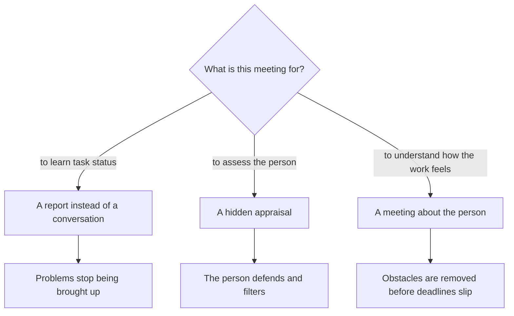
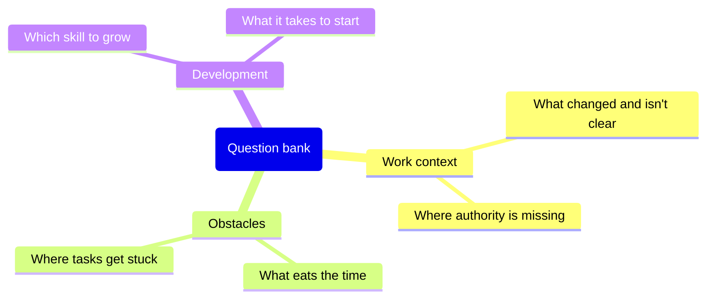

## Introduction

For my first six months, one-on-ones were a status report with a human face. I came in with a list of questions about tasks, the engineer came in with ready answers, half an hour later we parted, and neither of us had said what actually mattered. Formally the ritual existed: it was in the calendar, it ran regularly, it even produced recorded decisions. It started working only when I changed what the conversation was about rather than when it happened.

The claim I arrived at: a one-on-one is a ritual about the person. Not about their tasks (those live in the tracker), not about their assessment (that needs observable facts), but about how the work feels and what gets in the way. Turned into a status report, the meeting duplicates the tracker; turned into an appraisal, it stops receiving the truth.

This article covers the four things that hold the format together: structure, a question bank, the boundary of the personal, and rules for cancelling. It continues the conversation about a lead's rhythm — in "The lead's rhythm: the 40% rule" the one-on-one was one of five mandatory rituals; here it's about making sure that hour isn't wasted.

## Two degenerate formats

A one-on-one has two ways to go wrong, and both look decent from the outside.

**The status report.** The lead asks how things are going with the tasks, what's up with that ticket, when this one will close. The engineer answers, the lead writes it down. The problem isn't the content — it's that the information already exists in the tracker, and in such a meeting a person only brings what is safe to bring. They won't mention obstacles: an obstacle is an admission that you're not coping, and the conversation is nominally about deadlines. Worse, a status meeting teaches the opposite habit: people learn to arrive with a report instead of a question.

**The hidden appraisal.** The lead never says "this is an assessment", but the meeting is built like one: tell me what you failed at, how you rate your own level, why you didn't do what I would have done in your place. Feedback flows one way and lands like a verdict. The result is predictable: the person starts defending, prepares their wording in advance, and stops bringing anything that could be used against them. Two months in, the meetings are polite and empty.

The choice is simple: a meeting needs one subject, and it can be neither status nor appraisal.

Next: how to run a conversation with the right subject.

## The 40-minute structure

The format that stuck with me is short: forty minutes and five blocks. Minute precision doesn't matter; the order does — the person first, then context, agreements last.

| Block | Who leads | What should remain |
| --- | --- | --- |
| What piled up since last time | The engineer | The list of topics they came with |
| Obstacles | The engineer, the lead works through them | One or two obstacles with an owner and a date |
| Context and decisions from above | The lead | A clear "why", not just "what changes" |
| Development | Both | One next step on one skill |
| Wrap-up | The lead | Decisions with an owner and a date |

The first block is their agenda, and holding the pause there matters. If the lead opens with their own questions, everything after becomes an interview. A simple move works: "where shall we start — with what's piled up on your side".

The second block is obstacles, and it's the only part where the lead doesn't listen but acts. An obstacle is what blocks the work: no access, unclear ownership, a conflict with a neighbouring team, an outdated instruction. The lead's job isn't to explain why it's like that but to take the obstacle away and come back with a result.

The third block is context from above: what's changing in the company, the product, the rules, and why. An engineer who understands the reason argues with a decision instead of quietly sabotaging it. This is also where decisions that can't be discussed in the general review belong.

The fourth block is development, and it's easy to ruin by turning it into an annual plan. One skill and one next step are enough: what the person will try before the next meeting. The fifth block is the wrap-up: two or three decisions, each with an owner and a date.

Where decisions get recorded. Not in a transcript — verbatim notes make people cautious. A line in a shared document is enough: what was decided, who does it, by when. Personal matters aren't recorded, and decisions that concern other people are passed on without attribution.

## A question bank

A good question for this meeting has no ready answer in the tracker. I keep a bank of three groups and reshuffle it every few months — questions asked for years stop pulling out anything but politeness.

The bank looks like this: three groups, each with its own subject.

A few phrasings from the working bank:

- What took more time than you expected over the last two weeks?
- Where are you deciding without a mandate right now — asking me although you could decide yourself?
- What do I do that gets in the way of your work?
- Which skill do you need to take on harder tickets, and what stops you from starting?
- What in the team's rules feels outdated to you?
- What did you expect from this role, and what turned out differently?

<!-- вилка: 5–8 своих вопросов, которые реально работают в вашей команде. -->

What doesn't work in a bank: questions with the verdict built in ("don't you think you're closing tickets slowly?"), test questions ("what would you do in the client's place?"), and questions about a past that can't be changed.

## The boundary of the personal

In a one-on-one people talk about more than work, and the lead should know in advance what they do with what they hear.

I draw the line simply. Work facts are what can be written down and passed on: obstacles, agreements, skill plans. Personal disclosures are what a person said about themselves and their life. The second is never recorded, never repeated, and never used in an assessment. That isn't politeness, it's the condition without which the meeting only works one way.

Two clarifications worth saying out loud at the start rather than when it's too late.

- What I can't keep secret. Some things sit outside the work context — a long sick leave, a safety threat, a breach of the law — and can't stay between two people. Promising full confidentiality while knowing that is a lie that surfaces at the worst moment.
- What personal matters won't become. If private circumstances affect the work, we discuss the consequence rather than the cause: redistributing load, the schedule, a deferral — without a diagnosis or details.

The other side of the same boundary: the lead doesn't use the meeting as therapy. Complaining to an engineer about management, discussing other people's problems, or seeking support takes away their room to talk about themselves. That's what the lead's own meetings with their manager are for.

## Rules for cancelling

The most common way to kill this ritual is to cancel it for a good reason. An incident, an urgent request, a meeting with management: in the moment it all makes sense, and six weeks later there are no meetings at all.

The rules that work for me.

- **Moving is allowed, cancelling isn't.** Moving means a specific new slot proposed right there. "Let's do next week" isn't a slot.
- **If the lead moves it, they do it rarely and once.** A third move in a row reads one way: it doesn't matter. After the third, better to say so out loud and reduce the frequency than keep promising.
- **If the engineer moves it, that's a signal too.** Not because they're lazy, but because the conversation stopped being useful to them.
- **A skipped meeting doesn't lengthen the next one.** Two-hour catch-up meetings don't work: they turn into exactly the report we were escaping.

<!-- вилка: правила отмены в вашей практике — как часто переносили и что из этого следовало. -->

A one-on-one is expensive — it takes time from both people. But it's the only place where you learn about an obstacle before it breaks a deadline, and about burnout before the resignation letter arrives. If that hour keeps disappearing, start with the cancellation rule — and with an honest answer to what you're actually doing in the meeting.
