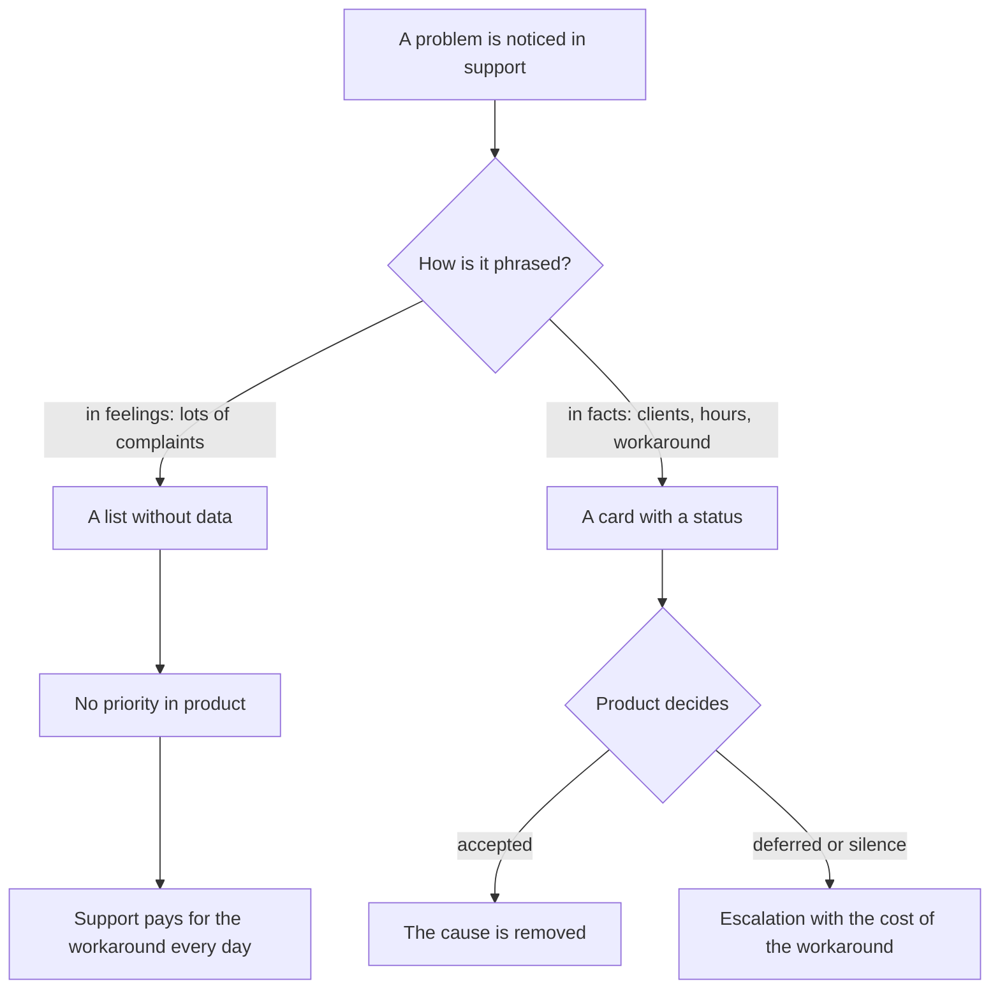
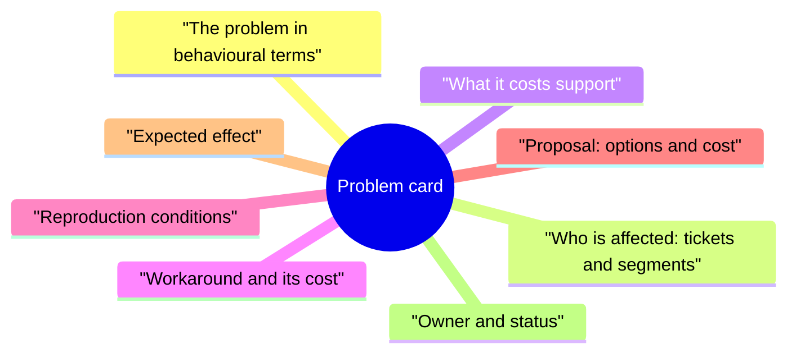
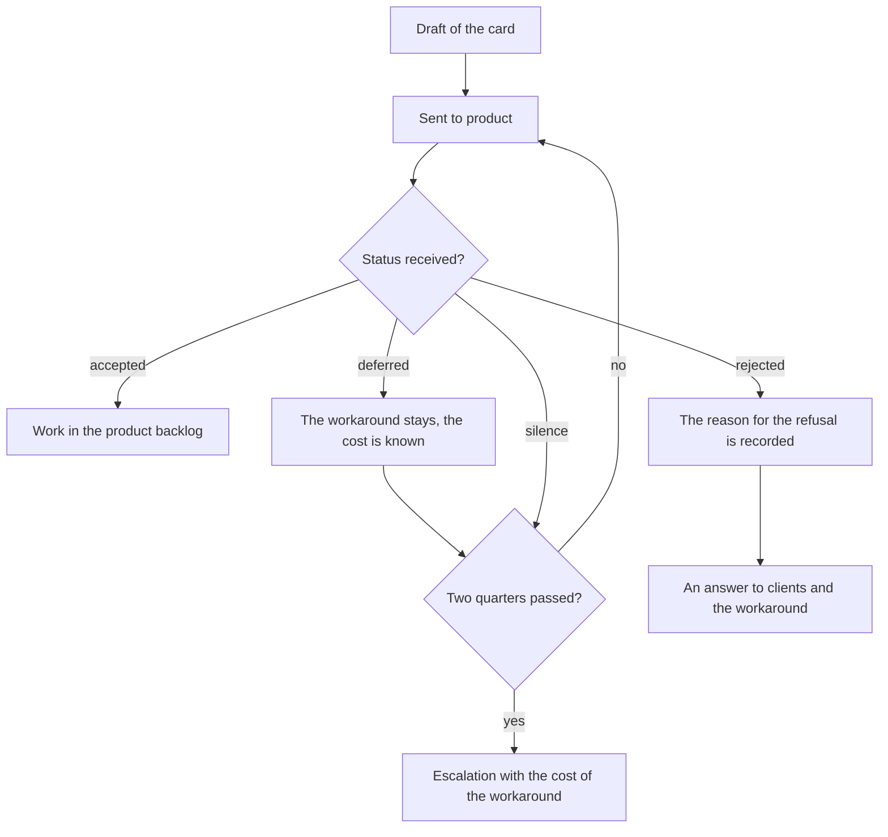

## Introduction

Support is the only place in the company where you can see what actually breaks for the client. Product looks at metrics, analytics and the release plan; support looks at people who could not get their work done. There is usually no channel between these two pictures, and a problem that is written about in tickets every day lives in support for years as "a product quirk".

I am convinced that the support lead owns the most honest data about client problems in the company. The only question is the shape in which that data gets out. "We get a lot of complaints about the export" does not survive the first meeting with release planning; a problem card does, because it contains clients, hours and the cost of the workaround.

The blameless postmortem from the previous article of the series dealt with a single incident: a failure happened, it was reviewed, the actions got owners. This article is about a different class of problems — the ones no single action closes, because the solution lies in the product.

## Why "we have problems" gets ignored

Every support team has a list of pain points, and almost always the list does not work. Not because product does not want to hear, but because the list answers none of the questions that planning asks.

- **Product has its own queue.** Priority is set by the release plan and by demand estimates, not by the number of messages in a support chat. A request without a number and a segment loses to any task that has an estimate.
- **The problem is phrased as an emotion.** "Clients are complaining" does not say how many clients, which ones, or what exactly happens. Product can neither reproduce nor estimate that phrasing.
- **The cost of inaction is invisible.** Until support has counted how many hours go into the workaround, the problem looks like a trifle next to the big tasks.
- **There is no addressee.** A request with no owner on the product side comes back and dies in correspondence.
- **There is no status.** A problem that is "in progress" is indistinguishable from one that was forgotten: a month later nobody will remember what was already decided.
- **There is no reminder.** Said once, never repeated; a quarter later nobody remembers either the problem or who raised it.

The fork looks like this:

The difference between the branches is not the volume of the complaint but the willingness to attach numbers and an addressee to it. What follows is what that work consists of.

## The anatomy of the card

A card is not a form for the sake of a form. It is the minimum set of details at which someone else's pain becomes a task with an estimate. I keep eight fields:

| Field | What goes in it | Why product needs it |
| --- | --- | --- |
| The problem in behavioural terms | What the client does and what they get instead of the expected result | Separates a complaint from a scenario that can be reproduced |
| Who is affected | Tickets, segments, client criticality, frequency | Gives scale and a basis for priority |
| Cost to support | Hours and the share of the flow, repeat contacts | Shows what inaction costs |
| Workaround | What engineers do instead of the proper solution, and at what risk | Shows the manual work that can be removed |
| Reproduction conditions | Environment, version, steps, data set | Saves product weeks of clarification |
| Proposal | Solution options with the cost of each | Turns the request from "fix it" into a choice |
| Expected effect | What leaves the flow and what stops breaking | Makes the card comparable with other tasks |
| Owner and status | The name of the person in product, the status, the date of the next contact | The problem stops being ownerless |

The fields are worth going through not in the order of the table but by the ones that are most often filled in wrongly.

**Who is affected.** It is the first thing any head of product asks. The answer "all clients are suffering" cannot be checked and therefore weighs nothing; the answer "here is the list of tickets, here are the segments, here are the repeat contacts" can be checked and weighs a lot. The important thing is not to exaggerate: one inflated number ruins trust in the whole card, and the next five sound cards will be read with suspicion.

**Cost to support.** It is counted from events, not by eye: how many contacts a month about this problem, how much time the workaround takes, how many of them are repeat contacts. Even a rough estimate using the formula "number of contacts multiplied by average workaround time" is stronger than no estimate. This is the only argument that sounds inside someone else's system of priorities: not "clients find it inconvenient" but "we spend this many hours a month on work that should not exist".

**The workaround.** The field that is most often skipped, and the most important one for the conversation. A workaround shows two things: the problem is already being solved by hand, and that works worse than it seems. A workaround has a cost — time, the risk of error, dependence on a particular engineer — and that cost is exactly what makes the product task urgent.

**The proposal.** Support has the right and the duty to propose a solution: it sees the scenario more often than anyone. But a proposal is options with a cost, not a demand. "You could fix the validation — that's cheap; you could redo the form — that's expensive and closes two more problems" gives product a choice, while "make it work properly" gives only irritation.

**Owner and status.** The name of a person in product turns the card from a letter into a task. Not "the product team", but an engineer or a domain owner who has taken the card. The status and the date of the next contact exist so the card does not sink.

Three rules without which the card falls apart: one card, one problem (if there are three causes inside, none of them moves); the card contains no judgements about people and no emotions, only facts and scenarios; and everything recorded can be checked against the tracker or the documentation.

<!-- вилка: поля своей карточки — как называется, где лежит, что реально заполняется, а что приходится вытаскивать руками. -->

## The quarterly report of top causes

Cards are the unit of work; the report is how they are shown together. Once a quarter I put together a page with the top causes: it is read by the person who allocates product priorities, and whether these problems reach the plan depends on it.

The format is deliberately short: one page, no presentation, with a table for each cause.

- **The card number and the statement of the problem** — one line, in terms of client behaviour.
- **Scale**: contacts over the quarter and the number of affected clients.
- **Cost to support**: hours and the share of the flow.
- **Trend**: growing, stable, declining. Trend matters more than the absolute number: a slowly growing problem becomes the main one two quarters later.
- **Status and owner** on the product side.
- **What we ask for**: a decision or a decision about priority, phrased as a choice.

The rules for what gets into the report are strict and useful:

- only cards with data make it into the report — otherwise it is a wish list;
- sorting by cost to support, not by date of appearance: the goal is to clear the flow, not to keep a chronicle;
- the report includes a "what has already been done" block: cards accepted and closed. Without it the meeting turns into a list of grievances and loses allies;
- the report does not repeat last quarter's resolutions line by line: every previous line needs a status.

It is better to prepare the report for a specific decision. Nobody will work through "here are twenty problems"; "here are five, two of which we ask you to take into the quarter, and for the rest we ask for a decision to defer" is discussable and ends with a result.

<!-- вилка: формат своего отчёта — кому идёт, какой объём, что из него попало в план продукта. -->

## Statuses and the escalation of silence

A card without a status turns into a letter to nowhere. So the status has rules, and the main one is: product sets the status, support is responsible for the data and the reminder dates.

What stands behind this scheme:

- **Silence is not a status.** If there is no answer within the agreed period, the card gets a "silence" mark with a date. This is not a formality: it is silence that eats quarters, not refusals.
- **Deferred is not a refusal.** A deferral has a reason and a review date. Without a date, "deferred" is a polite "never".
- **Rejected is a result too.** The reason is recorded, support tells the clients and keeps living with the workaround. That is more honest than silence: the workaround becomes a visible expense.
- **Escalation — with numbers.** If a problem has been deferred two quarters in a row, the conversation moves a level up — not in the format "product doesn't hear us" but with the cost of the workaround over the period and the risk. Asking for decisions rather than sympathy is a separate skill, and it was already covered in the previous part of the series.

A separate rule is about what must not be in an escalation. Cards are not used as an argument in disputes between teams or as a way to show who is to blame for a delay. As soon as a card becomes a weapon, product starts defending itself instead of reading the data, and the channel closes.

<!-- вилка: как у вас устроены статусы — кто их ставит, сколько живёт карточка без ответа, был ли случай эскалации. -->

## What changes when cards work

The changes are not immediate and not only in the numbers — the conversations change most of all.

Product priority stops depending on the volume of the last letter. A queue appears that has grounds: the number of clients and the cost of the workaround. Such a queue can still be argued about, but substantively — for instance, about which cost counts as higher.

Support stops being the only place where the problem is known. It gets an owner on the other side, and the lead gets a way to show management what is happening with the flow without retelling tickets one by one.

A history forms. A year later it is visible which problems get solved, which are closed by a refusal and what that means for clients. That is the most convincing argument in the next conversation about resources: not promises but a list of decisions and their consequences.

And the behaviour of engineers changes. When a problem has a number and a status, a first-line engineer stops feeling that they are writing into the void: their observations become data. This is perhaps the cheapest way to raise engagement that I know.

<!-- вилка: история одной карточки — от записи до решения продукта: что было в данных, какой аргумент сработал, что изменилось после. -->

A problem card is not bureaucracy but the minimum format at which a client's pain becomes a task with a cost and an owner. The next article of the series — "A metric without an action is a picture: the metric passport" — is about making sure that the numbers these cards rest on are actually used by someone to make decisions.
