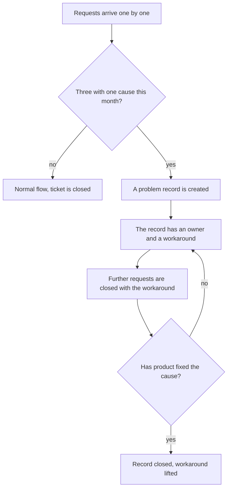
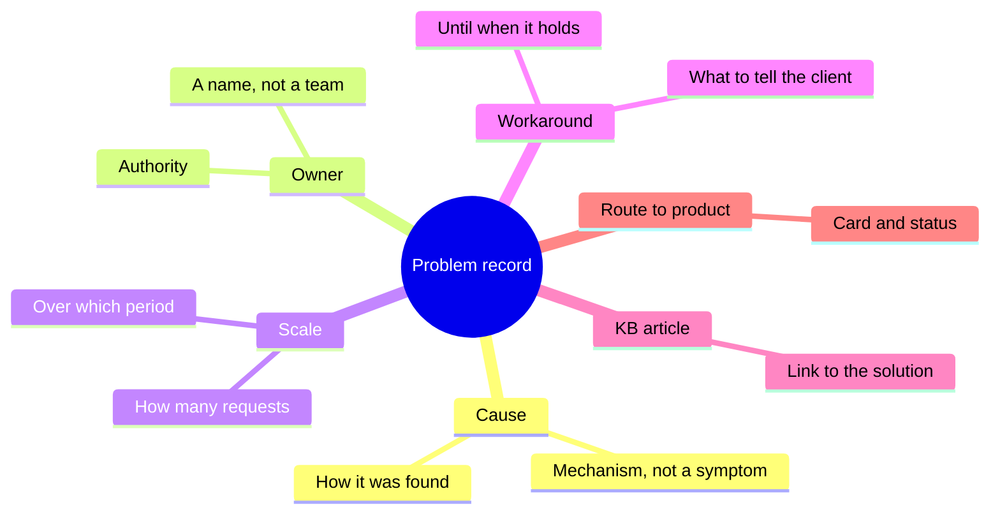

## Introduction

The most expensive ticket in support is the one the team has already solved. Not because it is hard, but because a different engineer pays for it every time, and each time from scratch.

For a while I looked at the report and saw health: the flow was closing, the queue was not growing, not a single overdue ticket. Then I listened to the weekly review and understood that three engineers were telling the same story in different words. In the report those were three successfully closed tickets; in reality it was one problem that nobody intended to solve.

This article is about the transition that costs a service more than anything else: from a stream of requests to a list of problems. A request is a unit of work and it has a deadline. A problem is a unit of cause and it has an owner, a workaround and a route into the product report. Until those two lists are separated, support is condemned to solve the same thing forever.

## The invisible cost of identical tickets

Recurring requests are invisible precisely because each of them looks normal. The ticket came in, the engineer worked it out, the client got an answer, the ticket is closed. The "closed" metric grows while the problem does not move.

The cost consists of four things, and none of them reaches any report:

- **Team hours.** Every repetition is analysis from scratch: the same search, the same checks, the same experiments. The time goes into operations and does not come back.
- **Client trust.** Someone writing for the third time in a month and hearing "have you tried..." draws a conclusion not about the product but about support. The first answer still counts as work; the third is a brush-off.
- **Knowledge that does not settle.** The engineer found a workaround — and it stayed in their head and in one closed ticket. A quarter later they go on holiday or to another team, and the workaround goes with them.
- **A blind spot for product.** While the problem lives as tickets, product has no argument: nothing to show except "clients are complaining". With a problem record the conversation changes — more on that below.

All of that is the price of a missing list. The list starts with a rule the team accepts without debate.

Why such repetitions are invisible in the standard report: it groups tickets by category, while a problem lives not in a category but in a cause. Two tickets in different categories can share the same failure mechanism, and no grouping will bring them together. That is why repeats are looked for not on a dashboard but at the weekly review and in a search across request texts.

## The rule of three requests

The rule is simple: three requests in a month with one cause are not three tickets but one problem record. One request is an accident, two are a coincidence, three are a pattern that has to be dealt with.

Three clarifications matter in it; without them the rule turns into a formality.

**One cause, not one text.** Matching wording means nothing: clients describe the same thing in different words, and the same word can mean different failures. You count by cause — by the mechanism the engineer established during the analysis.

**The window is a month.** A year is too long: the problem will eat more than its solution is worth. A week is too short: some problems show up rarely and will not gather three requests. A month is a working compromise, and it is also a convenient review period.

**Anyone notices, not only the lead.** If only the lead notices three requests, the rule lives exactly until the first busy week. The trigger has to fire at the weekly review, where the team names the repeats themselves and the lead confirms — or at triage, if the tracker has a field for linking requests.

How this works in the flow:

Note the backward arrow: until the cause is fixed, the record lives and keeps paying off — that is exactly how it differs from a ticket.

<!-- вилка: как у вас работает правило трёх — кто замечает повторы, где ведётся список, что было до него. -->

## The anatomy of a problem record

A record is not a ticket and not a chat note. It is a short document that outlives any single request and is read by people who took no part in the analysis. These are the concepts it is made of:

Two blocks deserve an explanation, because they are where records usually break.

**Cause.** The wording has to describe a mechanism: not "access issues" but "after a password change, old sessions are not invalidated". Such a cause can be checked, handed to product and closed. A formulation through a symptom cannot be verified and is only good for finding similar tickets.

**Owner.** A person's name, not a team's name. The owner does not have to fix everything personally: they have the authority to decide what happens to the problem, and they remember the context. A record without an owner is the same ticket, only longer.

The remaining blocks serve the reader, not bureaucracy: scale shows whether the problem is worth investing in; the workaround gives the team a ready answer; the KB article turns the workaround into reusable knowledge; the route to product makes the problem visible where it can actually be eliminated.

<!-- вилка: пример вашей записи о проблеме — причина, владелец, обходной путь, чем закончилась. -->

## What an owner gives you

The main benefit of an owner is not faster reaction. It is that the problem acquires a future.

Until the causes are fixed, the only thing support can do is give the client a working answer. That is exactly what the record stores: a workaround, verified and approved, with the boundary "until when it holds". A new engineer does not reinvent the solution and does not promise what will not happen; the client gets the same answer from any team member.

The second effect is saving the lead's attention. Without a record, every recurring problem comes back to the lead anew: now as a priority argument, now as a request to "look why it happened again". With a record the decision is made once and holds until the conditions change.

The third is what is visible from outside. A list of active problems with owners and statuses is the best answer to management's question "what is happening in support". It is more honest than a chart of closed tickets: it shows the state of the unresolved rather than activity.

The owner, meanwhile, is better taken from support itself rather than from product. An owner from support knows the clients and the workaround, decides within their own boundaries and does not wait for someone else's meeting; their job is to keep the problem in sight, not to eliminate the cause with their own hands. If you make product the owner, the record dies: product has a different rhythm, and support is left without an answer again.

<!-- вилка: сколько активных записей у вас одновременно и почему именно столько. -->

## A bridge into product

The weakest part of this mechanism in most teams is the last transition. The record lives inside support while the solution lives in product; if there is no bridge between them, the record turns into a permanent workaround.

The bridge is built from what the record already holds: the cause described as a mechanism, the known scale, the formulated workaround. From that a card for product is assembled — with data, a status and an owner on the other side; that is covered separately in the article "A problem card for product that won't close without a status".

A rule I consider essential: a problem record does not close on the fact of "we sent it". It closes when it has an external status — accepted for work, rejected with a reason, scheduled for a version. The absence of a status is also a status, and it has to be said out loud at the review.

<!-- вилка: пример пути от тикетов до карточки в продукте — что отправили, что ответили, чем закончилось. -->

And one last thing. The list of problems does not live in the lead's head or in a chat thread but in a place the team can reach: otherwise in a month it will have to be reassembled. Whether that is a spreadsheet or a field in the tracker does not matter; what matters is that any engineer sees it before starting on the next similar request.
