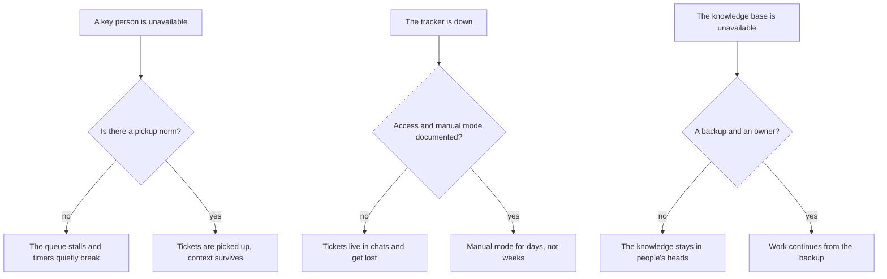
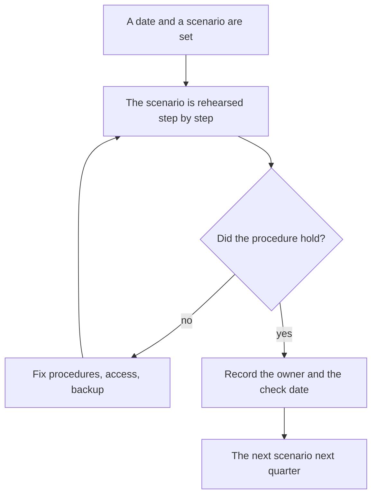

## Introduction

A support lead has exactly one honest test of what they actually manage: walk away and see what remains. Not "will the team cope" — they almost always cope — but how fast the service starts losing tickets, promises, and context.

The previous article in the series — "A metric without an action is a picture: the metric passport" — was about making every number lead to a decision. This one is the year's final check: what happens to the service when one specific person is removed from it. I call it a resilience audit. It isn't about trusting the team or hunting for someone to blame; it's about finding the failure points before they fail: on vacation, on sick leave, on the day someone resigns, or on the day the tracker goes down along with access to it.

The premise I start from: resilience is a property of the system, not of people's character. While the knowledge, the route, and the decision all live in one person, the service runs on that person's presence rather than on a process. The audit exists to expose that gap in calm times, when fixing it costs an hour instead of a reputation.

## Three failure scenarios

There are many scenarios worth rehearsing, but almost all of them collapse into three. The first is a key person being unavailable: vacation, illness, an abrupt resignation, two weeks without contact. The second is tool failure: the tracker is down, access is revoked, an integration breaks, inbound mail goes unread. The third is losing the knowledge base: it's stale, it's unavailable, nobody maintains it, and the knowledge has gone back to where we spent the whole year dragging it from — people's heads.

They share one thing: each scenario tests whether a norm and an owner exist, not whether the team is heroic. The diagram shows how each scenario splits into two outcomes:

The difference between the top and bottom branch of each scenario isn't people — it's whether a written answer exists in advance. Next I'll take the norm that makes the first scenario harmless, and the calculation that verifies it.

## The "picked up in 15 minutes" norm

The norm the whole resilience story rests on: every new ticket is picked up within fifteen minutes during working hours. Note what "picked up" means: the ticket has an owner, a category and a severity, and the client has a substantive first response or at least an honest timeline. Picking up is not resolving. Demanding a resolution in fifteen minutes is pointless; demanding that a ticket doesn't sit there unnamed is mandatory.

What must exist for this norm to hold without one specific person:

- **Triage at first touch.** Category, severity, and route are set on intake, not after the ticket has been sitting. Without that, "picked up" means "someone glanced at it".
- **A rotation of on-call duty.** The queue has a named person for each day, and the team knows who it is. Duty changes by calendar, not by an agreement in a chat.
- **A routing matrix.** For standard reasons a ticket has a written destination: L2, product, operations, an external vendor. If the route lives in the lead's head, pickup is impossible by definition.
- **Access for everyone who needs it.** The queue, the knowledge base, processes, and response templates are granted by role, not by a personal favour. A person who "knows who to ask for access" is the single point of failure.
- **Escalation with a timer.** A ticket that isn't picked up within the norm is visible: the on-call engineer gets an alert instead of learning about it at the weekly review.

<!-- вилка: ваш норматив подхвата — значение, часы работы, что считается подхватом и как фиксируется. -->

It's worth stating explicitly that the norm applies to working hours. Round-the-clock pickup is a different shift model with a different headcount; promising it without the resources means quietly writing a violation into your own process.

## Checking norms by calculation

A norm is easy to declare and hard to prove. It's verified with the capacity calculation from "Capacity instead of heroism": the volume of the flow over a period, multiplied by the average handling time per ticket, divided by the team's available hours. While the calculation balances at full strength, everything looks healthy. The resilience audit adds one question: does it still balance if you subtract one person — especially the one carrying the heaviest segment?

There are three subtractions to make.

1. **Minus the key engineer.** Available hours drop, the flow stays. If the pickup norm can't be met on paper after that subtraction, no amount of heroism will meet it in reality.
2. **Minus the lead.** If the flow only balances with your participation, then part of the work — routing, severity disputes, approvals — was never handed over. Those are exactly the roles you supposedly walked away from, but only in the document.
3. **Minus the tool.** A tracker outage costs days, not hours: while tickets arrive by email, first response time is counted by a different rule. In the calculation this looks like a productivity drop for the recovery period — and that period has to be estimated in advance.

The second way to check is by events rather than by model. Take the days when a key person was absent and look at the tickets that arrived then: time to first response, the share of tickets reassigned more than once, the number of reopenings after the person returned. If timers grow on those days and tickets get closed twice after the return, the problem isn't people — it's the handover of context.

<!-- вилка: свой расчёт — сколько заявок в неделю, среднее время, доступные часы, что показал вычет одного человека. -->

## Recovery procedures

An audit is useless if it ends with a list of risks. Every risk found gets a procedure — short, a page at most, with an owner and a check date.

- **Handover.** A checklist for a week of absence: which tickets are in progress, which promises were made to clients, where an answer is awaited, who needs to be warned. Filled in before vacation, not on the first day of sick leave.
- **Access register and emergency entry.** A list of systems and roles the queue needs, plus the path to access that bypasses normal approval — with the conditions under which it applies and a log of its use.
- **A knowledge base backup.** The base owner, the export cadence, where the copy lives, and how it is restored. Verifying the backup means restoring one article, not ticking a box in a process.
- **Manual mode for a tracker outage.** The address clients write to, the response template, who processes the inbox, how long this mode survives, and how tickets are migrated back into the tracker afterwards.
- **The announcement order.** Who tells the team and the clients that the mode has changed, at what point, and who decides to return to normal.

<!-- вилка: ваши процедуры — что уже написано, что проверялось на практике и чем закончилось. -->

## The audit schedule

A resilience audit isn't a one-off event but a rhythm. The minimum frequency that works: one scenario per quarter, with a full review afterwards. One quarter is a person being unavailable, the next is tool failure, the third is knowledge loss, the fourth is the scenario the team picks.

Here is the loop:

The main trap of any schedule is turning the audit into theatre: rehearse the scenario, confirm that "overall everyone coped", and change nothing. So every audit should have at least one visible result: an updated procedure, new access, an exported backup, or a risk taken off the list. An audit without a change isn't a resilience check — it's a report about calm.

Who to involve: the second engineer who can work that segment, a representative of the adjacent team if the scenario touches it, and the manager — not for a report, but so they see the failure points with their own eyes. What gets updated afterwards: the pickup norm, the access register, the knowledge base backup, the on-call calendar, and the risk list itself.

<!-- вилка: результаты вашего аудита — какие точки риска нашли, что закрыли, что осталось открытым. -->

Resilience can't be proven with a slide deck. One fact proves it: the service works when you're not there, and nobody has to figure out on the fly where the needed access lives. A year that ends with that fact can be called a success — and the next one planned from it rather than from wishes. That's the subject of the final article in the series: "Nine mistakes of a support lead — and the annual report".
