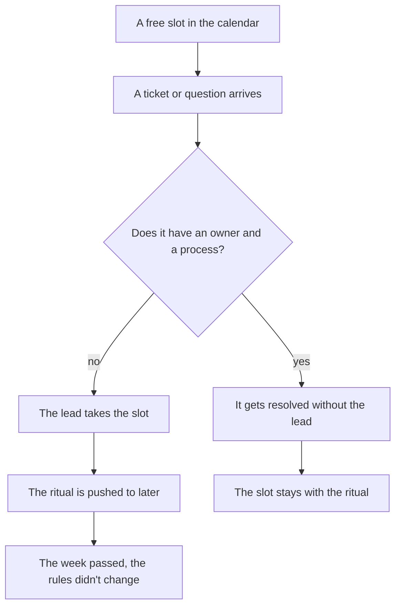
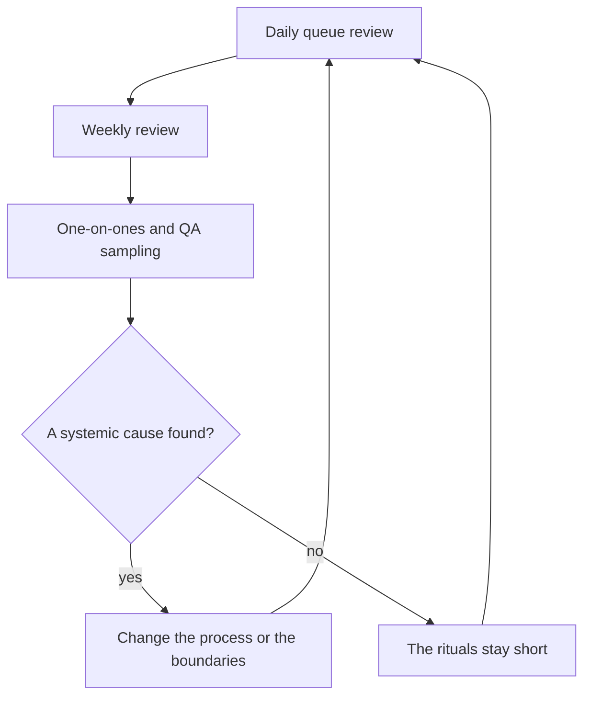

## Introduction

For a long time I believed the main problem of a support lead was a shortage of time, and that discipline would fix it: get up earlier, plan the day tighter, get distracted less. A few years of that proved otherwise. There is enough time. It just goes to the wrong place.

A lead's day is filled with work somebody has to do — the only question is who. Clearing the queue, answering "what do we do here", approving deadline changes, unblocking stuck tickets: all of that is work, and none of it waits. The rituals the role exists for also sit in the calendar — the queue review, the weekly review, one-on-ones, quality sampling, the status update to management. The problem is that the inflow doesn't respect a calendar: whatever isn't on fire today gets eaten first, which means exactly the rituals.

Hence the formulation I keep in my annual plan and treat as the main constraint on my week: the mandatory rituals may take no more than 40% of working time. Not "ideally", not "try to" — a budget. Anything above it is subtracted from another line, and that line is change, growing people, and agreements with management. The annual roadmap spells it out: work that isn't on fire today needs at least two days a week.

What follows: how to measure your own week without self-deception, what belongs in the minimum rhythm, where the number 40 comes from, and what to cut first when it still doesn't add up.

## Where a lead's week goes

Don't measure from memory. On Friday, memory will helpfully serve up a week of fires and quietly drop the four hours of meetings where you said nothing. I recorded it differently: three or four words at the end of each day on where the day went, and a breakdown by category at the end of the week.

The breakdown almost always comes out as six lines: fires and queue clearing; answering the team's questions; approvals and permissions; meetings someone else runs; reports and statuses; and the last line — what the role exists for: rules, quality, people, agreements.

Two things become visible in that breakdown that are hard to see otherwise. First: half the lines aren't the lead's work, they're work nobody else was there to take. Second, and more uncomfortable: the rituals aren't a separate line at all. They're dissolved inside the fires, because the queue review turns into working one specific ticket and the one-on-one turns into a project status catch-up. A ritual eaten along the way leaves no trace, so by Friday it looks like it never happened.

<!-- вилка: свой расклад недели — 4–6 категорий и их доли. -->

If you don't want to keep records, there are indirect signs. The calendar is packed, yet you can't recall a single quality decision you made last week. Engineers bring you problems after they've already happened. The report to management gets assembled from chat history on the last evening. Any one of those means the same thing: the rituals stopped being work and became what you do if there's time left.

The leak looks like this: a free slot in the calendar never stays free — the inflow fills it.

The diagram shows the main point: the leak doesn't happen when you decide to skip a ritual, it happens earlier — when the slot was taken by an incoming item with no owner. Which is why willpower isn't the fix; boundaries are. If a decision has an owner and a process, it doesn't have to pass through the lead. More on that in ["Ownership boundaries"](/en/blog/support-lead-boundaries/).

## The minimum rhythm

My minimum set has five items, and each answers a question nobody else would ask.

**Queue review — every day, at the start of it.** This isn't ticket handling but a look at deviations: what's older than the norm, what reopened, where the queue is growing faster than usual. Handling tickets is the engineers' work; reviewing the queue is the lead's, because the lead sees the whole flow and can change rules rather than close one ticket.

**Weekly review.** One regular block that looks at recurring causes rather than tickets: what broke most often, where a decision was made twice, which rules didn't hold. It's the only place where decisions become systemic.

**One-on-one.** A ritual about the person, not about task status; its structure gets a separate article in the series — "One-on-ones that don't turn into a status report or an appraisal".

**QA sampling.** A few closed tickets read end to end — the only way to talk about quality without relying on impressions. How the sample is built and which criteria a ticket is read against is covered in "Assessment by observable facts".

**Status to management.** Regular, in one and the same form. Its purpose isn't reporting but getting resources and decisions requested in advance instead of during an incident.

| Ritual | Cadence | What is lost without it |
| --- | --- | --- |
| Queue review | Daily, at the start of the day | Deviations are noticed once they're already being cleaned up |
| Weekly review | Once a week | Decisions are made one by one, systemic causes stay invisible |
| One-on-one | Weekly or every two weeks | Problems surface after they've happened |
| QA sampling | Weekly | Quality is discussed from impressions and memory |
| Status to management | Regularly, in the agreed form | Resources are asked for mid-incident — and refused |

Why five and not fifteen. A ritual has two marks: it has an owner, and it has a result visible from outside. A meeting after which nothing changed isn't a ritual, it's a habit. Fifteen rituals guarantee that half of them are exactly that, and that they'll eat the whole budget.

## The 40% rule

40% of working time is roughly two days out of five. That is what rituals may cost. Not because the share is elegant, but because the rest of the week is needed for work you can't do in between other things: change, growing people, the conversation with management, digging into what doesn't work.

The threshold is this and not 60 or 80 for three reasons.

- **Rituals maintain the system, they don't develop it.** They show what's happening but don't change rules. If all the time goes to watching, nobody is left to change the rules.
- **A ritual expands to the time allotted.** A weekly review with no end turns into one ticket reviewed by everyone. The limit keeps the shape.
- **Past half the week, the lead starts optimizing rituals instead of the service.** Prettier reports, more detailed minutes, more frequent meetings — and not one change in the rules.

Measure it with the same weekly breakdown rather than with the tracker: the tracker shows tickets, and what you need is hours. If rituals eat more than 40% across two or three weeks, the right question isn't "how do I go faster" but "what of the incoming flow shouldn't be going through me". The answer almost always lives in boundaries and processes, not in the calendar.

Here is the cycle the rituals exist to close:

The point is in the last step: if rituals don't lead to a rule change, they really do only consume time — and then they need reworking, not defending.

## The hierarchy of sacrifices

The week regularly doesn't add up, and that's normal: incidents don't consult the calendar. The trouble isn't that something has to give, it's that the sacrifice gets chosen at random — whatever sits lowest in the calendar falls first. So it's worth ordering the sacrifices in advance.

1. **Format, not content.** The slide-deck report becomes an email, the sync meeting a channel message, the detailed minutes three lines of decisions. The content stays, the price drops.
2. **Meetings that duplicate what's written.** If the outcome could have been read, the meeting wasn't needed.
3. **The depth of the weekly review.** It can get shorter but can't disappear: without it, decisions go back to being made one at a time.
4. **Rescheduling the one-on-one.** And only by the rules: it can be moved, not cancelled. If it's been moved for three weeks straight, the problem isn't the calendar.

What never gets cut: the queue review, QA sampling, and the weekly review. They share an unpleasant property — their absence stays invisible for a month. The queue looks fine until half the tickets turn out to be past their norm; quality seems acceptable until a client leaves. That is exactly why they're first on the cutting list and last to be allowed.

## A week in two modes

The difference between a week with the rule and one without isn't how much got done — it's who defines the day.

| Trait | A week without the rule | A week with the rule |
| --- | --- | --- |
| What defines the day | The incoming flow | The calendar of rituals and decisions |
| Where decisions get made | In chats, one at a time | At the weekly review, with an owner |
| What's visible on Friday | A list of closed tickets | What changed in the rules |
| Where over-budget time comes from | From change and from people | Nowhere: the budget doesn't grow |
| What happens during the lead's vacation | The queue stalls | A second person runs the rituals |

<!-- вилка: своё расписание ритуалов — дни, длительность, кто подстраховывает в отпуске. -->

The last row matters more than the rest. A rhythm that holds only because of you isn't a rhythm, it's another form of single-point risk. So write the second person into the schedule right away: who runs the queue review while you're away, who assembles the status, who reads the sample. That's not delegating the role, it's insurance for two weeks of vacation, and it's tested simply: go on vacation and see which rituals survived.

The 40% rule isn't about working less. It's about management having a price, and about paying that price regularly and in small instalments rather than once, when it turns out the year went into dispatching. Everything above the threshold is paid for by the service: with changes that didn't happen and people who didn't grow.
