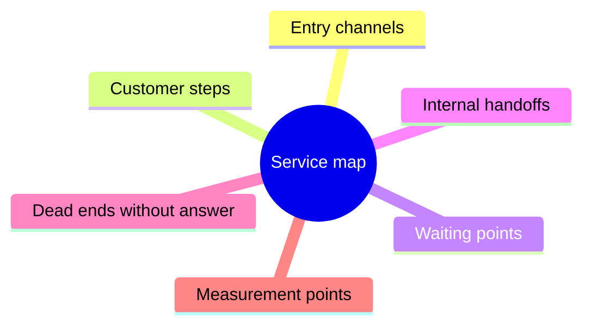
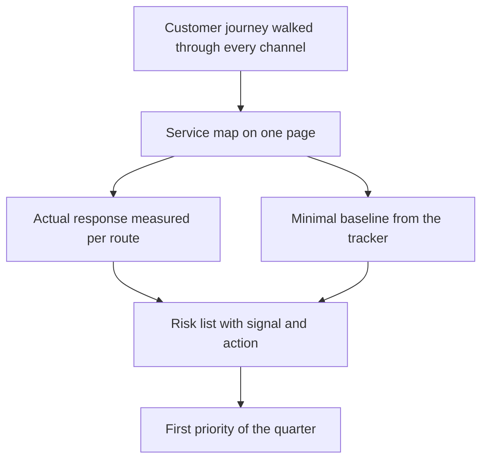

## Introduction

I spent my first month as a support lead on process documents: reading, cross-checking, asking questions. Those documents described a tidy service — a request comes into the tracker, lands in the right queue, an engineer responds on time, the customer is happy. Reality described a different service: half the requests started in a chat with "quick question", some never reached the tracker at all, and the deadlines everyone believed were met were calculated by a definition nobody remembered.

The gap between those two services isn't a sign of a bad team. It's the normal state of a system nobody ever described as a whole: every piece of it appeared at its own time, for its own task and its own customer. The trouble starts later — when a lead arrives with an improvement plan and has nowhere to apply it, because it's unclear what exactly is being improved.

Previous articles in the series covered the lead's time (["Ownership boundaries"](/en/blog/support-lead-boundaries/)), the logic of point A ("Baseline before goals"), and how goals turn into a year ("A support lead's year by quarters"). This article is about the step that precedes all three: how to get a description of the service and its point A in the first weeks, with no time, no data, and no approval for big changes.

The thesis: diagnosing the first month answers two questions — what the customer sees on the way to a solution, and how long they actually wait at each step. The first answer comes from a service map, the second from measuring the actual response. Together they turn into artifacts you can already use to talk about goals.

## Walking the customer journey through every channel

The first exercise takes time and looks odd: write to your own support desk as a customer. Not "check whether the form works" — walk the whole path by email, through the portal, by phone, in chat, and write down what happens.

What this exercise shows and the inside view never does:

- **How much you need to know just to send a request.** Where on the site does it say where to write? Does the form demand a contract number the customer doesn't remember? Does it ask you to pick a category from a list that has no entry for their case?
- **What comes back after you hit send.** An auto-reply with a ticket number, a "we received your request" email, or silence. An auto-reply isn't a formality: it's what tells the customer they were heard, and its absence is what produces a second email and a phone call.
- **Whether the customer can see status.** Can they find out what's happening without writing again? If not, every status check becomes a new request and a new unit of workload.
- **What happens when they go quiet.** The customer didn't answer a clarifying question: is the ticket waiting on them, on the engineer, or on nobody? Answering that often explains half of the "old" tickets.
- **Where the path breaks.** The form submits into nothing, the phone line outside business hours says "call back later", the chat closes with no reply.

Everything you wrote down goes onto a single page. Its structure is simple and the same for any service:

- **entry channels** — where requests come from and which channel matters most;
- **customer steps** — what's required of them at each stage;
- **waiting points** — where they wait, and for what exactly;
- **internal handoffs** — where the ticket moves between people, queues, and systems;
- **dead ends** — places where a request can end up with no answer;
- **measurement points** — where along this path there's an event you can time.

Here is the set of elements to put on the map:

A map without numbers isn't a diagnosis yet — it's a list of places where numbers must be taken. But it already has practical value: it shows that "support" isn't one queue but several routes with different speeds and different rules. That makes it obvious you need to measure each route separately, not "the service as a whole".

Walk one more path: what the customer experiences after the solution — the ticket closing, the summary email, the follow-up on the same topic. The second round of the same question is the most honest quality indicator there is, and it's almost never described in a process document.

## Measuring the actual response

The second step is to measure how long the customer really waits. Not by the standard and not by how busy the engineers feel, but by events in the tracker: from ticket creation to the first substantive reply, and from creation to closure.

Three rules without which the measurement turns into an argument about words.

**First: definition before number.** Is "first reply" an auto-reply, a templated acknowledgement, or a message that answers the question? Until the definition is written down, the number can be read any way you like, and both sides will be right. Same with "solved": closing on the engineer's initiative, on the customer's confirmation, or on expiry are three different events.

**Second: the customer doesn't wait for the average.** The average response time hides the tail: if most tickets close fast and some hang for weeks, the average stays respectable while customers remember the weeks. That's why the average needs a ninetieth percentile beside it — the time within which nine tickets out of ten are closed. The tail is what damages the service's reputation.

**Third: work time and waiting time stay apart.** A ticket waiting on the customer and a ticket waiting on a free engineer look identical in a report and mean the opposite. Without the split, blame for delays lands automatically on either the customer or the team — depending on who builds the report.

What comes out is a small table by channel and route: median and ninetieth percentile for the first reply, the same for resolution, and the share of tickets that never got a first reply at all. A few rows you can already show management and discuss without emotion.

<!-- вилка: цифры фактической реакции по каналам — медиана и p90 первого ответа и решения, доля заявок без первого ответа. -->

This is also where the first unpleasant discovery usually happens: part of the flow has no ticket at all. Questions in a shared chat, calls to a personal number, requests passed along through colleagues. Those requests are invisible to metrics but consume the team's time — and they are exactly why an engineer is "busy while tickets don't close".

## Baseline from the tracker

The third part of the diagnosis is a tracker export. It's easy to drown here: many fields, more reports, and the first attempt at "a proper dashboard" usually ends with a dashboard nobody uses.

I went through the full field list and export rules in "Baseline before goals". In the first month four cuts are enough, and each one answers a specific question.

| Cut | The question it answers | What to do with the answer |
| --- | --- | --- |
| Volume and flow structure | How many requests and of what kind: incidents, questions, change requests | Understand which routes are needed at all |
| Priority | How priorities are distributed and what share counts as critical | Find the queue that holds the risk |
| Reopens and returns | What share of tickets gets reopened | Separate speed from solution quality |
| Backlog age | How many tickets sit past the standard | See silent breaches and accumulated debt |

Four cuts don't replace a full baseline, but they deliver the main thing: a sense of scale and one or two hypotheses about where the bottleneck is. Hypotheses matter precisely now — with them you can go to the team with a question instead of an accusation.

<!-- вилка: собственные выгрузки первого месяца — какие разрезы взяли, за какой период, где лежит таблица. -->

It's worth agreeing on two rules right away; they save months of argument. First: every number is counted over one window from one source. Second: the definitions are written next to the table. Not because a methodology demands it, but because in a quarter you'll compare a new number with an old one, and "how did we count it back then" must have an answer in a document, not in someone's memory.

## The risk list

The last part of the diagnosis is the risk list. It isn't a hundred-line register or a formal probability assessment. It's a short list of what breaks first when the flow grows or when one element fails.

Simple method: walk the service map and ask three questions of every point.

- **What happens if the volume doubles?** Not "it gets harder" but specifically: which queue stalls first, which channel stops answering on time, where a manual step becomes the bottleneck.
- **What happens if one person disappears for two weeks?** Not just an engineer: the owner of an integration, the only person who can run the report, the author of the process document.
- **What happens if an external system fails?** The tracker, the mail gateway, the portal, telephony. Some routes never recover after such a failure at all — requests are simply lost.

The answers become a list of three to five items. Each has a signal showing the risk has started to materialise, and a first action. That list, and not the general call to "improve reliability", becomes the agenda for the first quarter.

<!-- вилка: три главных риска из собственного перечня — что сломается первым при росте потока и почему. -->

It helps to separate risks cured inside support from those that need decisions outside it. The first belong in the team plan, the second in a conversation with management: some cost money, some require process changes in other departments. Without that split, the risk list stays a list of complaints.

## Artifacts of the first month

The four parts of the diagnosis don't live apart: each rests on the previous one and loses meaning without it.

By the end of the first month a lead should have four things, and none of them needs a budget.

- **A service map on one page.** Channels, customer steps, waiting points, handoffs, dead ends, measurement points. It's not for a report: with it, any conversation about priorities stops being a conversation about taste.
- **An actual-response table.** Median and ninetieth percentile per route, with work time and waiting time kept apart.
- **A minimal baseline.** Four cuts from the tracker over one window, with written definitions.
- **The risk list.** Three to five items with a signal and a first action, split into "inside support" and "needs a decision outside".

These four artifacts aren't diagnosis for its own sake. They answer the question every manager eventually asks: "what is happening in the service". And they answer it with a description, not an impression.

What follows is work done once and then only maintained: routing requests. The diagnosis showed there are several routes and they differ; the next step is to make every request land on its own route at the first touch, not after two handoffs and a return. That's the subject of "Triage at first touch: category, priority, route".

A good diagnosis ends not with a document but with the sentence "now we know what comes first". If after a month of work that sentence is missing, you described the service but never looked at it through the customer's eyes.
