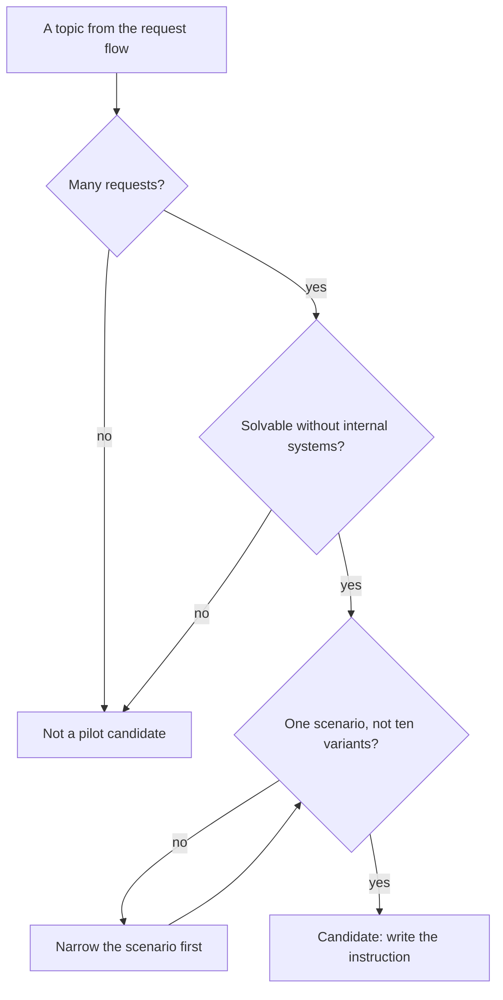
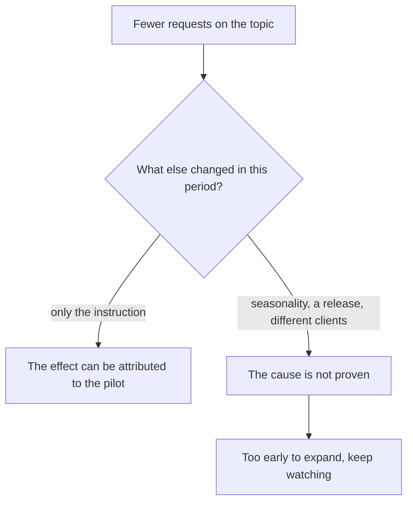

## Introduction

At one point I built a self-service portal: tidy articles, a pretty search, a link in the emails. A quarter later there were no fewer requests. Formally the portal worked; in practice it was used by the same three engineers who knew what to do without it anyway.

Since then I look at self-service differently. It is not about articles and not about a portal. It is about the client being able to close their question without us — and about us being able to prove that with numbers rather than with a feeling that things got better.

In ITIL 4 terms this is shift left — moving the resolution as close to the source of the problem as possible. For support that means a scenario that does not need our expertise moves out of the queue to the client, while expertise stays on what genuinely needs a human. A pilot on three to five scenarios with honest measurement is more useful than a large portal without metrics.

In the [yearly roadmap](/en/blog/support-lead-year-roadmap/) self-service sits in the third quarter — after the knowledge base and before the conversation with product, and that order is not accidental.

## Why "just write instructions" does not work

The first idea is always to take articles from the knowledge base and publish them for clients. It usually ends in nothing, and there are four reasons why.

**The text is not written for the client.** An internal article answers the engineer's question: where to look, what to check, how to confirm. The client needs something else — what to click and how to tell that it worked. Terms like "logging level" or "certificate reissue" are clear to us and obscure to someone reading the instruction for the first time.

**There is no entry point.** Even a good instruction is useless if the client does not know it exists. Clients search where it hurts: in email, in chat, in a search engine. If the instructions live on a separate site that takes three links to reach, very few will reach it.

**There is no measurement.** A drop in flow can be explained by anything: seasonality, a release, a change in the client base. Without a window and a metric defined in advance, any result will be read in favour of the pilot.

**An unmaintained instruction rots.** The product changes, the steps go stale, and a client who failed once following an instruction will not trust it again.

All four reasons are about one thing: an instruction for clients is a separate product with its own requirements, not an export of the internal base.

## Choosing scenarios from the flow data

The first step of the pilot is not writing instructions but choosing what to write them for. The basis for the choice is flow data, not desire or convenience.

You look at four things, and only their combination produces a good candidate:

| Criterion | The question to the data | Why it matters |
| --- | --- | --- |
| Volume | How many requests on the topic in the period | The effect is visible on a large flow |
| Simplicity | Is it solvable without access to internal systems | The client cannot take a step for us |
| Repeatability | One scenario or a multitude of variants | The instruction must cover the majority of cases |
| Risk of error | What happens if the client does it wrong | The cost of a wrong step must be zero |

A scenario that passes all four filters is a candidate. A scenario that passed three but needs admin rights or actions on our side is not a candidate, however massive it is: it belongs to a different mechanism.

What the selection looks like:

<!-- вилка: ваши сценарии-кандидаты — какие темы попали в топ по объёму и почему выбрали именно их. -->

Usually the top is occupied by the dullest things: restoring access, checking a ticket status, routine settings, forgotten passwords. That is normal: self-service starts with the frequent, not with the interesting.

## The instruction format for clients

An instruction for clients differs from a knowledge base article not in depth but in addressee. It has to be put together like this.

- **The title in the client's words.** Not "Authorisation error in the portal" but "The portal won't open after a password change". That is how search finds it and how a person recognises it.
- **No diagnosis.** The client does not need to know why this happens; the cause is our business. If a step seems pointless without an explanation, add one sentence, not a paragraph.
- **One step, one action.** A numbered list where every item can be done without going back.
- **A check of the result.** After the steps — how to make sure it worked.
- **What to do if it did not help.** A direct route into support and a list of what to attach to the request. This is the most important field: an instruction that leaves a person alone is worse than no instruction.
- **A short path to it.** A link from the email, from the request form, from the chat — from where the client already is.

Separately, the version. If the product has several versions or editions, the instruction has to say which one it is for. Otherwise the first discrepancy will wipe out trust.

## Signals of usefulness

A pilot without measurement turns into an argument about taste. So the metrics are defined in advance: what is counted, over which window, against what.

There are four signals, and they differ in strength:

1. **Requests on the topic.** Their number before and after is the most direct signal, and the noisiest.
2. **Usage.** Instruction opens, link clicks, "helped" or "did not help" marks inside the page.
3. **Repeat requests after the instruction.** If the client read it and still came, the instruction did not work — and that is worth more than any growth in opens.
4. **Quality of the conversation.** Whether "I broke everything following your instruction" requests grew — the price of unsuccessful steps.

The main caution in interpretation: a drop in flow is a sign, not proof. The same window might contain a seasonal dip, a release that changed behaviour, or a different group of clients arriving. So the pilot report records not only the numbers but also what else changed during the period.

<!-- вилка: измерение до и после — какая метрика, за какое окно, что ещё менялось в этот период. -->

How the conclusion about the effect is checked:

If there is an effect but the instruction does not explain it, that is a useful result too: it means the real cause of the flow was elsewhere, and now you can see it.

## Criteria for continuing the pilot

Whether to expand the pilot or wind it down is a decision better taken in advance, before the numbers appear and you want to defend them.

I state four conditions under which the pilot expands:

- **The effect is measured and stable.** The drop on the topic holds not for one week but for at least two comparable periods.
- **Clients did not get angrier.** "Followed the instruction, made it worse" requests did not grow, and the overall quality score did not fall.
- **Knowledge is not lost.** The knowledge base article is updated and says the same as the instruction: otherwise we have diverged from ourselves in two sources.
- **Maintenance is affordable.** Somebody has hours to update instructions on every product change. If nobody has those hours, it is too early to expand.

If even one condition fails, the pilot does not expand — but it does not necessarily close either: most often it stays on the current scenarios and gets refined. Expanding before the first update cycle is tuned is the most common way to end up with a dead portal.

<!-- вилка: критерии, по которым вы решали расширять или сворачивать пилот, и что в итоге сделали. -->

And one last thing. Shift left does not cancel support or reduce its value — it moves support to where it is needed. A client who restored access on their own comes to us with a question we genuinely can answer better than they can. That is exactly the point of the pilot.
