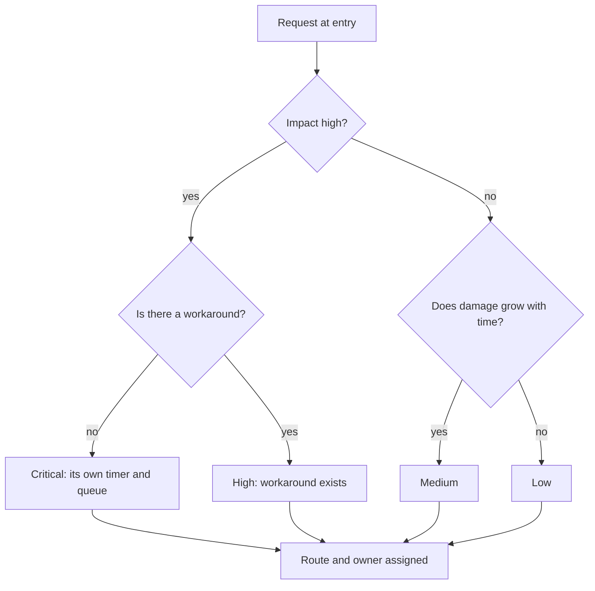
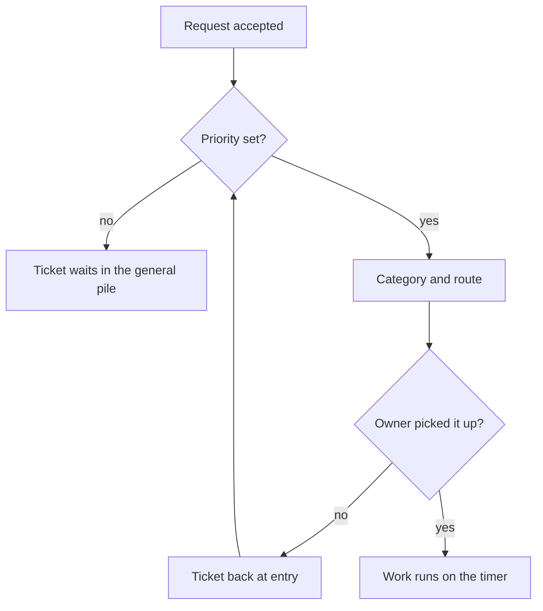

## Introduction

Triage is three decisions taken at the moment of first touch: how critical this is, what kind of request it is, and who gets it. Three decisions that take a few minutes, and the rest of the ticket's life depends on them.

In my first months as a lead I didn't do triage. Or rather I did, without calling it that: open the ticket, read it, think "that's one for Sasha", hand it over — and leave the priority exactly as it was at creation. Which was none. A month later the queue had a life of its own: incidents, documentation questions, and change requests were mixed together, integration work sat next to a request to change an email signature, and the most critical item surfaced not because it was critical but because the customer called.

The previous article in the series — "Service map and point A: diagnosing the first month" — was about seeing the routes and measuring the response. This one is about what turns several routes into a managed flow: an entry point where requests get a priority, a category, and an owner.

The thesis is simple: triage is the only entry into the service, and the order of decisions inside it isn't arbitrary. Priority first, classification second. Swap those two steps and you get tidy analytics about yesterday's fires.

## What happens without triage

Without triage the flow is governed not by rules but by volume. Whoever writes loudest is first in the queue; whoever knows how to call directly is outside the queue entirely.

The usual set of symptoms:

- **Everything is urgent.** The requester sets the priority, and to them their question is always the most important. The queue fills with "high" items that can't be told apart.
- **The top line drowns in the wrong work.** The third line gets everything, including questions already answered in the documentation. Development drowns in support, support waits on development, and deadlines move on neither side.
- **Critical work sinks into the general flow.** An incident affecting every customer sits in the same pile as cosmetic fixes: same priority, same order of review.
- **There's no data.** The flow can't answer how many incidents there were, how many change requests, and where it actually hurts. Categories are empty or filled with "other".
- **Returns are invisible.** A ticket went through three lines, came back, and was reopened — nobody counts that as a signal. More on this in "Not one silent SLA breach: weekly queue control".
- **The lead is a dispatcher again.** While routing is done by the most available person, the service hinges on them alone — exactly the role we walked away from in ["Ownership boundaries"](/en/blog/support-lead-boundaries/).

<!-- вилка: пример недели без триажа — что именно происходило с очередью и чем это закончилось. -->

Each of these symptoms looks minor on its own. Together they produce one thing: a service where you can neither plan nor promise.

## Priority first, classification second

The order of the two steps isn't pedantry — it follows from what each one starts.

**Priority starts the timer and places the ticket in a queue.** The clock starts the moment the request is created. If an hour later it turns out to be an outage and not a question, the timer has been running for an hour and the ticket has spent that hour in the wrong queue. So priority comes first, and it's set from what's visible at entry.

**Classification picks the route and feeds the analytics.** The category answers where the ticket goes and what gets counted later. It can be refined: an engineer who digs into the problem almost always refines the category, and that's fine.

The difference in the cost of error explains the order. A priority mistake costs a missed deadline and a lost customer, because priority decides when we are obliged to answer. A category mistake costs a line in a report that can be fixed at closure. The first decision is expensive to correct, the second nearly free. So the expensive one goes first.

There's a practical reason too. Priority is judged by impact: how many people are affected and whether there's a workaround. That's visible in the request text and in the answers to two questions. A category requires understanding the cause, and at first touch the cause is usually unknown. Putting classification first means guessing at the cause while the customer waits for an answer about the symptom.

Three rules I keep in mind at every first touch:

1. **Priority comes from impact, not from tone.** A calm customer may be reporting a total outage. A customer writing in capitals may want a logo changed.
2. **Priority can be raised without justification, lowered only with one.** The asymmetry guards against optimism: raising is always safe, lowering requires writing down why you decided it wasn't serious.
3. **An empty priority is not "medium by default".** A field you can skip is never filled in. If no value is chosen, triage isn't finished.

## The priority matrix and timers

The basis for the decision is a matrix of two dimensions: impact and urgency. Impact — how many people and functions are affected, and whether there's a workaround. Urgency — does the damage grow with time, or can it wait for a planned window. ITIL 4 (a set of practices for managing IT services) describes priority this way, and its strength is that it doesn't require re-arguing every case.

This is the fork every request passes at entry:

The matrix reduces an argument about priority to two questions you can answer in a minute without knowing the cause. Each cell then gets timers: first reply, next update, and escalation deadline.

| Level | What it means | What the timer fixes |
| --- | --- | --- |
| Critical | The service is down for many, with no workaround | First reply and the moment of escalation to L3 |
| High | Many people affected, but a workaround exists | First reply and resolution deadline |
| Medium | One customer or one function affected, moderate damage | First reply within business hours |
| Low | A question or cosmetics, work proceeds as planned | Reply in queue order |

The numbers in the timers are a matter of agreement, not of the lead's imagination. A target like "first reply within 30 minutes" at the critical level means someone must be at their desk during that time, and L3 must answer its part within a comparable window. A timer that rests on the first line alone is a promise the first line cannot keep by itself.

<!-- вилка: своя матрица и таймеры по уровням, согласованные с L3. -->

## Routing the ticket

After priority and category, the request needs an owner. A route isn't just "to whom" — it's three things at once: who drives it, what's expected of them, and by when.

What a route contains:

- **zone** — the line, product, or system the request belongs to;
- **competence** — the person or group with both the right and the knowledge to solve this class of problem;
- **expectation** — what the customer should see and when, including the case "received, looking into it, we'll update you by such a time";
- **next step on failure** — where the ticket goes if the owner misses.

One practice that looks like bureaucracy at first works well: record the route in a single line on the ticket. Not a long description but a sentence like "zone — portal integration, checked — logs and access, waiting on — development answer, deadline — high-level timer". That line costs a minute at entry and removes half the follow-up questions inside the team.

A word on lines. Triage doesn't decide who is right, it decides who goes first. If a first-line engineer can close the ticket, they close it; if not, they hand it over with a package, not with the words "take a look". A route without a package isn't handing over work, it's dropping it: the ticket comes back with questions, and the time goes to those instead of the solution.

## Where triage breaks

Triage is the most fragile part of the service, because it's done fast and at the entry point where information is thinnest. The typical failures are visible right in the tracker.

- **Empty priority.** The field exists, no value is chosen. The cure isn't persuasion but a rule: a ticket without priority isn't accepted into work.
- **"Urgent" by default.** If the priority is the first item in a list or one click away, in a month everything will be high. What helps is an explanation in the interface: what each level means, with examples.
- **Returns between lines.** The ticket went to the second line, came back, went to the third. That's not normal work, it's a sign of a bad route or an empty package.
- **The most available person triages.** Usually a newcomer who doesn't recognise the signs of an outage. Triage isn't the easiest job in support, it's one of the most responsible: a mistake here costs the most.
- **Triage outside the timer.** Time spent sorting incoming requests isn't in any report. So the service looks fast on paper and slow to the customer.
- **Triage on one person.** While one engineer — or worse, the lead — makes the decisions, the flow stops when their vacation starts.

Triage doesn't make a service fast by itself. It makes it predictable: every request has a priority, an owner, and a deadline everyone involved knows. Predictability is what later lets you promise customers dates without blushing. Once that works, the next question appears: who watches that deadlines don't expire quietly. That's "Not one silent SLA breach: weekly queue control".
