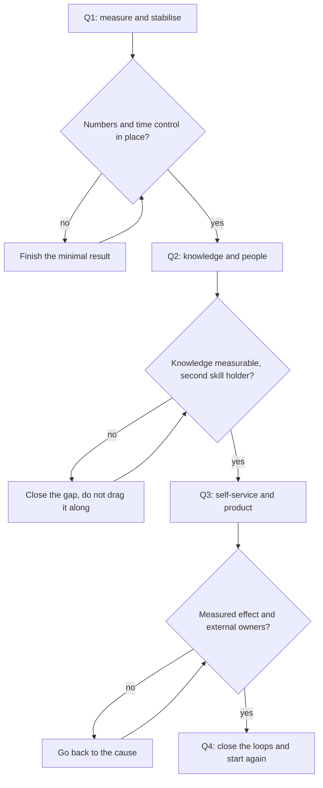

## Introduction

In my first year as a support lead I wrote a plan of nineteen initiatives. Three months later none of them remained: some burned up in day-to-day operations, some lost their point after the first data, some I simply forgot. The service did not get worse — it just did not change.

The previous article of the series — "Baseline before goals" — was about point A and calibrating goals with management. This one is about the next step: how agreed goals become a calendar with room both for operations and for change.

The main idea I arrived at after several such years: a roadmap is not a wish list but a sequence. Its value lies not in what it contains but in the order things happen and in what cannot start before the previous step is finished.

## Why plans of twenty initiatives don't survive

Initiatives rarely fail one by one. They fail together, and the reasons are shared.

- **Everything changes at once.** Triage, the knowledge base, metrics, hiring and shift left launch in the same month — and none of the changes gets the attention a launch requires.
- **The changes have no definition of done.** "Implement KCS" sounds like a task but does not answer when the work can be called finished. An unclosed task lives for years, moves from quarter to quarter and occupies a place on the agenda.
- **Change competes with operations.** The queue does not ask whether you have a quarter of change ahead. The first week of incidents eats the time set aside for processes, and from then on the plan lives only in the presentation.
- **The team stops believing in initiatives.** The fifth attempt to "finally start the knowledge base" is perceived as noise to be endured. After that even a good initiative needs extra effort to restore trust.
- **There is no visible movement.** The year ends and nothing in the service has changed: the same tickets, the same times, and the only way to explain what the lead did is a list of meetings held.

Nineteen initiatives lose not because they are bad. They lose without an order: each one makes sense on its own, the set does not.

## Four quarters of the year

A workable skeleton for a support lead's year is four quarters, each with its own task and its own type of result. Not because such a calendar is pretty, but because every next block rests on the artefacts of the previous one.

### First quarter: measure and stabilise

The quarter's task is to stop managing blind and to put out the heaviest operational fires.

- **Month 1: service map and point A.** An export from the tracker, a description of the flow, the bottleneck.
- **Month 2: goals and calibration.** Verifiable results for the year, agreed with management in writing.
- **Month 3: the first stability loop.** First-touch triage, time control, an escalation route. Not "fully implemented", but "works and does not hang on the lead".

Definition of done for the quarter: the service has numbers, the numbers have definitions, breaches of deadlines have regular control, and you can go on a two-week vacation without the queue collapsing.

### Second quarter: knowledge and people

Break down single points of failure — in knowledge and in the team.

- A knowledge base built on KCS (Knowledge-Centered Service — an approach where the article is written at the moment of solving, not after) and an article template with an owner.
- Records for recurring problems: from the ticket stream to a list with owners and statuses.
- Regular one-on-ones, assessment by observable facts, a competency matrix.

Definition of done: the share of resolutions with a reference to an article is measurable and growing, recurring problems have moved from the stream into a register, and every critical skill has a second holder.

### Third quarter: self-service and product

Move part of the flow out of support and start talking to product in the language of data.

- A shift left pilot (moving the solution closer to the user through self-service) with honest measurement: how many requests never reached support.
- An interaction matrix: who decides on which questions — product, engineering, operations.
- Problem cards for product with data, status and an owner on that side.

Definition of done: at least one self-service channel works with a measured effect; every problem that cannot be solved inside support has a card and an external owner; the general status carries data instead of "a lot of requests".

### Fourth quarter: close the loops

Make sure next year starts from a position of knowledge, not from a blank page.

- Metric passports: what we measure, why, and which action follows from a value.
- Regular management status and requests for decisions instead of requests for sympathy.
- Blameless incident reviews and a resilience audit: what breaks when you are not there.
- An annual report and a new baseline — with history behind it, not from scratch.

Definition of done: every metric has an owner and an action, every incident has a review without names and at least one change in the system, and the next year starts with a plan rather than with diagnostics.

How the quarters connect:

<!-- вилка: свои вехи по месяцам — что именно сделано в каждом квартале и какой результат это дало. -->

## The sequence rule

One line I keep coming back to: the next quarter does not start until the previous one has a result. It is an uncomfortable rule — it is exactly what makes you give up something interesting in favour of something needed.

Four concrete dependencies stand behind it:

1. **No point A, no KCS metrics.** The share of resolutions with a reference to an article is a meaningless number if you don't know how many resolutions there are at all and which of them should have gone through the base.
2. **No knowledge base, no shift left.** Self-service without verified articles makes the user search through rubbish. The first such experience closes the channel for a long time.
3. **No shift left, no conversation with product.** While the whole flow lands in support, you have no argument for product: you speak of pain, not of scale.
4. **No metrics, no annual report.** A report built from feelings and pretty diagrams does not survive the first clarifying question.

What to do when a quarter fails — the advice is the same: do not drag the next block along. The temptation is understandable — the year is running, you have to catch up. But every part of the roadmap rests on the previous one, and an unclosed gap turns the next initiative into decoration. Spend the beginning of the next quarter on the minimal result of the previous one — small but real: one knowledge base article with an owner, one time-control routine, one measured milestone.

## Rhythm and buffers

A roadmap dies not from bad ideas but from a lack of time to carry them out. So three things must be reserved in the calendar.

- **The lead's time for change.** The 40 % rule: at least two days a week for what is not on fire right now. If the whole week goes to the queue, quarterly milestones will never happen.
- **A buffer for incidents.** Planning a quarter with no reserve means building failure into the plan. I keep a week in every month that I consider lost in advance.
- **A review point.** Once a quarter — an hour to rebuild the plan: what is done, what moves, what is cancelled. Cancelling matters more than deferring: a list of nineteen items starts precisely with the inability to strike one out.

<!-- вилка: ваш ритм — сколько времени в неделю уходит на изменения, как выглядит квартальная ревизия. -->

## Series contents

This text is the fourth article of the "Support management strategy" series, and it also serves as its table of contents: the articles come out in blocks, and the order reflects the logic of dependencies.

**The strategic frame of the year**

- [The five results of a support lead](/en/blog/support-lead-five-results/)
- [Ownership boundaries: what a support lead decides, delegates, and walks away from](/en/blog/support-lead-boundaries/)
- Baseline before goals: why annual plans collapse at the start
- A support lead's year by quarters: a twelve-month roadmap — this article

**Stabilising the service**

- Service map and point A: diagnosing the first month
- Triage at first touch: category, severity, route
- Not one silent SLA breach: weekly queue control
- Escalation to L3: the package, the OLA and the client owner

**Knowledge as a system**

- KCS in the workflow: the article is written at the moment of solving
- A knowledge base article template and its owner
- Recurring problems: from the ticket stream to records with an owner
- Self-service as shift left: a pilot with honest measurement

**The team: people and growth**

- The manager's rhythm: the 40 % rule
- One-on-ones that don't turn into a report and an appraisal
- Assessment by observable facts: a QA sample and six criteria
- The competency matrix: closing single points of failure
- Capacity instead of heroism: calculating the need for engineers

**The outer contour**

- The interaction matrix: who decides and on which questions
- Status for management: a one-page letter and an hourly review
- Ask for decisions, not sympathy: escalation and the resource request
- A blameless incident review: a timeline without names
- A problem card for product that won't close without a status

**Metrics and closing the year**

- A metric without an action is a picture: the metric passport
- Resilience audit: what breaks when you are gone
- Nine mistakes of a support lead — and the annual report

The articles come out every two or three days, so links appear in the text as they publish. Every published article of the series is collected under the [team-leadership](/en/tags/team-leadership/) tag, while the list above stays the full plan of the series.

## What such a year leaves behind

A twelve-month roadmap does not guarantee that everything will work out. It guarantees something else: by the end of the year you can show what changed and why, instead of trying to recall what you were busy with. Four quarters are not a strict methodology but a way not to change everything at once and not to abandon what was started.

If you need a single sentence out of this text, take this one: numbers first, then knowledge, then self-service, then the outer contour. Everything else is implementation detail you can adapt to your service.
