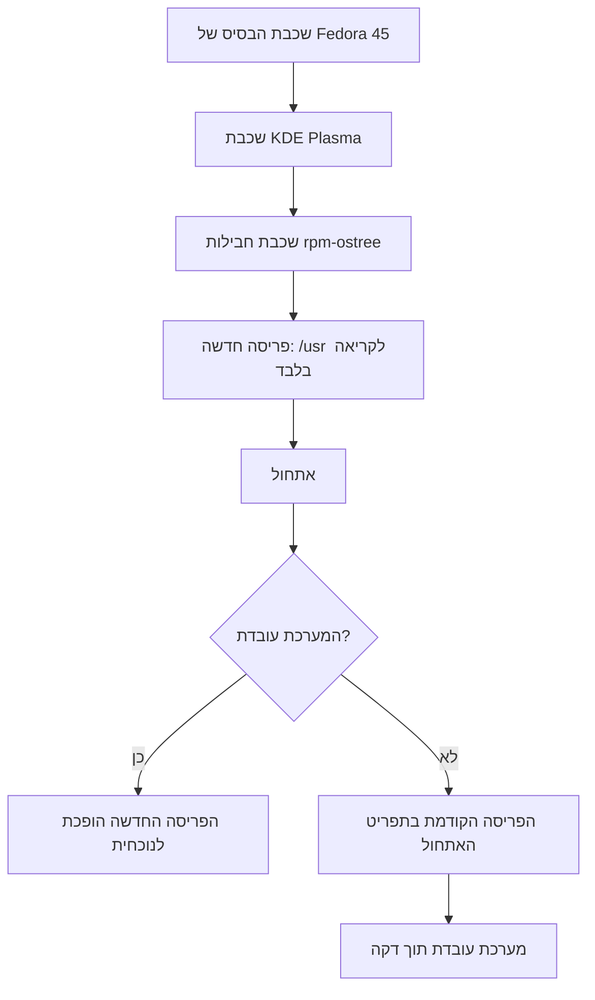
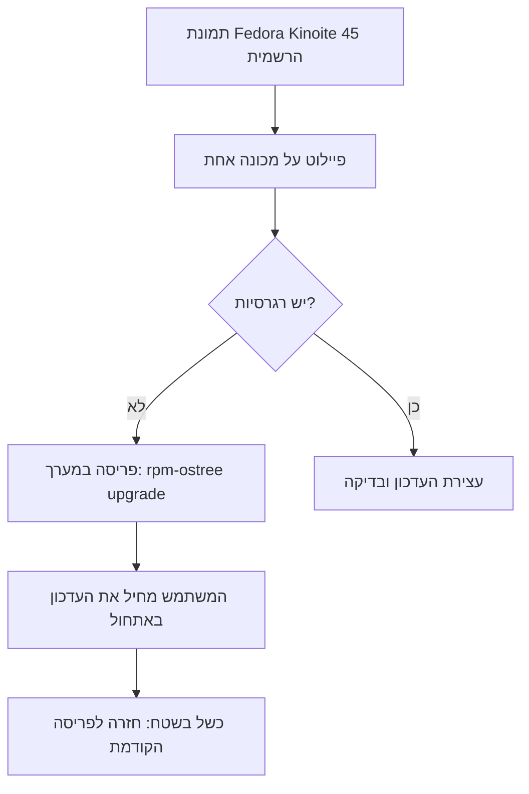

## מבוא

העברתי את מחשב הנייד לעבודה ל-Fedora Kinoite 45 — המהדורה האטומית של פדורה עם KDE Plasma. הסיבה אינה שולחן העבודה ואינה Flatpak. הסיבה היא מודל העדכון: המערכת אינה מותקנת כאוסף חבילות שמתוקנות אחת-אחת על מכונה פעילה, אלא כתמונה שלמה שנבנית משכבות. למודל הזה יש תוצאה שחשובה לי יותר מכל הגדרה: תוכנית הגיבוי מפסיקה להיות נוהל שצריך לזכור לבצע. היא הופכת לתכונה של המערכת.

## איך בנוי שחרור אטומי

מערכת אטומית נבנית כמו תמונה. למטה שכבת הבסיס של פדורה, מעליה שכבת שולחן העבודה, ומעליהן שכבת החבילות הנוספות שהוספתם בעצמכם. השכבות נבנות בשרת, נחתמות ומועברות למכונה כשלם. בתוך התמונה הספרייה `/usr` היא לקריאה בלבד: שום דבר לא כותב מחדש קבצי מערכת אחד-אחד במערכת פעילה.

כל עדכון הוא פריסה חדשה (deployment): סט שלם של שכבות, רשומת אתחול נפרדת ותיקייה נפרדת תחת `/ostree/deploy`. הפריסה הקודמת נשארת בדיסק עד שמסירים אותה או מצמידים אותה. הבחירה ביניהן נעשית על ידי מנהל האתחול, לא על ידי מנהל החבילות.

כך נראה הנתיב משכבות למערכת פעילה:



התיקיות הניתנות לשינוי — `/etc` ו-`/var` — משותפות לכל הפריסות. תצורה, מצב שירותים ותיקיות בית נשארים במקומם בעת המעבר. לכן חזרה לגרסה הקודמת מחזירה את המערכת ואינה מוחקת את העבודה.

ההבדל המרכזי מהסכמה המוכרת הוא היכן מתרחשים השינויים. בהפצה רגילה עדכון הוא מאות פעולות על מערכת חיה: כל חבילה מותקנת בנפרד, ובין הפעולה הראשונה לאחרונה המכונה נמצאת במצב לא ידוע. במודל האטומי כל מה שקשור למערכת קורה בשרת הבנייה: שם מרכיבים עץ, מחילים שכבות ומקבלים תמונה חתומה אחת. המכונה מקבלת תוצאה, לא תהליך.

רווח צדדי — יכולת אימות. החתימה ומזהה הבנייה עונים על השאלה מאין הגיעה המערכת, ו-`/usr` שאינו ניתן לשינוי מקשה להחליף קובץ הרצה בשקט או להניח ספרייה בנתיב מערכת. זה לא תחליף לאנטי-וירוס ולא הגנה מפני root, אבל זה מצמצם בבירור סחיפה שקטה.

## הזכות לטעות

מכאן מתחיל מה שכל זה נועד בשבילו. משתמש שתמיד יש לו גרסה קודמת של המערכת טועה בשקט נפשי — וזה חשוב יותר: הוא טועה לעתים קרובות יותר ובדרך שימושית יותר. מנסה, חוזר אחורה, מנסה אחרת.

דרייבר נשבר אחרי עדכון ליבה? אתחול, בחירת הרשומה הקודמת בתפריט האתחול, ממשיכים לעבוד. ה-Plasma החדש לא מוצא חן בעיניכם או שווידג'ט הפסיק לעלות? אותו דבר. התקנתם חבילה ניסיונית כשכבה ונתקלתם בהתנגשות? `rpm-ostree uninstall` מחזיר את סט השכבות הקודם, ואם הבעיה הגיעה עם עדכון, `rpm-ostree rollback` מעביר לפריסה הקודמת.

הפקודות היומיומיות נראות כך:

```bash
rpm-ostree status                     # הפריסה הנוכחית והקודמות
sudo rpm-ostree upgrade               # הורדה והכנת פריסה חדשה
sudo rpm-ostree rollback              # חזרה לפריסה הקודמת
sudo rpm-ostree deploy 45.20261028.0  # גרסה מסוימת
sudo rpm-ostree pin 0                 # הצמדת פריסה עובדת
```

הצמדה היא פרט שאולי לא מעריכים מספיק. לפני ניסוי מסוכן מספיק `pin` אחד: איסוף האשפה לא יפנה את הפריסה העובדת, וניתן לחזור אליה גם אחרי שבועות.

ההבדל מהפצה רגילה נראה במצבים קונקרטיים:

| מצב | הפצה רגילה | שחרור אטומי |
| --- | --- | --- |
| כשל אחרי עדכון | אבחון, chroot, snapshot או התקנה מחדש | בחירת רשומת האתחול הקודמת |
| עדכון שנקטע | מצב חבילות חלקי | אין מצב חלקי כלל |
| ניסוי עם חבילה | חזרה לאחור לפי יומן הטרנזקציות | הסרת השכבה או חזרה לפריסה קודמת |
| זמן התאוששות | משעה ועד ערב | אתחול אחד |

תופעת לוואי שלא ציפיתי לה: הפסקתי לדחות עדכונים ל"אחר כך, כשיהיה זמן להתעסק בזה". עדכון אינו עוד אירוע עם סיכון אלא פעולה שגרתית עם מחיר חזרה ידוע. בדרך כלל זה הפוך: מערכת חדשה היא בעיה פוטנציאלית, ולכן דוחים אותה. כאן הבעיה הפוטנציאלית מוגבלת לאתחול אחד, ואין סיבה לדחות.

רווח נפרד — הפרדה בין ניסויים למערכת. כל מה שצריך לנסות "ברצינות" חי במכולות Toolbx או Distrobox, ב-Flatpak ובסביבות פרויקט, ולא במערכת הבסיס. שולחן העבודה נשאר נקי: מחקתם את הניסוי — ולא נשארו אחריו שאריות של ספריות ותלויות. ואם הניסוי בכל זאת נגע במערכת, עדיין יש לכם פריסה קודמת.

הסתייגות שבלעדיה המאמר לא יהיה ישר: שחרור אטומי מגן על המערכת, לא על הנתונים. `/home` היא מערכת קבצים רגילה, ואטומיות לא תעצור `rm -rf` בתוכה. תיקיית הבית, מאגרי git וההערות צריכים גיבוי נפרד. אטומיות מסירה את הסיכון "מערכת ההפעלה נשברה", אבל לא את הסיכון "הקבצים אבדו".

## מה מקבל מנהל המערכת

למי שמנהל מערך מחשבים התועלת אינה ביופי של הרעיון אלא בצמצום מחלקות התקלות.

1. **גרסה אחת לכולם.** הגרסה היא מספר אחד, לא "לכל אחד משהו אחר, כי מישהו עדכן במארס". התשובה לשאלה "באיזו גרסה אתה?" היא הפלט של `rpm-ostree status`, והוא מצורף לפנייה.
2. **קו תמיכה ראשון בלי root.** ההוראה "בחר את הרשומה הקודמת בתפריט האתחול" עובדת אצל כל משתמש: בלי sudo, בלי גישה מרחוק, בלי הגעה פיזית. זה מסיר את מחלקת הפניות היקרה ביותר — "המחשב לא עולה אחרי עדכון".
3. **אין מצב חצי-מעודכן.** חבילות אינן מותקנות אחת-אחת במערכת חיה: או פריסה חדשה שלמה או הישנה. מחלקת התקלות "העדכון נקטע באמצע" נעלמת מכוח הבנייה.
4. **חקירה צפויה מראש.** הגרסה, סט השכבות והיסטוריית הפריסות ידועים. נקודת ההתייחסות "לפני העדכון עבד, אחרי לא" מתקבלת בפקודה אחת ולא בארכיאולוגיה של לוגים.
5. **קצב עדכונים נשלט.** אפשר להוריד תמונה חדשה ולא להחיל אותה; אפשר לבדוק אותה על מכונת פיילוט, ובמידת הצורך להחזיר בנייה מסוימת באמצעות `rpm-ostree deploy` ולא "את האחרונה שיצאה".
6. **פחות סחיפת תצורה.** `/usr` אינו ניתן לשינוי, והשינויים במערכת מפורשים — שכבת חבילה או עריכה ב-`/etc`. "מישהו התקין משהו לפני חצי שנה" נראה ב-`rpm-ostree status` ולא מתגלה בשדרוג הגדול הבא.

כך נראית פריסה במערך:



לגישה יש מחיר, וכדאי להכיר אותו מראש. כל שכבה שהוספתם צריכה להיבנות מחדש בכל עדכון בסיס, והתנגשויות שכבות הן עבודה אמיתית ולא מקרה נדיר. דרייברים של צד שלישי ומודולי DKMS דורשים בדיקה בכל גרסה. Flatpak מתעדכן בנפרד ואינו חלק מהתמונה. שמות הפקודות והדגלים עשויים להשתנות בין מהדורות — המודל הוא שנשאר, לא התחביר. אם דרושים לכם הגדרות ארגוניות בתוך `/usr`, מופיעה בנייה עצמאית של תמונה וצינור נפרד; אם לא — די בתמונה הרשמית ובעוד שכבות מנוהלות. והעיקר: את ההחלטה על המודל צריך לקבל לפני שמערך המחשבים התפזר, ולא אחרי.

## סיכום

שחרור אטומי לא הופך מערכת לחסינה לתקלות. הוא הופך כשל לזול. הגרסה הקודמת כבר נמצאת בדיסק ועולה מבחירה בתפריט — כלומר כל עדכון, כל ניסוי וכל טעות בתצורה עולים אתחול אחד. המשתמש מקבל זכות לטעות בלי השלכות, ומנהל המערכת מקבל מערך צפוי וקו תמיכה ראשון שלא צריך הרשאות root. לכן ברשימת תוכניות הגיבוי שלי השחרור האטומי נמצא ראשון ולא אחרון.
