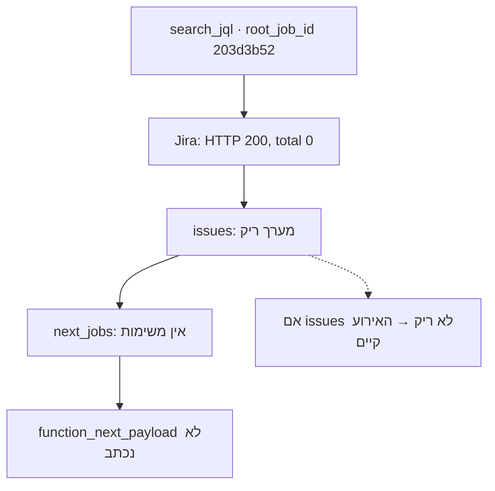

## הסימפטום

הפיצ'ר בפרודקשן. טסטים ירוקים: שבע מאות ארבעים ושבעה. החוזה עודכן, התיעוד עודכן. מדליק TRACE על instance חי, מריץ בקשה — ובלוג של ה-worker אין אף `function_next_payload` אחד.

המחשבה הראשונה של כל מהנדס ברגע כזה: "הקוד לא הגיע לקונטיינר".

איך מדליקים TRACE: רמת הלוג נקראת מקונפיג ה-instance, לא מהקוד (עקרון II לא סתם). מחליף ל-`TRACE`, מפעיל מחדש את הפוד, שולח לבוט את הפקודה הרגילה עם שאילתת JQL ומחכה לרשומה ב-`journalctl`. אין רשומה.

## שלב 1: הקוד בכלל בקונטיינר?

נכנס ל-`localhost/worker:dev`, מסתכל על קובץ ה-helper — במקום. מריץ probe ביד, פולט אירוע מה-REPL — הרשומה בלוג, הפורמט נכון.

מסקנה: הקוד עובד, הפליטה עובדת, הלוגר מוגדר. הבעיה לא בבנייה.

## שלב 2: שחזור המפל

הלאה — לחפש לא קוד אלא נתונים. לוקח את ה-`root_job_id` מהלוגים של בקשה אחת ומסתכל על כל משימות המפל:

- משימת `search_jql` — בדיוק אחת;
- משימות ילדים — אפס;
- אירועי `function_next_payload` — אפס.

שלושה אפסים. זה כבר חשוד: יש מפל אבל אין ילדים. הפונקציה רצה אבל לא הולידה כלום.

## שלב 3: מה ענתה Jira?

מסתכל באותו לוג על תשובת Jira לשאילתת JQL. היא נראית כך:

```text
event: jira_search_result
  status: 200
  total: 0
  issues: []
```

HTTP 200, אין שגיאה, פשוט אפס משימות. הפילטר `59251` שכל המערכת רצה עליו התברר כריק. כלומר הפונקציה החזירה בכנות `next_jobs: []`, ולפי דרישה FR-007 (רשימה ריקה — אין אירוע) גם לא היה אמור להיווצר אירוע.

הנה התמונה המלאה:



## ראיות

| רמה | מה רואים | מה זה אומר |
| --- | --- | --- |
| קונטיינר | ה-helper במקום, probe כותב | הקוד טרי |
| מפל | משימה 1, ילדים 0 | הפונקציה רצה |
| Jira | `HTTP 200, total: 0` | אין נתונים |
| מפרט | FR-007: רשימה ריקה — אין רשומה | ההתנהגות תואמת את הדרישה |

## לא באג אלא נתונים ריקים

זה הסוג המעצבן ביותר של פגמי פרודקשן: כל המערכות עובדות נכון, אבל התוצאה נראית כמו תקלה. המפרט צדק, הקוד צדק, הלוגר צדק — לא היו נתונים לאירוע.

אנסח את הלקח ככלל: "שקט בלוג" אינו "הקוד שבור". קודם שואלים אם היה בכלל מה לתעד. מניסיון, בשניים מכל שלושה מקרים בשלב הזה מתברר שלא היה ממה לכתוב אירוע.

עוד פרט שחסך זמן: לאירוע תמיד יש קודם. קודם מסתכלים בתשובת ה-API החיצוני, אחר כך במשימות שנבנו ממנה, ורק בסוף בפליטה. אילו התחלתי מקוד הפליטה, הייתי בודק יותר משלושה קבצים במקום שורה אחת בלוג של Jira.

הלקח השני הוא על תהליך: היה לי טסט לתוצאה ריקה (הטסט השביעי מהפוסט 8), אבל בפרודקשן שכחתי ממנו. המפרט זכר, אני לא.

## על אבטחת לוגים

בלוג ה-TRACE הזה, ליד השורה השימושית, יש עוד שני דברים: כותרת `Authorization: Bearer …` עם טוקן של Jira, ו-payload מלא של משימות עם מפתחות ותיאורים מלוח ייצור אמיתי. בדיוק את זה מציג מצב TRACE, שמדליקים לעשר דקות לצורך חקירה.

מכאן כלל שהוספתי לתרבות שלי אחרי הפיצ'ר הזה: לוגי TRACE גולמיים לא מפורסמים לשום מקום — לא לבלוג ולא ל-issue tracker. בסדרה הזאת הכל מנוסח מחדש, וכל מזהי המשימות והמפתחות בדויים.

החקירה סגורה, אין פגם. אבל נשארה שאלה שתהפוך את החלק הבא לשינוי ארכיטקטורה: אם פונקציה יכולה לא להוליד משימות — האם היא בכלל צריכה לשתוק?

אז התשובה נראתה מובנת מאליה. התברר שהיא לא.

---

[← פוסט 9: `/speckit.analyze`](/he/dev/blog/sdd-09-analyze-findings/) · [פוסט 11: הפליטה עוברת לפונקציות →](/he/dev/blog/sdd-11-emission-moves-to-functions/)
