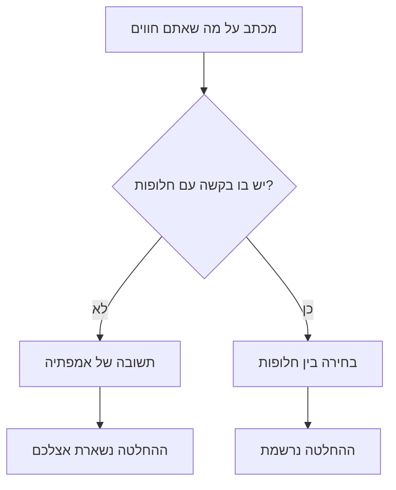
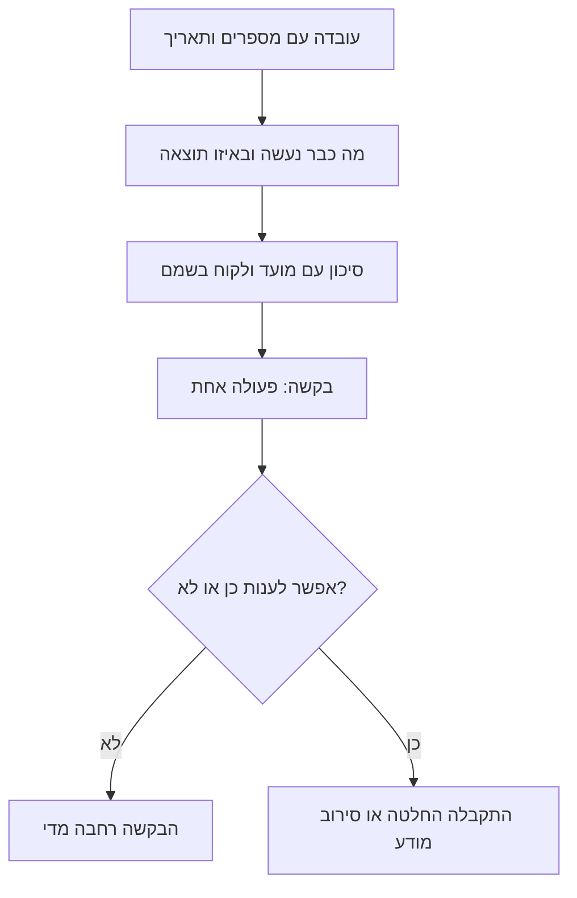

## מבוא

אחד המכתבים הראשונים שלי כלפי מעלה נכתב במצב שנראה לי מוצדק לחלוטין: שלושה שבועות בלי יום חופש, שתי תקלות ברצף, שני מהנדסים חולים, והכל על רקע מועדים שהובטחו. המכתב היה ארוך, רגשי וישר. התשובה היתה שורה אחת: "תחזיק מעמד, אנחנו מאמינים בך".

אמפתיה היא צורה מנומסת של סירוב. לא מפני שהמנהל אדיש, אלא מפני שבמכתב כזה לא היתה בקשה שאפשר היה לענות עליה אחרת: לא היתה חלופה, לא היה מחיר, לא היה תאריך. הוא היה על המצב שלי, והחלטות מתקבלות לפי מצב השירות — דברים קרובים, אבל לא זהים.

מאז אני כותב כלפי מעלה לפי שתי תבניות. **הסלמה** — כשבעיה יוצאת מגבולות השירות ודורשת התערבות מהצד השני: עובדה, מה נעשה, סיכון, בקשה. **בקשת משאבים** — כשחסרות שעות: נתונים, תוצאה, בקשה עם חלופות. הנושא שונה, ההיגיון אחד: להפוך חוויה לניסוח בעיה שיש לו תשובה.

## למה "אנחנו צריכים עזרה" לא מוביל להחלטה

במבט ראשון בקשה לעזרה היא הצורה התמימה ביותר של תקשורת. בפועל היא נשברת על שלושה דברים.

ראשית, אין בה על מה להתווכח. המנהל לא יכול לענות ל"אנחנו צריכים עזרה" — הוא יכול רק לשאול איזו עזרה וכמה. כלומר, את עבודת הניסוח הוא מקבל במקומכם.

שנית, אין בה בחירה. ההחלטה מצטמצמת ל"לעזור או לא לעזור", ואנשים בוחרים בדרך כלל באפשרות השנייה כשמחיר הראשונה לא נאמר.

שלישית, היא נקראת תמיד כהודאה בחוסר אונים — כי כך היא כתובה. מכאן גם ה"תחזיק מעמד": קל יותר לרחם על מי שמצבו קשה מאשר לצלול לפרטים שלא מכירים.

כך נראית השרשרת:

לפעמים גם מכתבים רגשיים עוזרים — אם אומרים בכנות שזו רגש ולא בקשה. אבל כחריג ובמילים מפורשות: "אני צריך תמיכה ולא החלטה, אגבש ניסוח עד יום שישי".

## תבנית הסלמה

הסלמה היא העברת בעיה למי שיש לו יותר סמכות, ולא למי שהתמזל מזלו בתפקיד. ארבעה בלוקים.

**עובדה.** מה קרה, מתי התחיל, את מי זה נוגע, אילו מספרים מאשרים זאת. בלי הערכות ובלי שמות תואר: "מתאריך כזה גדל חלק הפניות בלי מענה", ולא "המצב נורא לחלוטין".

**מה נעשה.** אילו נסיונות נעשו ומה הם הראו. זה הבלוק שמבדיל בין הסלמה לבין גלגול אחריות: רואים שהבעיה לא נזרקה למעלה אלא הובאה לנקודה שבה נדרשת סמכות.

**סיכון.** מה יקרה אם לא יתערבו, עם הצמדה לקונקרטי בהרבה: איזה לקוח, איזה מועד, איזה תקן. סיכון בלי תוצאה הוא מצב רוח, ועל מצב רוח לא מדברים.

**בקשה.** פעולה מפורשת שנדרשת מהנמען: החלטה, הרשאה, מכתב, משאב, עדיפות. מנוסחת כך שאפשר לענות עליה כן או לא.

כך הבלוקים מתחברים לפעולה:

כלל נפרד: הסלמה אחת — שאלה אחת. אם המכתב נושא שלוש בקשות, התשובה תהיה דיון בנוחה שבהן, והשאר ייעלמו בשקט.

עוד שני כללים קצרים. הנמען — מי שיש לו סמכות ולא מי שקרוב יותר בהיררכיה: מכתב למנהל שלא מחזיק בשאלה מבטיח עוד סבב העברות ואובדן אמון משני הצדדים. והשני: להסלים לפני שהמועד פג. הסלמה אחרי הפרה נקראת לא כניהול סיכון אלא כהסבר של כישלון, ומה שנדון בה הוא האשם ולא ההחלטה.

## תבנית בקשת משאבים

התבנית הזאת קשורה הדוק לחישוב כושר הנשיאה: בלעדיה הבקשה הופכת ל"תנו אדם". שלושה חלקים.

**נתונים.** מספרים לתקופה: נפח, זמנים, המחסור בשעות וההנחות שעליהן זה מחושב. ההנחות כתובות במפורש כדי שאפשר יהיה לערער עליהן.

**תוצאה.** מה יפסיק להתקיים בלי שינוי ועד איזה תאריך. כאן חשוב לדבר במונחים של התחייבויות ולא של תחושות: לא "הצוות לא יעמוד בזה" אלא "עד תאריך כזה יפסיק להתקיים תקן כזה".

**בקשה עם חלופות.** תמיד לא חלופה אחת אלא לפחות שתיים: להוסיף שעות, להקטין נפח, לשנות תקן בכתב. עצם קיום החלופות הופך את הבקשה לבחירה — גם כשההנהלה בוחרת באפשרות שלא חיכיתם לה.

מבחינה צורנית בקשה היא עמוד אחד ותוספת. בעמוד — שלושה בלוקים והתאריך שעד אליו נדרשת תשובה; בתוספת — החישוב והייצואים למי שיבדוק אותו. לא כדאי לערבב רמות: להנהלה דרושה המסקנה, לאנליטיקאי — נתוני המקור, ואלה מסמכים שונים.

יש גם חלק לא נעים: בקשת משאבים לפעמים נגמרת בסירוב. זו תוצאה סבירה, בתנאי שהסירוב מודע ונרשם יחד עם התוצאה: אז הדיון הבא לא מתחיל מאפס ולא מבזבז מכתב על תזכורת.

## רע וטוב על אותו מקרה

הדרך הברורה ביותר להסביר את ההבדל — לקחת מצב אחד ולכתוב אותו פעמיים. להלן לא טקסט להעתקה אלא השוואת צורה: שתי גרסאות של אותו אירוע.

בגרסה הרעה המכתב פותח ברקע וברגש, ממשיך בפירוט של כל מה שקרה, ומסתיים במשהו כמו "צריך לעשות עם זה משהו". הקורא מקבל שלושה עמודים של הקשר ואף לא פעולה אחת.

בגרסה הטובה אותו מצב מתואר אחרת: שורה אחת של עובדה עם תאריך, פסקה על מה שכבר נעשה, שורה אחת של סיכון עם תוצאה קונקרטית, ובקשה מפורשת אחת עם התאריך שבו נדרשת תשובה. שליש מהאורך.

מה שלא משתנה: תמונת הבעיה וחומרתה. המכתב הרע לא מוגזם והטוב לא מרוכך. משתנה רק דבר אחד — עכשיו לקורא יש מה לענות.

<!-- вилка: свои два письма — один и тот же кейс до и после перехода на шаблон. -->

## מה לא לכתוב

הרשימה קצרה, אבל כל טעות בה פגשתי עשרות פעמים — גם במכתבים של אחרים וגם בשלי.

- **האשמות.** "הפיתוח שוב לא ענה" — זה רגש ולא עובדה; החליפו אותו במועדים ובנסיונות ליצור קשר.
- **פרטים בלי מסקנה.** כרונולוגיה מלאה בלי סיכום מכריחה את המנהל לעשות את העבודה שלכם: לסנן את העיקר משלושים שורות.
- **בקשות בלי חלופות.** "צריך יותר אנשים" בלי חלופות מציב את המנהל בפני בחירה של כן או לא, ובחירה כזאת נגמרת כמעט תמיד בלא.
- **דחיפות מדומה.** אם כל מכתב מסומן כדחוף, בעוד חודש שום דבר לא נחשב דחוף.
- **אולטימטום סמוי.** "אחרת נהיה חייבים ל..." בלי חלופה קונקרטית — זה לחץ, והוא נקרא מיד.
- **בקשה לנמען הלא נכון.** הסלמה למנהל שלא מחזיק בשאלה מבזבזת את האמון של שני הצדדים.

וכלל אחד לעצמכם: לפני השליחה לקרוא את המכתב ולענות על השאלה איזו החלטה הייתם מקבלים אם היו לכם שתי דקות. אם התשובה לא מגובשת — המכתב עוד לא מוכן.

תבניות לא מרככות את הבקשה ולא מבטיחות הסכמה. הן עושות משהו אחר: הופכות שיחה על עייפות לשיחה על עדיפויות ומשאבים — ושיחה כזאת יכולה להסתיים בהחלטה, גם אם שלילית.
