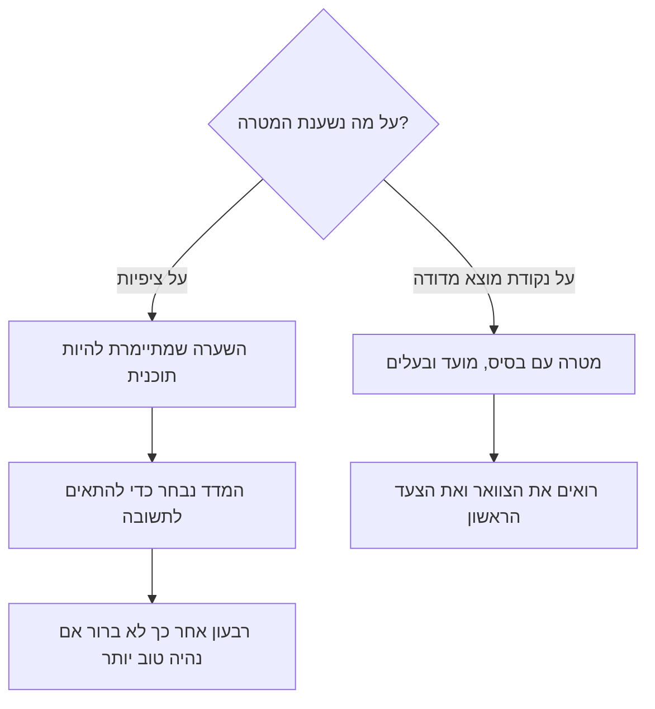
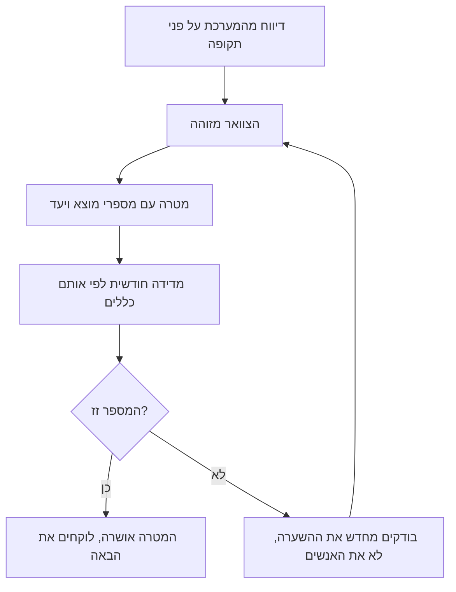

## מבוא

ביום העבודה הראשון שלי כמנהל תמיכה היו לי שני מסמכים: רשימת הציפיות של ההנהלה, והביטחון שאני יודע איך למלא אותן. כעבור חודש התברר שחצי מהציפיות נמדדו במשהו אחר ממה שחשבתי, והחצי השני לא נמדד בכלל. המספרים שציטטתי בישיבות לא היו מצב השירות אלא סכום של רשמים של אחרים.

המאמר הקודם בסדרה — ["גבולות אחריות"](/he/blog/support-lead-boundaries/) — עסק בשחרור הזמן של מנהל התמיכה מהחלטות של אחרים. המאמר הזה עוסק בצעד הבא: מה לעשות עם הזמן שהתפנה בשבועות הראשונים, כדי שהשנה לא תהפוך לאוסף של הבטחות רועשות.

הטענה פשוטה ולא נוחה: מטרה שנקבעה לפני המדידה היא השערה שמתיימרת להיות תוכנית. היא נשמעת נכון, היא מוצאת חן בעיני ההנהלה, ואין לה סיכוי לעבוד — כי אף אחד לא יודע מאיזו נקודה סופרים אותה.

## מטרות ביום הראשון — הטעות השגרתית

מנהל התמיכה כמעט ולא ממציא מטרות ביום הראשון. הן מגיעות מוכנות: מציפיות הממונה, מתיאור התפקיד, מהתוכנית של השנה שעברה, מהניסיון של החברה הקודמת. "תגובה ראשונה בתוך 30 דקות", "לחצות את זמן הפתרון", "להעלות את שביעות הרצון של הלקוחות" — כל זה נשמע כמו הצבת משימה, אבל בפועל זה משאלה.

למה מטרות כאלה לא שורדות את החודש הראשון:

- **אין להן נקודת התחלה.** "לחצות את זמן הפתרון" לא מכיל "מ", רק "ל". רבעון אחר כך אי אפשר לומר אם נהיה טוב יותר — אין עם מה להשוות.
- **הן מתארות את האובייקט הלא נכון.** זמן פתרון כממוצע על כל הפניות כולל גם את אלה שתלויות חודשים בהמתנה לתשובת הלקוח. המדד זז לא כשהצוות עובד אלא כשהלקוח טרח להגיב.
- **המדד נבחר בדיעבד.** קודם המטרה, אחר כך המדד ש"יאשר" אותה. כך נולדים דוחות שבהם הכל בסדר, ותחושה שהשירות חי חיים אחרים מאלה שהמספרים מראים.
- **הכישלון הראשון הורג את האמון בתוכנית.** המספר לא זז בחודש — והמסקנה היא לא "אנחנו לא יודעים ממה לספור" אלא "התוכנית לא עובדת, מנהל התמיכה לא עומד בזה".
- **הצוות לא רואה קשר.** מוקדן קורא את "מטרת השנה" ולא מבין מה משתנה במשמרת שלו. מטרה שלא הופכת לפעולה יומיומית חיה רק במצגת.

בתוכנית השנתית שלפיה אני עובד זה נקרא הטעות השגרתית הראשונה של מנהל תמיכה: מטרה לפני מדידה. ההיגיון פשוט — למדוד מפחיד, כי העובדה עשויה להיות גרועה מהציפיות. לכן המטרה באה ראשונה: היא יוצרת תחושת שליטה. אלא שהשליטה הזאת מדומה.

כך נראית ההסתעפות:

המשך — מה בדיוק משנה נקודת מוצא מדודה.

## מה משנה נקודת המוצא

בסיס (baseline, נקודה א) הוא מצב השירות הנמדד בכניסה: כמה פניות מגיעות, מאיזה סוג, כמה זמן עובר עד התגובה הראשונה ועד הפתרון, איזה חלק מהפתרונות חוזר, ואיפה הזרימה נתקעת. לא הערכה, לא תחושה של "נראה שאנחנו מסתדרים", אלא ספירה של אירועים מהמערכת.

דוגמה שממחישה את ההבדל. מטרה של "תגובה ראשונה בתוך 30 דקות" מול עובדה של "התגובה הראשונה מגיעה כעבור שלושה ימים" — זאת לא מטרה, זה שירות אחר עם כוח אדם אחר ותור אחר. בין העובדה למטרה לא עומדת מוטיבציה אלא עבודה: מיון במגע ראשון, תורנויות, חלוקת הזרימה, נוהל הסלמות. מטרה שנקבעה בלי הפער הזה נבחרת על ידי דמיון ולא על ידי עבודה, וכעבור חודש מתברר שהזזנו את הדבר הלא נכון.

שלוש פונקציות של הבסיס חשובות יותר מהמספר עצמו:

1. **קנה מידה.** הוא כמעט תמיד שונה ממה שנדמה. העומס מפוזר בצורה לא אחידה, חלק מהזרימה הוא לא תקלות אלא שאלות ובקשות שינוי, וצריך לטפל בהן אחרת.
2. **הצוואר.** יש בדרך כלל חמש השערות לגבי מה מפריע. העובדה מצביעה על אחת — וזה חוסך רבעון.
3. **אפשרות לבדיקה.** מטרה עם נקודת מוצא נשמעת אחרת: לא "להאיץ את התגובה" אלא "תגובה ראשונה משלושה ימים לשמונה שעות עד סוף הרבעון השני". אפשר לבדוק אותה, לערער עליה ולפרק אותה לצעדים.

<!-- вилка: 3–4 фактических значения точки А — MTTA, доля реопенов, доля решений по базе знаний, просроченные заявки. -->

כך נסגר המעגל סביב נקודת המוצא:

## בסיס מהמערכת בחודש הראשון

החודש הראשון הוא הזמן היחיד שבו יש לכם הזכות לא לדעת מספרים. אחריו הזכות הזאת נגמרת, וכל "נדמה לנו" עולה באמון. לכן הדיווח נעשה מיד ובמלואו, גם אם תפרקו אותו בהדרגה.

מה להוציא קודם:

| מדד | מה הוא מראה | למה הוא נחוץ בבסיס |
| --- | --- | --- |
| היקף ומבנה הזרימה | פניות בשבוע לפי קטגוריה: תקלה, שאלה, בקשת שינוי | קנה מידה ותור נכון |
| דחיפות | התפלגות לפי עדיפויות וחלק הפניות הקריטיות | איפה הסיכון האמיתי ואיפה הרעש |
| זמן לתגובה ראשונה | מרגע פתיחת הפנייה ועד תשובה מהותית | משמעת תגובה ולא עומס |
| זמן לפתרון | מרגע הפתיחה עד הסגירה — בפיצול לזמן בעבודה ולזמן המתנה | עבודת הצוות בנפרד מההמתנה ללקוח |
| פתיחות חוזרות | חלק הפניות שנפתחו שוב | איכות הפתרון ולא מהירות הסגירה |
| פתרון מתוך בסיס הידע | פניות שנסגרו עם הפניה למאמר | בגרות הידע והפוטנציאל לשירות עצמי |
| שיעור הסלמות | העברות ל-L2 ול-L3 | איפה נשבר המסלול ואיפה חסרות יכולות |
| גיל תור הפניות | פניות שממתינות מעבר לנוהל | הפרות שקטות שלא נראות בדוחות |
| עומס לפי מוקדן | התפלגות הפניות והזמן | כושר נשיאה וסיכוני נקודה בודדת |

כמה כללים שבלעדיהם הדיווח הופך לאוסף של מספרים בלתי־ניתנים להשוואה:

- **תקופה אחת, מקור אחד.** כל המדדים נספרים על אותו חלון מאותה מערכת. נתונים מצ'אט, מדואר ומזיכרון לא נכללים בבסיס.
- **ההגדרות כתובות.** "תגובה ראשונה" — מה בדיוק: אישור תבניתי או תשובה מהותית? כל עוד ההגדרה לא קבועה, אפשר לפרש את המספר איך שרוצים.
- **סופרים אירועים, לא סטטוסים נוכחיים.** פנייה שנסגרה היום נפתחה לפני חודש; דוח לפי סטטוסים נוכחיים לא יראה את זה.
- **זמן בעבודה וזמן בהמתנה — בנפרד.** אחרת האשמה בעיכובים נופלת אוטומטית על הלקוח או, להפך, על הצוות.
- **בלי תיקונים ידניים.** ברגע שהמספר הראשון "תוקן כדי שלא ייראה כל כך רע", כל הבסיס מפסיק להיות טיעון.
- **היסטוריה עדיפה על חודש.** אם במערכת יש רבעון או שנה — קחו אותם: עונתיות בתמיכה נראית רק על חלון ארוך. אם הנתונים מעטים, כתבו זאת — "מדגם של שלושה שבועות".

<!-- вилка: свои выгрузки — какие поля, за какой период, где хранится таблица. -->

שווה לספור בנפרד את מה שאין במערכת. בדרך כלל אלה עלות הפעולות הידניות, הזמן על מעבר בין מערכות, ועבודה שלא משאירה פנייה: ניתוח תקלות בצ'אט, התייעצויות עם עמיתים, חניכה. הבסיס לא יראה את המספרים האלה, אבל בדיוק הם מסבירים למה מוקדן "עמוס אבל הפניות לא נסגרות".

## כיול עם ההנהלה

החודש השני הוא זמן השיחה, ומוטב להכין אותה כהגנת פרויקט ולא כדוח על מה שנעשה. בקלט — הדיווח, בפלט — מטרות מוסכמות עם מספרי מוצא ויעד.

לשיחה ארבעה שלבים:

1. **עובדה.** מציגים את נקודת המוצא בלי ייפוי ובלי התנצלות: כל כך הרבה פניות, זמנים כאלה, פתיחות חוזרות כאלה.
2. **צוואר.** מציינים סיבה אחת או שתיים שמבוססות על נתונים ולא על תחושה.
3. **וקטור.** מציעים מה ישתנה אם ייעשו צעדים קונקרטיים, ואילו מטרות שנתיות זה נותן.
4. **בקשה.** אם הווקטור דורש משאב — אדם, כלי, החלטת הנהלה — הוא נאמר ישירות ובאותה שיחה.

כללים שהסקתי מהטעויות שלי באותה שיחה:

- **לבוא עם דיווח, לא עם מצב רוח.** "הצוות עמוס" מתווכחים עליו; "בתור תלויות פניות מעל לנוהל, הנה הן" — מחליטים על זה.
- **לכל מטרה ארבעה מאפיינים:** מוצא, יעד, מועד ובעלים. מטרה בלי בעלים היא משאלה, לא מטרה.
- **מטרה שדורשת משאב מכילה בקשת משאב.** הבטחת תגובה מהירה יותר בלי שינוי בכוח האדם היא דרך להסביר כישלון כעבור רבעון.
- **אבני דרך במקום הבטחות שנתיות.** "עד סוף הרבעון הראשון — תגובה ראשונה בתוך יום, עד סוף השני — שמונה שעות" קל יותר לדון בה ונבדקת ביושר מאשר מספר אחד לשנה.
- **ההסכמה נרשמת בכתב, עם תאריך בחינה מחדש.** אחרת בעוד חצי שנה תהיה גרסה חדשה של השיחה וציפיות חדשות.
- **הבסיס אינו תירוץ.** ברגע שמתחילים להשתמש במספרים כדי להסביר למה אנחנו איטיים, לשיחה אין טעם. הם נועדו להראות תנועה.

מלכודת נפרדת היא הממונה שמתעקש על מטרה בלתי־מושגת עם המשאב הנוכחי. להתווכח על הניסוח חסר תועלת: הוויכוח על העתיד, והטיעונים נמצאים בהווה. משהו אחר עובד — להסכים עם הכיוון ולפרק אותו לאבני דרך עם תנאים: "עד תאריך כזה מגיעים למספר כזה עם משאב כזה; בלי המשאב אבן הדרך נדחית בכך וכך". המטרה נשארת שאפתנית, ואתם לא האדם שהבטיח ולא עמד בזה.

<!-- вилка: ваш разговор о целях — что было на входе, какие цели согласовали, какой ресурс запросили. -->

## מה צריך להישאר אחרי החודשיים הראשונים

רשימת בדיקה קצרה שמראה שההתחלה הצליחה:

- הדיווח מהמערכת קיים ומתעדכן לפי כלל אחד;
- לכל מדד יש הגדרה כתובה, ואין יותר ויכוח על משמעות המספר;
- הצוואר מזוהה ומבוסס על נתונים ולא על סמכות;
- מטרות השנה מנוסחות כתוצאות ניתנות לבדיקה עם מספרי מוצא ויעד;
- לכל מטרה יש מועד, בעלים ואם צריך — בקשת משאב;
- ההסכמה עם ההנהלה נרשמה בכתב ויש לה תאריך בחינה מחדש.

נקודת המוצא היא לא בירוקרטיה ולא חוסר אמון בצוות. היא דרך להפסיק להתווכח על מה קורה ולהתחיל להתווכח על מה לעשות. הצעד הבא — להפוך את המטרות המוסכמות למפת דרכים לשנים עשר חודש: ארבעה רבעונים, שכל אחד נשען על התוצאה של זה שלפניו. על כך במאמר הבא בסדרה.
