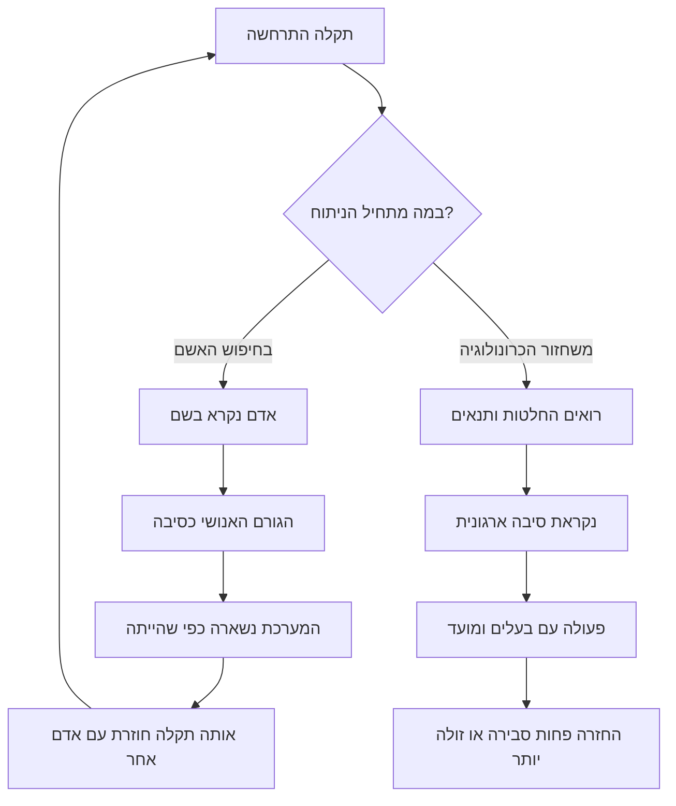
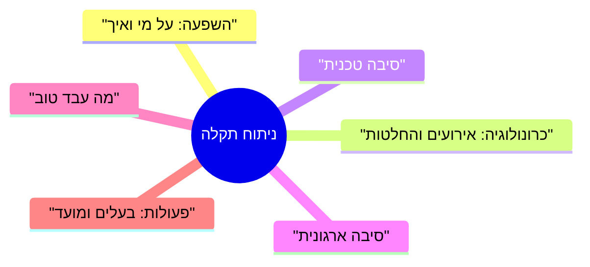

## מבוא

ניתוח תקלה הוא אחד הרגעים הבודדים שבהם הצוות מקבל רשות לדבר על טעויות בקול. בשאר הזמן טעות עולה באמון הלקוח, והאנשים זוכרים את זה. לכן ניתוח שמתחיל בשאלה "מי עשה את זה" נותן תוצאה צפויה: בפעם הבאה הבעיה תתגלה מאוחר יותר, כשלא אפשר עוד להסתיר אותה.

העברתי מספיק פגישות כאלה כדי לקבוע לעצמי כלל: בניתוח דנים בהחלטות ובתנאים שבהם הן התקבלו, לא באנשים. ניתוח כזה נקרא blameless — ניתוח בלי האשמות. המטרה שלו היא הסיבה הארגונית: נוהל חסר, סימן לא חד־משמעי בניטור, חוסר הרשאות, בדיקה שהוחמצה לפני שינוי.

חשוב לא לבלבל את זה עם חוסר אחריות. "בלי שמות" מתייחס לעבר, לא לעתיד: לכל פעולה אחרי הניתוח יש בעלים ומועד. בהמשך — למה חיפוש האשם לא מונע חזרה, ממה מורכב הניתוח, איך כותבים כרונולוגיה בלי שמות ומה עושים עם הפעולות שאחרי הפגישה.

המאמר ממשיך את המעגל החיצוני של הסדרה: ב["שנה של מנהל תמיכה לפי רבעונים"](/he/blog/support-lead-year-roadmap/) הניתוחים עומדים ברבעון הרביעי — כדרך לסגור מעגל, לא כטקס דיווח.

## למה חיפוש האשם לא מונע חזרה

אשם נמצא כמעט תמיד, וכמעט תמיד זה לא מי שקבע את התנאים: המוקדן התורן לא בנה ניטור שמציג סטטוס ירוק ולא כתב את הנוהל. הוא פשוט היה האחרון בשרשרת שבה ההחלטה נראתה נכונה.

מה קורה אחר כך, אם הניתוח נעצר על שם משפחה:

- **האשם שנמצא סוגר את השאלה.** בהמשך דנים בהתנהגות של אדם, לא במערכת שסביבו. הפגישה נגמרת בתחושה של סדר ובלי שינוי אחד בנוהל או בניטור.
- **"הגורם האנושי" לא מסביר דבר.** זה לא סיבה אלא המקום שבו הסיבה התגלתה. השאלה המהותית: למה ההחלטה נראתה נכונה ברגע קבלתה, ולמה המערכת לא עצרה אותה לפני שהגיעה ללקוח.
- **אנשים מתחילים להתגונן במקום לספר.** משתתף שוכח להזכיר שראה אזהרה בצ'אט, כי זה נשמע כמו הודאה באשמה. לשחזר את התמונה אחר כך יקר יותר מלעשות את הניתוח ביושר.
- **המערכת נשארת כפי שהייתה.** פעולה כמו "לשוחח עם העובד" לא משנה לא את הסימן בניטור ולא את סדר התור. כעבור חודש אותו דבר קורה למוקדן תורן אחר.
- **התקלה הבאה מגיעה מאוחר יותר.** הצוות לומד שכדאי לשתוק על תקלה עד הרגע האחרון. בין הבעיה להודאה בה נוצר עיכוב שאיש לא מודד, אבל כולם מרגישים אותו.

המעגל נסגר כך:

הענף השמאלי נעים יותר להרגשה: יש לו סוף ומישהו שאשם. הימני איטי יותר בהתחלה — צריך לאסוף כרונולוגיה ולהכיר בכך שחלק מהאשמה מונח על תהליכים שאתם עצמכם בניתם. אבל רק הוא משנה את מה שממנו נובעת החזרה.

## מבנה הניתוח

המבנה מגן על הפגישה מפני החלפה: בלעדיו דנים בדבר המעניין ביותר — בסיבה הטכנית — וההשפעה והתנאים הארגוניים נשארים מחוץ לתמונה.

ההרכב המינימלי של הניתוח:

השדות לגופם:

- **השפעה.** את מי זה פגע, באילו ערוצים, מה לא היה זמין וכמה זמן זה נמשך. השדה הזה ראשון לא מתוך נימוס: בלעדיו הניתוח הופך לסמינר על סיבה נדירה, והנזק נשאר בלי מילים.
- **כרונולוגיה.** אירועים והחלטות לפי השעון של המערכות: פניות, ניטור, צ'אט התורנות, היסטוריית שינויים. לא לפי הזיכרון — הוא מיישר את התמונה לסוף הידוע מראש.
- **סיבה טכנית.** השרשרת "מה נשבר — למה זה הוביל לכשל". עונה על השאלה "איך", לא "מי", ונמצאת מהר יותר מכל שדה אחר.
- **סיבה ארגונית.** למה המערכת אפשרה שינוי בלי בדיקה, למה הסימן לא נכנס לניטור, למה הקו הראשון לא ראה את ההיקף. השדה הזה קובע את הפעולות שמונעות חזרה.
- **מה עבד טוב.** שדה חובה, אחרת הניתוח הופך לענישה. מה קיצר את זמן השיקום, איזו הסכמה החזיקה מעמד. החלטות מוצלחות שווה לחזור עליהן לא פחות מלתקן כאלה שנכשלו.
- **פעולות.** רשימה עם סוגים, בעלים ותאריכים — על זה נדבר בנפרד בסוף המאמר.

שני כללים. הניתוח נערך בימי העבודה הראשונים, כל עוד הכרונולוגיה נאספת מהלוגים ולא מהאגדות. מנהל אותו אדם שלא השתתף בשיקום — אחרת השיחה גולשת לסיפור על המעשים של עצמו.

## כרונולוגיה בלי שמות

הטכניקה המרכזית של ניתוח blameless היא תפקידים במקום שמות משפחה. במקום "המהנדס לא בדק את תוקף התעודה" מופיע בכרונולוגיה "המוקדן התורן לא קיבל התראה על פקיעת התעודה".

ההבדל אינו קוסמטי. שם משפחה מדביק לאירוע הערכה: אחרי שקוראים אותו, המשתתפים דנים בשאלה אם האדם קשוב, ולא במה שהוא ראה על המסך. תפקיד משאיר מקום לשאלה על התנאים — השאלה היחידה שאפשר לענות עליה בפעולה.

שלושה נימוקים לכך שתפקיד מדויק יותר משם:

1. **הכרונולוגיה נהיית ניתנת לבדיקה.** תפקיד אפשר להצליב עם לוח המשמרות ועם הלוגים; שם גורר אחריו זיכרונות על האדם, לא על האירוע.
2. **אנשים מפסיקים לערוך את עצמם.** כל עוד ברשומה יש שם משפחה, המשתתף חושב על הניסוח ולא על העובדות.
3. **הסיבה הארגונית נראית מוקדם יותר.** אם אותו צעד חוזר אצל אנשים שונים, השאלה "מי אשם" מאבדת משמעות, והשאלה "מה משותף לתנאים האלה" נעשית מובנת מאליה.

את הפורמט של הרשומה אני מחזיק בארבעה מרכיבים: הרגע, האירוע, מה היה ידוע למשתתף, ואיזו החלטה התקבלה. מה שעובד זה לא הטופס אלא המשמעת במילוי:

- **הרגע — לפי שעון המערכות.** "בבוקר" ו"מיד אחרי הצהריים" לא משתחזרים ולא ניתנים להצלבה.
- **האירוע — עובדה, בלי הערכה.** "השער החזיר שגיאת לחיצת יד", לא "השער התנהג מוזר".
- **מה היה ידוע — המרכיב המרכזי.** את ההחלטה שופטים יחד עם המידע שהיה לאדם באותו רגע, ולא עם זה שהופיע לקראת הניתוח.
- **ההחלטה — עם האפשרויות שהיו גלויות.** שווה לרשום לא רק מה עשו, אלא גם מה נראה אז כחלופה.

בנפרד על תיקונים. כרונולוגיה שסוכמה לא נכתבת מחדש: הבהרות מתווספות בשורה נפרדת עם סימון. סתירות בין המשתתפים נשארות בטקסט: שני זיכרונות שונים הם עובדה על תהליך שבו המידע לא היה משותף, ולא סיבה לברר מי מהשניים צודק.

<!-- вилка: фрагмент своей хронологии — 3–5 строк «роль — событие — известное — решение» из реального разбора. -->

## דוגמה מנותחת

להלן תרחיש טיפוסי שהסיבה הטכנית בו משעממת, והארגונית — לא.

**השפעה.** לקוחות כותבים לתמיכה שהם לא מקבלים תשובות למיילים; שאר הערוצים עובדים. מבחוץ השירות שותק, למרות שפניות בטראקר נוצרות כיאות.

**כרונולוגיה.** שינוי מתוכנן בשער מוחל לפי הנוהל; המוקדן התורן רואה סטטוס ירוק; במהלך המשמרת מגיעות תלונות מאותו סוג, כל אחת מטופלת בנפרד; מוקדן מהקו השני מבחין שהתזמון של התלונות חופף לחלון השינוי.

**סיבה טכנית.** בשרשרת התעודות נשארה תעודת ביניים שפג תוקפה; חלק משירותי הדואר מגיבים ללחיצת יד כזאת בסירוב.

**סיבה ארגונית.** לשינוי המתוכנן לא היה קריטריון "הערוץ מקבל מייל אחרי השינוי"; לניטור — בדיקה של פונקציה עסקית, ורק של זמינות הפורט; לקו הראשון — סימן להיקף בערוץ אחד, ולכן פניות זהות עברו כפניות שונות.

**מה עבד טוב.** המוקדן מהקו השני הצליב את זמן התלונות עם חלון השינוי, והחיפוש התקצר; המוקדן התורן שמר את המיילים הנכנסים, ולכן אפשר היה לתאר את ההשפעה במדויק.

**פעולות.** בדיקה סינתטית לקליטת מייל אחרי שינויים — הבעלים בתפעול; כלל מיון "פניות זהות בערוץ אחד נאספות לתקלה אחת" — הבעלים בתמיכה; בדיקת שרשרת התעודות בנוהל השינוי — הבעלים בתשתית.

ניתוח כזה אורך פחות משעה, ורוב הזמן הולך לא על הסיבה הטכנית אלא על השאלה למה לשלוש קבוצות לא הייתה תמונה משותפת.

<!-- вилка: свой инцидент — влияние, хронология в три строки, организационная причина, что сработало. -->

## גורל הפעולות

הבעיה השכיחה ביותר בניתוח היא לא איכות המסקנות, אלא שהחלטות לא מתבצעות. הסיבות בדרך כלל אותן סיבות, וכמעט כולן ניתנות לניהול.

- **הבעלים הוא אדם, לא קבוצה.** ל"הצוות צריך לסדר את הניטור" אין בעלים, ולכן גם אין מועד. לניסוח "את הבדיקה הזאת עושה מוקדן התפעול, המועד — תאריך כזה" יש.
- **המועד הוא תאריך, לא רבעון.** "ברבעון הבא" נשמע כמו התחייבות, אבל אינו כזה.
- **הפעולה חיה בטראקר המשותף.** מסמך נפרד על תקלות קוראים פעם אחת — בניתוח עצמו. פעולה בתור העבודה הרגיל מקבלת עדיפות ונראות.
- **הפעולות מעטות.** חמש־שבע שורות לניתוח — הגבול שאחריו חלקן לא יתבצע.
- **לפעולה יש סוג.** לחסל את הסיבה, לזרז את הגילוי, לזרז את השיקום, לצמצם את ההשפעה — ארבע משימות שונות, וכמעט לא נפתרות בו־זמנית. לפעמים זול יותר לא למנוע תקלה אלא לקצר את זמן הגילוי שלה.
- **סטטוס — בניתוח הבא.** הדקות הראשונות של כל פגישה מוקדשות לפעולות הקודמות: בוצע, בתהליך, באיחור. מה שאיחר נדון כסיבה ארגונית — המועד לא היה מציאותי או שלא ניתנה עדיפות — ולא כשאלת משמעת.

<!-- вилка: как вы ведёте действия после разборов — где они лежат, как проверяется статус, что было с первым разбором. -->

ניתוח בלי שמות לא עושה את הצוות רך יותר — הוא עושה אותו מהיר יותר: אנשים מגיעים עם עובדות ולא עם גרסה מגוננת של האירועים, והסיבה הארגונית נמצאת בפגישה הראשונה ולא בשלישית. כרונולוגיה בלי שמות היא לא נימוס אלא כלי: היא מאפשרת לדון בתנאים שיצרו את הטעות ולשנות בדיוק אותם.

בהמשך הסדרה — "כרטיס בעיה למוצר שאי אפשר לסגור בלי סטטוס": על מה לעשות עם סיבות שאי אפשר לתקן בתוך התמיכה.
