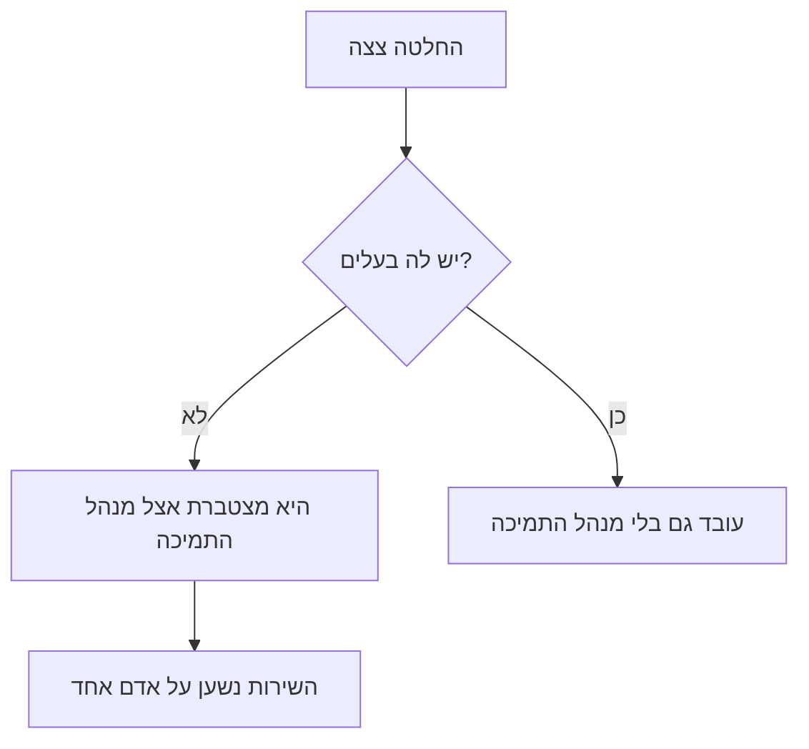
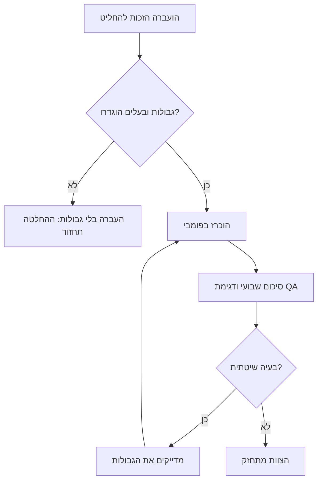

## מבוא

את השבועות הראשונים בתפקיד מנהל תמיכה אני זוכר כתמונה אחת: היום נבלע בהחלטות של אחרים. מהנדס מגיע לתאם עדיפות, מפתח רוצה לדעת מי יגיד ללקוח על דחייה, ההנהלה שואלת למה פנייה תקועה. אחרי הצהריים מתברר שהעבודה שלשמה קיים מנהל התמיכה — לא נעשתה.

הבעיה לא בעבודה מרובה ולא במחסור בזמן. הבעיה שלתפקיד אין גבולות מוגדרים. מנהל תמיכה בלי גבולות הופך למנתב היחיד: הכל עובר דרכו, כלום לא זז בלעדיו, וכל יום מחלה או חופשה עוצרים את השירות. במאמר הקודם בסדרה — ["חמשת התוצרים של מנהל תמיכה"](/he/blog/support-lead-five-results/) — פירקתי מה מבדיל מנהל ממנתב לעומק. כאן — המנגנון שמגן על ההבדל הזה בפועל: שלוש רשימות מהתוכנית השנתית שלפיה אני עובד. מה אני מחליט בעצמו, מה אני מאציל וממה אני פורש.

לפני הרשימות — המנגנון בלעדיהן. החלטות בלי בעלים מצטברות אצל האדם הזמין ביותר. האדם הזמין ביותר בתמיכה — מנהל התמיכה.

המשך — איך עוברים מ"מצטבר אצל מנהל התמיכה" אל "עובד גם בלעדיו": קודם לזהות תסמינים, אחר כך לבנות את שלוש הרשימות ולהפוך אותן להסכם עם ההנהלה.

## תסמינים של גבולות מטושטשים

גבולות מטושטשים לא מכריזים על עצמם. הם מתגלים בשגרה, ושווה לבדוק את עצמכם מול רשימה קצרה:

- **הסלמות כברירת מחדל.** כל פנייה לא־סטנדרטית מגיעה במוקדם או במאוחר אל מנהל התמיכה — לא מפני שהמהנדס לא יכול לפתור אותה, אלא מפני ש"כך נהוג". הטריגר להסלמה הוא לא מורכבות אלא חוסר ודאות: "אני לא יודע של מי ההחלטה הזאת".
- **מנהל התמיכה — המאשר ההכרחי.** הבטחה ללקוח, דחיית מועד, גישה למערכת, שינוי נוהל — הכל דורש את החתימה שלכם. כל עוד אתם בחופשה, הפעולות האלה פשוט לא קורות.
- **החלטות חיות בצ'אטים ובעל־פה.** שבוע אחרי אף אחד לא זוכר מי ולמה החליט להעביר פנייה לפיתוח. הוויכוחים מתחילים מחדש, והשופט — שוב אתם.
- **היום הולך לטקטיקה.** פתיחת פניות תקועות ומענה ל"מה עושים עם זה?" בולעים את היום; לא נשאר זמן לתהליכים, לאיכות ולאנשים. באופן רשמי אתם "מספיקים הכל" — פשוט לא עושים את העבודה שלכם.
- **הצוות לא מחליט בלעדיכם גם פרטים קטנים.** מהנדס יכול לסגור פנייה לבד, ועדיין שואל — לא מפני שהוא לא יודע את התשובה, אלא מפני שפעם אחת כבר קיבל על יוזמה עצמאית באז. כך מגודלת חוסר־אונים נלמדת — אותה אחת שמוטחים עליה אחר־כך.

<!-- вилка: 2–3 симптома из собственной практики — что именно съедало день до введения списков. -->

מאחורי התסמינים האלה עומד אותו מנגנון. וחשוב לראות גם את הצד ההפוך: גבולות הם לא גדר ביניכם ובין הצוות — הם חוזה אמון. מהנדס מוכן לקחת החלטות רק שם, היכן שהוא מבין היכן מסתיימות הרשאות שלו ומי גובה אותו. ככל שהגבולות שקופים יותר, כך הצוות מוכן לקחת על עצמו יותר החלטות — וכך השירות צריך פחות חתימות שלכם כדי לעבוד.

## הרשימה "מחליט בעצמו"

הרשימה הראשונה — החלטות שנשארות אצל מנהל התמיכה. עקרון הסינון פשוט: נשארות החלטות שעלות טעות בהן גבוהה, או שהן קובעות כללים לכולם.

- **עדיפות שנויה במחלוקת.** כשמהנדסים חלוקים בהערכה, ההחלטה של מנהל התמיכה: ממנו תלויים טיימרים לזמני תגובה וסדר התור.
- **הבטחות ללקוח מחוץ לנוהל.** פיצוי, דחיית מועדים, חריגות מ-SLA — כל מה שיוצר התחייבויות שאינן בחוזה או בנוהל.
- **הרכב הצוות וההקצאה לפרויקטים.** מי על איזה קו עובד, מי מצטרף לפרויקט, מי בתורנות.
- **כללי המשחק.** נהלים, עדיפויות תור, קריטריוני איכות: את זה משנה מי שאחראי על התוצאה.
- **הסלמה כלפי מעלה.** כשבעיה יוצאת מגבולות השירות אל רמת ההנהלה — איך ומתי להרים אותה נשאר למנהל התמיכה.

מבחן שימושי לכל סעיף: "האם אוכל להסביר למה מהנדס לא יכול לקבל את ההחלטה הזאת?" אם ההסבר מסתכם ב"כך נהוג אצלי" — הסעיף עובר לרשימה "מאציל".

קנה מידה: רשימת "מחליט בעצמו" נכנסת לשורה־שתיים. אם היא ארוכה מעשרה סעיפים — בלבלתם הנהגה עם שליטה, והחזרתם לעצמכם את כל התסמינים מהסעיף הקודם.

<!-- вилка: ваш список «решаю сам» — 3–5 пунктов из практики. -->

## הרשימה "מאציל"

הרשימה השנייה — מה עובר לצוות. הטעות המרכזית כאן — לבלבל בין האצלת משימה לבין האצלת זכות החלטה. "תסתכל על הפנייה" — זאת משימה: המהנדס מתמודד, אבל את ההחלטה עדיין מביא אליכם. האצלה נשמעת אחרת: "הפנייה שלך. אתה בוחר את המסלול ואומר ללקוח מה הלאה. לעצמי אני משאיר רק את העדיפות".

ההבדל בין שני הניסוחים האלה — כל ההבדל בין מנתב למנהל.

מה נכנס לרשימה "מאציל":

- טיפול בפניות במסגרת הנוהל — כולל לא־סטנדרטיות, כשעלות הטעות מתונה;
- תקשורת עם הלקוח במצבים שגרתיים: סטטוסים, דחיות בתוך SLA, הבהרות;
- תורנויות וחלוקת זרימה בתוך משמרת;
- חונכות וקליטת מהנדסים חדשים;
- הכנת סטטוסים ודוחות קבועים.

לכל החלטה מואצלת דרושים שני דברים: **גבולות** (מה המהנדס מחליט לבד, מתי מסלים ולמי) ו**בעלים** (אדם מסוים, לא "הצוות"). האצלה בלי גבולות איננה האצלה אלא העברת אחריות: ההחלטה תחזור אליכם בכל זאת — מאוחר יותר ועם הקשר מקולקל.

כך נראה מחזור העבודה של ההאצלה:

ועוד כלל שקל לפספס: זכות ההחלטה מוכרזת בפומבי. אם סיכמתם עם מהנדס אחד־על־אחד, בתוך שבוע התור יחזור אליכם — השאר הרי לא בפנים. הניסוח "בנושאים האלה עכשיו פונים לאניה, לא אליי" חייב להישמע בסיכום הכללי ולהיות גלוי בנוהל.

ואז מתחיל החלק שבדרך כלל שוכחים ממנו: האצלה לא נגמרת ברגע ההעברה. לכל בלוק מואצל דרושות נקודות בקרה — לא מפני שאין אמון, אלא מפני שלהחלטה יש בעלים גם אצלכם וגם אצל המהנדס. מספיק קצב קל: סקירת כמה החלטות מואצלות בסיכום השבועי ודגימת QA שמראה את איכות ההחלטות בלי תלות במי קיבל אותן. אם בדגימה מופיעה בעיה שיטתית — זה לא סיבה לקחת את ההחלטה בחזרה, אלא סיבה לדייק את הגבולות: כנראה נוסחו בערפול.

ועצרו את עצמכם מלחזור אחורה. טעויות ראשונות באזור המואצל בלתי־נמנעות, והפיתוי "טוב, נחזור כמו שהיה" עצום. אבל כל החזרה של החלטה מלמדת את הצוות דבר אחד: הגבולות קישוט, ההחלטות האמיתיות עדיין אצלכם.

<!-- вилка: что вы делегировали за последний месяц и как объявили это команде. -->

## הרשימה "פורש"

הרשימה השלישית — הקשה ביותר. לפרוש — זה לצאת במכוון מתפקיד שנתן תחושת שליטה. בתוכנית השנתית מוזכרים שני תפקידים כאלה, ושניהם מוכרים לכל מנהל:

- **המנתב היחיד.** פניות מנותבות על ידי מיון ומטריצה, לא על ידי. כל עוד הניתוב — הפונקציה האישית שלי, השירות נשען על אדם אחד והמיון לא מתפתח.
- **המאשר ההכרחי.** לפעולות שגרתיות — נוהל במקום החתימה שלי. אם פעולה שגרתית — היא צריכה להתבצע בלעדי; אם לא — היא ברשימה "מחליט בעצמו".

אפשר להוסיף תפקיד שלישי, פחות מובן:

- **המומחה הכי עמוק בכל מוצר.** אם המומחיות הכי עמוקה בצוות — אתם, אז החופשה שלכם היא תקלה והעזיבה שלכם — אסון. המטרה של מנהל התמיכה — שלמומחיות קריטית יהיה לפחות שני אנשים; זאת עבודה נפרדת עם מטריצת כשרים, והיא ראויה למאמר נפרד בסדרה.

למה הרשימה "פורש" הכי קשה: פרישה לא נראית כהישג. הסכמה "אני כבר לא מאשר דחיות בתוך SLA" נראית מבחוץ כ"מנהל התרשל". מה שעוזר להחזיק כאן — מחשבה אחת: אתם לא מאבדים שליטה — אתם מעבירים אותה מהראש אל המערכת. נהלים, מיון, מטריצת אינטראקציות, בעלי החלטות — זו בדיוק השליטה שלא תלויה במצב הרוח ובלוח הזמנים שלכם.

הודעה לצוות — צעד קריטי, ושווה לעשות אותו במילים ישירות: מה בדיוק אתם מפסיקים לעשות, מאיזה תאריך, מה עושים במקרים שנויים במחלוקת ומי גובה בתקופת המעבר. פרישה שקטה (פשוט הפסקתי לענות) נקראת אצל הצוות כנטירה או כקפריזה.

את תקופת המעבר שווה לתכנן באותה כנות כמו את הפרישה עצמה. השבועות הראשונים אחרי ההודעה — לא הזמן להוכיח קשיחות: אם מהנדס נתקע במקרה שנוי במחלוקת, עדיף לפתור פעם אחת יחד איתו ולדון בזה בסיכום, מאשר להשאיר את השירות להמתין. שווה גם להסכים על חזרה אחורה: אילו אירועים מחזירים לגיטימית את התפקיד אליכם (למשל, עזיבת שני מהנדסים ברצף או כשל בתקן האיסוף) ואיך זה נרשם. פרישה בלי תנאי חזרה נראית דוגמה; עם תנאים — החלטה מנוהלת.

<!-- вилка: формулировка сообщения команде — что вы перестаёте делать, с какой даты, куда идти в спорных случаях. -->

## ההסכם עם ההנהלה

שלוש הרשימות עובדות כשהן קיימות לא בראש אלא במסמך שגלוי ומאושר עם ההנהלה. זו לא בירוקרטיה אלא שלוש תועלות קונקרטיות.

ראשית, ההנהלה יודעת ממי לצפות לאילו החלטות — מכם או מהצוות. אין תרחיש "למה האישור הזה עבר למהנדס?" — כי יש מסמך שכותב את זה.

שנית, להאצלה יש הגנה. כשמהנדס מקבל החלטה בתוך הגבולות שלו — זו לא יוזמה סמכותית אלא ביצוע של ההסכם. בלי המסמך כל טעות בהחלטה מואצלת נקראת "היה צריך להתייעץ עם המנהל" — ורשימת "מאציל" מתה בשקט.

שלישית, פרישה מתפקידים מפסיקה להיות "מנהל התרשל". "אני כבר לא מנתב ולא מאשר" — זו אסטרטגיה רשומה עם הסבר היכן חיות הפונקציות האלה עכשיו, ולא קפריזה.

הצורה פשוטה יותר ממה שנדמה: עמוד טקסט או טבלה עם שלוש עמודות. ועוד סקירה רבעונית, והיא צריכה להיות משמעותית: אילו סעיפים עברו בין הרשימות (מה שהואצל והחזיק מעמד — אפשר לפרוש מהתפקיד הבא), היכן הגבולות התבררו מטושטשים בפועל, אילו החלטות נהיו שגרתיות וראויות לנוהל במקום האישור שלכם. סקירה בלי מעברים — סימן שהרשימות קיימות רק על הנייר.

חשוב להבין את מקום הרשימה הזאת בשנה. רשימות הגבולות אינן אופטימיזציה יומיומית אלא חלק מהמסגרת האסטרטגית: הן דרושות לפני שתתחילו למדוד baseline ולתאם מטרות. אי אפשר לבנות מפת דרכים שנתית כשחצי מהזמן שלכם הולך להחלטות של אחרים — המדידות ישקרו והמטרות יתאימו את עצמן לכאוס. על זה — המאמר הבא בסדרה.

ואחרון. גבולות הם לא על לעשות פחות. הם על לרכז את ערך המנהל שם, שם שאף אחד אחר לא יכול ליצור אותו: כללי המשחק, מחלוקות עדיפות, פיתוח אנשים, ההסכם עם ההנהלה. כל השאר — הזדמנות של מישהו לצמוח, שאתם לוקחים על ידי החלטה בשביל אחרים.