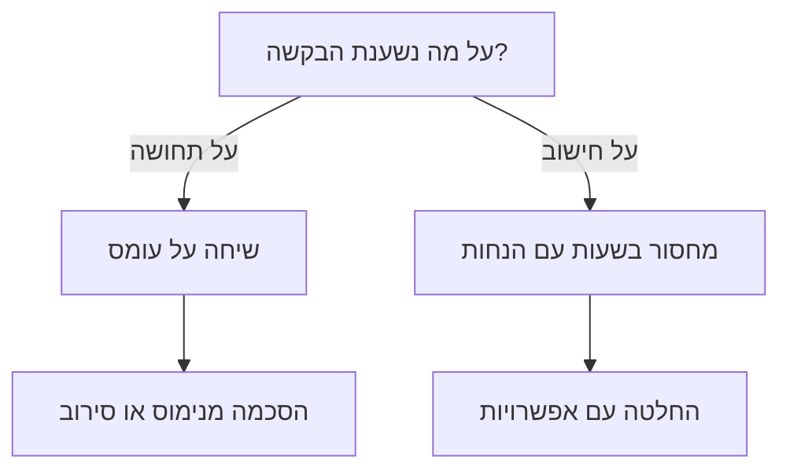
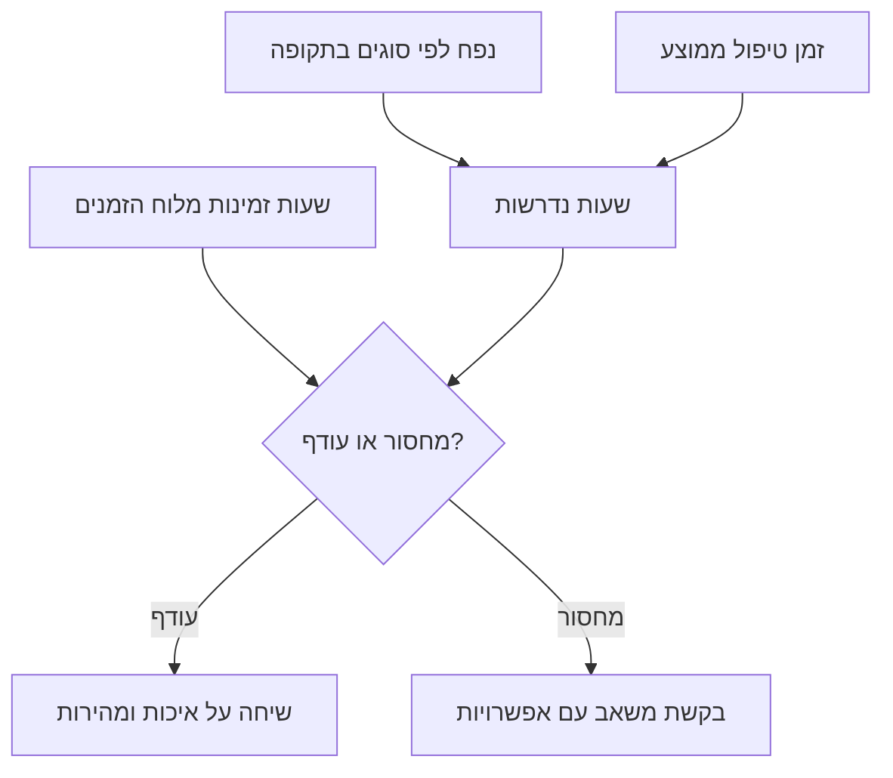

## מבוא

את הבקשה הראשונה שלי למהנדס נוסף כתבתי בטון שנראה לי משכנע: הצוות בעומס יתר, האנשים על הקצה, צריך עוד אדם אחד. התשובה של המנהל היתה מנומסת וקטלנית: "תביא חישוב". חישוב לא היה. היו שלושה סיפורים על שבוע קשה ועלבון של אדם שבאמת מנסה.

שנה אחר כך הבאתי את אותה בקשה בצורה אחרת: עמוד אחד, כמה מספרים, שתי הנחות מפורשות ושלוש אפשרויות. השיחה ארכה חמש עשרה דקות והסתיימה בהחלטה. לא המנהל השתנה ולא התקציב — השתנתה הצורה: עומס יתר הפך למחסור בשעות שאפשר לבדוק, לערער עליו ולסגור.

הטענה של המאמר פשוטה: הצורך באנשים הוא נוסחת כושר נשיאה, לא תחושת עומס. בנוסחה שלושה חלקים: נפח העבודה, זמן הטיפול הממוצע ליחידה והשעות הזמינות. כל עוד היא לא מחושבת, כל שיחה על גיוס היא משא ומתן על האמון במנהל התמיכה ולא על משאבים. אמון הוא יסוד גרוע לתקן כוח אדם.

החישוב יוצא מנקודת מוצא מדודה. בלי ייצוא מהמערכת הנוסחה נבנית מאותן תחושות, רק בטבלה. את נקודת המוצא פירקתי במאמר "בסיס לפני מטרות"; כאן מניחים שהיא כבר קיימת.

## למה "אנחנו בעומס יתר" לא עובד

המשפט "אנחנו בעומס יתר" ישר, ובדיוק מפני כך קשה להתווכח איתו. הבעיה לא ביושרה אלא בעובדה שאי אפשר לגזור ממנה פעולה.

- **הוא לא מבדיל בין הסיבות.** עומס יתר נובע מנפח, מהרכב הזרימה, מהמתנה לתשובת הלקוח, מהפסדי מעבר בין מערכות, ומכך שחצי משמרת הולכת לאישורים. כל אחד מהם מתוקן אחרת: גיוס, מיון, אוטומציה, שינוי תהליך. המילה "עומס" לא אומרת איזה מבין החמישה.
- **אין לו קנה מידה.** הוא נשמע זהה אצל צוות של שלושה ואצל צוות של עשרה: לכל צוות יש שבועות קשים, וההנהלה לא יכולה להבדיל בין שגרה לחריגה.
- **אי אפשר לבדוק אותו או לערער עליו.** עם תחושה אפשר רק להסכים או לא להסכים — כלומר להאמין או לא להאמין. אין מה לבדוק, ולכן השיחה גולשת עד מהרה לעניינים אישיים.
- **אין בו אפשרויות.** הבקשה נשמעת כמו "תנו אדם", וההחלטה מצטמצמת לבחירה בין כן ללא. סירוב אחרי בקשה כזאת נראה כמו נטישת הבעיה ולא כמו בחירת עדיפות.
- **הוא נשחק מחזרה.** אותו משפט בכל חודש הופך לרקע, ועל רקע לא מדברים.
- **יש לו מחיר למנהל התמיכה.** סירוב אחד ל"אנחנו בעומס יתר" מלמד לא לבקש, ואז הצוות סוחב את הנפח בשקט — עד שאנשים מתחילים לעזוב.

יש גם צד שני: מנהל שמסכים ל"עומס יתר" בלי חישוב קונה לעצמו בעיה. כעבור חודש יש אדם נוסף והתור לא התקצר, מפני שהסיבה לא היתה מספר האנשים. אחרי שני סבבים כאלה האמון בבקשות יורד אצל שני הצדדים.

לכן אני בונה את הבקשה לא כתלונה אלא כהסתעפות עם ענפים ניתנים לבדיקה:

המשך — איך בנוי החישוב שעושה את השיחה לקצרה.

## נוסחת כושר הנשיאה

בשורה אחת הנוסחה נראית פשוטה עד כדי עלבון: השעות הנדרשות שוות לנפח העבודה כפול זמן הטיפול הממוצע ליחידה. השעות הזמינות נלקחות מלוח הזמנים. הפער בין השניים הוא המחסור שאיתו הולכים להנהלה.

הטעויות כמעט אף פעם לא בחשבון. הן בנתוני הקלט, ולכן את הקלט צריך לפרק.

- **נפח.** נספר לפי אירועים במערכת על פני תקופה קבועה, בפילוח לפי סוג: תקלה, שאלה, בקשת שינוי. דואר, צ'אט ו"היו גם כמה שיחות" לא נכנסים לנפח — אחרת אי אפשר לשחזר את המספר. החלון צריך להיות ארוך: חודש מראה שבוע מקרי, רבעון מראה עונתיות.
- **זמן ממוצע.** זה זמן הטיפול, לא זמן החיים של הפנייה. המתנה לתשובת הלקוח, המתנה לגרסה והמתנה לאישור נספרות בנפרד: הצוות לא מוציא עליהן שעות, אבל המערכת מחברת אותן לזמן הכולל. הטיפול כולל גם תקשורת, בדיקה חוזרת ומעבר בין מערכות — מה שלא נראה בפנייה עצמה.
- **שעות זמינות.** לא "יש לנו כל כך הרבה אנשים", אלא לוח זמנים: מי בחופשה, מי בהדרכה, מי בפרויקט, מי בתורנות. על זה הסעיף הבא, מפני שכאן החישוב קורס לרוב.
- **יחידות.** הכל בשעות־מהנדס לאותו שבוע. ברגע שחלק אחד בשעות והשני בפניות, הנוסחה מפסיקה להסתדר והוויכוח חוזר.

בדיקת יציבות שכדאי לעשות: לחשב מחדש בלי השבוע הכבד ביותר בתקופה. אם המחסור נעלם — זה לא כושר נשיאה אלא שיא, ושיאים מכסים בחוצץ ובסדר עדיפויות, לא בגיוס. אם המחסור נשאר — זה חוסר מבני בשעות, והוא לא ייעלם מעצמו.

שווה לומר בפה מלא מה הנוסחה לא נותנת. היא לא מפיקה מספר אנשים מדויק: התוצאה תלויה בהנחות, וזמן הטיפול הממוצע הוא בעצמו גודל משתנה. היא נותנת סדר גודל, וחשוב מזה — היא מראה על אילו הנחות שווה להתווכח. אם ההנהלה לא מסכימה עם המספר, יש לנו על מה לדבר: איזה משלושת החלקים היא קוראת אחרת ולמה.

כך הנוסחה הופכת להחלטה:

## לוח הזמינות

השעות הזמינות הן החלק המוזנח ביותר בנוסחה. קל להכפיל כוח אדם בארבעים שעות בשבוע, אבל למספר שמתקבל אין קשר לעבודה: חלק מהשעות האלה כבר מכור מראש.

מה מורידים מהמספר הנומינלי:

- חופשות ומחלות — לא "לפי מה שיקרה" אלא לפי התוכנית לשנה קדימה;
- הדרכות, חונכות וקליטת מהנדסים חדשים;
- התחייבויות בפרויקטים: הטמעות, מיגרציות, אינטגרציות חד־פעמיות;
- תורנויות, כשהן מוציאות אדם מהתור ולא יושבות מעליו;
- פגישות וסקירות קבועות;
- הפסדי מעבר בין פניות ומערכות.

הסעיף האחרון הוא בדרך כלל השנוי ביותר במחלוקת, ובצדק: הוא לא נראה במערכת וכל שירות מעריך אותו בדרכו. אני לא לוקח את המקדם מהאוויר — אני גוזר אותו מהתאמה בין השעות שלוח הזמנים הציע ובין הפניות שנסגרו בפועל. אותו חלק הפסדים מוצג לצד החישוב כהנחה מפורשת. אפשר להתווכח איתה, אבל אי אפשר להעמיד פנים שההפסדים לא קיימים.

על עונתיות בנפרד. שיא החופשות ידוע בינואר, ובכל שנה העומס ביולי נראה כמו הפתעה. לוח זמינות לשנים עשר חודש הוא הדרך היחידה לראות את השפל מראש ולבחור: להזיז יוזמות, להביא משאב זמני או להזהיר בכנות לגבי המועדים.

<!-- вилка: свой календарь доступности — как считаются отпуска, проектные обязательства и потери на переключение, какой коэффициент потерь получился по сверке. -->

## תקנים בתוך החישוב

תקנים פנימיים הם החלק שקל לשכוח, מפני שהם לא על נפח אלא על צורת השירות.

תקן כמו "איסוף בתוך חמש עשרה דקות בשעות העבודה" הוא לא משאלה אלא שעות שמורות. מישהו צריך בכל רגע לזרוק את הפנייה הנוכחית ולקחת חדשה; כלומר, אי אפשר לשים אותו על משימה ארוכה, וכושר הנשיאה שלו בתור נמוך מהנומינלי. טיימרים לזמני תגובה עובדים באותו אופן: ככל שהתקן מחמיר, יותר שעות הולכות לא לעבודה אלא למוכנות לעבודה.

מכאן שתי מסקנות, ושתיהן משנות את שיחת הגיוס.

הראשונה: תקן וכושר נשיאה הם גדלים קשורים, ואחד מהם צריך לזוז. אם השעות חסרות, יש בדיוק שתי אפשרויות — להוסיף שעות או לשנות את התקן. הבטחה לשמור על התקן בלי השעות מתקיימת בגבורה של אנשים מסוימים, וגבורה היא לא משאב: היא לא מתרחבת ולקראת סופה באה שחיקה.

השנייה: החישוב מראה אילו תקנים הם היקרים ביותר. לפעמים מתברר שטיימר תגובה מחמיר לכל סוגי הפניות עולה יותר מכל שאר השירות — וצמצום התקן לקטגוריות קריטיות משחרר שעות בלי גיוס ובלי אובדן איכות במקום שבו האיכות באמת נחוצה.

<!-- вилка: ваши нормативы — подхват, таймеры реакции — и сколько часов они стоят по расчёту; какие нормативы пересматривались. -->

## בקשת משאבים לפי נתונים

לבקשה שעובדת יש שלושה חלקים: נתונים, תוצאה, אפשרויות.

**נתונים.** עמוד אחד: נפח לפי סוגים, זמן ממוצע, שעות זמינות, המחסור עם התקופה והמקורות. ההנחות כתובות בנפרד, כדי שאפשר יהיה לערער עליהן אחת־אחת ולא על הכל יחד.

**תוצאה.** מה יקרה אם לא משנים דבר: אילו תקנים יפסיקו להתקיים, אילו פניות ייפלו לפיגור, אילו יוזמות ייעצרו. לא "יהיה רע" אלא "עד תאריך כזה לא יתקיים תקן כזה". זה החלק הכי לא נוח, והוא זה שמדלגים עליו לרוב: בלי התוצאה הבקשה נקראת כמחווה ולא כבחירה.

**אפשרויות.** בקשה בלי חלופות היא אולטימטום, גם אם היא מנוסחת בנימוס. יש בדרך כלל שלוש, והן ממעטות לשלול זו את זו:

1. **להוסיף שעות.** גיוס, קבלן, תגבור זמני לשיא.
2. **להקטין את הנפח.** שירות עצמי, בסיס ידע, קטימת זרימה שלא אמורה להגיע למהנדסים.
3. **לשנות את התקן.** במכוון ובכתב, עם הסבר מה בדיוק מפסיק להתקיים.

את השיחה עם ההנהלה אני בונה כבחירה מבין השלוש, לא כבקשה שבעד הראשונה. לפעמים בוחרים בשנייה, וזו תוצאה סבירה: בקשת משאבים ובקשת גיוס הן דברים שונים. סוף רע יש רק אחד — "נשאיר כמו שזה" בלי שינוי התקן: אז ההחלטה קיימת, אבל האחריות עליה לא נרשמה באף מקום.

והדבר האחרון שהופך בקשה לעובדת: תאריך בחינה. "נחזור לזה בעוד רבעון ונראה אם המחסור זז" הוא חלק מההחלטה ולא נימוס. בלעדיו השיחה נגמרת בכן או בלא, ובעוד חצי שנה היא מתחילה מאפס ועם אותן רגשות.

<!-- вилка: свой расчёт и пример запроса — что было на входе, какие варианты предложены, что выбрало руководство. -->

נוסחת כושר הנשיאה לא הופכת את מנהל התמיכה לחזק יותר ולא מבטלת שיחות לא נעימות. היא עושה משהו אחר: היא הופכת עומס לנושא לניהול. כל עוד המחסור בשעות לא מחושב, הכלי היחיד שעומד לרשותנו הוא גבורה של הצוות, והיא נגמרת. המאמר הבא בסדרה — על איך מסכמים עם צוותים שכנים שחלק מהנפח הזה בכלל לא יגיע לתמיכה: אינטראקציות בלי מטריצה נשענות על הסדרים אישיים ועל זיכרון.
