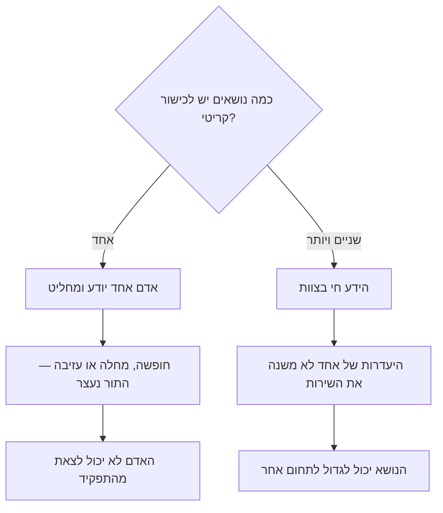
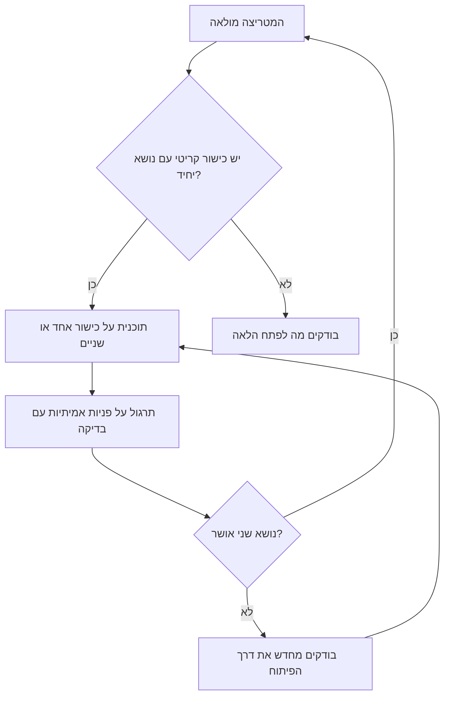

## מבוא

זה קרה בפעם הראשונה ברגע הכי לא מתאים: האדם היחיד שהכיר את אחד המוצרים יצא לחופשה. עשרים דקות אחר כך התברר שאף אחד בצוות לא יכול לשחזר את הבעיה ולא להסביר ללקוח מה קורה, והתור נעצר לא מרוב עומס אלא מהיעדרותו של אדם אחד.

מאז אני מתייחס לידע לא כרכוש משותף של הצוות אלא כתכונה של אנשים מסוימים: לכל כישור יש נושאים, ואם הנושא יחיד — זו אינה כשרות אלא תלות. מטריצת כישורים — טבלה פשוטה של כישורים × אנשים × רמות — הופכת את התלות לגלויה לפני שהיא קורית.

הטענה קצרה: סיכון של נקודה בודדת מתגלה כמעט בחינם ועולה יותר מכולם. המאמר על איך בנויה המטריצה, איזה תקן אני מחזיק ואיך ממנה יוצאת תוכנית פיתוח ולא דוח למראית עין.

## סיכון של נקודה בודדת

סיכון של נקודה בודדת הוא מצב שבו כישור קריטי לשירות קיים בעותק אחד בלבד. כל עוד האדם הזה עובד, הכל נראה טוב: הוא מהיר, הוא יודע את ערכו, והוא היחיד שאליו מביאים פניות קשות.

זה נשבר באותה צורה בכל המקרים, ורק הסיבה שונה: חופשה, מחלה, חופשת לידה, עזיבה, מעבר לצוות אחר. ולהסיכון הזה שתי מערכות של תוצאות: לשירות ולאדם.

השירות מקבל תור בלי בעלים ולקוחות שאין מי שיסביר להם את המצב. האדם מקבל תפקיד שאי אפשר לצאת ממנו: הוא לא יכול לצאת לחופשה רגילה כי בלעדיו הכל קורס, הפרויקטים שלו תמיד תלויים בו, והקידום הבא נדון בהסתייגות שאין מי שיחליף אותו.

כך נראית ההסתעפות:

<!-- вилка: свои точки риска — навыки, которые держатся на одном человеке. -->

שווה לנקוב גם במה שאינו נחשב סיכון. כישור נדיר שנדרש פעם בשנה ומטופל דרך ספק חיצוני או פיתוח יכול לחיות בשקט בעותק אחד: החזקת מומחיות שנייה ומלאה בו יקרה יותר מהמתנה נדירה.

## המטריצה: כישורים × אנשים × רמות

המטריצה היא טבלה עם שני צירים: שורות — כישורים, עמודות — אנשים, בתאים — רמת השליטה. בלי רמות המטריצה הופכת לרשימת וי, ולכן סולם דרוש — אבל פשוט, בדרך כלל ארבע מדרגות.

| רמה | מה פירושה | מה אפשר להעביר |
| --- | --- | --- |
| 1 | מכיר את התאוריה, נדרשת תמיכה | פניות פשוטות לפי הוראה, בבדיקה |
| 2 | פותר שגרתי לבד | זרימה שגרתית ותורנויות |
| 3 | פותר לא־שגרתי ומסביר לאחר | פניות מורכבות וחונכות |
| 4 | בעל התחום וקובע הכללים | פיתוח הכישור בצוות והחלטות בו |

הכישורים למטריצה נלקחים לא מתיאור התפקיד אלא מהעבודה: המוצרים שאיתם עובדת התמיכה, סוגי הבעיות — הבחנה בין באג לשאלת קונפיגורציה — והכלים: המערכת, הלוגים, סביבת הבדיקה. ובנפרד כישורי עבודה עם אנשים: תקשורת בכתב וניתוח תקלות. רשימה של שלושים כישורים ממלאים בשבוע ושוכחים בעוד חודש; הגודל העובד הוא זה שבו כל כישור באמת יכול ללכת לאיבוד אצל מישהו.

איך לא להפוך את המילוי לבירוקרטיה:

- **לקבוע רמה לפי נכונות להעביר עבודה ולא לפי הערכה עצמית.** השאלה אינה "כמה אתה טוב" אלא "האם אני יכול לתת לאדם הזה פנייה כזאת בלי לבדוק".
- **למלא יחד.** המוקדן נותן את הערכתו, מנהל התמיכה את שלו, ודנים רק בפער.
- **לא לערבב עם הערכת ביצועים.** המטריצה היא על יכולות ולא על השאלה אם האדם עבד טוב ברבעון הזה.
- **לא להסיק מתא אחד.** הרמה בתא היא השערה שנבדקת בעבודה אמיתית, כולל דגימת QA.

<!-- вилка: фрагмент своей матрицы — 4–6 навыков и 3–4 человека. -->

הדבר היקר ביותר במטריצה אינו הטבלה עצמה אלא השיחה שמתנהלת בזמן המילוי: כמעט בכל פעם מתגלה כישור שבו המנהל היה בטוח שיש שני נושאים, ובפועל אחד מהם לא טיפל בפנייה כזאת אף פעם.

## התקן: רמה 3 ומעלה אצל שני אנשים

התקן שאני מחזיק נשמע כך: לכל כישור קריטי צריכים להיות לא פחות משני אנשים ברמה 3 ומעלה. לא שני אנשים בכלל, אלא שניים שיכולים לפתור את הלא־שגרתי בלי השתתפותכם.

למה דווקא שנים ולמה דווקא הרמה השלישית:

- **שני נושאים — זה המינימום להיעדרות.** אחד בחופשה, השני במקום — השירות לא משתנה.
- **הרמה השלישית — זה גבול העצמאות.** רמות 1 ו-2 מועילות אבל לא יחליפו בזמן תקלה: הן דורשות בדיקה, כלומר דורשות אדם שלישי.
- **שנים — זאת גם בדיקה של הידע.** אדם שהוא היחיד שיודע לא טועה בעיני הצוות: אין מי שיתקן אותו. נושא שני יוצר בדיקה הדדית.

המשמעות של התקן לא נעימה: הוא דורש זמן מהחזקים. נושא שני לא מופיע כשהראשון מסביר, אלא כשהשני פותר לבד כמה פניות קשות והראשון בודק. זו לא הדרכה בוידאו אלא עבודה עם גיבוי, וצריך לתכנן אותה בעומס ולא במילים.

## תוכנית פיתוח על כישור אחד או שניים

תוכנית פיתוח אישית היא טופס קצר לאדם אחד: אילו כישורים מפתחים, מה האדם יעשה ואיך ומתי נבדוק את התוצאה. מהמטריצה היא נובעת מעצמה אם שומרים על גבולות.

הגבול הראשון: כישור אחד או שניים. תוכנית של שבעה סעיפים לא מתבצעת, כי למוקדן יש עוד שמונה שעות פניות ביום. שני כישורים הם ריאליים, כי בהם אפשר להשקיע תשומת לב.

הגבול השני: לכל כישור יש דרך בדיקה. לא "ללמוד את המוצר" אלא "לסגור לבד שלוש פניות קשות במוצר ולפרק אחת מהן בסיכום הכללי" — כך הפיתוח נבדק באותה עבודה ולא בדוח עצמי.

הגבול השלישי: מועד ותפקידים. בתוכנית משתתפים שלושה: המוקדן עצמו, חונך — בדרך כלל אחד מנושאי הכישור — ומנהל התמיכה, שאחראי לכך שלמוקדן יהיו זמן ופניות מהסוג הנכון. בלי השלישי התוכנית נשארת משאלה.

הקשר בין המטריצה לפיתוח נסגר למעגל:

<!-- вилка: пример ИПР из своей практики — навык, шаг, способ проверки. -->

## סקירת המטריצה

המטריצה מתיישנת מהר: אנשים לומדים מוצרים חדשים ושוכחים ישנים, הצוות משתנה, העדיפויות זזות. ולכן פעם ברבעון היא נסקרת — לא נכתבת מחדש אלא נבדקת: איפה הופיע נושא שני, איפה נפתח חור חדש, ואיפה התקן מתקיים על הנייר אבל לא בחיים.

שווה לקשור את הסקירה לגיוס. אם המטריצה מראה שדרוש נושא שני לכישור נדיר ואין בחברה אדם כזה, המשימה עוברת מפיתוח לגיוס או לגורם חיצוני. ולהפך: לפעמים החור נסגר לא באדם אלא בכלל — אם ההוראה טובה, אולי נושא שני בכלל לא נחוץ.

ואחרון. המטריצה אינה מסמך על אנשים. היא על היכולת של השירות לעבוד בלי אדם מסוים — וזה משנה את הטון של השיחה: המוקדן אינו "חלש" בכישור ברמה 1, זה פשוט עוד לא התחום שלו; ובעל רמה 4 לא חייב ללמד את כולם — אבל אם הוא היחיד, הסיכון נוצר דווקא ממנו, בלי קשר לרמתו.
