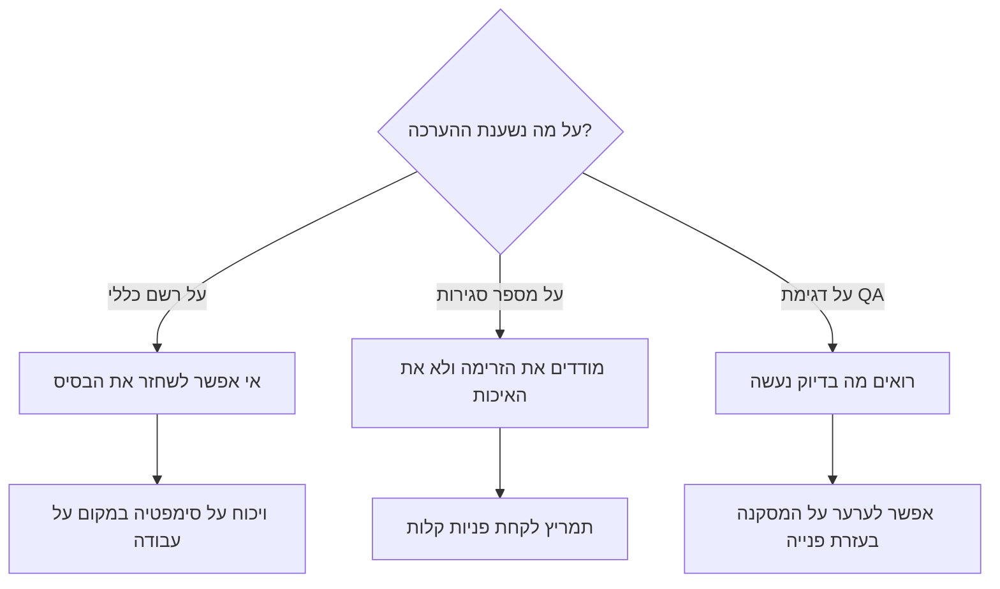
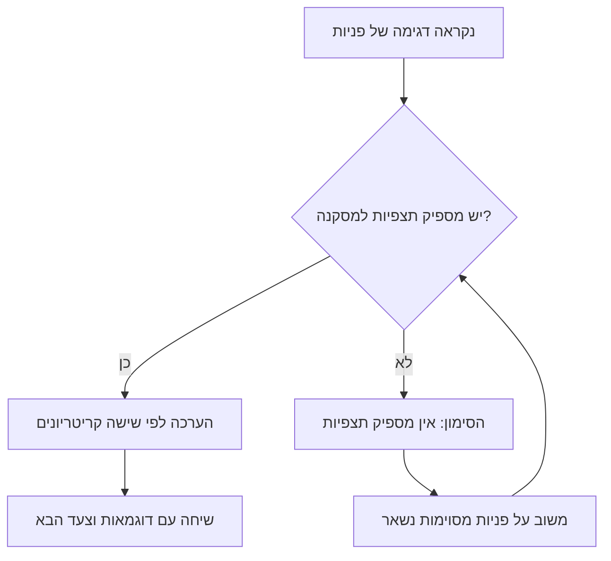

## מבוא

את ההערכות הראשונות שלי כמנהל תמיכה נתתי לפי רשמים והתביישתי בזה. הרשם נבנה מעשר השיחות האחרונות, ממי שהתלונן חזק יותר על מורכבות, ומהפניות שבאופן מקרי נתקלתי בהן. פורמלית זאת הייתה הערכה לפי עובדות — הרי קראתי פניות. בפועל העובדות נבחרו על ידי הזיכרון ולא על ידי דגימה, וזה ידע כל אחד בצוות.

הטענה שאני מחשיב מאז כמחייבת: מוקדן מוערך לפי עובדות נצפות מדגימת QA, ולא לפי מספר הפניות שנסגרו ולא לפי תחושה כללית. הדגימה אינה בירוקרטיה אלא דרך להפוך את השיחה על האיכות לחזרתית: אותם קריטריונים, אותו סדר, ואפשרות לערער על המסקנה בעזרת פנייה מסוימת.

המאמר הזה עוסק בארבעה חלקים של המבנה הזה: למה השיטות הרגילות לא עובדות, איך בנויה הדגימה, מהי רשימת שישה קריטריונים ומתי המסקנה הכנה היא "אין מספיק תצפיות".

## למה "בעין" ולפי מספר סגירות לא עובד

מספר הפניות שנסגרו נראה כמו מדד מפני שהוא קיים במערכת ותמיד טרי. אבל הוא מודד את הזרימה ולא את האדם.

- **הזרימה אינה מתחלקת באופן אחיד.** מישהו בתקופה הזאת לקח פניות מהירות ושגרתיות, מישהו — את הכבדות, עם שחזור והתכתבות. באותה איכות המספרים שלהם יהיו שונים, ולא לטובת השני.
- **סגירה היא אירוע, לא איכות.** אפשר לסגור פנייה בתשובה פורמלית, והמונה יעריך את זה כמו עבודה אמיתית.
- **הערכה לפי המונה יוצרת תמריץ.** אנשים מתחילים לבחור פניות קלות ולסגור מהר — כלומר לעשות בדיוק את מה שאחר כך ידרוש התנצלויות בפני לקוחות.
- **רשם אינו ניתן לשחזור.** כעבור חודש לא אתם ולא המוקדן תשחזרו למה המסקנה הייתה דווקא כך. ושיחה שאי אפשר לשחזר נשמעת כמו "כך נדמה לי".

השרטוט של ההסתעפות נראה כך: להערכה יכול להיות אחד משלושה בסיסים, ורק השלישי שורד בדיקה.

המשך — איך בנוי הענף השלישי.

## דגימת QA

הדגימה היא כמה פניות סגורות מהתקופה, שנקראו מתחילתן ועד סופן: התכתבות הלקוח, ההערות הפנימיות, היסטוריית החלפת הסטטוסים והפתרון הסופי. לא רק הטקסט שנשלח ללקוח אלא ההיסטוריה, כי בה רואים את העצירות, הסבבים המיותרים ואם ציין צעד הבא.

כללים שבלעדיהם הדגימה הופכת למצוד מכשפות:

- **מקריות עם כיסוי.** הפניות נלקחות לא לפי "מה שמעניין אותי" אלא לפי רשת: מוקדנים שונים, קטגוריות שונות, רמות דחיפות שונות. אחרת לדגימה נכנסות רק מריבות עם לקוחות.
- **בקבוצה, לא אחת־אחת.** אף מסקנה לא נשענת על פנייה אחת. הדיון נעשה בקבוצה, ותבנית חוזרת נראית רק בה.
- **אותם קריטריונים בכל פעם.** אם הקריטריונים משתנים לפי המקרה, אין מה להשוות.
- **לא רק מנהל התמיכה קורא.** קורא שני בתפקיד מעריך הוא ההבטחה הזולה ביותר שההערכה לא משקפת את היחסים שלכם עם המוקדן.
- **קודם עובדה, אחר כך שיחה.** המסקנה מנוסחת לפני הפגישה ולא תוך כדי.

<!-- вилка: свой размер выборки и правила отбора — сколько заявок, откуда, кто ещё читает. -->

חשוב שהדגימה אינה בדיקה לאיתור טעויות. תפקידה לראות איך נראית העבודה, ולא לתפוס מישהו. אם המשימה מנוסחת כ"למצוא על מה להוריד את הציון", אנשים ילמדו את זה מהר יותר משתסיימו את הרבעון הראשון.

## רשימת שישה קריטריונים

כל פנייה שנקראה מוערכת לפי שישה קריטריונים בסולם 0/1/2. הסולם גס במכוון: 0 — לא נעשה, או נעשה כך שהיה צריך לעשות מחדש; 1 — נעשה עם הסתייגויות; 2 — נעשה כך שאפשר להראות את הפנייה כדוגמה. חמישה מתוך עשרה יוצרים אשליה של דיוק וויכוח על יחידות במקום על עבודה.

| קריטריון | מה נצפה בפנייה | מה משמעות "2" |
| --- | --- | --- |
| הבנת הבעיה | שחזור, הבהרות, ניסוח התמצית | הלקוח אישר שהבעיה הובנה נכון |
| שלמות הפתרון | הוסרה הסיבה ולא רק הסימפטום | הפנייה לא חזרה ולא אמורה לחזור |
| תקשורת | בהירות, צעד הבא, ציפיות לזמן | ללקוח לא נדרשה שאלת המשך "מה הלאה" |
| עמידה בתהליך | קטגוריה, דחיפות, מועדים, מסלול | התהליך עזר ולא הפריע |
| עבודה עם ידע | הפניה למאמר, תרומה לבסיס הידע | הפתרון נרשם כך שאדם אחר יוכל להשתמש בו |
| העברה והסלמה | חבילת הקשר, בעלים, מה כבר נבדק | לאדם הבא לא נשארו שאלות |

הערה על קריטריון העבודה עם ידע: הכוונה אינה לכמה מאמרים נכתבו. KCS (Knowledge-Centered Service — גישה שבה המאמר נכתב בזמן פתרון הבעיה ולא אחריו) נראה בדגימה אחרת: האם נשארה בפנייה הפניה שתאפשר לאדם הבא לפתור את אותה בעיה מהר יותר.

למה דווקא שישה ולא עשרים: כל קריטריון חייב להיות נראה בפנייה בעיניים, בלי סקרים נוספים. עשרים קריטריונים נותנים טבלה יפה ובלי הערכה בכלל — אדם לא מחזיק עשרים דרישות בראש, ולכן כל הערכה מפורטת מצטמצמת לשניים־שלושה קריטריונים שנראים חשובים בחודש הזה.

<!-- вилка: сверьте формулировки шести критериев со §6.2 годового плана — здесь они даны в рабочем виде. -->

ועוד דבר: הציונים לא מתחברים למספר "איכות" אחד. סכום שישה קריטריונים מסתיר את הפרופיל: מוקדן עם תקשורת מצוינת ופתרון חלש לא הופך ל"בינוני" — אצלו חוזקות ושחיקות במקומות שונים, וצריך לעבוד עם כל אחד מהם אחרת.

## הסימון "אין מספיק תצפיות"

החלק המועיל ביותר במבנה הוא האפשרות לא להסיק מסקנה. לפעמים הדגימה פשוט קטנה: האדם היה בחופשה, הצטרף לאחרונה, או העביר את התקופה בתורנות עם פניות אחידות. לגזור הערכה מחומר כזה פירושו להמציא אותה.

זה אינו פער בתהליך אלא תוצאה רגילה שלו. כך הוא נקרא:

שלושה כללים שמחזיקים את הסימון הזה כן.

- **הוא לא מחליף משוב.** גם כשיש מעט תצפיות, פנייה מסוימת אפשר לפרק: מה היה טוב, מה היינו עושים מחדש.
- **אסור לו להפוך להרגל.** אם לאותו אדם הוא תלוי בדגימה שלישית ברצף, הבעיה אינה בדגימה אלא בחלוקת הזרימה.
- **מסקנה ממספר סגירות לא מוסקת לעולם.** אי אפשר להחליף היעדר תצפיות במספר מהמערכת — זה בדיוק מה שממנו ברחנו.

## השיחה על ההערכה

ההערכה אינה קיימת כדי שתינתן אלא כדי שמשהו ישתנה אחריה. ולכן השיחה בנויה לפי אותם קריטריונים ובפתחה הערכה עצמית.

הסדר שעובד אצלי:

1. **הערכה עצמית לפי אותם שישה קריטריונים.** האדם קורא את הפניות שלו ונותן ציונים.
2. **סגירת פערים.** לא דנים בציונים אלא במקרים שבהם הציונים התרחקו מאוד.
3. **פנייה אחת או שתיים כדוגמה, לא כפסק דין.** הדוגמה צריכה להיות מזוהה אך לא משפילה.
4. **צעד הבא אחד.** לא רשימה של שבעה סעיפים אלא שינוי אחד בעבודה עד הדגימה הבאה.

<!-- вилка: обезличенный пример разговора — что было в выборке, что разошлось и чем закончилось. -->

שווה להסכים בנפרד שהערכה לפי עובדות נצפות אינה הערכת ביצועים שנתית. זה כלי פיתוח ושיחה על איכות: אם מוקדן שומע לראשונה על נקודות החולשה שלו ברגע שמצפים ממנו למספר לקראת בחינת השכר, אשמה אינה הדגימה אלא העובדה שלא השתמשו בה כל השנה.
