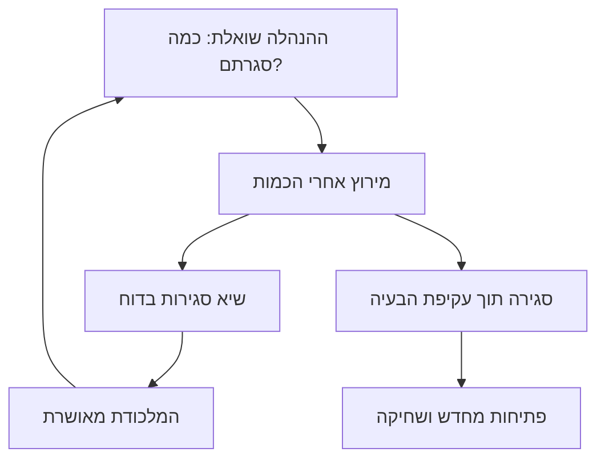
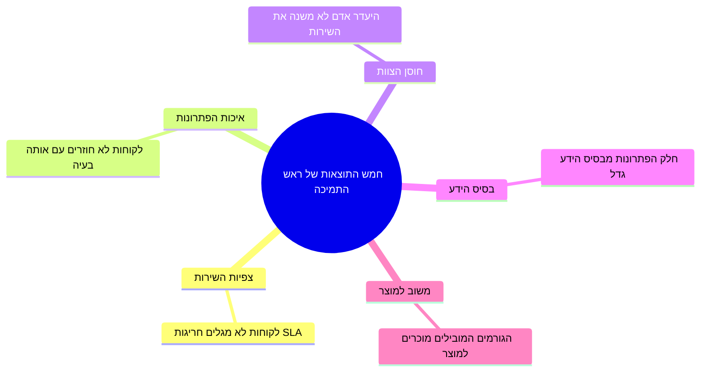
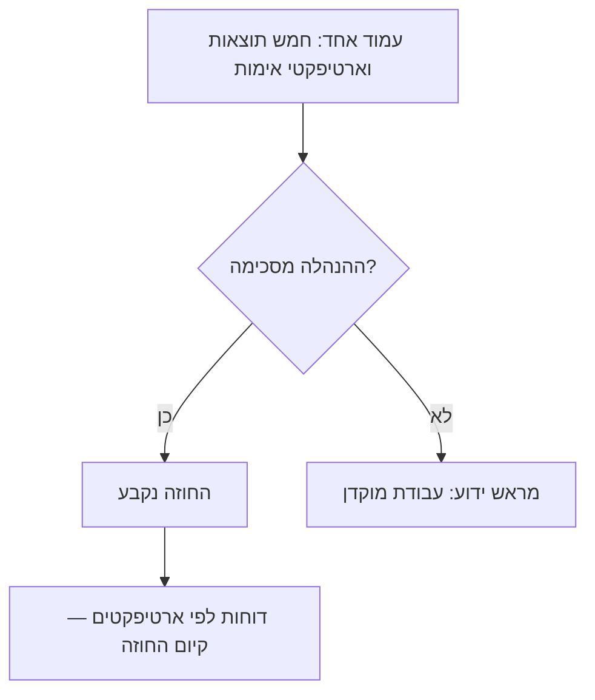

## מבוא

זה המאמר הראשון בסדרה על הפיכת התמיכה לשירות מנוהל. הסדרה עוקבת אחרי הלוגיקה של שנת עבודה של ראש תמיכה: קודם המסגרת האסטרטגית — מה בכלל נחשב לתוצאה — ואז תהליכים תפעוליים, ידע, צוות, מעגל החוץ והמדדים.

כשאני שואל ראשי תמיכה איך נמדדת העבודה שלהם, אני שומע לרוב את אותה רשימה: מספר כרטיסים שנסגרו, זמן תגובה ממוצע, גודל התור. אלה מספרים נוחים — רואים אותם במערכת בכל דקה, והם מתלכדים לתחושה ש"המערכת עובדת". אבל אלה מספרים של פעילות, לא של תוצאה.

את עבודת ראש התמיכה מודדים לא בכמה כרטיסים עברו בשירות, אלא במה שהשתנה בשירות בזכות העבודה שלו. ניסחתי לעצמי חמש תוצאות כאלה: צפיות השירות, איכות הפתרונות, חוסן הצוות, בסיס הידע ומשוב למוצר. כל אחת מהן ניתנת לאימות — לא במדד מושלם מהספרות, אלא בארטיפקט קונקרטי שקיים או לא קיים.

אם אינך יכול לנקוב בחמש תוצאות של העבודה שלך — אתה עובד כמוקדן. גם מוקדן נחוץ, אבל המחיר שלו נקבע לפי מספר הכרטיסים שעיבד. ראש תמיכה צריך לעלות יותר — והמאמר הזה הוא בדיוק על מה.

## המלכודת של «עשינו יותר — סימן טוב»

המלכודת הערמומית ביותר במקצוע שלנו נראית כך: הרבעון נסגר עם שיא של כרטיסים סגורים, הצוות עובד על קצה היכולת, הדוח נראה מצוין. חודש אחרי אתה מגלה שחלק הכרטיסים שנפתחו מחדש גדל, לקוחות מתרגזים יותר ויותר, והמהנדסים נשחקים — כי "לסגור בכל מחיר" אומר לסגור תוך עקיפת הבעיה: בלי לגלות את הסיבה, בלי לרשום לבסיס הידע, בלי שיחה כנה עם הלקוח.

נשמע מוכר? ויש לזה סיבה שיטתית: כשהמדד המובן היחיד הוא "עשינו יותר", הצוות מייעל בדיוק אותו. כל מה שלא נכנס למדד הזה — איכות, ידע, מניעת בעיות — הופך "בלתי נראה" ונזנח כברירת מחדל.

הגרוע מכל — המלכודת מקיימת את עצמה. שיא הסגירות מגיע לדוח, ההנהלה מרוצה, ראש התמיכה מקבל אישור שהוא עושה הכול נכון — וברבעון הבא הצוות שוב מתחרה על הכמות. לתקן את התוצאות — פתיחות מחדש, פניות חוזרות, שחיקה — יצטרך אותו ראש תמיכה, אבל כבר בלי משאבים: הזמן הושקע במירוץ אחרי המספר. יש דרך אחת לשבור את המעגל: להסכים על תוצאות אחרות עוד לפני שהמספרים הפכו למטרה.

כך נסגר המעגל:

שימו לב: אף אחד לא בוחר במלכודת הזאת במכוון. היא נוצרת מעצמה — מתוך דוחות שקל לאסוף, מהשאלה של ההנהלה "כמה סגרתם השבוע?", מההרגל למדוד את מה שקל למדוד. התרופה אחת: להחליט מראש אילו תוצאות באמת דרושות מהשירות, ולהסכים איך יאמתו אותן. אלה חמש התוצאות שלהן המאמר.

## חמש התוצאות של ראש התמיכה

סקירה של חמש התוצאות — לכל אחת כיוון עבודה משלה וסימן נצפה:

### 1. צפיות השירות

צפיות — זה כשללקוח, למהנדס ולהנהלה ידוע מה יקרה עם הכרטיס ומתי. כרטיס עם בעיה קריטית מקבל טיימר תגובה; הסלמה ל-L3 יוצאת עם חבילה ברורה ומועד מוסכם; חריגת SLA לא "קורית" — היא חזויה מראש, והלקוח מוזהר לפני שהמועד פג.

ההבדל בין שירות שיש לו נוהל לבין שירות צפוי נראה כבר בתקלה הראשונה. במקרה הראשון הנוהל קיים, אבל הוא חי במסמך: כרטיס עם מועד שנשרף יושב בתור הכללי, ההסלמה מוחלפת בהודעה "העברנו לצוות הרלוונטי", והלקוח הוא הראשון לגלות על החריגה. במקרה השני הנוהל מובנה בעבודה: הקריטיות נקבעת במגע הראשון, המועדים נראים בתור בכל יום, וסיכון חריגה הוא סיבה לפעול — לא לקוות.

הסימן: חריגות SLA לא מתגלות על ידי לקוחות. אם אתה למד על פגית מועד ממייל זועם ולא מסקירת התור השבועית שלך — אין עדיין צפיות, יש רק נוהל על הנייר.

### 2. איכות הפתרונות

כרטיס נסגר בפתרון, ולא ב"לא משוחזר" ולא ב"נסה להפעיל מחדש". המהנדס מבין את הסיבה, מתעד אותה ואומר ללקוח מה בדיוק נעשה ולמה זה לא יחזור.

חשוב לא לבלבל סגירה עם פתרון. סגירה היא אירוע במערכת; פתרון הוא מצב הלקוח: הבעיה נעלמה, הלקוח מבין מה קרה ויודע מה לעשות אם יופיעו תסמינים דומים. מבלבלים ביניהם לעיתים קרובות, כי במערכת הם נראים אותו דבר, ואת הראשון הרבה יותר קל למדוד. אבל אמון הלקוח נרכש דווקא בשני: מי שתיאר את אותה בעיה פעמיים וקיבל פעמיים "נסה שוב" — לא יכתוב בפעם השלישית לתמיכה, הוא יכתוב להנהלה של הלקוח שלך.

הסימן: לקוחות לא חוזרים עם אותה בעיה. פורמלית — חלק נמוך של פתיחות מחדש; בפועל — דגימת QA שבה המהנדס מאשר לפי כמה כרטיסים: הסיבה נמצאה, הפתרון מלא, התשובה ללקוח ברורה.

### 3. חוסן הצוות

השירות שורד חופשה, מחלה או עזיבה של אדם מפתח בלי ירידה. הידע מפוזר: מיומנות קריטית קיימת אצל לפחות שני אנשים, וכל כרטיס נכנס נתפס תוך 15 דקות — לא כי "גיבור בתור", אלא כי זו נורמה שנבדקת בחישוב.

סיכון נקודתי — הזול ביותר לגילוי והיקר ביותר באירוע. כל עוד נושא הידע הקריטי במקום, הכול עובד ונדמה שהבעיה מדומיינת. ואז הוא הולך — לחופשה, לחברה אחרת, לשחיקה — ואיתו הולך מה שאף אחד לא למד: איך מגדירים את האינטגרציה, למה התור נופל, איפה לחפש שגיאה מוזרה. השירות לא נופל מיד; הוא נרקב לאט במשך חודשים, בזמן שהידע משוחזר בניסוי וטעייה.

הסימן: היעדרות של אדם אחד לא משנה לא את המהירות ולא את איכות השירות. אם מומחה האינטגרציות היחיד שלך יוצא לחופשה ותור האינטגרציות עומד — אין חוסן, יש נקודת כשל עם שם פרטי ומשפחה.

### 4. בסיס הידע

פתרונות מצטברים ונעשה בהם שימוש חוזר. מהנדס שפוגש בעיה מוכרת מחפש בבסיס, ולא בזיכרון של עמיתים; מוצא אי-דיוק — מתקן את המאמר. הבסיס גדל ברגע הפתרון, ולא "מתישהו בזמן הפנוי".

ההסגה האחרונה חשובה יותר משנדמה. "נכתוב מאמר כשנתפנה" — זו הבטחה שלעולם לא מתקיימת: ההתפנות לא תגיע, והקשר של הפתרון — תסמינים, גרסאות, מוקשים — נמחה מהזיכרון תוך ימים. מאמר שנכתב חודש אחרי משוחזר מהזיכרון ומאבד את החלק היקר ביותר — את הפרטים שהופכים אותו לשמיש. לכן הרגע העובד היחיד לבסיס הידע — פתרון הכרטיס עצמו: מצאת בבסיס — השתמשת; לא מצאת — כתבת, כל עוד הבעיה בראש.

הסימן: חלק הכרטיסים שנפתרו מבסיס הידע גדל. ושני, פחות מובן מאליו: מהנדסים חדשים מגיעים למהירות עבודה מהר יותר — לא צריך שנים כדי לספוג ניסיון ממנחה שיושב לידך.

### 5. משוב למוצר

התמיכה — הצוות היחיד שמכיר את הבעיות האמיתיות של הלקוחות בהיקף ובהקשר. אבל רשימה של "הכול רע" נזנחת על ידי המוצר — בצדק: בלי היקף ("כמה לקוחות"), מחיר ("כמה שעות תמיכה"), עוקף והצעה קונקרטית זה לא נתונים אלא מצב רוח. משוב עובד כשבעיות חוזרות הופכות לכרטיסים עם נתונים: כמה לקוחות מושפעים, כמה שעות תמיכה נצרכו, איזה עוקף קיים, מה מציעים. ולכל כרטיס מופיע סטטוס — אושר, נדחה במועד, נדחה.

בלי הלולאה הזאת התמיכה נידונה לשרת את אותן בעיות לנצח — ולהשקיע בהן חלק גדל של הצוות. עם הלולאה כל בעיה שיטתית מקבלת סיכוי לצאת מהזרם סופית: תוקנה במוצר או כוסתה בעוקף ובהוראות.

הסימן: הגורמים המובילים של הרבעון מוכרים למוצר, וחלקם תוקן או כוסה. התמיכה מפסיקה להיות "הסובלת" והופכת למקור נתונים שהפיתוח נשען עליו.

## כיצד לאמת כל תוצאה

היכולת לאימות — התכונה המרכזית של כולן. לא מדד מושלם, אלא ארטיפקט שלפיו פעם בחודש אפשר לענות על השאלה: האם השתפר?

| תוצאה | ארטיפקט אימות |
| --- | --- |
| צפיות | בקרת תור שבועית לפי מסנני סיכון; יומן חריגות SLA עם סיבות — כל חריגה מוסברת, ולא "נשרפה" |
| איכות פתרונות | דגימת QA של כרטיסים לפי צ'ק-ליסט; חלק הפתיחות מחדש כאות גס, לא כדירוג המהנדס |
| חוסן הצוות | מטריצת מיומנויות: מיומנות קריטית ברמה 3+ אצל לפחות שניים; ביקורת חוסן — "מה ישבר כשלא אהיה" |
| בסיס הידע | חלק הפתרונות מבסיס הידע; חלק המאמרים שעודכנו ברבעון |
| משוב | כרטיסי בעיות עם סטטוסים של המוצר; דוח רבעוני של הגורמים המובילים |

שימו לב: אף ארטיפקט לא דורש נתונים מושלמים או מערכות יקרות. יומן החריגות — רשומות במערכת; דגימת QA — שעה בשבוע על כמה כרטיסים; כרטיס בעיה — מסמך בעמוד אחד. יכולת האימות מושגת במשמעת, לא בתשתית.

השאלה המעשית השנייה — מי בודק ובאיזו תדירות. פעם בחודש מספיק: פחות — התוצאות טבועות ברעש; יותר — הבדיקה הופכת טקס לשם הטקס. לבדוק צריך את ראש התמיכה עצמו: זו לא ביקורת מלמעלה אלא כלי הניהול שלו. ואיסור אחד נוקשה: ארטיפקטים לא צריכים להפוך לדוחות. ברגע שהטבלה "תוצאה → ארטיפקט" מתחילה להתמלא "להנהלה" — היא מתה: ממלאים אותה כדי שלא יהיו שאלות, והיא מפסיקה להראות את האמת. הארטיפקטים האלה — כלי עבודה של ראש התמיכה; ההנהלה רואה מסקנות, לא טבלאות גלם.

ולהיפך: אין ארטיפקט — אין תוצאה. לא "נמדד רע" — אין. לא ניתן לנהל את מה שאי אפשר לאמת; יותר כן להודות "אנחנו עוד לא עושים את זה" מאשר לדווח על תוצאה שלא קיימת.

## חמש התוצאות כחוזה מול ההנהלה

הייעוד החשוב ביותר של הרשימה — לא ניתוח עצמי אלא הסכם. חמש התוצאות — החוזה שלי מול ההנהלה: הנה מה שאני מבטיח לייצר, הנה איך כל תוצאה נאמתת, והנה הארטיפקטים שלפיהם תראו את זה בסוף השנה.

שיחה כזאת שווה לקיים בחודשים הראשונים, לפני כיול היעדים למדדים. אחרת המלכודת "עשינו יותר" תחזור — הפעם בצורת KPI שיקבעו לך במקומך. בפועל זה נראה כך: אתה מגיע עם עמוד אחד — חמש תוצאות, לכל אחת סימן וארטיפקט אימות — ושואל: "האם אתם מסכימים שבעוד שנה השירות צריך להשתנות בדיוק באלה?" ההסכמה נרשמת, ויש לך לגיטימציה: דוחות חודשיים על צפיות וידע — זה לא "תחליף למספרים" אלא קיום החוזה.

שני הענפים של השיחה הזאת:

הנהלה שהסכימה עם חמש התוצאות מפסיקה לשאול "כמה סגרתם" — ומתחילה לשאול "מה נעשה צפוי יותר" ו"אילו בעיות יצאו למוצר". אם הסכמה אין — גם זה אות חשוב: מראש ידוע לך איך יעריכו את העבודה שלך, ואתה יכול להחליט במודע אם אתה מוכן לעבוד כמוקדן.

ההשלכה השנייה: אותן חמש תוצאות הופכות לשלד של השנה. ייצוב השירות — זו צפיות. ידע ושירות עצמי — זה בסיס הידע. הערכה ופיתוח הצוות — חוסן ואיכות. ניתוחי תקלות וכרטיסי בעיות — משוב למוצר. במאמר הבא בסדרה — גבולות האחריות: מה ראש תמיכה עושה בעצמו, מה הוא מעביר לאחרים, וממה הוא פורש במכוון.