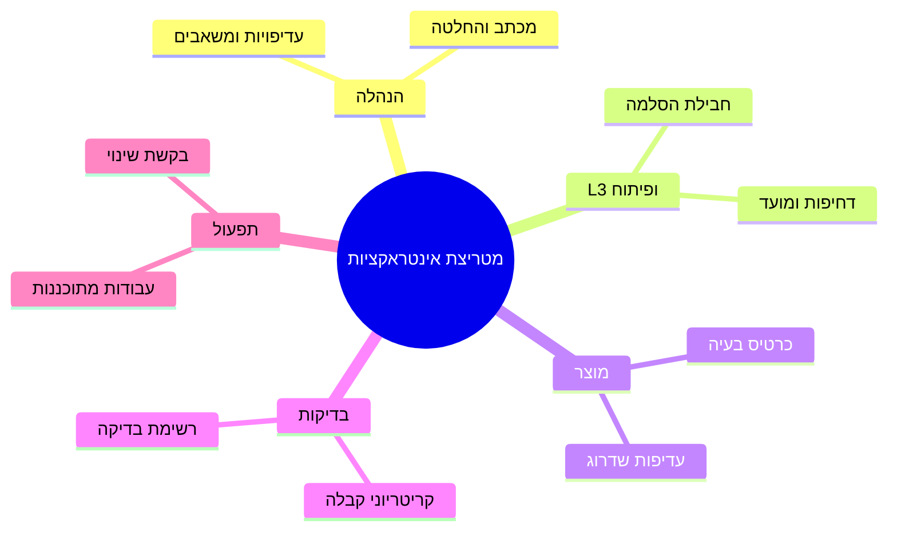
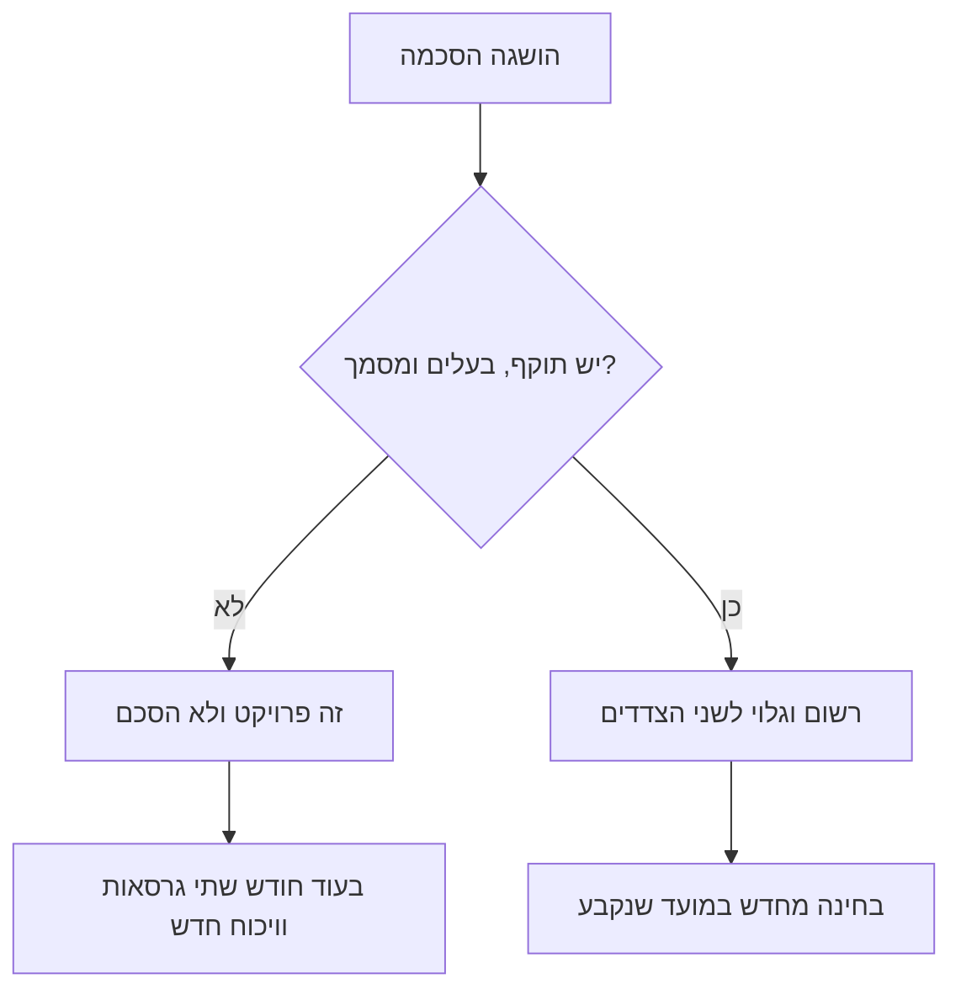

## מבוא

רוב הזמן שלי הלך לא לפניות אלא לבירור יחסים עם צוותים שכנים. הפיתוח חיכה שהתמיכה תשחזר תקלה, התמיכה חיכתה שהפיתוח יתקן, המוצר חיכה מכולם להערכת מועדים, וההנהלה חיכתה שאסביר למה הכל תקוע. כל אחד היה צודק בדרכו ואף אחד לא היה אשם.

הסיבה לא באנשים אלא בהנחה שכולם עושים בשקט: שצוותים שכנים קוראים מחשבות. שברור מי מחליט על דחיית גרסה, לאן הולכת פנייה שלא נמצא בה באג, ושל מי התשובה שהלקוח מחכה לה. שום דבר מזה לא ברור. ברגע שההנחה פוגשת מציאות, מתחיל מאבק מנומס על מי חייב מה למי.

מטריצת אינטראקציות היא הטבלה שמחליפה קריאת מחשבות: מי מחליט באילו שאלות, בערוץ איזה זה קורה ואיזה מסמך נשאר אחרי. וכלל "הסכם כפרויקט" משלים אותה: לכל הסכמה יש תוקף, בעלים ומסמך — אחרת היא פשוט לא קיימת.

שני הכלים הם חלק מהמעגל החיצוני בתוכנית השנתית, שתיארתי במאמר ["שנה של מנהל תמיכה לפי רבעונים"](/he/blog/support-lead-year-roadmap/). כאן — המכניקה: איך בנויה המטריצה ואיך היא מוציאה שיחה מסוימת מהבוץ.

## חיכוכים שגרתיים

חיכוכים עם שכנים כמעט אף פעם לא ייחודיים. במשך שנתיים אספתי ארבעה סיפורים חוזרים — אחד לכל מעגל חשוב.

**עם ההנהלה — ציפיות מול משאבים.** ההנהלה מציבה מטרה שנולדה ממשאלות לב של לקוחות, והתמיכה יודעת מה המטרה הזאת עולה בשעות. החיכוך לא בכך שהמטרה גרועה, אלא בכך שהמחיר נדון אחרי ההבטחה. התוצאה: מנהל התמיכה או מסביר כישלון או סוחב אותו בגבורה.

**עם L3 והפיתוח — מי מחזיק את הכדור.** פנייה עוברת לקו השלישי, חוזרת עם "לא משוחזר", חוזרת עם לוגים, וחוזרת עם בקשה לסרטון. עם שלוש־ארבע העברות זה נראה כמו המולה רגילה. עם עשרות משתנה משהו אחר: הפנייה מזדקנת, הלקוח כועס, ובאופן רשמי אף אחד לא מפר מועדים, כי בזמן ההעברה הטיימר לא רץ.

**עם המוצר — שפת הכאב מול שפת הקנה מידה.** התמיכה מגיעה עם סיפורים על לקוחות מסוימים, המוצר עונה בעדיפויות הרבעון. שני הצדדים צודקים ושניהם יוצאים לא מסופקים: לתמיכה אין טיעון מלבד הרגשי, ולמוצר אין תמונה של כמה סיפורים כאלה יש באמת.

**עם הבדיקות והתפעול — גבול האחריות על האיכות.** מי מאמת את מעקף, מי אחראי לכך שאחרי גרסה גדל זרם הפניות, מי מודיע ללקוחות על עבודות מתוכננות. בשגרה זה לא חשוב, בתקלה זה קריטי, ובתקלה כבר מאוחר לברר.

<!-- вилка: 2–3 своих примера трений — с кем, из-за чего, чем заканчивалось. -->

בכל ארבעת הסיפורים יש יסוד משותף: לשאלה מי מחליט אין תשובה שכתובה לפני הקונפליקט. בהמשך — איך התשובה הזאת נרשמת.

## מטריצת האינטראקציות

המטריצה בנויה על ארבעה עמודות: מעגל, שאלות, בעל ההחלטה, ערוץ ומסמך. שורות — כמה מעגלים שיש איתם חליפין קבוע.

אצלי זה נראה כך:

| מעגל | השאלות שהוא מחליט | בעל ההחלטה | ערוץ ומסמך |
| --- | --- | --- | --- |
| הנהלה | עדיפויות השנה, משאבים, חריגות מהכללים | המנהל | מכתב בעמוד אחד וההחלטה בו |
| L3 ופיתוח | דחיפות, סיבת התקלה, מועד התיקון | המוביל הטכני של המעגל | חבילת הסלמה במערכת |
| מוצר | עדיפות השדרוג, הכנסה לגרסה | בעל המוצר | כרטיס בעיה עם נתונים |
| בדיקות | קריטריוני קבלה, רגרסיות | מוביל הבדיקות | רשימת בדיקה לקבלה |
| תפעול | עבודות מתוכננות, הרשאות, סביבות | התורן בתפעול | בקשת שינוי |

העיקר בטבלה הוא לא רשימת המעגלים אלא שני דברים שבדרך כלל חסרים בכל מקום: **שם הבעלים** ו**המסמך**. בלי שם, "ברמת הצוות" לא מחליט אף אחד, ובתוך שבוע השאלה חוזרת למנהל התמיכה — כאל הצד המעוניין ביותר. בלי מסמך, ההחלטה חיה בצ'אט עד הסיפור הראשון שלה מחדש.

ערוץ ומסמך הם לא אותו דבר, והבלבול ביניהם יקר. הערוץ הוא איפה השיחה קורית: דואר, מערכת, פגישה. המסמך הוא מה שנשאר אחריה: רשומה, מסמך, סעיף בנוהל. שיחה בערוץ הנכון בלי מסמך חסרת תועלת בדיוק כמו מסמך שאיש לא מכיר: בעוד שבועיים במערכת יסתמכו על "הרי דיברנו" בלי עקבות של השיחה.

בצורתה המטריצה דומה ל-RACI (מטריצת אחריות: מי מבצע, מי אחראי, מי מתייעץ ומי מעודכן), אבל התפקיד שלה צר יותר. RACI מחלקת תפקידים בתוך פרויקט אחד, ומטריצת האינטראקציות עונה על שאלה שבפרויקט לא נשאלת: איפה עובר הגבול בין שני שירותים שונים ומי מחזיק בהחלטה בתפר.

כך המטריצה נראית כמבט על:

למלא את המטריצה לבד זה רעיון גרוע. לכל שורה אני יושב עם הבעלים בצד השני ושואל שלוש שאלות: אילו החלטות במעגל הזה אתה מקבל בלעדיי, מה אתה צריך מהתמיכה כדי לקבל אותן מהר, ואיזה מסמך יישאר אחרי. שתי השאלות הראשונות נותנות תוכן, השלישית — עקבות שאחר כך מראות שההסכמה קיימת ולא רק נשמעה.

<!-- вилка: своя матрица — контуры, владельцы, артефакты; что оказалось сюрпризом при заполнении. -->

## כלל "הסכם כפרויקט"

הסכמות מתפוררות לא מפני שמפרים אותן בזדון, אלא מפני שהן נשארות פרויקט: "סיכמנו שפניות עם תסמינים כאלה הולכות ישר לפיתוח". סיכמנו איפה? מתי? מי בדיוק? עד מתי? כשאין תשובות, בעוד חודש לכל אחד יש הגרסה שלו, ושתי הגרסאות בתום לב.

הכלל אומר: להסכמה יש תוקף, בעלים ומסמך — אחרת היא לא קיימת. לא מפני שצריך ביורוקרטיה, אלא מפני שבלי שלושת היסודות אי אפשר לבדוק אותה, לבחון אותה מחדש ולסיים אותה.

- **תוקף.** הסכמה היא לא חוק לדורות אלא השערת עבודה לתקופה. תאריך בחינה מסיר את הפחד להסכים: בעוד רבעון אפשר לשנות דעה בלי האשמות.
- **בעלים.** אדם, ולא צוות. לא "הפיתוח מחליט על דחיפות" אלא "את הדחיפות מאשר מהנדס כזה, ובהיעדרו — הממלא מקום שלו".
- **מסמך.** קישור לרשומה במערכת, עמוד בבסיס ידע, סעיף בנוהל, תבנית מכתב. המסמך הוא המקום שבו ההסכמה חיה בלעדינו.

כך הכלל עובד בפועל:

<!-- вилка: пример провала без артефакта — что договорились, как рассыпалось, что изменили. -->

בנפרד על הבחינה מחדש. התאריך ביומן הוא לא פורמליות: הוא בדיוק מה שהופך הסכמה מהבטחה לאובייקט מנוהל. בבחינה שלוש שאלות: האם זה עובד, מה השתנה מאז, ממשיכים או משנים. בלי הטקס הזה הסכמות חיות שנים אחרי שהפסיקו להיות נכונות, ומפריעות להסכים מחדש.

## לא להבטיח בשם צוותים אחרים

המיומנות היקרה ביותר במעגל הזה — ללמוד לא להבטיח בשם צד שלישי. הלקוח שואל: מתי יתקנו? למנהל התמיכה יש שתי תשובות גרועות ואחת טובה.

הגרועה הראשונה — לנקוב בתאריך שהמצאת. בעוד שבועיים מתברר שהעדיפות השתנתה, והאשמה נופלת על התמיכה, שלמעשה רק היתה מנומסת. הגרועה השנייה — "אני לא יודע, זה לא אצלנו": מבחינה רשמית ישר, מבחינת הלקוח — התחמקות מאחריות על השירות שלכם.

התשובה הטובה מורכבת משלושה חלקים: מה ידוע בוודאות, מי בעל השאלה בצד השני, ומתי העדכון הבא. "התקלה אושרה, התיקון אצל צוות X, הבעלים — פלוני; העדכון הבא ביום רביעי, גם אם אין חדשות". זאת עדיין הבטחה, אבל הבטחה על התקשורת שלכם ולא על המועד של מישהו אחר.

יש למיומנות גם חצי שני — לא להבטיח גם בפנים. כשמוקדן אומר ללקוח "עכשיו נעשה", וההחלטה תלויה בשלושה צוותים, ההבטחה מתפוררת באותו יום. אותה נוסחה עוזרת כאן, רק קצרה: מה ידוע, מי הבעלים, מתי עדכון.

עם המטריצה המיומנות הזאת הופכת טכנית ולא עניין של אופי. אם בשורה במטריצה כתוב שמהנדס מסוים בצד השני מאשר דחיפות, התשובה ללקוח לא דורשת אלתור: אני לוקח את השורה ומדבר ממנה. בלי מטריצה אותה תשובה נבנית מחדש בכל פעם ותלויה בכמה מוצלח היה היום.

## הטמעה בלי עוד מסמך

הסיכון העיקרי של המטריצה — להפוך למסמך החמישי בתיקייה שאיש לא פותח. ראיתי את זה יותר מפעם: טבלה יפה, מוצגת בישיבה כללית, ובעוד חודש אף אחד לא זוכר איפה היא נמצאת.

מה משאיר אותה בחיים:

- **היא יושבת במקום שבו העבודה קורית.** קישור לשורה במטריצה — בתבנית ההסלמה, בכרטיס הבעיה, במכתב להנהלה. אז המטריצה נקראת ברגע שבו היא נחוצה ולא בהדרכה נפרדת.
- **היא קצרה.** חמש־שבע שורות שמשתמשים בהן עדיפות משלושים שמתארות עולם אידיאלי.
- **היא נבחנת מחדש באותן פגישות שבהן מתקבלות החלטות.** פעם ברבעון — עשר דקות בסיכום הכללי: אילו שורות התיישנו, איפה הבעלים התחלף, איזו הסכמה פגה.
- **היא מתחילה בשורה אחת.** הדרך הכי עובדת — לבחור מעגל אחד שבו החיכוך היקר ביותר ולמלא רק אותו. המעגל השני יתווסף מעצמו כשהראשון יתחיל לחסוך זמן.

אין צורך ללמד את המטריצה בנפרד, וזה הסימן העיקרי שהיא חיה. אם מוקדן פותח את תבנית ההסלמה ורואה בה שדות מהמטריצה, הוא קולט אותה בשבועיים בלי הדרכה. ואם בשבילה צריך קורס נפרד, סימן שהטבלה מתארת עולם שאיש לא עובד فيه.

מה המטריצה לא פותרת. היא לא תחליף אמון ולא תפטור אנשים משיחה. היא מסירה את הסוג הגרוע ביותר של שיחה — זאת שמבררת קודם כל מי בכלל היה אמור להחליט. אחריה נשארת שיחה לגופו של עניין, והיא בדרך כלל קצרה.

והדבר האחרון ששווה לזכור: המטריצה היא לא על חלוקת אשמה אלא על חלוקת החלטות. שורה שכתוב בה "בעלים — מוצר" לא אומרת "המוצר עונה על זה ואנחנו נוטלים ידיים": על איכות התשובה ללקוח עדיין עונה התמיכה, ועל העדיפות — המוצר. ברגע שההבדל הזה הולך לאיבוד, המטריצה הופכת לדרך להעביר פניות הלאה, והאמון בה נעלם מהר יותר משהספיקה להתבסס.

<!-- вилка: как матрица живёт у вас — где лежит, как часто пересматривается, что изменилось после внедрения. -->
