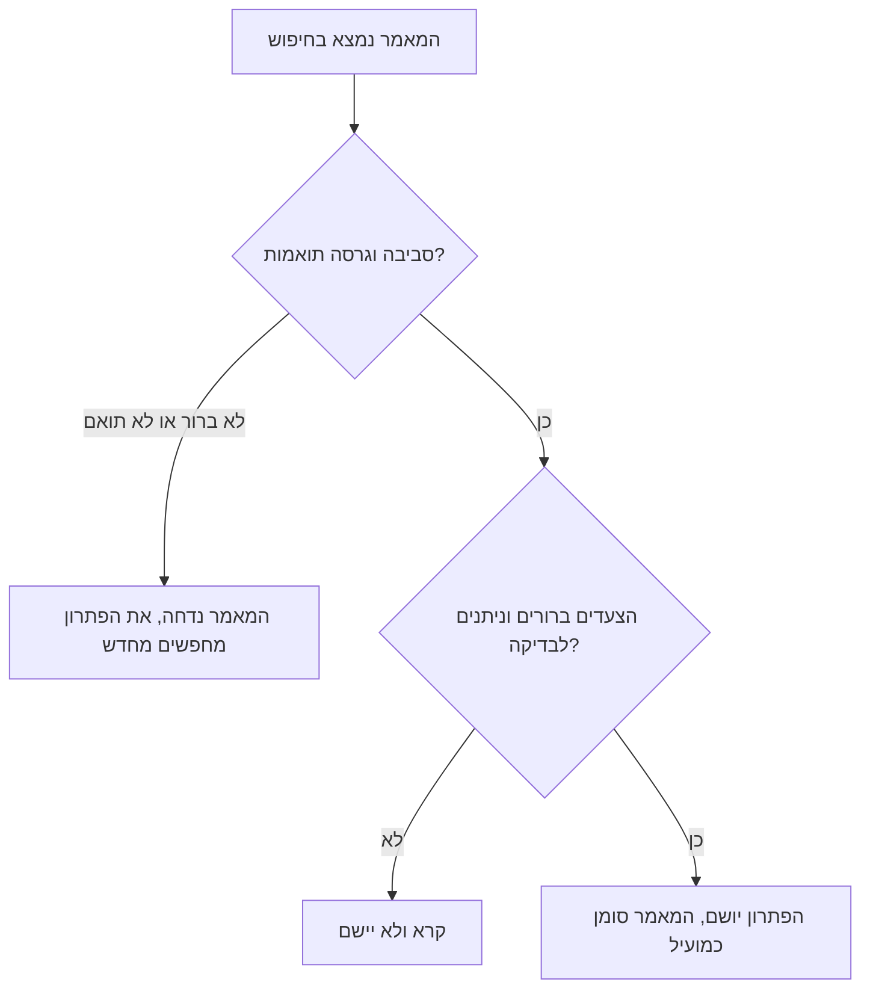
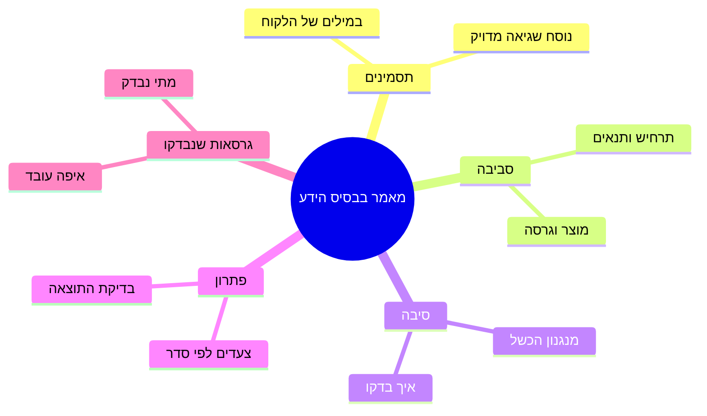

## מבוא

כשהצעתי לצוות לעשות סדר בבסיס הידע, התגובה הראשונה הייתה צפויה: "אני לא יודע לכתוב". אנשים שמסבירים ללקוחות כל יום דברים מורכבים במילים פשוטות היו בטוחים שמאמר הוא ספרות, וספרות היא לא העבודה שלהם.

כעבור חצי שנה אותם אנשים כתבו מאמרים בעשר דקות ולא התייחסו לזה כמשימה נפרדת. מה שהשתנה לא היה היחס שלהם לטקסט — השתנה הפורמט. במקום דף ריק הופיעה תבנית: חמישה בלוקים, לכל אחד שאלה משלו. כשיודעים שהבלוק הראשון הוא התסמינים במילים של הלקוח והאחרון הוא הגרסאות שבהן הפתרון נבדק, אין מה להמציא — נשאר רק להיזכר מה היה.

במאמר "KCS בזרימת העבודה: המאמר נכתב ברגע הפתרון" עסקנו בכך שהמאמר ייווצר בתוך הפנייה. המאמר הזה עוסק במה שצריך להיות בו, כדי שטיוטה מתוך פנייה תוכל לשמש מישהו אחר בעוד חודש.

## למה מאמרים בטקסט חופשי לא משמשים שימוש חוזר

טקסט חופשי נראה דמוקרטי: כתוב איך שאתה חושב, העיקר שיהיה לגוף העניין. בפועל יש לו שלושה פגמים מערכתיים, ואף אחד מהם לא נרפא בקריאה "לכתוב יותר טוב".

**החיפוש לא מוצא.** חיפוש עובד על מילים, והמילים בטקסט חופשי שייכות לכותב. מוקדן מחפש "לא נפתח אזור אישי", המאמר נקרא "בעיית הזדהות אחרי עדכון", ובפנים יש סיפור על טוקנים. אין התאמות, התוצאות ריקות, והאדם הולך לצ'אט.

**אין עם מה להשוות את המבנה.** הקורא לא יכול לענות מהר על השאלות שלו: זה נוגע לגרסה שלי? זה נוגע לתרחיש שלי? איפה בודקים שזה עזר? הוא קורא הכל ברצף או לא קורא בכלל — ובשני המקרים לא בוטח בתוצאה.

**הגרסאות לא נבדקו.** טקסט חופשי לא מחייב לציין על מה הפתרון נבדק. המאמר חי שנים; המוצר משתנה; הקורא מיישם את ההוראה על גרסה אחרת, מקבל תוצאה אחרת ומסיק שהבסיס משקר.

כל שלושת הפגמים הם על דבר אחד: הקורא לא יכול להחליט אם המאמר מתאים למקרה שלו. כך נראה המסלול שלו במאמר חופשי:

כל בלוק בתבנית שלמטה סוגר פנייה אחת בהסתעפות הזאת. לכן התבנית היא לא בירוקרטיה אלא דרך לצמצם את מספר היציאות של "לא יישם".

## תבנית המאמר בבסיס הידע

התבנית שאליה הגעתי מורכבת מחמישה בלוקים. היא קצרה במכוון: ככל שיש יותר שדות, כך קטן הסיכוי שימלאו אותם בתוך הפנייה.

עכשיו לפי בלוקים — מה לכתוב בהם ומה בדרך כלל כותבים במקום.

| בלוק | על איזו שאלה הוא עונה | הטעות השגרתית במילוי |
| --- | --- | --- |
| תסמינים | מה הלקוח רואה ובאילו מילים הוא מכנה את זה | סיפור במונחי המערכת במקום במשפטים של המשתמש |
| סביבה | באילו תנאים זה משוחזר | "אצל כולם" או היעדר גרסת מוצר |
| סיבה | למה זה קורה | שם השגיאה במקום מנגנון |
| פתרון | מה לעשות, צעד אחר צעד | פסקה אחת במקום רצף עם בדיקה |
| גרסאות שנבדקו | איפה הפתרון באמת עובד | "רלוונטי" בלי תאריך ובלי רשימת גרסאות |

כמה כללים שאני מוסיף לתבנית:

- **תסמינים במילים של הלקוח.** לא "שגיאת הזדהות" אלא מה שאדם היה מקליד בחיפוש: "אחרי החלפת סיסמה לא מכניסים אותי לאזור האישי".
- **סביבה — רק מה שמשפיע.** אין טעם לפרט הכל; דרושים אותם שניים־שלושה פרמטרים שמשנים את התוצאה.
- **סיבה — מנגנון ולא תווית.** "תעודה שפג תוקפה בפרוקסי" מסבירה למה דווקא הפתרון הזה עזר ומאפשרת לקורא לזהות את אותה סיבה מאחורי תסמין אחר.
- **פתרון — בצעדים ועם בדיקה.** הצעד האחרון תמיד עונה על השאלה "איך יודעים שזה הצליח".
- **גרסאות — חובה.** בלעדיהן מאמר שלא מתיישן קיים רק בחלומות.

<!-- вилка: ваши обязательные поля шаблона — что вы добавили к пяти блокам под свой продукт. -->

## דוגמה מפורקת

קל להסכים לתבנית במילים וקשה ליישם אותה. לכן בהדרכה אני מראה לא תבנית ריקה אלא מאמר אחד שמפורק עד הסוף: איפה התסמין נשמע כמו משפט של הלקוח, איפה הסביבה מצומצמת לפרמטרים שבאמת השפיעו, איפה הסיבה מוסברת כמנגנון, ובסוף — הגרסאות שבהן הפתרון נבדק.

מה רואים בדוגמה טובה:

- **תסמין וסיבה הם שני דברים שונים.** בדוגמה הם לא מתלכדים, ובדיוק בגלל זה המאמר נמצא לפי המילים של הלקוח ולא לפי שם הטכנולוגיה.
- **הפתרון מסביר ולא רק מורה.** הקורא מבין למה הצעד נדרש; אם הצעד לא עבד, הוא יכול לשער איפה לחפש הלאה.
- **בדיקת התוצאה נפרדת מהצעד.** "להפעיל מחדש את השירות" הוא צעד; "לוודא שאין יותר שגיאת חיבור ביומן" היא בדיקה.
- **גבולות התחולה נקראים בשמם.** בדוגמה רואים באיזה מקרה הפתרון לא יעזור ומה לעשות אז.

<!-- вилка: обезличенный реальный пример статьи КБ целиком по шаблону — одна статья из вашей базы, приведённая целиком. -->

לפירוק כדאי לקחת לא את המאמר המורכב ביותר אלא את זה שהצוות מפנה אליו הכי הרבה. דווקא אותו כולם קוראים בחופזה, דווקא בו טעות פורמט עולה ביוקר — ודווקא בו רואים למה הבלוקים שבדרך כלל מדלגים עליהם חשובים.

הדוגמה מועילה גם משום שהיא מורידה את הפחד העיקרי: מאמר לפי תבנית נכתב מהר יותר מטקסט חופשי. אין צורך להמציא קומפוזיציה ולבחור מילים — צריך לענות על חמש שאלות שתשובותיהן כבר נמצאות אצל הכותב.

## בעל בסיס הידע בלי משרה נפרדת

התבנית פותרת את בעיית המבנה אבל לא את בעיית הזמן. מאמרים מתיישנים, משתכפלים, מאבדים רלוונטיות — ומישהו צריך לשים לב. במאמר "KCS בזרימת העבודה" זה התפקיד של בעל בסיס הידע; כאן — מה הכוונה בפועל, בלי משרה נפרדת בטבלת כוח האדם.

בעל בסיס הידע הוא מוקדן שיש לו שעות מוקצות בשבוע ומנדט לשנות מאמרים של אחרים. העבודה מורכבת מארבע פעולות חוזרות:

1. **בחינה לפי אותות.** לא "לקרוא הכל מחדש" אלא להסתכל מה קרה לבסיס בתקופה: אילו מאמרים נפתחו, אילו סומנו כלא מועילים, איפה הופיעו כפילויות, מה הפסיק להיפתח בכלל.
2. **איחוד וניקוי.** שני מאמרים על אותו דבר גרועים מאחד: הקורא בוחר את הלא נכון. כפילויות מאוחדות, מיושן עובר לארכיון.
3. **תיקונים חזרה לכותבים.** הבעלים לא משכתב הכל בעצמו; הוא מחזיר לכותב הערה קונקרטית: "במאמר על ה-VPN חסרה גרסת הלקוח, בבקשה תוסיף".
4. **מבנה.** קטגוריות, שמות, קישורים צולבים — מה שעושה את החיפוש לעובד ומה שלא נראה באף פנייה בודדת.

המגבלה העיקרית: לבעל הבסיס לא יכולות להיות יותר מאחת־שתיים משימות נוספות מעבר לקו. אם הוא גם ראש הבסיס וגם ראש ההסלמות, הבסיס יטופל לפי מה שנשאר — כלומר אף פעם.

<!-- вилка: частота ревизии и её формат — раз в неделю или раз в две, по какому списку, сколько времени занимает. -->

והדבר האחרון שהבנתי על הבעלים: התפקיד עובד רק יחד עם מנהל התמיכה. הבעלים רואה את הבעיות אבל לא תמיד מוסמך לשנות את התהליך — למשל לדרוש מהצוות לסמן מאמרים כמועילים. החלטות כאלה נשארות אצל מנהל התמיכה, וזו סיבה נוספת להחזיק את בחינת הבסיס בקצב קבוע ולא במצב של שריפה.

התבנית, הדוגמה והבעלים — שלושה דברים שהופכים טיוטות מפניות לבסיס שמשתמשים בו. הצעד הבא — לעסוק במה שחוזר בבסיס הכי הרבה: תקלות חוזרות ורשומות עם בעלים.
