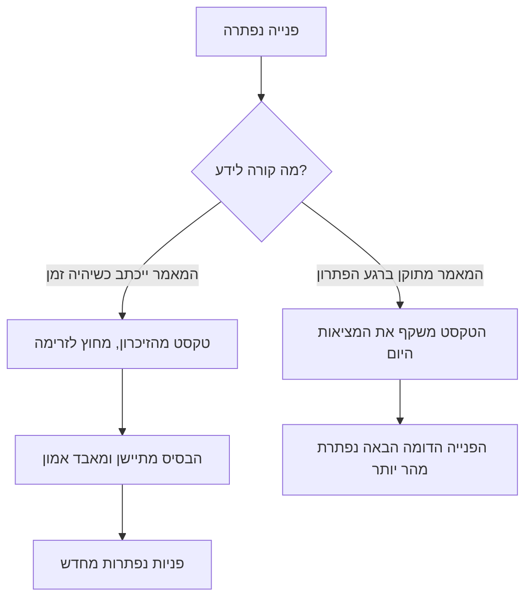
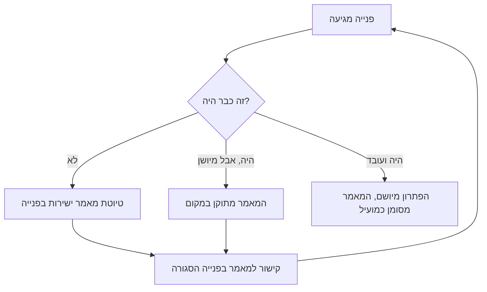

## מבוא

את המשפט "אשלים את המאמר בבסיס הידע כשארוקן את התור" אמרתי כל השנה הראשונה שלי כמנהל תמיכה. התור לא התרוקן, המאמר לא הושלם, ובסיס הידע נשאר במצב שהצוות הקודם השאיר: כמה עשרות מאמרים מהעבר, חלקם על גרסאות מוצר שכבר לא קיימות, חלקם על שאלות שאף אחד לא שואל.

אז נדמה לי שהעניין במשמעת: מוקדנים לא אוהבים לכתוב, צריך להזכיר, לקבוע מועד, לבקש. כעבור שנה הבנתי שבסיס הידע היה מאורגן מחוץ לעבודה. התיעוד עמד לצד פתרון הפניות כמשימה נפרדת ל"אחר כך", ולכן תמיד הפסיד לתור. ברגע שהפסקתי להפוך את הידע למשימה נפרדת, הבסיס התחיל להשתנות בלי תזכורות.

כך עובד KCS (Knowledge-Centered Service — גישה שבה בסיס הידע גדל כתוצר לוואי של פתרון פניות ולא כפרויקט נפרד של כתיבת מאמרים): הידע נוצר, משמש ומשתפר באותה זרימה שבה נסגרות הפניות. זה לא כלי ולא נוהל, אלא דרך לארגן את העבודה.

ב[מפת הדרכים של השנה](/he/blog/support-lead-year-roadmap/) הידע נמצא ברבעון השני, ולא לפניו: כל עוד אין מספרים על הזרימה, לא ברור אילו מאמרים בכלל דרושים. המאמר הזה עוסק במכניקה של אותו רבעון. הצעדים הקודמים בבלוק הם ייצוב השירות: מיון במגע ראשון, בקרת זמנים, הסלמה ל-L3.

## בסיס כארכיון ובסיס ככלי

שני המודלים של צבירת ידע נראים דומים בדוח ונפרדים בעבודה היומיומית.

**בסיס כארכיון.** ידע מתועד כשיש זמן: בשבוע שקט, לפני ביקורת, לבקשת ההנהלה. כותבים אלה שאוהבים לכתוב או שקשה להם לסרב. המאמר נכתב מהזיכרון, אחרי סגירת הפנייה, והוא מתאר לא את מה שקרה אלא את מה שהכותב זוכר שקרה. המטרה של בסיס כזה היא עצם קיומו: "יש לנו בסיס ידע, הנה הקישור".

**בסיס ככלי.** המאמר הוא חפץ עבודה שמשתמשים בו בתוך הפנייה. פותחים אותו לפני הפתרון, בודקים לפי הצעדים, מתקנים אותו כשהוא לא מתאים למציאות. הכותב הוא לא "זה שיודע לכתוב" אלא זה שזה עתה פתר את הבעיה ויודע בדיוק מה עזר.

ההבדל נראה בשאלה אחת שמוקדן שואל כשהוא לוקח פנייה חדשה: "איפה רואים אם זה כבר היה?" אם התשובה היא "לשאול את דני" או "לגלול בצ'אט", הבסיס עובד כארכיון, לא משנה כמה מאמרים יש בו. אם התשובה היא "לחפש בבסיס", הוא עובד ככלי, גם כשהמאמרים בו מעטים.

מה קורה לארכיון בהמשך — צפוי. קודם המאמרים מתיישנים בשקט: המוצר השתנה, המאמר נשאר. אחר כך הצוות מפסיק להאמין בהם: חיפוש אחד נתן משהו לא רלוונטי, שני נתן משהו מיושן, בשלישי המוקדן הלך ישר לצ'אט. אחר כך אף אחד לא כותב מאמרים חדשים, כי לכתוב לתוך מזבלה חסר טעם. כעבור שנה הבסיס קיים רק בשביל הדוח, ופותחים אותו כדי לסמן וי.

ההסתעפות במלואה נראית כך:

המשך — מה בדיוק פירושו "ברגע הפתרון" ברמה של פנייה אחת.

## Solve Loop בתוך הפנייה

ב-KCS מחזור העבודה של פנייה נקרא Solve Loop — מחזור הפתרון. הוא מורכב מארבע פעולות, וכל הארבע קורות בתוך הפנייה ולא אחריה.

1. **לחפש.** הפעולה הראשונה בפנייה היא חיפוש בבסיס, לא ניתוח מאפס. לא בשביל הדוח, אלא כדי לא לפתור פעמיים את מה שכבר נפתר.
2. **להשתמש.** הפתרון שנמצא מיושם. אם המאמר עזר — מסמנים זאת במאמר או בפנייה: בלי סימון אף אחד לא ידע שהוא עובד.
3. **ליצור או לתקן.** אם לא נמצא מתאים — נוצרת טיוטה. אם נמצא אבל מיושן — מתקנים את המאמר הקיים. שתי הפעולות לוקחות דקות ולא שעות: זאת טיוטה, לא פרסום.
4. **לקשר.** בפנייה הסגורה נשאר קישור למאמר שהשתמשו בו או שנוצר. הקישור הוא לא דיווח אלא דרך למצוא את המאמר מתוך היסטוריית הפניות.

הגרסה הראשונה שלי של המחזור הזה הייתה אחרת, והיא לא עבדה: דרשתי מאמר שלם בסוף כל פנייה. בתגובה הגיע או כלום, או טקסט של שני עמודים שאף אחד לא פתח. הדרישה "טוב מההתחלה" הורגת את המנגנון עצמו: אדם שזה עתה התמודד עם בעיה מוכן לרשום את העיקר, אבל לא מוכן לערוך אותו.

לכן בגרסה העובדת יש שלוש הרשאות שאני נותן לצוות במפורש:

- **טיוטה לא חייבת להיות יפה.** קישור, צעדים, מה עזר — מספיק. פורמט ומבנה מלטש בעל בסיס הידע, על כך בהמשך.
- **הכותב לא חייב להכליל.** מאמר שנכתב לפנייה מסוימת כבר מועיל בעצם קיומו; ההכללה היא עבודה נפרדת, והיא לא נעשית על ידי מי שסוגר את הפנייה.
- **מותר וחשוב לתקן מאמר של אחר.** לכל מוקדן יש זכות עריכה, לא רק לכותב. מאמר בלי עורכים הופך מהר למוצג במוזיאון.

כך נסגר המחזור בתוך זרימת הפניות:

החץ האחרון בתרשים הוא החשוב ביותר. הפנייה הבאה מתחילה בחיפוש, ואיכות החיפוש הזה תלויה במה שהשאירה הפנייה הקודמת.

<!-- вилка: как устроен Solve Loop в вашем трекере — где инженер ищет статью, где создаёт черновик, как отмечает, что статья помогла. -->

## Evolve Loop ובעל בסיס הידע

ל-KCS יש מחזור שני — Evolve Loop, מחזור הפיתוח של הבסיס. אם Solve Loop עונה על השאלה "איך ידע נכנס לבסיס", Evolve Loop עונה על "מה קורה לבסיס אחר כך". מאמרים מתיישנים, משתכפלים, מצטברות בהם סתירות; מבנה הקטגוריות מפסיק להתאים למה שהלקוחות שואלים. בלי המחזור השני הראשון עובד אל תוך חלל ריק: ככל שהצוות כותב בחריצות רבה יותר, המזבלה גדלה מהר יותר.

Evolve Loop נשען על אותות שימוש, לא על דעה על איכות. האותות פשוטים: כמה פעמים פתחו את המאמר, כמה פעמים סימנו אותו כמועיל, כמה פניות נסגרו עם קישור אליו, מה כותבים בהערות, והאם לקוחות חוזרים עם אותה בעיה אחרי שהמאמר יושם.

מחזור החיים של מאמר במערכת כזאת נראה כך:

| מצב | איך מזהים | מה עושים עם זה |
| --- | --- | --- |
| טיוטה | נוצרה בפנייה, אף אחד לא בדק | להשתמש, להשלים, לסמן כמועיל |
| עובד | פותחים, עוזר, נותן סגירות | לעקוב אחרי גרסאות המוצר ולעדכן |
| מיושן | סימונים "לא עזר", פניות חוזרות | לשכתב או להוציא מהחיפוש |
| ארכיון | התרחיש או המוצר נעלמו | להוציא מהתוצאות, לשמור כהיסטוריה |

מישהו צריך לעסוק במחזור הזה. אצלי זאת תפקיד ולא משרה נפרדת: בעל בסיס הידע הוא מוקדן שיש לו שעות מוקצות בשבוע ומנדט לשנות מאמרים של אחרים. מה הוא עושה: מפרק סימונים של "לא עזר", מאחד כפילויות, מנקה מיושן, דואג שלמאמרים יהיו שמות מובנים, ומחזיר לכותבים תיקונים שלא הספיקו לעשות.

תפקיד בלי שעות לא עובד. "תעסוק בבסיס כשיש זמן" זה בדיוק הניסוח שממנו צמח הארכיון בפרק הראשון. השעות חייבות להיות ביומן ומוגנות מהתור — בדיוק כמו הזמן של מנהל התמיכה לשינויים במאמר "הקצב של המנהל: כלל 40 %".

<!-- вилка: ритм владельца КБ — сколько часов в неделю, какие сигналы смотрит, что чинит первым. -->

## למה מכסות הורגות את הבסיס

הפתרון הפופולרי ביותר לבעיה "הבסיס לא גדל" הוא מכסה: כל כך הרבה מאמרים בחודש למוקדן. גם אותו ניסיתי.

מכסה מודדת נפח ולא תועלת. ברגע שהנפח הופך לקריטריון, הצוות מתחיל לייצר נפח — לא מתוך כוונה רעה, אלא כי כך עובד כל מדד. מה מופיע בבסיס תחת מכסה:

- **מאמרים על מה שקל לתאר.** פנייה פשוטה הופכת למאמר, מורכבת לא, למרות שדווקא המורכבת חוזרת יותר.
- **כפילויות ווריאציות.** כל אחד כותב גרסה משלו לאותה הוראה, כי לחפש ולהשלים לוקח יותר זמן מאשר ליצור מחדש.
- **עותקים של פניות.** טקסט הפנייה והתשובה מועברים למאמר, בלי הכללה ובלי תיאור הסביבה.
- **חיפוש שלא עובד.** ככל שיש יותר מאמרים כמעט זהים, כך התוצאות גרועות יותר, האמון בבסיס קטן יותר — והצוות חוזר מהר יותר לצ'אט.
- **סימונים פיקטיביים.** השלב האחרון: קישור למאמר נכנס לפנייה כדי לעמוד במדד, והמאמר בכלל לא נפתח.

קל להחליף מכסה במדדי תרומה שאי אפשר למלא פורמלית:

- חלק הפניות שנפתרו בעזרת מאמר;
- מספר התיקונים במאמרים קיימים — תיקון נחשב לעבודה ולא לתופעת לוואי;
- חלק המאמרים שסומנו כמועילים לפחות פעם אחת בתקופה;
- מספר הפניות החוזרות בנושא המאמר אחרי שיושם.

אם מכסה בכל זאת דרושה כאמצעי זמני לתנופה, עדיף לשים אותה על תיקונים ותיוג ולא על טקסטים חדשים. תיקון מחייב לפתוח את המאמר ולקרוא אותו — וזאת כבר עבודה עם הבסיס ככלי.

## חלק הפתרונות מבסיס הידע

המדד המרכזי של בריאות הבסיס הוא חלק הפתרונות מבסיס הידע: היחס בין פניות שנסגרו תוך שימוש במאמר לבין כל הפניות שנסגרו. הוא מראה לא את פעילות הכותבים אלא את התפקיד האמיתי של הידע בזרימה.

כמו כל מדד, גם זה חי או מת לפי ההגדרה. "נסגר עם קישור למאמר" זה לא אותו דבר כמו "נסגר לפי מאמר". במקרה הראשון מספיק לצרף קישור, בשני המאמר צריך באמת לתת את הפתרון. לכן ההגדרה קובעת שני דברים: מה נחשב שימוש ואיך זה מאומת — בסימון "מועיל", בשדה בפנייה או בבדיקת מדגם. בלי זה המדד מודד משמעת במילוי שדה ולא בגרות של ידע.

השני — עם מה להשוות. ערך מוחלט של החלק לא אומר כלום בפני עצמו: שירות עם זרימה גדולה של שאלות שגרתיות ושירות עם תקלות אינדיבידואליות אינם ניתנים להשוואה. המשמעות מופיעה בתנועה בין רבעונים ובשילוב עם שאר מדדי נקודת המוצא — זמן לפתרון, חלק הפניות החוזרות, שיעור ההסלמות. על כך בהרחבה במאמר ["בסיס לפני מטרות"](/he/blog/support-lead-baseline-first/).

<!-- вилка: динамика доли решений по КБ за квартал — значение на старте, текущее значение, что повлияло. -->

השלישי — מי מסתכל על המספר ומה הוא עושה איתו. מדד בלי פעולה נשאר תמונה. בקצב שלי הוא נבחן פעם בחודש יחד עם אותות Evolve Loop, ולבחינה תמיד יש תוצאה אחת: מה בדיוק משתנה בבסיס בחודש הבא — הנושא, הפורמט, המבנה, או כלום, כי המספר במקום הנכון.

KCS לא נגמר בהשקה. זאת זרימה שבה המאמר הוא לא תוצר של פרויקט אלא עקב עבודה של פתרון. הצעד הבא בבלוק — להפוך טיוטות למאמרים שאפשר לעשות בהם שימוש חוזר: תבנית מאמר בבסיס הידע והתפקיד של בעליו.
