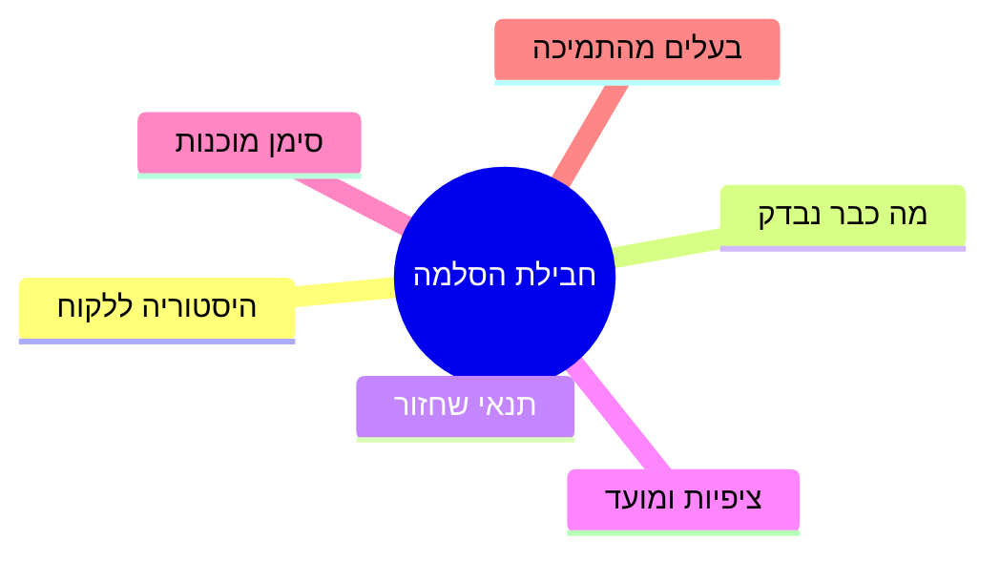
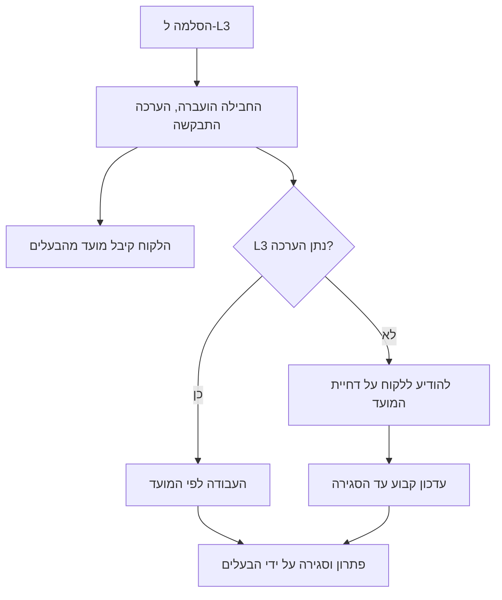

## מבוא

את ההסלמות הראשונות שלי עשיתי בהקלה. הפנייה עברה לקו השלישי, ואיתה עברה גם המתח: עכשיו זו לא הבעיה שלי. כעבור יום התברר שהבעיה עדיין שלי — הלקוח כתב אליי, המפתח ביקש הבהרות, והפנייה חזרה עם השאלה "ומה כבר בדקתם?". העבודה גדלה מזו שהייתה לפני ההסלמה.

הסיבה אינה בפיתוח שעונה לאט ואינה בלקוח שממהר. הסיבה היא שהעברתי את הפנייה בלי חבילה ובלי הסכמה, ואת האחריות ללקוח חשבתי כמועברת יחד איתה. לא זה ולא זה קרה במציאות.

המאמר הקודם בסדרה — "בלי הפרת SLA שקטה: בקרת תור שבועית" — עסק בבקרת מועדים ובהתראה לפני הפרות. הסלמה היא הצעד הבא של אותו מעגל: מה עושים כשהמועד בסכנה דווקא בגלל תלות בצוות אחר.

הטענה: הסלמה היא העברת עבודה עם חבילה ועם הסכמה על זמן, אבל לא העברת האחריות ללקוח. דווקא ההפרדה בין שני הדברים האלה הופכת את קו התמיכה למנוהל.

## חבילת ההסלמה

החבילה היא סט הפרטים שבלעדיהם הקו השלישי לא יכול להתחיל. מטרתה אינה בירוקרטיה אלא חיסכון של סבב התכתבות אחד: בלי חבילה המפתח מחזיר את הפנייה עם שאלות הבהרה, והיום הראשון הולך לא לפתרון אלא לאיסוף ההקשר שהיה לתמיכה מההתחלה.

מה נכנס לחבילה:

- **היסטוריה.** מה קורה מנקודת המבט של הלקוח: מה עשה, למה ציפה, מה קיבל.
- **מה כבר נבדק.** כלשונו: אילו צעדים, באיזו סביבה, עם איזו תוצאה. "הפעלנו מחדש" ו"הפעלנו מחדש את השירות בסביבת הבדיקות והשגיאה חזרה" הם שני פרטים שונים.
- **תנאי השחזור.** גרסה, סביבה, זמן, צעדים. אם לא משחזר — לכתוב כך, גם זה מידע.
- **ציפיות הלקוח.** לא רק "שיעבוד": המועד שהובטח לו ומה יעשה אם לא יהיה פתרון.
- **סימן המוכנות.** מה צריך לקרות כדי שהפנייה תיחשב פתורה מנקודת המבט של התמיכה.
- **בעלים מצד התמיכה.** שם, ולא "הצוות".

כך נראית החבילה כרשימת רכיבים ולא כטקסט של מכתב:

החבילה נכתבת פעם אחת ומכאן רק מתרחבת — זה הכוח שלה. היא גם הופכת לבסיס למענה ללקוח: כמעט כל הטקסט כבר נמצא בפנים.

שווה גם לומר מה החבילה אינה. היא אינה העברת מכתב של הלקוח: מכתב מועבר מכיל רגשות אבל לא בדיקות. היא אינה קישור לשרשור בצ'אט: בצ'אט לא קוראים אחרי שבוע. והיא אינה רשימת השערות — השערות מצורפות בנפרד ומסומנות כהשערות, אחרת הקו השלישי מתחיל לבדוק ניחושים של אחרים במקום את העבודה שלו. החבילה עונה על השאלה "מה ידוע בוודאות", וזה בדיוק מה שעושה אותה שימושית לשני הצדדים: הפיתוח לא מבזבז זמן על איסוף הקשר, והתמיכה לא עונה פעמיים על אותן שאלות.

<!-- вилка: свой шаблон пакета эскалации — какие поля обязательны и где он живёт. -->

## OLA עם הפיתוח

החבילה פותרת חצי מהבעיה: הקו השלישי מקבל את כל הדרוש. החצי השני הוא הזמן. כאן מתחיל מה שנקרא ב-ITIL 4 בשם OLA (Operational Level Agreement — הסכם פנימי על רמת שירות בין צוותים, להבדיל מ-SLA מול הלקוח).

ה-OLA נבדל מה-SLA רק בצד: ההבטחה ניתנת לא לצוות השכן ולא ללקוח. המכניקה זהה: מה בדיוק מבטיחים, באילו יחידות מודדים, ומה קורה כשמפרים.

ל-OLA עם הפיתוח יש בדרך כלל שלושה נושאים:

1. **זמן תגובה ראשונה.** לא פתרון — תגובה: "קיבלתי, מסתכל" כבר מסיר את אי הוודאות ומאפשר לומר ללקוח משהו מוגדר.
2. **זמן עד הערכה.** מתי הקו השלישי יגיד אם הבעיה נכנסת לגרסה הזאת או לא. ההערכה היא הרכיב החשוב ביותר: בלעדיה אי אפשר לתת ללקוח מועד חדש.
3. **מה קורה בסירוב.** אם L3 לא לוקח את המשימה — מי אומר על כך, באיזה מועד, ולאן המשימה ממשיכה.

את ה-OLA הכי קל לקבוע לא במשא ומתן אלא במספר: לבוא לפיתוח עם זמן התגובה הראשונה בפועל מהחודש האחרון ולשאול איזה ערך הם מוכנים להחזיק. הסכמה שהמבצע עצמו נוקב בה מחזיקה מעמד יותר מזו שמורדת מלמעלה.

להגן על ה-OLA צריך בשני אופנים. הראשון — למדוד: אותו זמן תגובה ראשונה בהסלמות, שקוף לשני הצדדים. השני — להסתכל עליו יחד באופן קבוע, ולא להיזכר בהסכמה ברגע הכשל. הפרה שיטתית של OLA אינה עילה לשערורייה בפנייה מסוימת, אלא עובדה לשיחה על משאבים ברמת הממונים. דווקא משום כך ה-OLA מכונה לעתים הסכם שמגן לא על הלקוח אלא על צוות התמיכה.

<!-- вилка: фактическое время первого ответа L3 и что было сделано с нарушениями. -->

## כלל בעל הלקוח

הכלל החשוב ביותר בהסלמה קצר: האחריות ללקוח אינה מועברת. הקו השלישי הופך לבעלים של המשימה הטכנית — אבל לא לבן השיח של הלקוח ולא למי שמבטיח מועדים.

מכאן נובעים כמה דברים מעשיים.

- **הלקוח תמיד יודע מי מדבר איתו.** לא "הפיתוח" אלא אדם מסוים מהתמיכה שמנהל את הדיאלוג.
- **הסטטוס מגיע באותה תכיפות כמו לפני ההסלמה.** בזמן ההמתנה לקו השלישי הלקוח לא אמור לנפול לוואקום: שתיקה אחרי המילה "העברנו" נקראת כ"שכחו אותנו".
- **את המועד מבטיח מי שיכול לתאם אותו מחדש.** אם מנהל התמיכה נוקב במועד לפי הערכת הפיתוח — כשההערכה משתנה, הלקוח שומע על כך ראשון, ולא להפך.
- **חזרת הפנייה לא מחזירה שום דבר אוטומטית.** אם המשימה חזרה בלי פתרון, התמיכה לא מתחילה מדף חלק: העבודה שהקו השלישי כבר עשה נשארת חלק מההיסטוריה.

יש גם הטעות ההפוכה — הגנת יתר: התמיכה משחזרת ללקוח כל תנועה של המפתח, כולל פרטים טכניים שהלקוח לא צריך. כלל בעל הלקוח אינו על נפח אלא על אחריות: הלקוח מקבל תשובה מובנת ולא זרם של פרטים, ומקבל אותה מאדם אחד.

כך זה נראה בעבודה:

## רשימת הבדיקה של ההסלמה

הטעות הנפוצה ביותר אחרי הסלמה — "העברתי ל-L3 ושכחתי". התרופה היא רשימת בדיקה קצרה שנבדקת בכל פנייה שיצאה לצוות אחר.

1. **החבילה שלמה.** היסטוריה, מה נבדק, תנאים, ציפיות, סימן מוכנות, בעלים.
2. **ה-OLA הוחל.** זמן התגובה הראשונה ומועד ההערכה נאמרים, ולא משתמעים.
3. **הלקוח יודע את המועד ואת הבעלים.** אדם אחד מנהל את הדיאלוג ומעדכן סטטוס.
4. **יש נקודת בקרה.** תאריך שבו אמור להגיע מענה מ-L3; אם היא לא ברשימת המשימות — היא לא קיימת בשום מקום.
5. **הפנייה לא נותרה בלי בעלים.** יש לה שני בעלים: טכני ב-L3 ולקוח בתמיכה, ושניהם נקובים בשמם.
6. **דרך החזרה מוגדרת.** איך נגמרת ההסלמה אם L3 מסרב או לא עומד בזמן: למי מודיעים ומה הלאה.

רשימת הבדיקה עובדת רק כשיש לה השפעה חיצונית: למשל, פנייה בלי נקודת בקרה נופלת לסקירת הסיכונים השבועית. בלי זה הכללים נשארים כוונה, וההסלמות — תקווה שהבעיה תסתדר מעצמה.

<!-- вилка: сколько сейчас тикетов в эскалации и сколько из них без контрольной точки. -->

הדבר היקר ביותר שהסדר הזה נותן אינו המהירות של הקו השלישי, אלא היכולת לענות ללקוח ביושר בכל רגע. כל עוד הסלמה היא העברת עבודה עם חבילה ועם הסכמה, התמיכה מפסיקה להיות חוליה מקשרת והופכת למה שהיא צריכה להיות: הבעלים של הלקוח.
