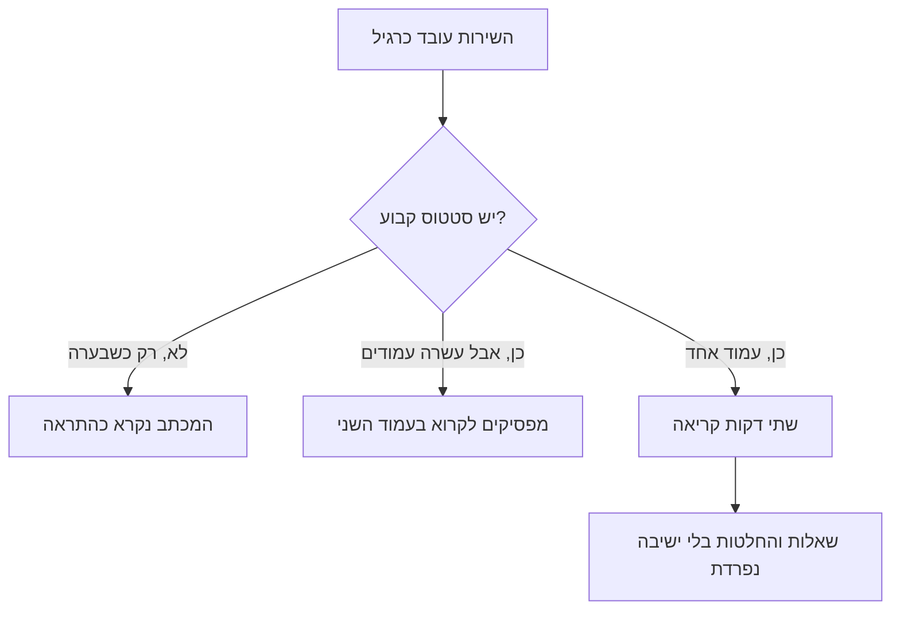

## מבוא

בשנה הראשונה ניהלתי את הסטטוס של התמיכה כמו שנראה לי נכון: פעם בחודש הרכבתי מצגת גדולה של שלושים שקופיות ובה הכל — מדדים, גרפים, ניתוחים, תוכניות. המצגת היתה טובה. איש לא קרא אותה, כולל אני עצמי שבוע אחרי ההצגה.

יום אחד המנהל אמר משפט שזכרתי: "אני לא יכול לקרוא דוחות ארוכים מעמוד. אם צריך יותר — סימן שלא החלטת מה העיקר". חד ומדויק. סטטוס הוא לא הוכחה לעבודה שנעשתה אלא כלי לקבלת החלטות, ולכלי יש פורמט.

מאז מעגל השקיפות שלי מורכב משני דברים: מכתב שבועי בעמוד אחד וסקירה של שעה פעם בחודש. הראשון מחזיק את ההנהלה בעניינים בלי לגזול מזמנה — נקרא בשתי דקות. השני נותן מקום לשיחה שלא נכנסת למכתב. שאר הדוחות והדשבורדים לא נעלמו, אבל הם הפסיקו להיות הדרך שבה אני מדבר עם ההנהלה.

הטקסט הזה על המכניקה: מה יש במכתב, ממה מורכבת שעה של סקירה ואיך סטטוס משנה החלטות ולא רק מיידע.

## שתיקה ודוח בן עשרה עמודים

לתקשורת עם ההנהלה יש שני מצבים מנוונים, ושניהם נראים כמו עבודה.

**שתיקה.** כל עוד הכל בסדר, מנהל התמיכה לא כותב: למה להטריד כשאין סיבה. ההודעה הראשונה מופיעה כשכבר בוער, והיא נשמעת כמו "יש לנו אסון". אחרי שניים־שלושה מכתבים כאלה נכנס מצב ברירת מחדל: ממנו מחכים לחדשות רעות, וכל מכתב שלו נקרא במתח. שתיקה נראית ניטרלית, אבל היא בונה תרחיש אחד בלבד — הוא כותב כשהמצב רע.

**דוח בן עשרה עמודים.** הקצה השני: כותבים הרבה, בפירוט ובקביעות, מוציאים מהמערכת כל מה שיש ומוסיפים ניתוחים. מבחינה רשמית זו שקיפות מלאה. בפועל ההנהלה מפסיקה לקרוא בעמוד השני — קודם באלכסון, אחר כך בכלל לא. ואם שואלים אותה מחוץ לדוח, היא לא תזכור אף מספר: הנפח דחק את התוכן.

לשני המצבים יש תכונה משותפת: אף אחד מהם לא מוביל להחלטה. בראשון מחליטים בלעדיכם ובלי נתונים, בשני הנתונים קיימים אבל איש לא ראה אותם.

יש גם וריאנט שלישי, ערמומי יותר: הסטטוס קיים, הוא קבוע ואפילו קצר, אבל נבנה ממה שקל לספור. אז שבוע אחרי שבוע המכתב נראה תקין והתור גדל — מפני שגדלות הפניות האיטיות ביותר ולא הבולטות ביותר.

כדאי להחזיק מחשבה פשוטה: סטטוס לא נועד לדיווח אלא לכך שההנהלה תוכל לקבל את ההחלטה הנכונה ברגע הנכון — בלי צורך בישיבה נפרדת. כך זה נראה בפועל:

## מכתב בעמוד אחד: שבעה סעיפים

המכתב נכתב לפי אותה תבנית בכל שבוע. הקביעות חשובה יותר מהתוכן של מכתב אחד: כשהמבנה לא משתנה, בתוך חודש ההנהלה זוכרת איפה נמצא המענה לשאלה שלה ומפסיקה לקרוא את הפתיח.

שבעה סעיפים, כל אחד עונה על שאלה משלו:

1. **תמצית.** שורה או שתיים: שבוע רגיל או משהו מעבר לכך. עונה על השאלה האם צריך לקרוא את כל המכתב.
2. **נפח.** כמה הגיע ובאילו קטגוריות. עונה על השאלה מה קורה בזרימה.
3. **זמנים.** כמה פניות מחוץ לתקן ואילו קטגוריות נפגעו. עונה על השאלה איפה כואב עכשיו.
4. **תקלות.** מה קרה, איך נגמר ומה נשנה. בלי שמות אשמים — רק עובדות והחלטה.
5. **תור ופניות תקועות.** פניות שמזדקנות ולא נסגרות בכוחות עצמן. עונה על השאלה מה הצטבר.
6. **יוזמות.** איפה אנחנו מול התוכנית שהוצהרה: מה נעשה, מה נדחה ולמה.
7. **בקשות.** באופן קונקרטי: אילו החלטות או משאבים נדרשים מההנהלה השבוע, ועד איזה תאריך.

הסעיף השביעי הוא החשוב ביותר והנשמט ביותר. מכתב בלי בקשות נקרא כתחזית מזג אוויר: מעניין, אבל אין מה לעשות. מכתב עם בקשות הופך לכלי עבודה.

שני כללים שבלעדיהם התבנית לא עובדת. הראשון — פורמט העמוד: לא יותר מעמוד אחד, בלי קבצים מצורפים ובלי "ראו בדשבורד", אם הדשבורד הוא העיקר. מה שלא נכנס הולך לסקירה החודשית ולא למכתב הבא. השני — אותו תאריך: המכתב יוצא באותו יום בכל שבוע, כדי שלא צריך לחכות לו.

<!-- вилка: свой шаблон письма — точные формулировки семи пунктов, куда и когда отправляется, кто читатели. -->

## סקירה חודשית של שעה

מכתב טוב למצב, גרוע לשיחה. פעם בחודש צריך שעה שבה יושבים האנשים שמקבלים החלטות ויש מקום לדון במה שלא נכנס לשתי דקות קריאה.

סדר היום של השעה אצלי תמיד אותו דבר:

- **חמש דקות — תמונת המדדים.** לא ספירה מחדש של המספרים מהמכתבים אלא התנועה של החודש ומסקנה אחת ממנה.
- **חמש עשרה דקות — הפרות SLA.** לא סיכום אלא שניים־שלושה ניתוחים: מה בדיוק קרה, איזה יסוד מערכתי הוליד את זה ואיזה שינוי יבוא בעקבותיו.
- **חמש עשרה דקות — יוזמות.** סטטוס לכל אחת: נעשה, בתהליך, נעצר. על "נעצר" — סיבה והחלטה, לא תיאור.
- **חמש עשרה דקות — סיכונים.** מה שעדיין לא קרה אבל יקרה אם לא נשנה דבר: כושר נשיאה, אנשים מרכזיים, תלות בצוותים שלישיים.
- **עשר דקות — החלטות ומטלות.** נרשמים בעלים ומועדים, כל השאר נכנס לפרוטוקול.

שני תנאים שבלעדיהם השעה הופכת לעוד דוח. הראשון: בסקירה נוכחים מי שיכול להחליט ולא רק מי שרוצה לשמוע. השני: לכל סעיף יש מסקנה — החלטה או "החלטנו לא לעשות", שרשומה בפרוטוקול. סקירה בלי החלטות גרועה מהיעדרה: היא גוזלת שעה ויוצרת תחושה שהכל בשליטה.

<!-- вилка: своя повестка обзора — кто участвует, где ведётся протокол, что изменилось после первых обзоров. -->

## איך הסטטוס משנה החלטות

הטעות השכיחה ביותר בסטטוסים היא לחשוב שהמטרה היא ליידע. יידוע הוא תוצר לוואי. המטרה היא שההנהלה תביט בשירות בעיניים שלכם ותחליט על אותם נתונים.

רואים את זה בכך אם ההחלטות משתנות. אם ברבעון אף החלטה של ההנהלה לא נשענה על המכתבים והסקירות שלכם, הסטטוס קיים בנפרד מהניהול: קוראים אותו, מהנהנים וממשיכים הלאה.

מה הופך סטטוס לעובד:

- **מספרים עם פעולות.** לכל מדד בסקירה יש תוצאה: אם הערך כזה — עושים כך. מדד בלי תוצאה הופך את הסקירה לקריאת גרפים.
- **חדשות רעות קודם.** במכתב שבו הכל טוב, שורה רעה בסוף נקראת כמקרה. חדשה רעה בפסקה הראשונה נותנת להנהלה זמן לתגובה — ונותנת אמון לשאר הטקסט.
- **נושא אחד דורש החלטה.** בכל מכתב ובכל סקירה יש בדיוק דבר אחד שדורש תשובה מההנהלה. אם יש עשר בקשות, אף אחת לא תבוצע.
- **היסטוריה.** המכתבים מצטברים לכרונולוגיה: רואים מתי הבעיה הופיעה ומה נעשה. אחרי חצי שנה זו הדרך היחידה לא להתחיל את השיחה מהתחלה.

ועוד פרט טכני שחוסך את השעה: הסקירה מוכנה מראש ונשלחת לפני הפגישה. אם המשתתפים רואים את המספרים לראשונה בחדר, עשרים הדקות הראשונות הולכות לקריאה ולא לשיחה. מכתב וסקירה הם לא שני טקסים נפרדים אלא מעגל אחד: המכתבים השבועיים מצטברים לתמונה חודשית, והחלטות מהסקירה חוזרות למכתבים הבאים כסעיפים שבוצעו או נדחו.

<!-- вилка: пример, когда статус изменил решение руководства — что было в письме, какое решение принято, к какому сроку. -->

סטטוס הוא לא ביורוקרטיה ולא הוכחה לעומס. הוא דרך לוודא שההנהלה לומדת על בעיה לפני שהיא הופכת לתקלה, ושהחלטות מתקבלות כשהן עוד זולות. המאמר הבא בסדרה — על איך לבקש את ההחלטות האלה: הסלמה ובקשת משאבים לפי תבנית ולא לפי רגשות.
