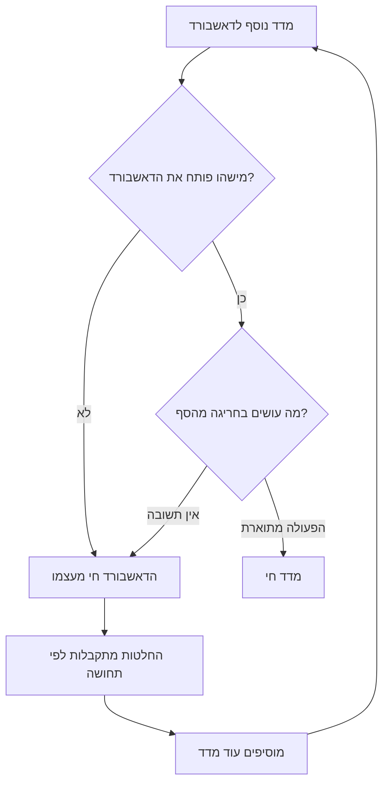
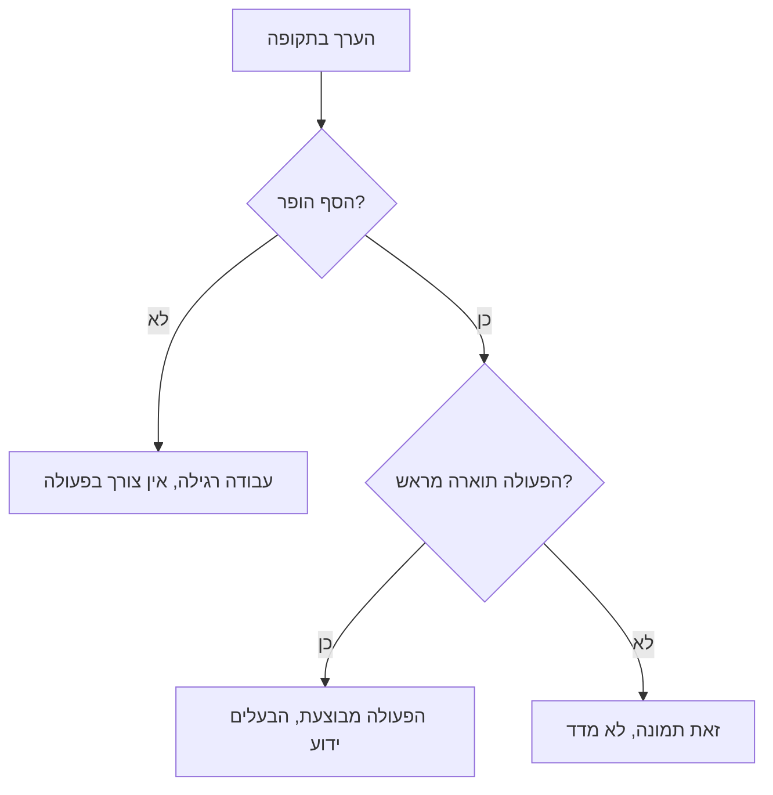
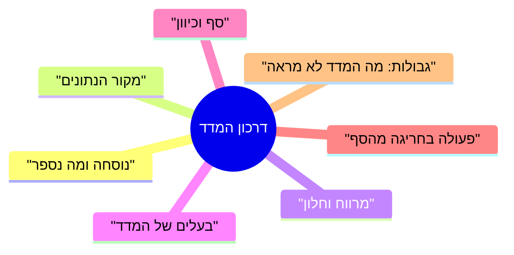

## מבוא

דאשבורד יש לכל תמיכה, וכמעט בכל תמיכה הוא לא משנה אף החלטה. המספרים מתעדכנים, הגרפים חיים חיים משל עצמם, והשיחה בישיבת הבוקר בכל זאת מתנהלת במונחים של "נראה שאנחנו מסתדרים" ו"נראה שנהיה גרוע יותר". המדד נוכח, ההחלטות — לא.

הגעתי לקריטריון פשוט שמסנן את רוב המדידות חסרות התועלת: למדד צריכה להיות פעולה שמתרחשת אחרי חריגה מהסף. אם אין תשובה לשאלה "מה אנחנו עושים אם הערך עבר את הגבול", זה לא מדד אלא איור: הוא מתאר את העבר ולא משפיע על העתיד.

במאמר הזה — למה דאשבורדים מתים, איך נראה הקריטריון של מדד חי, מה נרשם בדרכון ומאילו שלושה מדדים כדאי להתחיל כדי לא לטבוע. הוא ממשיך את הקו שהתחיל ב["בסיס לפני מטרות"](/he/blog/support-lead-baseline-first/): שם דובר על מאיפה מגיעים המספרים ואיך הם הופכים למטרות; כאן — איך המספרים הופכים לפעולות.

## מוזיאון המדדים

הדאשבורד הראשון שקיבלתי בירושה היה יפה וחסר תועלת. המדדים בו נוספו אחד אחד: למישהו בהנהלה היה מעניין כמה פניות מגיעות בלילה, למישהו אחר — איזה חלק מהלקוחות פונה שוב. כל בקשה בוצעה, וכעבור שנה היו על המסך כל כך הרבה גרפים שאי אפשר היה לקרוא אותם.

מוזיאון המדדים מזוהה לפי סימנים שאינם קשורים לאיכות המספרים עצמם:

- **את הדאשבורד אף אחד לא פותח.** חוץ ממקרים שצריך צילום מסך לדוח.
- **הערך לא נדון.** על השאלה "למה ירד" עונים "עונתיות", ובזה השיחה נגמרת.
- **אף החלטה לא השתנתה.** לא עדיפות התור, לא כוח האדם, לא הנוהל — שום דבר לא היה תלוי במספרים האלה.
- **האוסף גדל.** כל רבעון נוסף מדד חדש, והישן נשאר: להסיר מפחיד יותר מאשר להוסיף.

המכניקה של ההידרדרות פשוטה: מדד נוסף כדי לענות על השאלה של מישהו, אבל אף אחד לא מסכים מה עושים עם התשובה. אחרי כמה מחזורים הדאשבורד מפסיק להיות כלי והופך לארכיון.

מלכודת נפרדת היא ההסרה. להסיר מדד קשה יותר מבחינה פסיכולוגית מאשר להוסיף: נדמה שבלעדיו נתעוור. בפועל דווקא עשרה גרפים הם שמעוורים: כל עוד כולם מסתכלים עליהם, אף אחד לא מסתכל.

יש מוצא אחד מהמעגל — לא לנקות את הדאשבורד אלא להסכים על פעולות. בהמשך — איך נראית ההסכמה הזאת.

## הקריטריון של מדד חי

שאלה אחת מפרידה בין כלי לתמונה: מה קורה ביום שני אם המספר לשבוע עבר את הסף? התשובה צריכה להיות קונקרטית: מישהו עושה משהו עד תאריך מסוים. אם אין תשובה, המדד לא עובד — ולא משנה כמה עבודה הושקעה באיסוף שלו.

מהקריטריון הזה נובעות שלוש מסקנות שאני בודק בכל מדד חדש.

**למדד יש בעלים.** לא "הצוות עוקב", אלא אדם שמסתכל על הערך ומפעיל את הפעולה. בלי בעלים מדד חי עד החופשה הראשונה.

**למדד יש סף, לא רק גרף.** הסף הוא הגבול שמעבר לו הצוות הסכים לפעול. הוא יכול להיות גס: חשוב לא המספר המדויק אלא העובדה שחציית הגבול משמעה שיחה קונקרטית, לא דיון חדש בשאלה אם המספר טוב.

**למדד יש גבולות פרשנות.** כל מדד לא מראה משהו, וזה נרשם בנפרד. אחרת כעבור חודש יתחילו להשתמש בו למסקנות שהוא לא תומך בהן — והאמון בו ימות יחד עם המסקנה הראשונה כזאת.

איך זה נראה ביישום:

יש גם בדיקה הפוכה, והיא האהובה עליי ביותר: המדד צריך להפריע למישהו. אם הערך תמיד בטווח התקין ואף פעם לא דורש שיחה, הוא לא בודק דבר מלבד תקינותו שלו.

## דרכון המדד לפי שדות

הדרכון הוא עמוד לכל מדד, שבו רשום כל מה שבלעדיו אי אפשר לפרש אותו באופן אחיד. הטופס משעמם, אבל דווקא הוא מסיר את מקור המחלוקת העיקרי: אנשים שונים סופרים דברים שונים תחת אותו שם.

השדות לגופם:

- **נוסחה.** מה במונה, מה במכנה, מה מוחרג מהחישוב. פרטים משעממים כמו "לספור לפי אירועים ולא לפי סטטוסים נוכחיים" או "לא להביא בחשבון פניות שנסגרו לבקשת הלקוח" מכריעים יותר מהמדד עצמו.
- **מקור הנתונים.** מערכת מסוימת וכלל הייצוא. תקופה אחת — מקור אחד: נתונים מהטראקר, מהצ'אט ומהזיכרון לא מתערבבים.
- **מרווח וחלון.** כמה פעמים מסתכלים ועל איזו תקופה סופרים. בקרה שבועית על חלון רבעוני היא שילוב עובד: היא מסירה את הרעש של שבועות בודדים.
- **בעלים.** האדם שאחראי על הערך ועל הפעולה. יש לו זכות לבוא למנהל התמיכה עם בעיה לגבי המדד הזה.
- **סף וכיוון.** מה נחשב לתקין ואיזו סטייה היא אות. הכיוון חשוב יותר מהערך המוחלט: עלייה איטית בחלק הפניות החוזרות חשובה יותר מהמספר עצמו היום.
- **פעולה.** מה בדיוק נעשה בחריגה מהסף: מי, מה ובאיזה מועד. אם אי אפשר לנסח פעולה, המדד מיותר, וזו סיבה לא להקים אותו.
- **גבולות.** מה המדד לא מראה ולאילו מסקנות הוא לא מתאים.

כלל שימושי למילוי: את הדרכון כותב מי שיפעל לפי המדד, לא מי שאוסף אותו. אנליטיקאי יכול לספור כל דבר, אבל אם לערך אין צרכן, הדרכון הופך למסמך לשם המסמך.

ועוד דבר — על בחינה מחדש. הדרכון לא חקוק באבן: נוסחאות וספים מתחדדים ככל שנצברים נתונים, אבל כל שינוי נרשם עם תאריך וסיבה. בלי זה כעבור שנה אי אפשר להשוות ערכים: המספר אותו מספר, אבל סופרים אותו אחרת, וכל המסקנות על תנועה נעשות שנויות במחלוקת.

<!-- вилка: пример одного своего паспорта целиком — формула, источник, окно, владелец, порог, действие. -->

## סט המדדים של הסדרה

מדד בודד מדבר על עניינו, ורק סט סוגר את השאלות שבגללן קיימת התמיכה: האם אנחנו עונים מהר, האם אנחנו פותרים באיכות, האם הידע גדל, והאם הצוות לא נשחק.

| מדד | מה הוא מראה | מה הוא לא מראה |
| --- | --- | --- |
| זמן לתגובה ראשונה (FRT) | כמה מהר הלקוח מקבל תשובה מהותית | לא מבדיל בין תשובה אנושית לתבניתית, אם ההגדרה לא נקבעה |
| MTTA — הזמן הממוצע עד אישור הפנייה | מהירות התגובה של המשמרת התורנית | מסתיר את ההתפלגות: הממוצע יכול להיות תקין כשיש כשלים במשמרות מסוימות |
| MTTR לפי תוצאות — זמן הפתרון הממוצע | כמה זמן הבעיה חיה אצל הלקוח | מערבב עבודת צוות עם המתנה של הלקוח, אם לא מפרידים בין הזמנים |
| FCR — חלק הפתרונות בפנייה הראשונה | באיזו תדירות מספיק מגע אחד | עולה כשסוגרים באגרסיביות ויורד כשהסיווג כן |
| CSAT עם כיסוי | איך הלקוח מעריך את הפתרון | בלי כיסוי אין לו פרשנות: עונים בעיקר מקרי הקצה |
| חלק הפניות החוזרות | איכות הפתרון, לא מהירות הסגירה | תלוי בשאלה אם פנייה באותו נושא נחשבת חזרה |
| חלק הפתרונות עם הפניה למאמר | בגרות הידע והפוטנציאל לשירות עצמי | לא מראה אם המאמר עזר: המוקדן יכול היה להפנות ובכל זאת להסביר |
| eNPS של הצוות | עד כמה אנשים מוכנים להמליץ לעבוד כאן | על אנשים, לא על לקוחות; נמדד לעיתים נדירות ולא מתאים לבקרה שבועית |

כמה כללים על הסט כולו, שבלעדיהם הטבלה הופכת למוזיאון ההוא.

**המדדים צריכים להיות פחות מהפעולות.** אם על הדאשבורד עשרה מספרים, מהם חיים בדרך כלל שניים־שלושה. את השאר שווה להסיר — לא מפני שהם גרועים, אלא מפני שתשומת הלב של הצוות מוגבלת.

**MTTA ו-MTTR נספרים בנפרד לפי קריטיות ולפי תוצאות.** ממוצע כללי על כל הפניות מערבב דקות ושבועות ולא אומר דבר.

**את CSAT אי אפשר לקרוא בלי כיסוי.** שביעות רצון בלי חלק המשיבים היא הערכה של מי שהיה במצב רוח לענות.

**חלק הפתרונות עם הפניה למאמר בלי הקשר מטעה.** הוא עולה כשיש מאמרים ויורד כשהסיווג נהיה כן יותר.

**eNPS נמדד לעיתים נדירות ולא הופך לבקרה שבועית.** התפקיד שלו הוא לראות דינמיקה ברבעון, לא לתפוס תנודות.

<!-- вилка: какие метрики у вас на дашборде сейчас, какие из них действительно живые и какие данные есть в трекере. -->

## התחלה משלושה מדדים

הפיתוי בבנייה מחדש של הדאשבורד הוא לאסוף הכול בבת אחת. הדרך הזאת מובילה לאותו מוזיאון, רק מהר יותר: עשרה דרכונים בחודש לא ממלא אף אחד, גם לא מחבר הרעיון. התחלה איטית נראית פחות משכנעת במצגת, אבל כעבור רבעון שלושה מדדים חיים עושים לניהול יותר מכל הדאשבורד הקודם.

התחלה עובדת — שלושה מדדים, אחד לכל שאלה:

1. **מהירות.** זמן לתגובה ראשונה או MTTA — מה שהצוות יכול לשנות בפעולות שלו כבר השבוע.
2. **איכות.** חלק הפניות החוזרות או FCR — מה שלא נותן לרדוף אחרי מהירות על חשבון הלקוח.
3. **ידע או אנשים.** חלק הפתרונות עם הפניה למאמר או eNPS — מה שמראה אם המערכת גדלה, ולא רק את תפוקת הזרימה שלה.

סדר ההטמעה שאני מחשיב לעובד:

- לבחור שלושה מדדים ולכתוב שלושה דרכונים: בקצרה, עמוד לכל אחד;
- למדוד את נקודה א לפי אותם כללים שלפיהם נספור בהמשך;
- להסכים על ספים עם הצוות, ולא להוריד אותם מלמעלה: סף שאיש לא מאמין בו לא מפעיל פעולות;
- לבדוק כעבור חודש את הדבר העיקרי: האם הייתה לפחות החלטה אחת שהתקבלה לפי המספרים האלה? אם לא, המדד מת — או שהסף שלו לא נכון, או שהבעלים לא נכון;
- להוסיף מדד רביעי רק אחרי ששלושה יחיו רבעון.

<!-- вилка: свои паспорта трёх–пяти метрик и текущие значения — что стало действием в первый квартал. -->

מדד חי משנה לא את הדוח אלא את ההתנהגות: מישהו פותח את הערך, רואה חריגה מהסף ועושה את מה שרשום בדרכון. כל השאר הוא גרפיקה שעושה מהדוח משהו שנראה כמו ניהול.

המאמר הבא בסדרה — "ביקורת חוסן: מה יישבר כשלא תהיו" — על אילו מהמנגנונים האלה ישרדו את החופשה שלכם, ואילו מחזיקים רק בהרגל.
