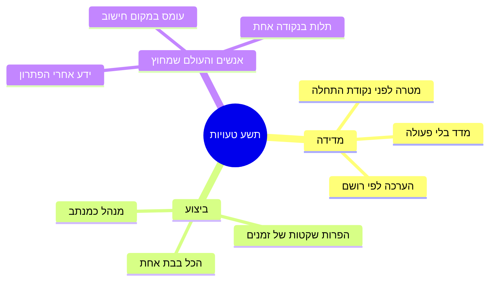
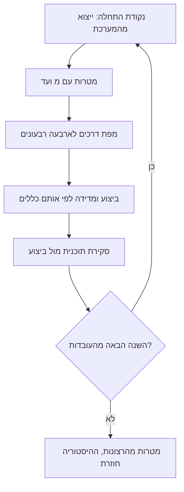
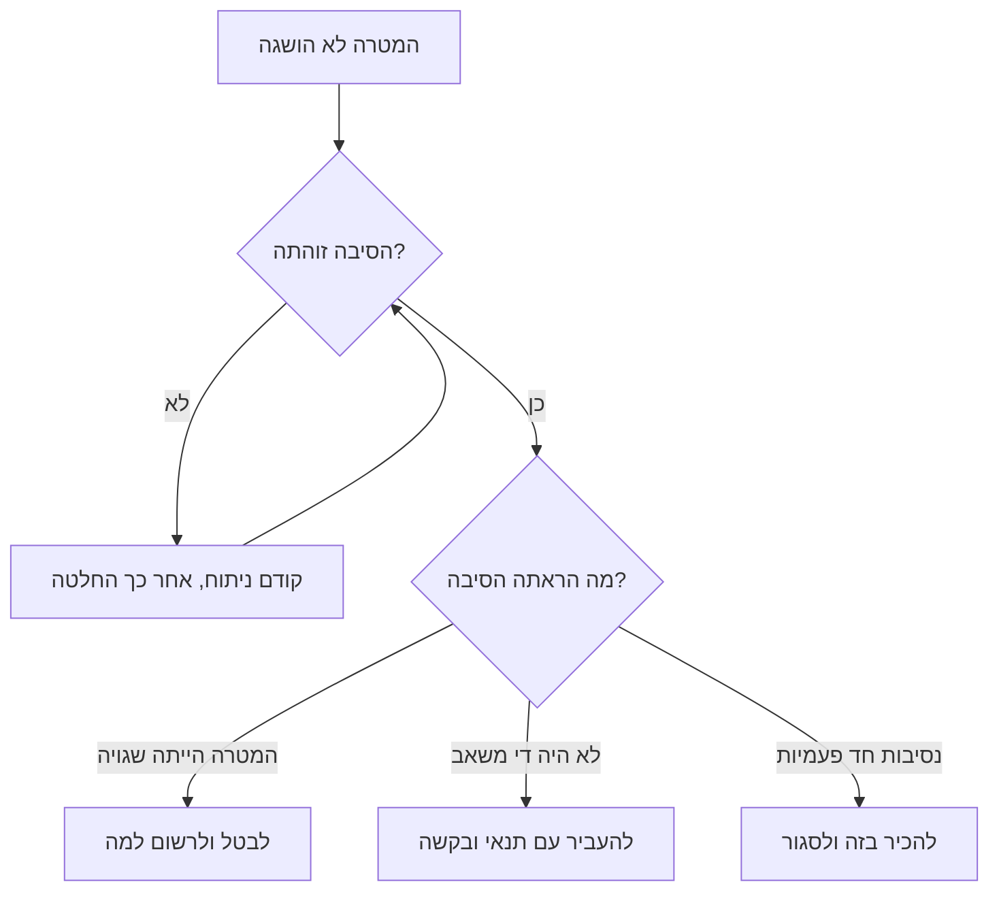

## מבוא

השנה של מנהל תמיכה נגמרת פעמיים: קודם נסגר הרבעון האחרון, אחר כך הדוח. ואם עם הרבעון פחות או יותר ברור, הדוח הוא הרגע היחיד בשנה שבו צריך לענות בכנות על השאלה שנדחתה כל השנה: כמה ממה שהובטח באמת קרה.

במשך כמה שנים ובכמה שירותים בניתי רשימה של טעויות שאני עצמי עשיתי — חלקן שוב ושוב. בתוכנית השנתית שלפיה אני עובד היא מצומצמת לתשע טעויות מנוסחות, ולכל אחת יש תרופה: חפץ או כלל מסוים שסוגר את הטעות. ההיגיון של כל התשע זהה: ברגע נתון הטעות נראית כמו פעולה הגיונית — לקבוע מטרה, לקחת הכל על עצמי, להשיק הרבה בבת אחת — והחשבון מגיע רבעון אחר כך.

המאמר הזה סוגר את הסדרה, ולכן יש לו שתי מטרות. הראשונה — להציג את תשע הטעויות כך שאפשר יהיה לזהות כל אחת מהן בשבוע שלכם. השנייה — להביא את השנה עד הדוח: איך נראית סקירת תוכנית מול ביצוע, איך ממנה נולדת התוכנית של השנה הבאה ומה עושים עם מה שלא קרה.

## תשע טעויות והתרופות שלהן

הסתייגות חשובה: זו לא רשימה של חטאי אחרים. עשיתי כל אחת מהן ואני חוזר לחלקן עד היום — בדרך כלל אחרי שהשירות משנה היקף או הרכב. פורמט של שלוש עמודות פשוט: איך הטעות מנוסחת, איך היא נראית בפועל ומה מרפא אותה.

| הטעות | איך היא נראית בפועל | התרופה |
| --- | --- | --- |
| מטרה לפני מדידה | התוכנית השנתית נפתחת ב"להעלות שביעות רצון", ואין נקודת התחלה | קודם ייצוא מהמערכת לניהול פניות, אחר כך מטרה עם "מ" ו"עד", מועד ובעלים |
| מנהל התמיכה כמנתב היחיד | כל פנייה לא־סטנדרטית מגיעה למנהל, והחופשה שלו עוצרת את הניתוב | שלוש רשימות גבולות, מיון במגע הראשון ומטריצת מסלולים במקום פונקציה אישית |
| הכל בבת אחת | תריסר יוזמות ברבעון אחד, ואף אחת לא נסגרה | כלל הרצף: הרבעון הבא — רק אחרי שיש תוצאה לרבעון הקודם |
| מדד בלי פעולה | לוח בקרה שאף אחד לא פותח ומספרים שמהם לא נובע כלום | דרכון מדד: נוסחה, מקור, סף ופעולה; אין פעולה — אין מדד |
| הפרות שקטות של זמנים | פניות באיחור צפות בדיון חודש אחר כך | בקרת תור שבועית והתראה לפי טיימר, לא לפי זיכרון |
| ידע אחרי הפתרון | המאמר בבסיס הידע נכתב "כשיהיה זמן" ולא נכתב לעולם | KCS: המאמר נוצר ברגע הפתרון, ולבסיס יש בעלים ותבנית |
| הערכה לפי רושם | בשיחות 1:1 נשמע "משתדל" ו"כל הכבוד", ולאף אחד אין קריטריונים | דגימת QA וקריטריוני איכות, עובדות נצפות במקום תחושות |
| עומס במקום חישוב | בכל ישיבת צוות "אנחנו עמוסים", ואף נוסחה אחת | חישוב כוח ופנייה למשאבים לפי נתונים, עם חלופות |
| תלות בנקודה אחת | חופשה של אדם אחד היא תקלה, עזיבה — אסון | תקן איסוף, מחזיק שני לכל כישור וביקורת עמידות |

<!-- вилка: сверьте формулировки с §9 годового плана и добавьте 1–2 ошибки, которые встречались именно у вас. -->

אם מסתכלים מקרוב, תשע הטעויות מתחלקות לשלוש משפחות, וכל אחת נסגרת בסוג עבודה משלה.

מדידה — על זה שאנחנו לא יודעים מאיפה אנחנו סופרים. ביצוע — על זה שאנחנו לוקחים על עצמנו יותר מדי ומחזיקים מסלולים בראש. אנשים והעולם שמחוץ — על זה שהשירות נשען על גבורה ועל היעדר שיחה עם מי שמחוץ לתמיכה. בתוך כל משפחה התרופות שקולות במהותן: הייצוא הופך לדרכון מדד, הדרכון לחישוב כוח, והחישוב לפנייה למשאבים.

ועוד תכונה משותפת: תרופה היא הרגל ולא פעולה. ייצוא אחד מהמערכת אינו נקודת התחלה אלא סקרנות. רשימות גבולות שנכתבו פעם אחת אינן גבולות אלא מסמך שהתיישן תוך חודש. הטעויות חוזרות בכל פעם שהשירות משנה היקף, וההרגל הוא מה שמחזיק אותן מחוץ לדלת.

<!-- вилка: какие из девяти ошибок вы совершали и что помогло конкретно вам. -->

## סקירת תוכנית מול ביצוע

את הדוח השנתי אני מבין לא כמצגת הישגים אלא כהצלבת נתונים. בו, לכל תוצאה של השנה, רואים ארבעה דברים: מה תוכנן, מה הראו העובדות, מה מסביר את הפער ומה נובע מזה לשנה הבאה. בלי הסעיף הרביעי הדוח הופך למסמך היסטורי.

מבנה הדוח חוזר על מבנה השנה: קודם המסגרת הבסיסית (תוצאות, גבולות, בסיס, מפת דרכים), אחר כך ייצוב, ידע, אנשים, העולם שמחוץ ומדדים. לכל נושא — בלוק קצר, לא סיפור על התהליך. הכללים שבלעדיהם ההצלבה מפסיקה להיות הצלבה:

- **אותן הגדרות.** המספר בדוח נספר לפי אותה הגדרה שבנקודת ההתחלה. אם ההגדרה השתנתה במהלך השנה — זה נרשם בשורה נפרדת ולא נשאר בשתיקה.
- **מספרים מהמערכת, לא מהזיכרון.** דוח שנאסף מזכרונות של חודשים קשים תמיד מספר סיפור דרמטי יותר ממה שהיה.
- **פער מוסבר על ידי המערכת, לא על ידי אנשים.** "לא היה כוח אדם", "המטרה נקבעה לפני המדידה", "ליוזמה לא היה קריטריון סיום" — אלה הסברים שאפשר לעבוד איתם. "הצוות לא עמד בזה" — לא.
- **מה שלא קרה נמצא בדוח.** דוח בלי כישלונות נקרא כדוח שבו הסתירו אותם, והוא מבטל את כל השאר.
- **לכל מסקנה יש כתובת.** שינוי נוחת בתוכנית, בנוהל, בפנייה למשאבים או בוויתור על מטרה — אחרת הוא נשאר מצב רוח.

<!-- вилка: ваши результаты года — 3–5 показателей с планом и фактом и объяснением расхождения. -->

דוח שנאסף בערב אחד בסוף דצמבר יוצא כמעט תמיד או מהלל או בהול — תלוי איך היה החודש האחרון. לכן אני אוסף אותו בחלקים במשך השנה: כל סקירה רבעונית מוסיפה את הבלוק שלה, ובדצמבר נשאר רק לאחד אותן ולכתוב את המסקנות. התועלת הצדדית חשובה יותר: סקירה רבעונית מראה את הפער כשעוד אפשר לעשות משהו, ולא אחרי.

## תוכנית השנה הבאה מהעובדות

הכלל המרכזי במעבר מדוח לתוכנית: השנה הבאה מתחילה לא מהרצונות אלא מעובדה חדשה. העובדה של סוף דצמבר היא נקודת ההתחלה של ינואר, וכל מה שהיה מטרה בשנה שעברה הופך השנה לנקודת מוצא. בדיוק בגלל זה הסדרה נפתחת ב-baseline: בלי נקודת מוצא מדודה כל שנה הבאה מתחילה מאפס ומאותן הבטחות.

כך נראה המחזור:

בפועל זה נראה צנוע יותר ממה שזה נשמע. לתוכנית של השנה הבאה נכנסים לא יותר מארבע־חמש תוצאות, ולכל אחת יש בעלים, מועד ודרך בדיקה. כל מה שלא נכנס חי ברשימת "לא עכשיו" — וזה בסדר: תוכנית של ארבעה סעיפים שהושלמו משנה את השירות יותר מאשר תוכנית של תשעה־עשר שאף אחד מהם לא נסגר.

<!-- вилка: что вошло в ваш план следующего года и от какого факта вы отсчитывались. -->

## מה עושים עם מה שלא קרה

הסעיף הקשה ביותר בדוח — זה שמונה את מה שלא נעשה. הפיתוי ברור: לנסח מחדש כך שזה ייראה כבוצע, להעביר לשנה הבאה בלי הסבר, או פשוט למחוק. כל שלוש הדרכים מבטיחות שבעוד שנה הרשימה תהיה ארוכה יותר.

למה שלא קרה יש שלוש תוצאות כנות, ולכל אחת צריך בעלים להחלטה.

הכללים כאן:

1. **להבחין בין "לא עשינו" ל"לא עבד".** לא עשינו — לא היה זמן, משאב או עדיפות. לא עבד — עשינו והמדד לא זז. הטיפול במקרים שונים, ואסור לבלבל ביניהם.
2. **לא לשכתב את ההיסטוריה.** המטרה מנוסחת בדוח כמו בתוכנית, גם אם היום היא נראית נאיבית. אחרת בעוד שנה אין עם מה להשוות.
3. **לכל סעיף שלא התקיים יש החלטה ולא סטטוס.** "בתהליך" אינו החלטה. לבטל, להעביר עם תנאי, להכיר בכך שהמטרה שגויה — אלה החלטות.
4. **העברה בלי תנאי היא ביטול.** אם סעיף עבר לשנה הבאה, יש לו מועד חדש ותנאי חדש; בלי אלה הוא עבר לא לתוכנית אלא להרגל.

והכלל האחרון של הסעיף: הניתוח של מה שלא קרה מתנהל בלי שמות. ברגע שנכנס הסבר עם אדם מסוים, הדיון מפסיק להיות על המערכת: האחרים מתחילים להתגונן, והסיבות שבאמת היה חשוב למצוא נעלמות מהשיחה. "לא היה די כוח אדם", "לא היה קריטריון סיום", "המסלול נשען על אדם אחד" — אלה נוסחות שאפשר להמשיך לעבוד איתן. שמות לא נכנסים לניתוח כזה בשום צורה — כולל השם שלכם.

<!-- вилка: 2–3 пункта своего года, которые не сбылись, — что именно решили с каждым. -->

## סיום הסדרה

הסדרה "אסטרטגיית ניהול תמיכה" נכתבה כמערכת ולא כאוסף עצות: כל מאמר נשען על הקודם, והוא נבדק לא בפני עצמו אלא יחד עם שכניו. הנה כולה, לפי סדר הופעתה.

**המסגרת האסטרטגית של השנה**

- [חמשת התוצרים של מנהל תמיכה](/he/blog/support-lead-five-results/) — 2026-03-31
- [גבולות אחריות](/he/blog/support-lead-boundaries/) — 2026-06-07
- [Baseline לפני מטרות](/he/blog/support-lead-baseline-first/) — 2026-11-10
- [השנה של המנהל לפי רבעונים](/he/blog/support-lead-year-roadmap/) — 2026-11-13

**ייצוב השירות**

- מפת השירות ונקודת ההתחלה — 2026-11-15
- מיון במגע הראשון — 2026-11-18
- אף הפרה שקטה של SLA — 2026-11-21
- הסלמה ל-L3 — 2026-11-24

**ידע כמערכת**

- KCS בזרימת העבודה — 2026-11-26
- תבנית מאמר בבסיס הידע והבעלים שלו — 2026-11-29
- בעיות חוזרות — 2026-12-02
- שירות עצמי כ-Shift Left — 2026-12-05

**הצוות: אנשים והתפתחות**

- הקצב של המנהל: כלל 40 אחוז — 2026-12-07
- שיחות 1:1 שלא הופכות לדוח — 2026-12-10
- הערכה לפי עובדות נצפות — 2026-12-13
- מטריצת כשרים — 2026-12-15
- כוח במקום גבורה — 2026-12-18

**העולם שמחוץ**

- מטריצת אינטראקציות — 2026-12-21
- סטטוס להנהלה — 2026-12-24
- לבקש החלטות ולא הזדהות — 2026-12-26
- ניתוח תקלה בלי אשמים — 2026-12-29
- כרטיס בעיה למוצר — 2026-12-31

**מדדים וסגירת השנה**

- מדד בלי פעולה — 2027-01-04
- ביקורת עמידות — 2027-01-06
- תשע טעויות של מנהל תמיכה — המאמר הזה

תודה שקראתם עד הסוף: השנה של מנהל תמיכה נבנית לא משיטות אלא מהרגלים, ותשע הטעויות אינן גזר דין אלא רשימה של מה שכדאי להעביר לתוכנית. אם יש לכם טעות שאינה בטבלה — כתבו לי, אשמח להרחיב את הרשימה ולדון בה בסדרה הבאה.
