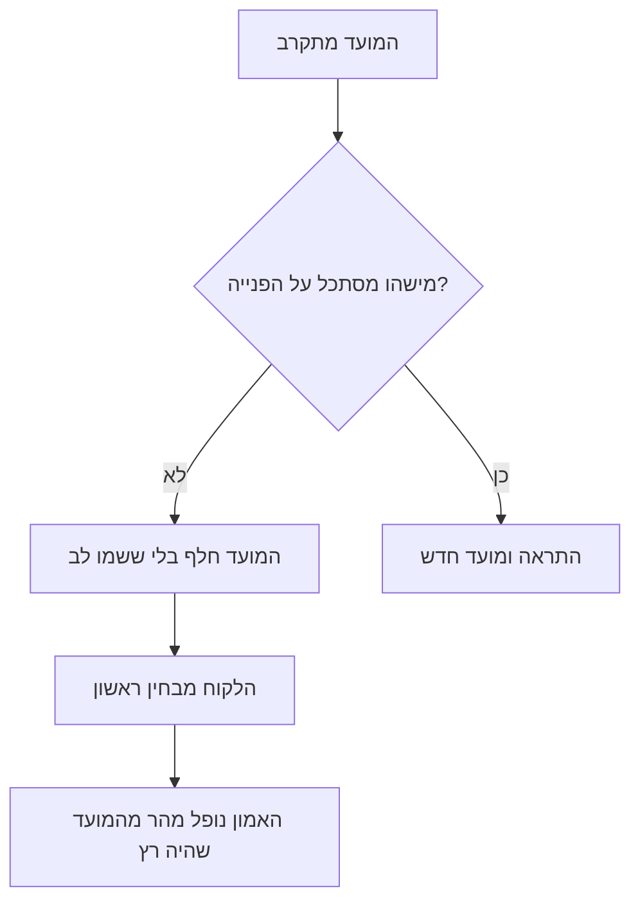

## מבוא

על הפרת ה-SLA (Service Level Agreement — הסכם רמת השירות עם הלקוח) הראשונה שלי נודעתי ממכתב של הלקוח. לא מדוח, לא מהמערכת ולא ממוקדן — ממכתב שבו היה כתוב "הבטחתם לענות אתמול". הפנייה הייתה בעבודה, המוקדן היה עסוק בדבר אחר, והמועד חלף בשקט ובלי ששמנו לב.

דווקא המילה הזאת — בשקט — היא הבעיה. הפרת מועד כשלעצמה לא נעימה אבל מובנת: קרתה, פירקנו, תיקנו. הפרה שהלקוח מגלה ראשון שוברת משהו אחר: את האמון שהשירות רואה את העבודה של עצמו. אחרי מכתב כזה הלקוח מתחיל לבדוק בעצמו, וכל שאלה שלו נשמעת כמו חוסר אמון.

המאמר הקודם בסדרה — "מיון במגע ראשון: קטגוריה, דחיפות, מסלול" — עסק בכך שכל פנייה בכניסה תקבל דחיפות, קטגוריה ובעלים. המאמר הזה עוסק במעגל הבא: בקרה קבועה שמבחינה בסיכון לפני שהוא הופך לעובדה.

הטענה: הפרת מועד היא אירוע מנוהל אם היא נראית מראש. הפרה שקטה אינה כשל של הצוות אלא כשל של הבקרה: אף אחד לא מסתכל בתור ברגעים שבהם עוד אפשר לעשות משהו.

## למה הלקוחות מוצאים את ההפרות

להפרה שקטה תמיד אותו תרחיש.

למה זה קורה כמעט תמיד:

- **המערכת מציגה סטטוסים ולא סיכונים.** פנייה "בעבודה" נראית אותו דבר שעה לפני המועד ושבוע אחריו.
- **מסתכלים על הדוח ולא על התור.** הדוח של החודש שעבר עונה על מה שכבר קרה. למניעה צריך רשימה של מה יקרה השבוע.
- **כל אחד חושב שמישהו אחר מסתכל.** המוקדן חושב שהמועדים באחריות מנהל התמיכה, המנהל חושב שהם באחריות המוקדן האחראי, והדוח נוצר אוטומטית ואיש לא קורא אותו.
- **הדחוף דוחק את החשוב.** כל עוד בעיה אחת בוערת בתור, כל שאר המועדים ממשיכים לרוץ — אבל אין להם תשומת לב.

<!-- вилка: собственный случай тихого нарушения — как обнаружилось и чем закончилось. -->

לתרחיש הזה יש תכונה לא נעימה: הוא חוזר על עצמו לעתים קרובות יותר, ככל שהצוות מתמודד טוב יותר עם הזרימה השוטפת. ככל שפחות שריפות, כך פחות סיבות להסתכל בתור כולו.

## שלושה מסנני סיכון

בקרה שעובדת פשוטה עד שיעמום: פעם בשבוע הדיווח מהמערכת עובר שלושה מסננים, וכל פנייה שנופלת לאחד מהם מקבלת פעולה.

**המסנן הראשון — המועד עומד לפוג.** לא "הופר" אלא "יופר אם לא ישתנה משהו". לכאן נכנסות פניות שנשאר להן כרבע מהזמן או פחות. זה המסנן החשוב ביותר: רק כאן עוד אפשר להספיק בלי השלכות.

**המסנן השני — אין מענה כמה ימים.** הפנייה פתוחה אבל איתה לא קורה כלום: לא תשובה ללקוח ולא תנועה פנימית. הסף תלוי בנוהל, אבל עצם השתיקה חשוב מהמספר המדויק: שתיקה בפנייה תמיד אומרת שהבעלים איבד אותה מהעין.

**המסנן השלישי — פתיחה חוזרת.** הפנייה נסגרה ונפתחה שוב. זו לא פנייה חדשה אלא הודעה שהפתרון הקודם לא עבד — ובפנייה הזאת ספירת הזמן מתחילה בדרך כלל מאפס, בעוד ההבטחה ללקוח לא.

| מסנן | מה מחפשים | פעולה |
| --- | --- | --- |
| מועד עומד לפוג | נשאר פחות מרבע מהזמן | ליצור קשר עם הבעלים ולבחור: להספיק או לתאם מחדש |
| אין מענה | שתיקה בפנייה כמה ימים | להחזיר לבעלים ולקבוע מועד לצעד הבא |
| פתיחה חוזרת | הפנייה נפתחה שוב | לפרק את סיבת החזרה, ולא רק את הסימפטום |

הכלל המרכזי: **לכל פנייה מהמסנן — פעולה, ולא סימון "הסתכלנו"**. יש רק שלוש פעולות: להספיק, לתאם מחדש, להסלים. הרביעית — "לחכות עוד קצת" — לא קיימת, מפני שהיא בדיוק המנגנון שמייצר הפרות שקטות.

<!-- вилка: свои пороги фильтров и ритм прогона — когда и кем смотрится очередь. -->

ההרצה לא גוזלת יום שלם אלא חצי שעה, והערך שלה אינו ברשימה אלא בהרגל: התור נסקר כולו ולא בחתיכות. אם זה לא קורה פעם בשבוע, הסיכון הופך לעובדה בלי שום כוונת זדון.

## התראה לפני ההפרה

אם המסנן אותת וברור שהמועד לא יחזיק, הצעד הבא הוא להודיע על כך ראשון. זה לא נעים ונראה כהודאה בכישלון, אבל בפועל ההפך הוא הנכון: התראה היא קיום ההבטחה לדווח על בעיות לפני שהלקוח מבחין בהן.

ההודעה ללקוח בנויה מארבעה חלקים, וכל אחד מהם חובה:

1. **מה קורה.** בלי ניסוחים חלקלקים: הפנייה בעבודה, המועד זז.
2. **למה.** משפט או שניים לגוף העניין. לא "מצב מורכב" אלא "צריך לשחזר את הבעיה בסביבת בדיקות".
3. **המועד החדש.** קונקרטי ומציאותי, ולא "בקרוב". מועד שלא עומדים בו הוא הפרה שנייה, גרועה מהראשונה.
4. **מה עושה הלקוח.** בדרך כלל כלום: הוא מקבל עדכון עד השעה שנקבעה. אם נדרש ממנו משהו, אומרים זאת ישירות.

ההודעה הפנימית נבדלת בדבר אחד: יש בה פעולה. לא "מעדכן על סיכון" אלא "מציע אפשרות כזאת: להאיץ בפנים או להזיז את המועד בהסכמת הלקוח; אם השנייה, נדרשת תשובתכם עד שעה כזאת". הודעה כזאת לא מבקשת מהממונה אמפתיה, היא מבקשת החלטה.

<!-- вилка: пример письма клиенту и короткого внутреннего сообщения о риске. -->

## הסימן לבעיה שיטתית

פנייה בודדת במסנן — מצב עבודה רגיל. שני סיכונים דומים באותה קטגוריה בתוך שבוע — כבר השערה על המערכת, ושווה לבדוק אותה לפני שהיא הופכת לחוקיות.

שלוש שאלות עוזרות להבדיל בין מקריות למערכת.

- **איפה בדיוק זה חוזר?** אותה קטגוריה, אותו מוצר, אותו קו, אותו לקוח. אם הסיכון מגיע בפעם השנייה מאותו מקום, העניין בכללים של אותו מקום, ולא באנשים.
- **במה דומים המועדים?** למשל, הסיכונים מופיעים בשלב ההמתנה לקו השלישי. כלומר ההסכמה איתו לא מחזיקה — ושום משמעת בתוך התמיכה לא תתקן את זה.
- **מה כבר ניסו לעשות?** אם אחרי המקרה הראשון לא השתנה כלום, השני אינו חדשות אלא אישור.

התשובות מצביעות בדרך כלל על אחת משתי סיבות: המיון קבע דחיפות לא נכונה והפנייה נפלה לתור הלא נכון, או שאין כושר נשיאה לזרימה הנוכחית. הראשון נרפא בכללים, השני רק בשיחה על משאבים. אסור לערבב את שתי השיחות: כל עוד הסיבה לא נקראת בשמה, כל פתרון נראה כמו "לעבוד יותר קשה".

מכאן הסימן חי לא בדוח אלא בסדר היום. אם הסיבה היא דחיפות שגויה — מתקנים את המטריצה ואת ההדרכה למיון. אם זו כושר נשיאה — צריך מספרים: כמה שעות עבודה בשבוע דורשת הזרימה וכמה יש. זה כבר לא בקרת תור אלא חישוב צרכים, והנושא הזה שייך לחלק אחר בסדרה.

## השיעור מההפרה

הפרות יהיו. גם עם שלושה מסננים, מועדים מוסכמים והתראות נשארים מקרים שבהם הכל הלך לא כשורה. השאלה אינה איך לחסל אותם אלא מה נשאר אחריהם.

אני רושם בניתוח ארבעה דברים, ואף אחד מהם לא עוסק בשמות:

- **הכרונולוגיה.** מתי הפנייה הגיעה, מתי קיבלה דחיפות, מתי הגיעה לבעלים, מתי המועד עמד בסכנה ומתי חלף. רק זמן ואירועים.
- **מה לא עבד.** המסנן לא ראה, הבעלים לא הגיב, ההסכמה עם צוות אחר לא החזיקה. ניסוח בלי "שכח" ו"החמיץ": מערכת שבה אפשר לשכוח היא מערכת פגומה.
- **מה נעשה אחר כך.** ההתראה ללקוח, דחיית המועד, הפיצוי — כל מה שקרה בפועל.
- **שינוי אחד.** לא רשימה של עשרה סעיפים אלא כלל אחד שמשנה את התהליך כך שהמקרה הזה לא יתאפשר או ייראה מראש.

התוצאה של הניתוח אינה ענישה ואינה פרוטוקול לדוח, אלא שינוי במערכת. אם אחרי ההפרה לא השתנה כלום מלבד מצב הרוח של המשתתפים, ההפרה הבאה היא עניין של זמן.

<!-- вилка: свой разбор нарушения — что было изменено в процессе после него. -->

מטרת כל הבקרה הזאת אינה אפס הפרות. אפס הפרות קיים רק במקום שאין מה להבטיח. המטרה היא שאף הפרה לא תהיה חדשות ללקוח ולא הפתעה לצוות. במאמר ["חמש התוצאות של ראש התמיכה"](/he/blog/support-lead-five-results/) התוצאה הראשונה נקראת צפיות: הפרות SLA לא מגיעות קודם ללקוח. בקרת תור קבועה היא הדרך הזולה ביותר להגיע לשם.
