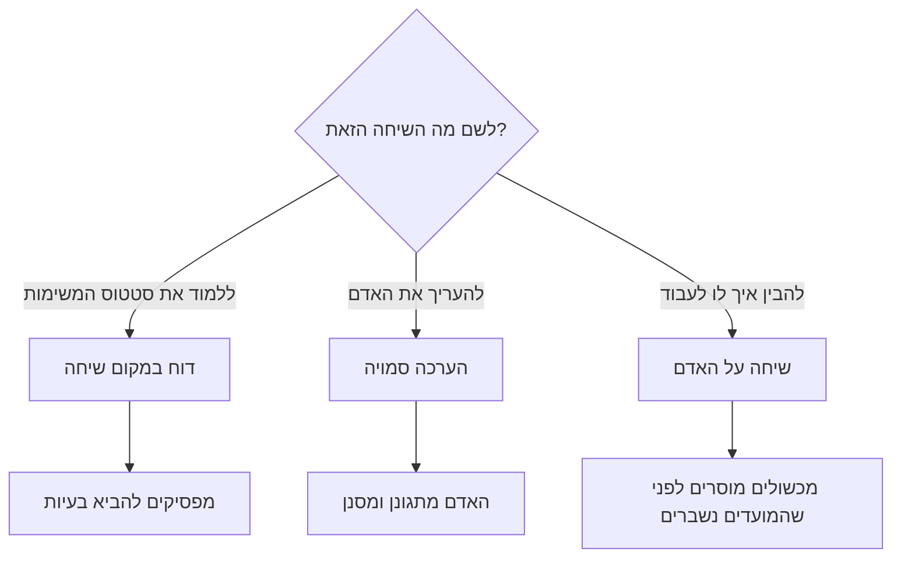
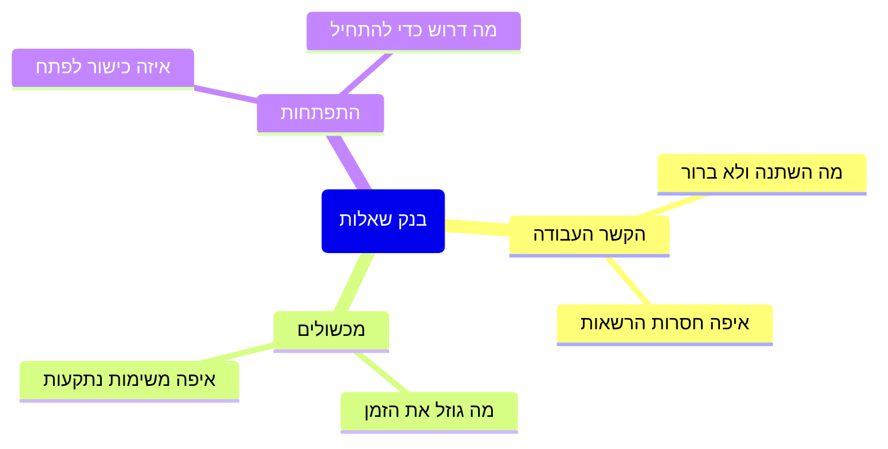

## מבוא

בחצי השנה הראשונה שיחותיי אחת־על־אחד היו דוח סטטוס עם פנים אנושיות. באתי עם רשימת שאלות על משימות, המוקדן בא עם תשובות מוכנות, כעבור חצי שעה נפרדנו, ואף אחד מאיתנו לא אמר את מה שחשוב באמת. פורמלית הטקס התקיים: הוא היה בלוח הזמנים, התנהל בקביעות, ואפילו נרשמו בו החלטות. הוא התחיל לעבוד רק אחרי ששיניתי לא את התדירות אלא על מה מדברים.

הטענה שאליה הגעתי: שיחה אחת־על־אחד היא טקס על האדם. לא על המשימות שלו (אלה חיות במערכת), לא על ההערכה שלו (לכך דרושות עובדות נצפות), אלא על איך מתנהלת העבודה שלו ומה מפריע. כשהיא הופכת לדוח סטטוס, היא משכפלת את המערכת; כשהיא הופכת להערכה, היא מפסיקה לקבל את האמת.

המאמר הזה עוסק בארבעה דברים שמחזיקים את הפורמט: מבנה, בנק שאלות, גבול האישי וכללי ביטול. הוא ממשיך את השיחה על הקצב של מנהל התמיכה — במאמר "הקצב של מנהל התמיכה: חוק 40%" השיחה האחת־על־אחד הייתה אחד מחמישה טקסים מחייבים; כאן — איך לעשות שהשעה הזאת לא תלך לאיבוד.

## שני פורמטים מנוונים

לשיחה אחת־על־אחד יש שתי דרכים להיהרס, ושתיהן נראות הגונות מבחוץ.

**דוח סטטוס.** מנהל התמיכה שואל: איך הולך עם המשימות, מה עם הפנייה ההיא, מתי תסגור את זאת. המוקדן עונה, המנהל רושם. הבעיה אינה בתוכן — הבעיה היא שהמידע הזה כבר קיים במערכת, ובשיחה כזאת אדם מביא רק את מה שבטוח להביא. על מכשולים הוא לא יספר: מכשול הוא הודאה שאינך מתמודד, והשיחה הרי על מועדים. יתרה מזו, פגישת סטטוס מחנכת להרגל ההפוך: לומדים לבוא עם דוח ולא עם שאלה.

**הערכה סמויה.** המנהל לא אומר "זו הערכה", אבל השיחה בנויה כהערכה: ספר מה לא הצלחת, איך אתה מעריך את הרמה שלך, למה לא עשית את מה שהייתי עושה במקומך. המשוב הולך לכיוון אחד ונשמע כמו פסק דין. התוצאה צפויה: האדם מתחיל להתגונן, מכין ניסוחים מראש ומפסיק להביא כל דבר שאפשר להשתמש בו נגדו. בעוד חודשיים השיחות מנומסות וריקות.

הבחירה פשוטה: לשיחה צריך להיות נושא אחד, והוא לא יכול להיות סטטוס ולא הערכה.

המשך — איך לבנות שיחה עם הנושא הנכון.

## מבנה של 40 דקות

הפורמט שאצלי החזיק מעמד הוא קצר: ארבעים דקות וחמישה בלוקים. הדיוק בדקה לא חשוב — הסדר חשוב: קודם האדם, אחר כך ההקשר, ובסוף ההסכמות.

| בלוק | מי מוביל | מה צריך להישאר |
| --- | --- | --- |
| מה הצטבר מהפעם הקודמת | המוקדן | רשימת הנושאים שאיתם בא |
| מכשולים | המוקדן, המנהל מפרק | מכשול אחד או שניים עם בעלים ומועד |
| הקשר והחלטות מלמעלה | מנהל התמיכה | "למה" ברור, ולא רק "מה משתנה" |
| התפתחות | שניהם | צעד הבא אחד בכישור אחד |
| סיכום | מנהל התמיכה | החלטות עם בעלים ומועד |

הבלוק הראשון — סדר היום שלו, וכאן חשוב להחזיק את ההפסקה. אם המנהל מתחיל מהשאלות שלו, כל השאר הופך לראיון. מהלך פשוט עובד: "ממה נתחיל — ממה שהצטבר אצלך".

הבלוק השני — מכשולים, וזה החלק היחיד שבו המנהל לא מקשיב אלא פועל. מכשול — זה מה שמפריע לעבודה: אין הרשאה, לא ברור של מי המשימה, קונפליקט עם צוות שכן, הוראה מיושנת. תפקיד המנהל אינו להסביר למה כך קרה אלא לקחת את המכשול איתו ולחזור עם תוצאה.

הבלוק השלישי — הקשר מלמעלה: מה משתנה בחברה, במוצר, בכללים ולמה. מוקדן שמבין את הסיבה לשינוי מתווכח עם ההחלטה במקום לחבל בה בשקט. כאן גם מקומן של החלטות שאי אפשר לדון בהן בסיכום הכללי.

הבלוק הרביעי — התפתחות, וקל להרוס אותו אם הופכים אותו לתוכנית שנתית. מספיק כישור אחד וצעד הבא אחד: מה האדם ינסה עד השיחה הבאה. הבלוק החמישי — סיכום: שתיים־שלוש החלטות, ולכל אחת בעלים ומועד.

איפה נרשמות ההחלטות. לא בפרוטוקול של השיחה — רישום מילה במילה הופך אנשים לזהירים. מספיקה שורה במסמך משותף: מה הוחלט, מי יעשה, עד מתי. אישי לא נרשם, והחלטות שנוגעות לאחרים מועברות בלי ייחוס.

## בנק שאלות

לשאלה טובה לשיחה כזאת אין תשובה מוכנה במערכת. אני מחזיק בנק משלוש קבוצות ומחליף אותו כל כמה חודשים — שאלות שנשאלות שנים מפסיקות להוציא משהו חוץ מנימוס.

כך נראה הבנק: שלוש קבוצות, ולכל אחת נושא משלה.

כמה ניסוחים מהבנק העובד:

- מה בשבועיים האחרונים לקח יותר זמן ממה שציפית?
- איפה אתה מחליט היום בלי מנדט — כלומר שואל אותי למרות שיכולת להחליט לבד?
- מה אני עושה שמפריע לך לעבוד?
- איזה כישור דרוש לך כדי לקחת פניות מורכבות יותר, ומה מונע להתחיל?
- מה בכללי הצוות נראה לך מיושן?
- למה ציפית מהתפקיד הזה ומה התברר אחרת?

<!-- вилка: 5–8 своих вопросов, которые реально работают в вашей команде. -->

מה לא עובד בבנק: שאלות עם הערכה מובנית ("לא נדמה לך שאתה סוגר פניות לאט?"), שאלות מבחן ("מה היית עושה במקום הלקוח?") ושאלות על עבר שאי אפשר לשנות.

## גבול האישי

בשיחה אחת־על־אחד אנשים מדברים לא רק על עבודה, ומנהל התמיכה צריך לדעת מראש מה הוא עושה עם מה ששמע.

את הגבול אני מתווה בפשטות. עובדות עבודה — מה שאפשר לרשום ולהעביר הלאה: מכשולים, הסכמות, תוכניות כישורים. גילויים אישיים — מה שאדם סיפר על עצמו ועל חייו. השני לא נרשם, לא מועבר הלאה ולעולם לא משמש בהערכה. זה לא נימוס אלא תנאי שבלעדיו השיחה עובדת לכיוון אחד.

שני דברים שמוטב לומר בקול בהתחלה ולא כשכבר מאוחר.

- מה אני לא יכול לשמור בסוד. יש דברים מחוץ להקשר העבודה — מחלה ארוכה, איום על ביטחון, הפרת חוק — שאי אפשר להשאיר בין שני אנשים. הבטחה לסודיות מלאה ביודעין היא שקר שיתגלה ברגע הקשה.
- מה אישי לא יהפוך לעבודה. אם נסיבות אישיות משפיעות על העבודה, דנים בתוצאה ולא בסיבה: חלוקה מחדש של עומס, לוח זמנים, דחייה — בלי אבחון ובלי פרטים.

הצד השני של אותו גבול: המנהל לא משתמש בשיחה כטיפול לעצמו. להתלונן בפני המוקדן על ההנהלה, לדון איתו בבעיות של אחרים או לחפש תמיכה — זאת דרך לקחת ממנו את האפשרות לדבר על עצמו. לכך יש למנהל פגישות משלו עם הממונה.

## כללי ביטול

הדרך הנפוצה ביותר להרוג את הטקס הזה היא לבטל אותו מסיבה מוצדקת. תקלה, בקשה דחופה, פגישה אצל ההנהלה: ברגע עצמו הכל נראה הגיוני, וכעבור שישה שבועות אין שיחות בכלל.

הכללים שעובדים אצלי.

- **אפשר להעביר, אסור לבטל.** העברה משמעה חלון חדש וקונקרטי שמוצע שם במקום. "נו, בשבוע הבא" אינו חלון.
- **אם המנהל מעביר — עושה זאת לעתים רחוקות ופעם אחת.** העברה שלישית ברצף נקראת באופן חד־משמעי: זה לא חשוב. אחרי השלישית עדיף לומר את זה במילים ולהקטין את התדירות מלהמשיך להבטיח.
- **אם המוקדן מעביר — גם זה סימן.** לא מפני שהוא מתעצל, אלא מפני שהשיחה הפסיקה להיות לו מועילה.
- **שיחה שהוחמצה לא מאריכה את הבאה.** שיחות השלמה של שעתיים לא עובדות: הן הופכות בדיוק לדוח שממנו ברחנו.

<!-- вилка: правила отмены в вашей практике — как часто переносили и что из этого следовало. -->

שיחה אחת־על־אחד היא מחיר יקר: היא לוקחת זמן משניכם. אבל היא היחידה שבה נודע על מכשול לפני שהוא שבר מועד, ועל שחיקה לפני שהאדם הגיש מכתב התפטרות. אם השעה הזאת נעלמת בעקביות, להתחיל צריך מכלל הביטול — ומתשובה כנה על מה אתם בעצם עושים בשיחה הזאת.
