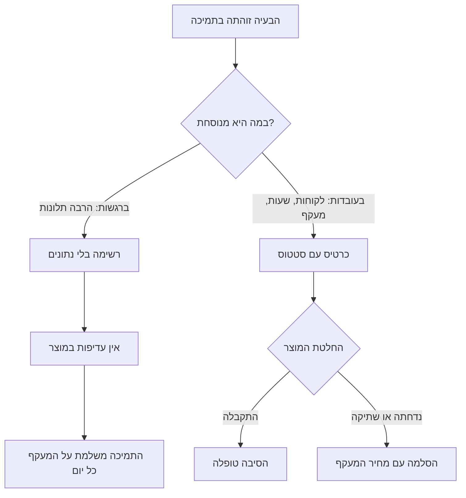
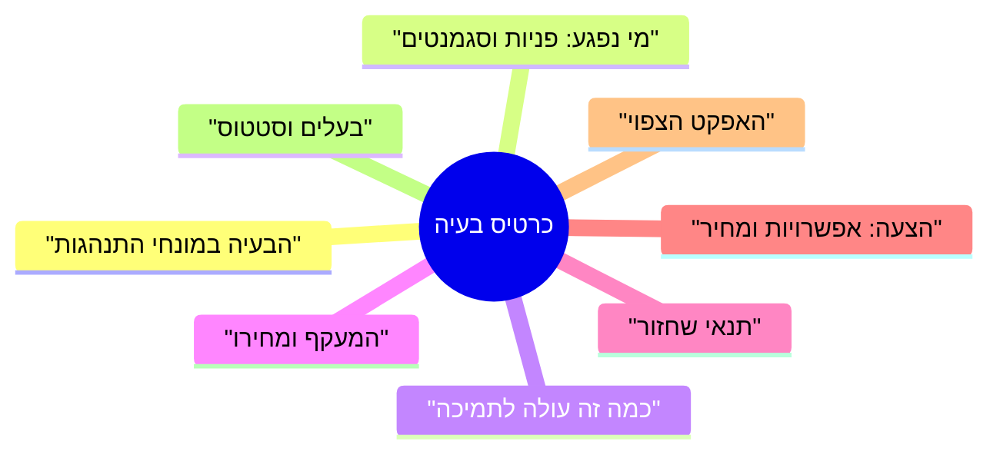
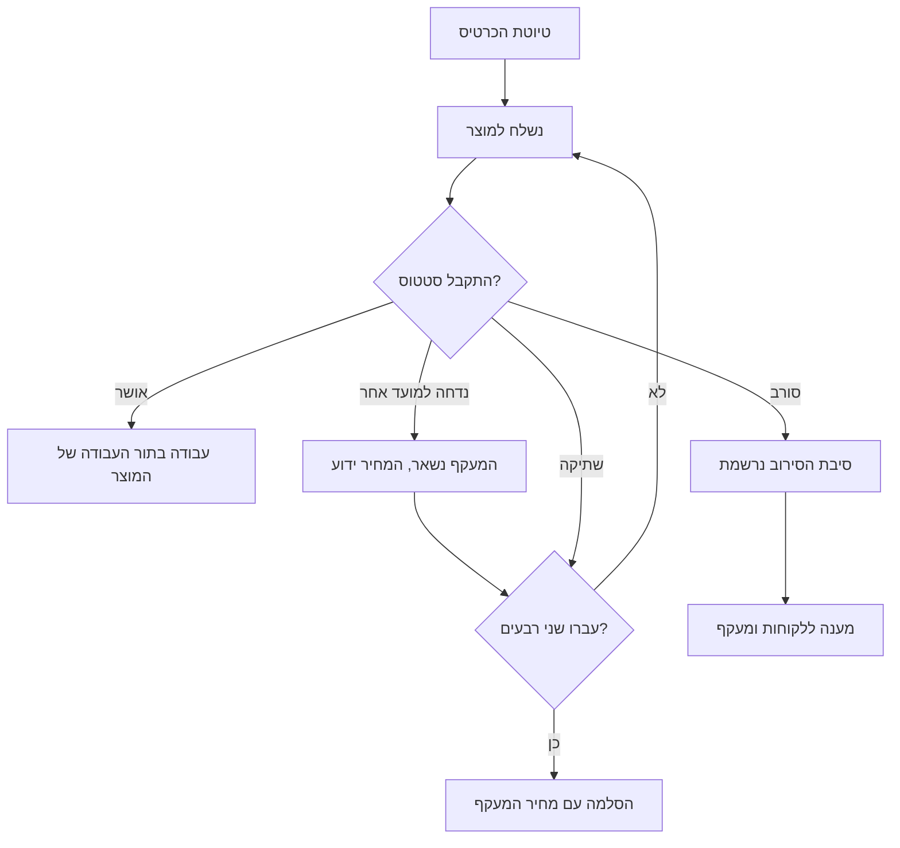

## מבוא

התמיכה היא המקום היחיד בחברה שבו רואים מה באמת נשבר אצל הלקוח. המוצר מסתכל על מדדים, אנליטיקה ותוכנית השחרור; התמיכה מסתכלת על אנשים שלא הצליחו לעשות את העבודה שלהם. בין שתי התמונות האלה בדרך כלל אין ערוץ, ובעיה שכותבים עליה כל יום בפניות חיה שנים בתוך התמיכה כ"מאפיין של המוצר".

אני משוכנע שלמנהל התמיכה יש את הנתונים הכי ישרים על בעיות של לקוחות בחברה. השאלה היחידה היא באיזו צורה הנתונים האלה יוצאים החוצה. הניסוח "יש לנו הרבה תלונות על הייצוא" לא שורד פגישה ראשונה עם תכנון השחרור, וכרטיס בעיה שורד — כי יש בו לקוחות, שעות ומחיר של מעקף.

הניתוח blameless מהמאמר הקודם בסדרה עסק בתקלה בודדת: התקלה קרתה, נותחה, ולפעולות נמצאו בעלים. המאמר הזה עוסק בסוג אחר של בעיות — כאלה שלא נסגרות בפעולה אחת, כי הפתרון נמצא במוצר.

## למה מתעלמים מ"יש לנו בעיות"

רשימת הכאבים קיימת בכל תמיכה, וכמעט תמיד היא לא עובדת. הבעיה היא לא שהמוצר לא רוצה לשמוע, אלא שהרשימה לא עונה על אף שאלה שתכנון השחרור שואל.

- **למוצר יש תור משלו.** העדיפות נקבעת לפי תוכנית השחרור והערכת הביקוש, לא לפי מספר ההודעות בצ'אט התמיכה. בקשה בלי מספר ובלי סגמנט מפסידה לכל משימה שיש לה הערכה.
- **הבעיה מנוסחת כרגש.** "לקוחות מתלוננים" לא אומר כמה לקוחות, אילו, ומה בדיוק קורה. המוצר לא יכול לא לשחזר ולא להעריך ניסוח כזה.
- **לא רואים את מחיר אי־המעש.** כל עוד התמיכה לא ספרה כמה שעות הולכות על המעקף, הבעיה נראית זוטה לעומת המשימות הגדולות.
- **אין נמען.** בקשה בלי בעלים בצד המוצר חוזרת חזרה ומתה בהתכתבות.
- **אין סטטוס.** בעיה ש"בתהליך" אינה ניתנת להבחנה מבעיה שנשכחה: כעבור חודש איש לא יזכור מה כבר הוחלט.
- **אין תזכורת.** אמרנו פעם אחת — לא חזרנו על זה; כעבור רבעון איש לא יזכור לא את הבעיה ולא מי העלה אותה.

ההסתעפות נראית כך:

ההבדל בין הענפים הוא לא בעוצמת התלונה אלא בנכונות לצרף לה מספרים ונמען. בהמשך — ממה מורכבת העבודה הזאת.

## אנטומיה של הכרטיס

הכרטיס הוא לא טופס לשם הטופס. זה סט מינימלי של פרטים שבו כאב של מישהו אחר הופך למשימה עם הערכה. אני מחזיק שמונה שדות:

| שדה | מה בו | למה זה נחוץ למוצר |
| --- | --- | --- |
| הבעיה במונחי התנהגות | מה הלקוח עושה ומה הוא מקבל במקום המצופה | מפריד בין תלונה לבין תרחיש שאפשר לשחזר |
| מי נפגע | פניות, סגמנטים, קריטיות של לקוחות, תדירות | נותן קנה מידה ובסיס לעדיפות |
| מחיר לתמיכה | שעות וחלק הזרימה, פניות חוזרות | מראה כמה עולה אי־מעש |
| מעקף | מה המוקדנים עושים במקום פתרון רגיל ובאיזה סיכון | מראה עבודה ידנית שאפשר להסיר |
| תנאי שחזור | סביבה, גרסה, צעדים, סט נתונים | חוסך למוצר שבועות של הבהרות |
| הצעה | אפשרויות פתרון עם מחיר לכל אחת | מתרגם את הבקשה מ"תתקנו" לבחירה |
| האפקט הצפוי | מה ייצא מהזרימה ומה יפסיק להישבר | מאפשר להשוות למשימות אחרות |
| בעלים וסטטוס | שם האדם במוצר, סטטוס, תאריך המגע הבא | הבעיה מפסיקה להיות בלי בעלים |

את השדות שווה לפרק לא לפי סדר הטבלה, אלא לפי אלה שממלאים בהם שגוי הכי הרבה.

**מי נפגע.** זאת השאלה הראשונה שכל מנהל מוצר שואל. התשובה "כל הלקוחות סובלים" אינה ניתנת לבדיקה ולכן לא שוקלת כלום; התשובה "הנה רשימת הפניות, הנה הסגמנטים, הנה הפניות החוזרות" — ניתנת לבדיקה ושוקלת הרבה. חשוב לא להגזים: מספר אחד מנופח הורג את האמון בכל הכרטיס, וחמשת הכרטיסים התקינים הבאים ייקראו בחשדנות.

**מחיר לתמיכה.** מחשיבים לא לפי העין אלא לפי אירועים: כמה פניות בחודש על הבעיה הזאת, כמה זמן הולך על המעקף, כמה מהן חוזרות. גם הערכה גסה לפי הנוסחה "מספר הפניות כפול זמן המעקף הממוצע" חזקה יותר מהיעדר הערכה. זה הטיעון היחיד שנשמע בתוך מערכת עדיפויות זרה: לא "ללקוחות לא נוח", אלא "אנחנו מוציאים כל כך הרבה שעות בחודש על עבודה שלא אמורה להתקיים".

**המעקף.** השדה שמדלגים עליו לרוב, והוא החשוב ביותר לשיחה. המעקף מראה שני דברים: את הבעיה כבר פותרים בידיים, וזה עובד פחות טוב ממה שנדמה. למעקף יש מחיר — זמן, סיכון טעות, תלות במוקדן מסוים — והוא בדיוק מה שהופך את משימת המוצר לדחופה.

**ההצעה.** לתמיכה יש זכות ואף חובה להציע פתרון: היא רואה את התרחיש יותר מכולם. אבל הצעה היא אפשרויות עם מחיר, לא דרישה. "אפשר לתקן את הוולידציה — זה זול; אפשר לבנות מחדש את הטופס — זה יקר וסוגר עוד שתי בעיות" נותן למוצר בחירה, ואילו "תעשו כמו שצריך" נותן רק עצבים.

**בעלים וסטטוס.** שם של אדם במוצר הופך את הכרטיס ממכתב למשימה. לא "צוות המוצר", אלא מוקדן או בעלים של תחום שלקח את הכרטיס. סטטוס ותאריך המגע הבא נחוצים כדי שהכרטיס לא ישקע.

שלושה כללים שבלעדיהם הכרטיס מתפרק: כרטיס אחד — בעיה אחת (אם בפנים שלוש סיבות, אף אחת לא זזה); בכרטיס אין הערכות של אנשים ורגשות, רק עובדות ותרחישים; וכל מה שרשום אפשר לבדוק בטראקר או בתיעוד.

<!-- вилка: поля своей карточки — как называется, где лежит, что реально заполняется, а что приходится вытаскивать руками. -->

## דוח רבעוני של הסיבות המובילות

כרטיסים הם יחידת העבודה, והדוח הוא הדרך להראות אותם יחד. פעם ברבעון אני מרכיב עמוד עם הסיבות המובילות: קורא אותו מי שמחלק את העדיפויות במוצר, וממנו תלוי אם הבעיות האלה ייכנסו לתוכנית.

הפורמט קצר במכוון: עמוד אחד, בלי מצגת, עם טבלה לכל סיבה.

- **מספר הכרטיס וניסוח הבעיה** — שורה אחת, במונחי ההתנהגות של הלקוח.
- **קנה מידה**: פניות ברבעון ומספר הלקוחות שנפגעו.
- **מחיר לתמיכה**: שעות וחלק הזרימה.
- **מגמה**: עולה, יציבה, יורדת. המגמה חשובה יותר מהמספר המוחלט: בעיה שגדלה לאט תהפוך בעוד שני רבעים לראשונה.
- **סטטוס ובעלים** בצד המוצר.
- **מה אנחנו מבקשים**: פתרון או החלטה על עדיפות, מנוסחת כבחירה.

כללי הסינון לדוח נוקשים ושימושיים:

- לדוח נכנסים רק כרטיסים עם נתונים — אחרת זאת רשימת משאלות;
- מיון לפי מחיר לתמיכה, לא לפי תאריך ההופעה: המטרה היא לפנות את הזרימה, לא לתעד כרוניקה;
- לדוח נכנס בלוק "מה כבר נעשה": כרטיסים שהתקבלו ונסגרו. בלעדיו הפגישה הופכת לרשימת תלונות ומאבדת בעלי ברית;
- הדוח לא חוזר על החלטות הרבעון הקודם שורה בשורה: לכל שורה מהעבר נדרש סטטוס.

עדיף להכין את הדוח לקראת החלטה מסוימת. "הנה עשרים בעיות" לא יפרק אף אחד; "הנה חמש, מתוכן שתיים אנחנו מבקשים לקחת לרבעון, ובשאר אנחנו מבקשים החלטה על דחייה" — נושא לדיון ומסתיים בתוצאה.

<!-- вилка: формат своего отчёта — кому идёт, какой объём, что из него попало в план продукта. -->

## סטטוסים והסלמה של שתיקה

כרטיס בלי סטטוס הופך למכתב לשום מקום. לכן לסטטוס יש כללים, והחשוב שבהם: את הסטטוס קובע המוצר, והתמיכה אחראית לנתונים ולמועדי התזכורות.

מה עומד מאחורי התרשים הזה:

- **שתיקה היא לא סטטוס.** אם אין תשובה במועד שסוכם, הכרטיס מקבל סימון "שתיקה" עם תאריך. זה לא פורמליות: דווקא השתיקה אוכלת רבעים, לא הסירובים.
- **נדחה למועד אחר — לא סירוב.** לדחייה יש סיבה ותאריך בחינה מחדש. בלי תאריך, "נדחה" הוא "אף פעם" מנומס.
- **סירוב הוא גם תוצאה.** הסיבה נרשמת, התמיכה מודיעה ללקוחות וממשיכה לחיות עם המעקף. זה ישר יותר משתיקה: המעקף הופך להוצאה גלויה.
- **הסלמה — עם מספרים.** אם הבעיה נדחתה שני רבעים ברצף, השיחה עוברת לרמה גבוהה יותר — לא בנוסח "המוצר לא שומע אותנו", אלא עם מחיר המעקף בתקופה והסיכון. לבקש החלטות ולא אמפתיה זה כישור נפרד, והוא כבר נותח בחלק הקודם של הסדרה.

כלל נפרד — על מה שאסור שיהיה בהסלמה. אין להשתמש בכרטיסים כטיעון בוויכוחים בין צוותים או כדרך להראות מי אשם בעיכוב. ברגע שהכרטיס הופך לנשק, המוצר מתחיל להתגונן במקום לקרוא נתונים, והערוץ נסגר.

<!-- вилка: как у вас устроены статусы — кто их ставит, сколько живёт карточка без ответа, был ли случай эскалации. -->

## מה משתנה כשהכרטיסים עובדים

את השינויים רואים לא מיד ולא רק במספרים — יותר מכל משתנות השיחות.

עדיפות המוצר מפסיקה להיות תלויה בעוצמה של המכתב האחרון. נוצר תור שיש לו בסיס: מספר הלקוחות ומחיר המעקף. על תור כזה אפשר להתווכח, אבל כבר לעניין — למשל על השאלה איזה מחיר נחשב גבוה יותר.

התמיכה מפסיקה להיות המקום היחיד שיודע על הבעיה. יש לה בעלים בצד השני, ולמנהל התמיכה — דרך להראות להנהלה מה קורה בזרימה, בלי לספר פניות אחת אחת.

נוצרת היסטוריה. כעבור שנה רואים אילו בעיות נפתרות, אילו נסגרות בסירוב ומה זה אומר ללקוחות. זה הטיעון המשכנע ביותר בשיחה הבאה על משאבים: לא הבטחות, אלא רשימת החלטות והשלכותיהן.

וגם ההתנהגות של המוקדנים משתנה. כשבעיה יש מספר וסטטוס, מוקדן בקו הראשון מפסיק להרגיש שהוא כותב לשום מקום: התצפיות שלו הופכות לנתונים. זאת כנראה הדרך הזולה ביותר להעלות מעורבות שאני מכיר.

<!-- вилка: история одной карточки — от записи до решения продукта: что было в данных, какой аргумент сработал, что изменилось после. -->

כרטיס בעיה הוא לא ביורוקרטיה אלא פורמט מינימלי שבו כאב של לקוח הופך למשימה עם מחיר ובעלים. המאמר הבא בסדרה — "מדד בלי פעולה הוא תמונה: דרכון המדד" — על איך לוודא שהמספרים שעליהם עומדים הכרטיסים האלה באמת משמשים מישהו להחלטות.
