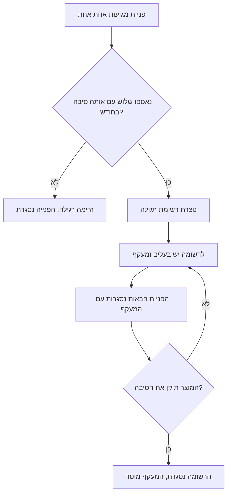
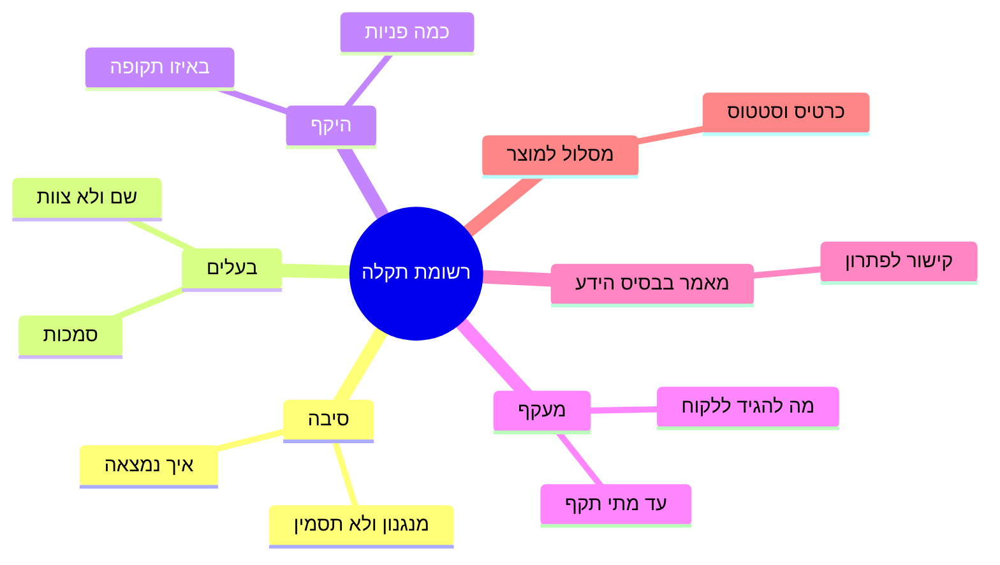

## מבוא

הפנייה היקרה ביותר בתמיכה היא זו שהצוות כבר פתר. לא מפני שהיא קשה, אלא כי בכל פעם משלם עליה מוקדן אחר, ובכל פעם מאפס.

במשך תקופה הסתכלתי על הדוח וראיתי בריאות: הזרימה נסגרת, התור לא גדל, אף פנייה לא באיחור. אחר כך הקשבתי לניתוח השבועי והבנתי ששלושה מוקדנים מספרים את אותו סיפור במילים אחרות. בדוח אלה היו שלוש פניות שנסגרו בהצלחה; במציאות זאת היתה תקלה אחת שאף אחד לא התכוון לפתור.

המאמר הזה עוסק במעבר שעולה לשירות יותר מכל דבר אחר: מזרימת פניות לרשימת תקלות. פנייה היא יחידת עבודה ויש לה מועד. תקלה היא יחידת סיבה ויש לה בעלים, מעקף ומסלול לדוח המוצר. כל עוד שתי הרשימות לא מופרדות, התמיכה נידונה לפתור את אותו דבר לנצח.

## המחיר הבלתי נראה של פניות זהות

פניות חוזרות אינן נראות בדיוק מפני שכל אחת מהן נראית רגילה. הפנייה הגיעה, המוקדן פירק אותה, הלקוח קיבל תשובה, הפנייה נסגרה. מדד "נסגרו" גדל והתקלה לא זזה.

העלות מורכבת מארבעה דברים, ואף אחד מהם לא מגיע לשום דוח:

- **שעות של הצוות.** כל חזרה היא פירוק מאפס: אותו חיפוש, אותן בדיקות, אותם ניסויים. הזמן נספר בעבודה השוטפת ולא חוזר.
- **אמון הלקוח.** מי שכותב בפעם השלישית בחודש ושומע "האם ניסית..." מסיק מסקנה לא על המוצר אלא על התמיכה. התשובה הראשונה עוד נחשבת לעבודה, השלישית היא כבר מכתב תבניתי.
- **ידע שלא שוקע.** המוקדן מצא מעקף — והמעקף נשאר בראשו ובפנייה אחת סגורה. כעבור רבעון הוא יוצא לחופשה או עובר לצוות אחר, והמעקף יוצא איתו.
- **נקודה עיוורת למוצר.** כל עוד התקלה חיה כפניות, למוצר אין שום טיעון: אין מה להראות חוץ מ"לקוחות מתלוננים". עם רשומת תקלה השיחה משתנה — על כך בהמשך.

כל זה הוא המחיר של היעדר רשימה. הרשימה מתחילה בכלל שהצוות מקבל בלי ויכוח.

למה חזרות כאלה לא נראות בדוח הסטנדרטי: הוא מקבץ פניות לפי קטגוריות, והתקלה חיה לא בקטגוריה אלא בסיבה. שתי פניות בקטגוריות שונות יכולות לחלוק את אותו מנגנון כשל, ושום קיבוץ לא יקרב ביניהן. לכן מחפשים חזרות לא בלוח המחוונים אלא בניתוח השבועי ובחיפוש בטקסטי הפניות.

## כלל שלוש הפניות

הכלל פשוט: שלוש פניות בחודש עם אותה סיבה הן לא שלוש פניות אלא רשומת תקלה אחת. פנייה אחת היא מקרה, שתיים צירוף מקרים, שלוש זה כבר דפוס שצריך לעשות איתו משהו.

שלושה דיוקים חשובים בו; בלעדיהם הכלל הופך לפורמליות.

**סיבה אחת ולא נוסח אחד.** התאמת ניסוחים לא אומרת כלום: לקוחות מתארים את אותו דבר במילים שונות, ואותה מילה עשויה לתאר כשלים שונים. סופרים לפי סיבה — לפי המנגנון שהמוקדן זיהה בזמן הפירוק.

**החלון — חודש.** שנה זה ארוך מדי: התקלה תאכל יותר ממה ששווה הפתרון שלה. שבוע קצר מדי: חלק מהתקלות מופיעות לעתים רחוקות ולא יאספו שלוש פניות. חודש הוא פשרה עובדת, וגם תקופה נוחה לניתוח.

**מבחין כל אחד, לא רק מנהל התמיכה.** אם רק מנהל התמיכה מבחין בשלוש פניות, הכלל חי בדיוק עד השבוע העמוס הראשון. הטריגר צריך לפעול בניתוח השבועי, שבו הצוות עצמו מציין את החזרות והמנהל מאשר — או במיון, אם במערכת יש שדה לקישור פניות.

כך זה עובד בזרימה:

שימו לב לחץ האחורי: כל עוד הסיבה לא תוקנה, הרשומה חיה וממשיכה להניב — בדיוק בכך היא שונה מפנייה.

<!-- вилка: как у вас работает правило трёх — кто замечает повторы, где ведётся список, что было до него. -->

## אנטומיה של רשומת תקלה

רשומה היא לא פנייה ולא הערה בצ'אט. זה מסמך קצר שחי יותר מכל פנייה נקראת על ידי אנשים שלא השתתפו בפירוק. אלה המושגים שמהם היא בנויה:

שני בלוקים דורשים הסבר, כי בהם הרשומות נשברות לרוב.

**סיבה.** הניסוח צריך לתאר מנגנון: לא "בעיות גישה" אלא "אחרי החלפת סיסמה הסשנים הישנים לא מתבטלים". סיבה כזאת אפשר לבדוק, למסור למוצר ולסגור. ניסוח דרך תסמין לא ניתן לבדיקה ומתאים רק לחיפוש פניות דומות.

**בעלים.** שם של אדם ולא שם של צוות. הבעלים לא חייב לתקן הכל בעצמו: יש לו סמכות להחליט מה קורה עם התקלה, והוא זוכר את ההקשר. רשומה בלי בעלים היא אותה פנייה, רק ארוכה יותר.

שאר הבלוקים משרתים את הקורא ולא את הבירוקרטיה: ההיקף מראה אם שווה להשקיע; המעקף נותן לצוות תשובה מוכנה; המאמר בבסיס הידע הופך את המעקף לידע שאפשר להשתמש בו שוב; המסלול למוצר הופך את התקלה לנראית במקום שבו אפשר לחסל אותה.

<!-- вилка: пример вашей записи о проблеме — причина, владелец, обходной путь, чем закончилась. -->

## מה נותן הבעלים

התועלת העיקרית של בעלים אינה תגובה מהירה יותר. היא בכך שלתקלה יש עתיד.

כל עוד הסיבות לא תוקנו, הדבר היחיד שהתמיכה יכולה לעשות הוא לתת ללקוח תשובה שעובדת. בדיוק זה נשמר ברשומה: מעקף שנבדק ואושר, עם גבול "עד מתי הוא תקף". מוקדן חדש לא ממציא את הפתרון מחדש ולא מבטיח מה שלא יקרה; הלקוח מקבל אותה תשובה מכל עובד.

ההשפעה השנייה — חיסכון בתשומת הלב של מנהל התמיכה. בלי רשומה כל תקלה חוזרת חוזרת אליו מחדש: פעם כוויכוח על עדיפות, פעם כבקשה "תראה למה זה שוב". עם רשומה ההחלטה מתקבלת פעם אחת ותקפה עד שינוי התנאים.

השלישית — מה שנראה מבחוץ. רשימת תקלות פעילות עם בעלים וסטטוסים היא התשובה הטובה ביותר לשאלת ההנהלה "מה קורה בתמיכה". היא ישרה יותר מגרף הפניות הסגורות: היא מראה את מצב הלא־פתור ולא את הפעילות.

את הבעלים, אגב, עדיף לקחת מתוך התמיכה ולא מתוך המוצר. בעלים מהתמיכה מכיר את הלקוחות ואת המעקף, מחליט בגבולות שלו ולא ממתין לישיבה של מישהו אחר; תפקידו להחזיק את התקלה בשדה הראייה ולא לחסל את הסיבה בידיים. אם ממנים את המוצר לבעלים, הרשומה מתה: למוצר קצב אחר, והתמיכה שוב נשארת בלי תשובה.

<!-- вилка: сколько активных записей у вас одновременно и почему именно столько. -->

## גשר למוצר

החלק החלש ביותר במנגנון הזה ברוב הצוותים הוא המעבר האחרון. הרשומה חיה בתוך התמיכה והפתרון נמצא במוצר; אם אין ביניהם גשר, הרשומה הופכת למעקף נצחי.

הגשר נבנה ממה שכבר יש ברשומה: הסיבה מתוארת כמנגנון, ההיקף ידוע, המעקף מנוסח. מזה מרכיבים כרטיס למוצר — עם נתונים, סטטוס ובעלים בצד השני; על כך בנפרד במאמר "כרטיס בעיה למוצר שאי אפשר לסגור בלי סטטוס".

כלל שאני מחשיב מרכזי: רשומת תקלה לא נסגרת על עצם העובדה ש"שלחנו". היא נסגרת כשיש לה סטטוס חיצוני — התקבל לעבודה, נדחה עם סיבה, תוכנן לגרסה. גם היעדר סטטוס הוא סטטוס, וצריך לומר אותו בקול בניתוח.

<!-- вилка: пример пути от тикетов до карточки в продукте — что отправили, что ответили, чем закончилось. -->

והדבר האחרון. רשימת התקלות לא חיה בראש של מנהל התמיכה ולא בת'רד בצ'אט אלא במקום שהצוות יכול להגיע אליו: אחרת בעוד חודש יהיה צריך להרכיב אותה מחדש. לא חשוב אם זה גיליון או שדה במערכת; חשוב שכל מוקדן יראה אותה לפני שיתחיל לפרק פנייה דומה.
