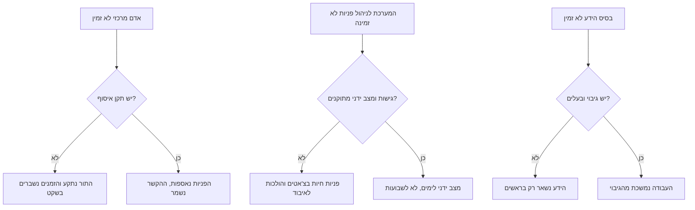
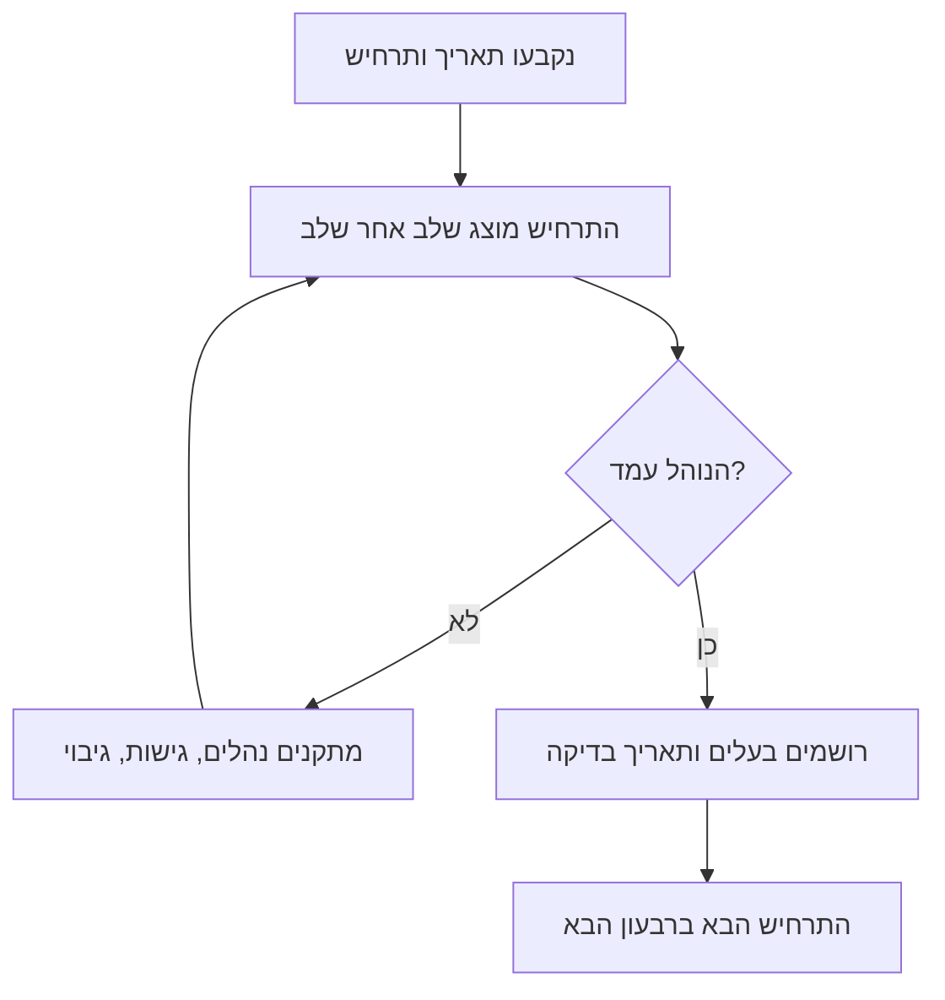

## מבוא

למנהל תמיכה יש מבחן כן אחד למה שהוא באמת מנהל: לצאת ולראות מה נשאר. לא "האם הצוות יסתדר" — הצוות כמעט תמיד מסתדר — אלא באיזו מהירות השירות מתחיל לאבד פניות, הבטחות והקשר.

במאמר הקודם בסדרה — "מדד בלי פעולה הוא תמונה: דרכון המדד" — עסקנו בכך שלכל מספר תהיה פעולה. המאמר הזה הוא הבדיקה האחרונה של השנה: מה יקרה לשירות אם יוציאו ממנו אדם מסוים. אני קורא לבדיקה הזאת ביקורת עמידות. היא לא על אמון בצוות ולא על חיפוש אשמים, אלא על איתור נקודות כשל לפני שהן נכשלות: בחופשה, ביום מחלה, ביום עזיבה או ביום שהמערכת לניהול פניות נפלה יחד עם הגישה אליה.

הנחת המוצא שלי: עמידות היא תכונה של המערכת, לא של האופי של האנשים. כל עוד הידע, המסלול וההחלטה חיים אצל אדם אחד, השירות עובד מנוכחותו ולא מהנוהל. הביקורת דרושה כדי לראות את הפער הזה בזמן שקט, כשהתיקון עולה שעה ולא מוניטין.

## שלושה תרחישי כשל

התרחישים ששווה לשחק בהם רבים, אבל כמעט כולם מתקבצים לשלושה. הראשון — אי־זמינות של אדם מרכזי: חופשה, מחלה, עזיבה פתאומית, שבועיים בלי קשר. השני — כשל של הכלי: המערכת לניהול פניות לא זמינה, הגישה נשללה, אינטגרציה נשברה, הדואר לא נקרא. השלישי — אובדן בסיס הידע: הוא מיושן, הוא לא נגיש, אין לו מתחזק, והידע חזר למקום שממנו גררנו אותו כל השנה — לראשים.

המשותף לכולם אחד: כל תרחיש בודק לא את הגבורה של הצוות אלא את קיומו של תקן ושל בעלים. התרשים מראה איך כל תרחיש מתפצל לשני כיוונים:

ההבדל בין הענף העליון לתחתון בכל תרחיש אינו באנשים, אלא בקיומה של תשובה כתובה מראש. בהמשך – התקן שהופך את התרחיש הראשון ללא־מזיק, והחישוב שבודק אותו.

## תקן "איסוף תוך 15 דקות"

התקן שכל העמידות נשענת עליו: כל פנייה חדשה נאספת תוך חמש־עשרה דקות בשעות העבודה. חשוב לדייק מה זה "נאספת": לפנייה יש בעלים, קטגוריה וקריטיות, והלקוח קיבל תגובה עניינית ראשונה או לפחות מועד כן. איסוף אינו פתרון. לדרוש פתרון בחמש־עשרה דקות זה חסר טעם; לדרוש שפנייה לא תישאר בלי שם — חובה.

מה חייב להתקיים כדי שהתקן יתבצע בלי אדם מסוים:

- **מיון במגע הראשון.** קטגוריה, קריטיות ומסלול נקבעים בקליטה, לא אחרי שהפנייה שכבה. בלי זה "איסוף" הופך ל"מישהו הסתכל".
- **תורנות עם רוטציה.** לתור יש תורן בשם לכל יום, והצוות יודע מי הוא. התורנות מתחלפת לפי לוח שנה ולא לפי סיכום בצ'אט.
- **מטריצת מסלולים.** לעילות טיפוסיות כתוב לאן הפנייה עוברת: קו L2, מוצר, תפעול, ספק חיצוני. אם המסלול יושב בראש של המנהל — איסוף בלתי אפשרי מלכתחילה.
- **גישה לכל מי שצריך.** התור, בסיס הידע, הנהלים ותבניות המענה נפתחים לפי תפקיד ולא לפי בקשה אישית. האדם ש"יודע ממי לבקש גישה" — הוא נקודת הכשל הבודדת.
- **הסלמה עם טיימר.** אם פנייה לא נאספה בתקן, זה נראה: התורן מקבל התראה ולא לומד על ההפרה בסיכום השבועי.

<!-- вилка: ваш норматив подхвата — значение, часы работы, что считается подхватом и как фиксируется. -->

שווה להסכים בנפרד שהתקן חל בשעות העבודה. איסוף מסביב לשעון הוא מודל משמרות אחר עם תקן כוח אדם אחר; להבטיח אותו בלי משאבים פירושו לרשום הפרה שקטה בנוהל של עצמכם.

## בדיקת התקנים בחישוב

קל להכריז תקן וקשה להוכיח אותו. הוא נבדק בחישוב הכוח מהמאמר "כוח במקום גבורה": היקף הזרימה בתקופה, כפול זמן הטיפול הממוצע לפנייה, חלקי השעות הזמינות של הצוות. כל עוד החישוב מסתדר בהרכב מלא, הכל נראה תקין. ביקורת העמידות מוסיפה שאלה אחת: האם החישוב מסתדר אם מחסירים אדם אחד — ובעיקר אם מחסירים את זה שמחזיק את הקטע הכבד ביותר.

יש לעשות שלוש הפחתות.

1. **פחות המהנדס המרכזי.** השעות הזמינות קטנות והזרימה נשארת. אם אחרי ההפחתה תקן האיסוף לא מתקיים אפילו על הנייר, שום גבורה לא תקיים אותו במציאות.
2. **פחות המנהל.** אם הזרימה מסתדרת רק בהשתתפותכם, חלק מהעבודה — ניתוב, מחלוקות עדיפות, אישורים — לא הועבר. אלה בדיוק התפקידים שמהם לכאורה פרשתם, אבל רק במסמך.
3. **פחות הכלי.** כשל של המערכת לניהול פניות עולה ימים ולא שעות: כל עוד פניות מגיעות במייל, זמן התגובה הראשונה נמדד בכלל אחר. בחישוב זה נראה כירידה בתפוקה לתקופת השחזור — ותקופה זו צריכה להיות מוערכת מראש.

הדרך השנייה לבדוק — לפי אירועים ולא לפי מודל. לוקחים ימים שבהם האדם המרכזי נעדר, ובודקים במערכת את הפניות שהגיעו באותם ימים: זמן עד התגובה הראשונה, שיעור הפניות שהועברו שוב, מספר הפתיחות מחדש אחרי חזרתו. אם בימים כאלה הזמנים גדלים ואחרי החזרה פניות נסגרות פעמיים, הבעיה אינה באנשים אלא בהעברת ההקשר.

<!-- вилка: свой расчёт — сколько заявок в неделю, среднее время, доступные часы, что показал вычет одного человека. -->

## נהלי שחזור

ביקורת חסרת תועלת אם היא נגמרת ברשימת סיכונים. כל סיכון שנמצא מקבל נוהל — קצר, עמוד אחד, עם בעלים ותאריך בדיקה.

- **העברת תיקים.** צ'ק־ליסט לשבוע היעדרות: אילו פניות בעבודה, אילו הבטחות ניתנו ללקוחות, היכן מחכים לתשובה, את מי להתריע. ממלאים לפני החופשה, לא ביום הראשון של המחלה.
- **מרשם גישות וכניסת חירום.** רשימת מערכות ותפקידים שנדרשים לתור, והמסלול לקבלת גישה בעקיפת האישור הרגיל — עם התנאים שבהם הוא מופעל ורישום של השימוש.
- **גיבוי בסיס הידע.** הבעלים של הבסיס, תדירות הייצוא, היכן הגיבוי ואיך משחזרים אותו. בדיקת הגיבוי היא שחזור של מאמר אחד, לא סימון וי בנוהל.
- **מצב ידני בכשל המערכת.** הכתובת שאליה כותבים הלקוחות, תבנית המענה, מי מטפל בנכנס, כמה זמן המצב הזה מחזיק ואיך הפניות עוברות אחר כך חזרה למערכת.
- **סדר ההודעה.** מי ומתי מודיע לצוות וללקוחות שהמצב השתנה, ומי מחליט לחזור לשגרה.

<!-- вилка: ваши процедуры — что уже написано, что проверялось на практике и чем закончилось. -->

## לוח הזמנים של הביקורת

ביקורת עמידות אינה אירוע חד־פעמי אלא קצב. התדירות המינימלית שעובדת: תרחיש אחד לרבעון, עם ניתוח מלא בסופו. רבעון אחד — אי־זמינות של אדם, הבא — כשל כלי, השלישי — אובדן ידע, הרביעי — התרחיש שהצוות בחר.

כך נראה המחזור:

המלכודת המרכזית של כל לוח זמנים — להפוך את הביקורת לתיאטרון: להציג את התרחיש, לוודא ש"בסך הכל כולם הסתדרו" ולא לשנות כלום. לכן לכל ביקורת צריכה להיות לפחות תוצאה אחת נראית: נוהל מעודכן, גישה חדשה, גיבוי מיוצא או סיכון שירד מהרשימה. ביקורת בלי שינוי היא לא בדיקת עמידות אלא דוח של שקט.

את מי לצרף: את המהנדס השני שיודע לעבוד בקטע הזה, נציג של צוות סמוך אם התרחיש נוגע בו, ואת ההנהלה — לא בשביל דוח, אלא כדי שתראה את נקודות הכשל בעיניים שלה. מה מתעדכן בסוף: תקן האיסוף, מרשם הגישות, גיבוי בסיס הידע, לוח התורנויות ורשימת הסיכונים עצמה.

<!-- вилка: результаты вашего аудита — какие точки риска нашли, что закрыли, что осталось открытым. -->

עמידות לא מוכיחים במצגת. אותה מוכיח עובדה אחת: השירות עובד כשאין אתכם, ואף אחד לא מגלה בדרך איפה נמצאת הגישה הנדרשת. שנה שמסתיימת בעובדה הזאת אפשר לקרוא לה מוצלחת — ואת הבאה לתכנן ממנה ולא מרצונות. על כך במאמר האחרון בסדרה: "תשע טעויות של מנהל תמיכה — והדוח השנתי".
