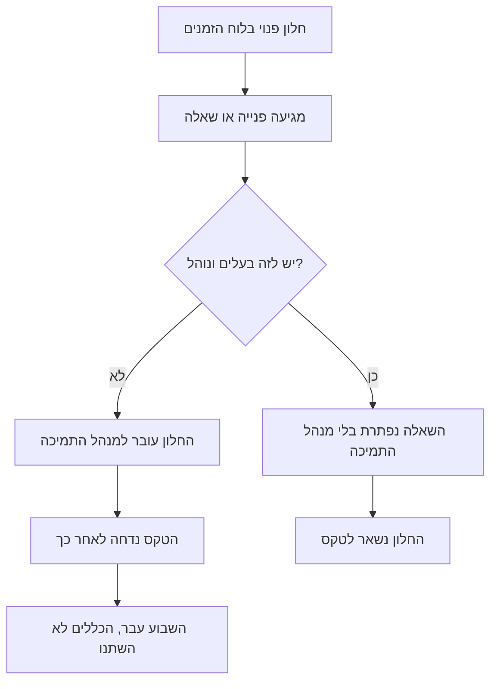
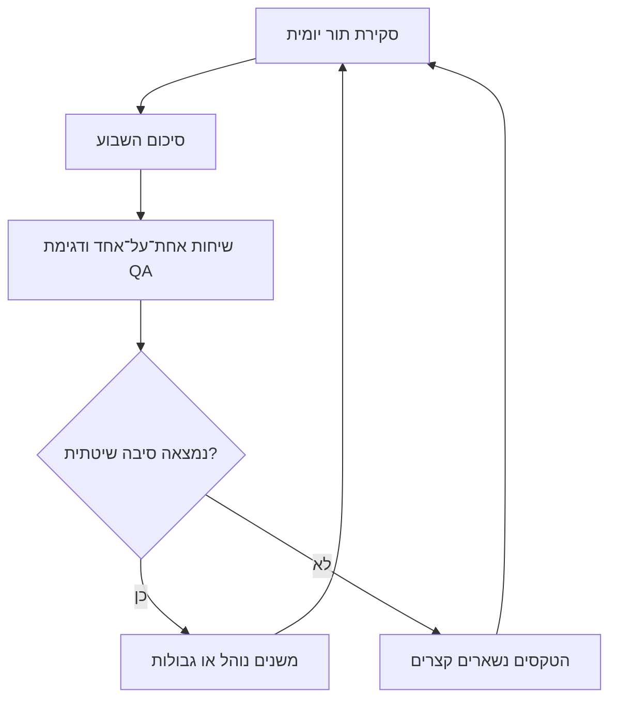

## מבוא

הרבה זמן חשבתי שהבעיה המרכזית של מנהל תמיכה היא מחסור בזמן, ושמשמעת תפתור אותה: לקום מוקדם יותר, לתכנן את היום בצפיפות, להתעסק בפחות דברים. אחרי כמה שנים התברר ההפך. יש מספיק זמן. הוא פשוט הולך למקום הלא נכון.

היום של מנהל התמיכה מלא בעבודה שמישהו חייב לעשות — השאלה רק מי. ניקוי התור, מענה ל"מה עושים כאן", אישור דחיות, פתיחת פניות תקועות: כל אלה עבודה, ואף אחת מהן לא ממתינה. הטקסים שלשמם קיים התפקיד גם הם בלוח הזמנים — סקירת התור, סיכום השבוע, שיחות אחת־על־אחד, דגימת איכות, סטטוס להנהלה. הבעיה היא שהזרימה לא מכירה לוח זמנים: מה שלא בוער היום נבלע ראשון, כלומר בדיוק הטקסים.

מכאן הניסוח שאני מחזיק בתוכנית השנתית ומתייחס אליו כאילוץ המרכזי של השבוע שלי: הטקסים המחייבים רשאים לתפוס לא יותר מ-40% מזמן העבודה. לא "כדאי", לא "נסו" — תקציב. כל מה שמעליו יורד משורה אחרת, והשורה הזאת היא שינוי, פיתוח אנשים והסכמות עם ההנהלה. במפת הדרכים השנתית זה כתוב במפורש: לעבודה שלא בוערת עכשיו דרושים לפחות יומיים בשבוע.

המשך — איך למדוד את השבוע שלכם בלי לרמות את עצמכם, מה נכנס לקצב המינימלי, מנין בא המספר 40, ומה לקצץ ראשון כשזה עדיין לא מסתדר.

## לאן הולך השבוע של מנהל התמיכה

לא למדוד מהזיכרון. ביום שישי הזיכרון ישמח להגיש שבוע של שריפות ולהשמיט בשקט ארבע שעות פגישות שבהן שתקתם. אני רשמתי אחרת: שלוש־ארבע מילים בסוף היום על מה שהיום הלך אליו, ובסוף השבוע — פירוק לפי קטגוריות.

הפירוק כמעט תמיד יוצא שש שורות: שריפות וניקוי התור; מענה לשאלות הצוות; אישורים והרשאות; פגישות שאחרים מובילים; דוחות וסטטוסים; והשורה האחרונה — מה שלשמו קיים התפקיד: כללים, איכות, אנשים, הסכמות.

מהפירוק הזה רואים שני דברים שקשה לראות אחרת. הראשון: חצי מהשורות אינן עבודה של מנהל התמיכה אלא עבודה שלא היה מי שייקח אותה. השני, הפחות נעים: לטקסים אין שורה נפרדת בכלל — הם מתמוססים בתוך השריפות, כי סקירת התור הופכת לטיפול בפנייה מסוימת ושיחה אחת־על־אחד הופכת לעדכון סטטוס על פרויקט. טקס שנבלע בדרך לא משאיר סימן, ולכן בסוף השבוע נדמה שהוא בכלל לא היה.

<!-- вилка: свой расклад недели — 4–6 категорий и их доли. -->

אם לא בא לכם לתעד, יש סימנים עקיפים. לוח הזמנים צפוף, אבל אתם לא מצליחים להיזכר בהחלטה אחת על איכות שקיבלתם בשבוע שעבר. מוקדנים מביאים לכם בעיות אחרי שהן כבר קרו. הדוח להנהלה מורכב מהתכתבות בערב האחרון. כל אחד מהסימנים האלה אומר אותו דבר: הטקסים הפסיקו להיות עבודה והפכו למה שעושים אם נשאר זמן.

כך נראית הדליפה: חלון פנוי בלוח הזמנים לא נשאר פנוי — הזרימה ממלאת אותו.

התרשים מראה את העיקר: הדליפה לא קורית ברגע שבו החלטתם לוותר על טקס, אלא קודם — כשאת החלון תפס משהו נכנס שאין לו בעלים. ולכן התיקון אינו כוח רצון אלא גבולות: אם להחלטה יש בעלים ונוהל, היא לא חייבת לעבור דרך מנהל התמיכה. על כך בהרחבה במאמר ["גבולות אחריות"](/he/blog/support-lead-boundaries/).

## הקצב המינימלי

הסט המינימלי שלי כולל חמישה דברים, וכל אחד מהם עונה על שאלה שאין מי שישאל אחרת.

**סקירת התור — כל יום, בתחילת היום.** זה לא טיפול בפניות אלא מבט על סטיות: מה תלוי יותר מהנוהל, מה נפתח מחדש, איפה התור גדל מהר מהרגיל. טיפול בפניות — עבודת המוקדנים; סקירת התור — עבודת מנהל התמיכה, כי הוא רואה את כל הזרימה ויכול לשנות כללים ולא רק לסגור פנייה אחת.

**סיכום השבוע.** בלוק קבוע אחד שמסתכל לא על פניות אלא על סיבות חוזרות: מה נשבר הכי הרבה, איפה החלטה התקבלה פעמיים, אילו כללים לא החזיקו. זה המקום היחיד שבו החלטות נהיות שיטתיות.

**שיחה אחת־על־אחד.** טקס שעוסק באדם ולא בסטטוס של משימות; למבנה שלו מוקדש מאמר נפרד בסדרה — "שיחות 1:1 שלא הופכות לדוח סטטוס ולהערכה".

**דגימת QA.** כמה פניות סגורות שנקראו מתחילתן ועד סופן — הדרך היחידה לדבר על איכות לא לפי רשמים. איך בנויה הדגימה ולפי אילו קריטריונים קוראים פנייה — במאמר "הערכה לפי עובדות נצפות".

**סטטוס להנהלה.** קבוע, באותה צורה. מטרתו אינה דיווח אלא בקשה מוקדמת של משאבים והחלטות, ולא בזמן תקלה.

| טקס | תדירות | מה הולך לאיבוד בלעדיו |
| --- | --- | --- |
| סקירת התור | כל יום, בתחילת היום | סטיות מתגלות כשכבר מטפלים בהן |
| סיכום השבוע | פעם בשבוע | החלטות מתקבלות אחת־אחת, סיבות שיטתיות לא נראות |
| שיחה אחת־על־אחד | פעם בשבוע או בשבועיים | על בעיה נודעים אחרי שהיא כבר קרתה |
| דגימת QA | כל שבוע | האיכות נדונת לפי רשמים וזיכרון |
| סטטוס להנהלה | בקביעות, בצורה מוסכמת | משאב מתבקש בזמן תקלה — ולא ניתן |

למה חמישה ולא חמישה־עשר. לטקס יש שני סימנים: יש לו בעלים, ויש לו תוצאה שנראית מבחוץ. ישיבה שאחריה לא השתנה כלום אינה טקס אלא הרגל. חמישה־עשר טקסים מבטיחים שחצי מהם בדיוק כאלה, ושהם יאכלו את כל התקציב.

## חוק 40%

40% מזמן העבודה הם בערך שניים מחמישה ימים. זה מה שמותר לטקסים לעלות. לא מפני שהחלק הזה יפה, אלא מפני ששאר הזמן דרוש לעבודה שאי אפשר לעשות בין לבין: שינוי, פיתוח אנשים, השיחה עם ההנהלה, חקירת מה שלא עובד.

הסף הוא זה ולא 60 או 80 משלוש סיבות.

- **טקסים מתחזקים את המערכת ואינם מפתחים אותה.** הם מראים מה קורה אבל לא משנים כללים. אם כל הזמן הולך להסתכלות, לא נשאר מי שישנה את הכללים.
- **טקס מתמתח לזמן שהוקצה לו.** סיכום שבוע בלי סוף הופך לדיון בפנייה אחת של כולם. הגבול שומר על הצורה.
- **מעל חצי שבוע מנהל התמיכה מתחיל לשפר טקסים במקום את השירות.** דוחות יפים יותר, פרוטוקולים מפורטים יותר, פגישות תכופות יותר — ואף שינוי אחד בכללים.

עדיף למדוד את זה באותו פירוק שבועי ולא במערכת: המערכת תראה פניות, ואתם צריכים שעות. אם לאורך שניים־שלושה שבועות הטקסים אוכלים יותר מ-40%, השאלה הנכונה אינה "איך להאיץ" אלא "מה מהנכנס לא צריך לעבור דרכי". התשובה כמעט תמיד נמצאת בגבולות ובנהלים, ולא בלוח הזמנים.

כך נסגר המעגל שלשמו קיימים הטקסים:

המשמעות בשלב האחרון: אם טקסים לא מובילים לשינוי בכללים, הם באמת רק אוכלים זמן — ואז צריך לשנות אותם, לא להגן עליהם.

## היררכיית הקורבנות

השבוע לא מסתדר באופן קבוע, וזה נורמלי: תקלות לא מתייעצות עם לוח הזמנים. הרע אינו בכך שצריך לוותר על משהו, אלא בכך שהקורבן נבחר במקרה — נופל ראשון מה שנמצא נמוך בלוח. ולכן שווה לסדר את הקורבנות מראש.

1. **צורה, לא תוכן.** דוח במצגת הופך למכתב, פגישת סינכרון להודעה בערוץ, פרוטוקול מפורט לשלוש שורות של החלטות. התוכן נשאר, המחיר יורד.
2. **פגישות שמכפילות את הכתוב.** אם את התוצאה אפשר היה לקרוא, הפגישה לא הייתה נחוצה.
3. **עומק סיכום השבוע.** הוא יכול להתקצר אבל לא להיעלם: בלעדיו החלטות חוזרות להתקבל אחת־אחת.
4. **דחיית שיחה אחת־על־אחד.** ורק לפי כללים: אפשר להעביר, אסור לבטל. אם הדחיות נמשכות שבוע שלישי, הבעיה כבר לא בלוח הזמנים.

מה שלא מקצצים אף פעם — סקירת התור, דגימת QA וסיכום השבוע. יש להם תכונה לא נעימה: ההיעדרות שלהם לא נראית במשך חודש. התור נראה תקין עד שמתברר שחצי מהפניות תלויות מעל לנוהל; האיכות נראית סבירה עד שלקוח עוזב. בדיוק מפני זה הם ראשונים ברשימת הקיצוץ ואחרונים שמותר להם.

## שבוע בשני מצבים

ההבדל בין שבוע עם החוק לשבוע בלעדיו אינו בכמה הספקנו אלא במי קובע את היום.

| סימן | שבוע בלי החוק | שבוע עם החוק |
| --- | --- | --- |
| מה קובע את היום | הזרימה הנכנסת | לוח הטקסים וההחלטות |
| איפה מתקבלות החלטות | בצ'אטים, אחת־אחת | בסיכום השבוע, עם בעלים |
| מה רואים ביום שישי | רשימת פניות סגורות | מה השתנה בכללים |
| מנין בא זמן מעל התקציב | משינוי ומאנשים | משום מקום: התקציב לא גדל |
| מה קורה בחופשה של המנהל | התור נעצר | אדם שני מבצע את הטקסים |

<!-- вилка: своё расписание ритуалов — дни, длительность, кто подстраховывает в отпуске. -->

השורה האחרונה חשובה יותר מכולן. קצב שנשען רק עליכם אינו קצב אלא עוד צורה של סיכון נקודה בודדת. ולכן שווה לרשום בתוך לוח הטקסים מיד אדם שני: מי מוביל את סקירת התור כשאינכם, מי מרכיב את הסטטוס, מי קורא את הדגימה. זו לא האצלת התפקיד אלא ביטוח לשבועיים חופשה, והוא נבדק בפשטות: צאו לחופשה ותראו אילו טקסים שרדו.

חוק 40% אינו על לעבוד פחות. הוא על כך שלניהול יש מחיר, ועדיף לשלם אותו בקביעות ובמנות קטנות מאשר פעם אחת, כשמתברר שהשנה עברה על ניתוב. כל מה שמעל הסף משלם השירות: בשינויים שלא קרו ובאנשים שלא צמחו.
