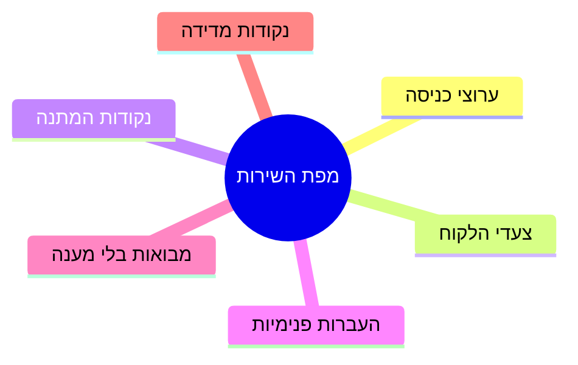
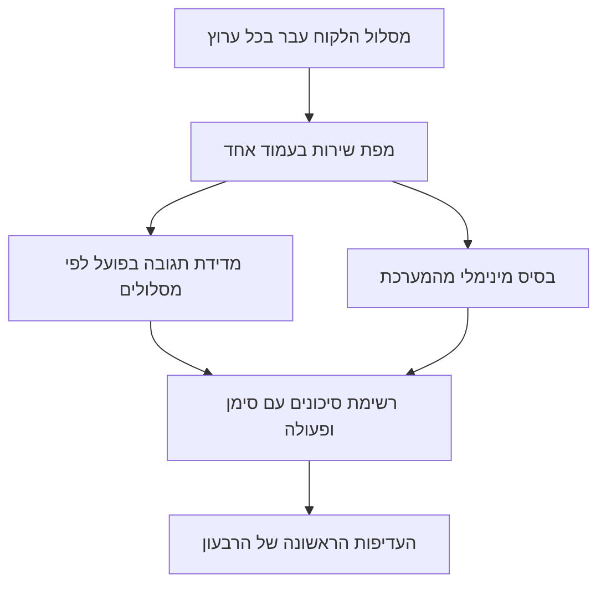

## מבוא

את החודש הראשון בתפקיד מנהל תמיכה ביליתי על נהלים: קראתי, השוויתי, שאלתי שאלות. בנהלים חי שירות מסודר — פנייה מגיעה למערכת, נופלת לתור הנכון, מוקדן עונה בזמן, הלקוח מרוצה. במציאות חי שירות אחר: חצי מהפניות התחילו בצ'אט במשפט "אפשר שאלה", חלק מהבקשות בכלל לא הגיעו למערכת, והמועדים שכולם חשבו שנענו נספרו לפי הגדרה שאיש לא זכר.

הפער בין שני השירותים האלה אינו סימן לצוות גרוע. זה מצב תקין של מערכת שאיש לא תיאר אותה בשלמותה: כל חלק בה נוצר בזמנו, למשימה שלו וללקוח שלו. הבעיה מתחילה מאוחר יותר — כשמנהל התמיכה מגיע עם תוכנית שיפור ואין להיכן להחיל אותה, כי לא ברור מה בדיוק משפרים.

במאמרים הקודמים בסדרה עסקנו בזמן של מנהל התמיכה (["גבולות אחריות"](/he/blog/support-lead-boundaries/)), בהיגיון של נקודת המוצא (["בסיס לפני מטרות"](/he/blog/support-lead-baseline-first/)) ובאיך מטרות הופכות לשנה (["שנה של מנהל תמיכה לפי רבעונים"](/he/blog/support-lead-year-roadmap/)). המאמר הזה עוסק בצעד שלפני שלושתם: איך להשיג בשבועות הראשונים תיאור של השירות ואת נקודת המוצא שלו, בלי זמן, בלי נתונים ובלי אישור לשינויים גדולים.

הטענה: אבחון החודש הראשון עונה על שתי שאלות — מה הלקוח רואה בדרך לפתרון, וכמה הוא באמת ממתין בכל שלב. את התשובה הראשונה נותנת מפת השירות, ואת השנייה — מדידת התגובה בפועל. יחד הן הופכות לתוצרים שאפשר כבר לדבר איתם על מטרות.

## לעבור את מסלול הלקוח בכל ערוץ

התרגיל הראשון גובה זמן ונראה מוזר: כתבו לתמיכה שלכם כלקוח. לא "בדקו אם הטופס עובד", אלא עברו את המסלול כולו — בדואר, דרך הפורטל, בטלפון, בצ'אט — ורשמו מה קורה.

מה רואים בתרגיל הזה ולא רואים מבפנים:

- **כמה צריך לדעת רק כדי לשלוח פנייה.** איפה באתר כתוב לאן לפנות? האם הטופס דורש מספר חוזה שהלקוח לא זוכר? האם הוא מבקש לבחור קטגוריה מרשימה שאין בה את המקרה שלו?
- **מה חוזר אחרי השליחה.** מענה אוטומטי עם מספר פנייה, מכתב "קיבלנו את פנייתכם", או שתיקה. מענה אוטומטי אינו פורמליות: דווקא הוא אומר ללקוח ששמעו אותו, והיעדרו יוצר את המכתב השני ואת שיחת הטלפון.
- **האם הלקוח רואה סטטוס.** האם הוא יכול לדעת מה קורה עם הפנייה בלי לכתוב שוב? אם לא, כל בדיקת סטטוס הופכת לפנייה חדשה וליחידת עומס חדשה.
- **מה קורה כשהוא שותק.** הלקוח לא ענה על שאלת הבהרה: הפנייה ממתינה לו, למוקדן או לאיש? התשובה לשאלה הזאת מסבירה לעתים קרובות חצי מהפניות ה"ישנות".
- **איפה המסלול נשבר.** הטופס נשלח לשום מקום, הטלפון מחוץ לשעות העבודה אומר "התקשרו מאוחר יותר", הצ'אט נסגר בלי תשובה.

כל מה שרשמתם נכנס לעמוד אחד. המבנה שלו פשוט וזהה לכל שירות:

- **ערוצי כניסה** — מאיפה מגיעות הפניות ואיזה ערוץ עיקרי;
- **צעדי הלקוח** — מה נדרש ממנו בכל שלב;
- **נקודות המתנה** — איפה הוא ממתין ולמה בדיוק;
- **העברות פנימיות** — איפה הפנייה עוברת בין אנשים, תורים ומערכות;
- **מבואות סתומים** — מקומות שבהם הפנייה עלולה להישאר בלי מענה;
- **נקודות מדידה** — איפה במסלול יש אירוע שאפשר למדוד לפיו זמן.

כך נראה סט הרכיבים שצריך להעלות על המפה:

מפה בלי מספרים אינה אבחון עדיין — היא רשימה של מקומות שמהם צריך לקחת מספרים. אבל כבר יש לה תועלת מעשית: רואים עליה ש"תמיכה" אינה תור אחד אלא כמה מסלולים במהירויות שונות ובכללים שונים. מכאן מתברר שצריך למדוד כל מסלול בנפרד ולא את "השירות בכללו".

עברו גם מסלול אחד נוסף: מה הלקוח חווה אחרי הפתרון — סגירת הפנייה, מכתב הסיכום, פנייה חוזרת באותו נושא. סבב שני של אותה שאלה הוא המדד הכי כן לאיכות, והוא כמעט תמיד לא מתואר בנוהל.

## מדידת התגובה בפועל

הצעד השני הוא למדוד כמה הלקוח באמת ממתין. לא לפי הנוהל ולא לפי תחושת המוקדנים, אלא לפי אירועים במערכת: מרגע פתיחת הפנייה ועד תשובה מהותית ראשונה, ומרגע הפתיחה ועד הסגירה.

שלושה כללים שבלעדיהם המדידה הופכת לוויכוח על מילים.

**ראשון: הגדרה לפני מספר.** "תגובה ראשונה" — מענה אוטומטי, אישור תבניתי או הודעה שיש בה תשובה לגוף העניין? כל עוד ההגדרה לא כתובה, אפשר לפרש את המספר איך שרוצים, וכל צד יהיה צודק. כך גם עם "פתרון": סגירה ביוזמת המוקדן, באישור הלקוח או בתום המועד — אלה שלושה אירועים שונים.

**שני: הלקוח לא ממתין לממוצע.** זמן תגובה ממוצע מסתיר את הזנב: אם רוב הפניות נסגרות מהר וחלקן תלוי שבועות, הממוצע יישאר סביר והלקוחות דווקא את השבועות יזכרו. לכן לצד הממוצע צריך אחוזון תשעים — הזמן שבתוכו נסגרות תשע פניות מעשר. הזנב הוא מה שמקלקל את המוניטין של השירות.

**שלישי: זמן בעבודה וזמן בהמתנה — בנפרד.** פנייה שממתינה לתשובת הלקוח ופנייה שממתינה למוקדן פנוי נראות בדוח אותו דבר ומשמעותן הפוכה. בלי ההפרדה, האשמה בעיכובים נופלת אוטומטית על הלקוח או על הצוות — תלוי במי שבונה את הדוח.

מה שמתקבל בסוף — טבלה קטנה לפי ערוצים ומסלולים: חציון ואחוזון תשעים לתגובה הראשונה, אותו דבר לפתרון, וחלק הפניות שלא קיבלו תגובה ראשונה בכלל. כמה שורות שאפשר כבר להראות להנהלה ולדון בהן בלי רגשות.

<!-- вилка: цифры фактической реакции по каналам — медиана и p90 первого ответа и решения, доля заявок без первого ответа. -->

כאן גם מתגלה בדרך כלל הדבר הראשון הלא נעים: לחלק מהזרימה אין פנייה בכלל. שאלות בצ'אט משותף, שיחות למספר אישי, בקשות שהועברו דרך עמיתים. הפניות האלה בלתי נראות למדדים אבל גוזלות זמן של הצוות — והן בדיוק מסבירות למה מוקדן "עמוס והפניות לא נסגרות".

## בסיס מהמערכת

החלק השלישי של האבחון — דיווח מהמערכת. כאן קל לטבוע: שדות רבים, דוחות עוד יותר, והניסיון הראשון "לעשות דשבורד נורמלי" נגמר בדרך כלל בדשבורד שאיש לא משתמש בו.

את רשימת השדות המלאה וכללי הדיווח פירקתי במאמר ["בסיס לפני מטרות"](/he/blog/support-lead-baseline-first/). בחודש הראשון מספיקים ארבעה חתכים, ולכל אחד יש שאלה קונקרטית שהוא עונה עליה.

| חתך | השאלה שהוא עונה עליה | מה עושים עם התשובה |
| --- | --- | --- |
| היקף ומבנה הזרימה | כמה פניות ומאיזה סוג: תקלות, שאלות, בקשות שינוי | להבין אילו מסלולים בכלל דרושים |
| דחיפות | איך מתפלגות העדיפויות ואיזה חלק נחשב קריטי | למצוא את התור שמחזיק את הסיכון |
| פתיחות חוזרות | איזה חלק מהפניות נפתח שוב | להפריד בין מהירות לאיכות הפתרון |
| גיל תור הפניות | כמה פניות ממתינות מעבר לנוהל | לראות הפרות שקטות וחוב שהצטבר |

ארבעה חתכים אינם מחליפים בסיס מלא, אבל הם נותנים את העיקר — הבנה של קנה המידה והשערה אחת או שתיים לגבי מקום הצוואר. ההשערות חשובות דווקא עכשיו: איתן אפשר לבוא לצוות עם שאלה ולא עם האשמה.

<!-- вилка: собственные выгрузки первого месяца — какие разрезы взяли, за какой период, где лежит таблица. -->

שווה להסכים מראש על שני כללים שיחסכו חודשי ויכוחים. הראשון: כל המספרים נספרים על אותו חלון ומאותו מקור. השני: ההגדרות כתובות לצד הטבלה. לא מפני שהמתודולוגיה דורשת זאת, אלא מפני שבעוד רבעון תשוו מספר חדש לישן, ולשאלה "איך ספרו אז" צריכה להיות תשובה במסמך ולא בזיכרון של מישהו.

## רשימת הסיכונים

החלק האחרון של האבחון — רשימת הסיכונים. זה לא מרשם של מאה שורות ולא הערכת הסתברויות פורמלית. זו רשימה קצרה של מה יישבר ראשון כשהזרימה תגדל או כשרכיב אחד ייצא מכלל פעולה.

השיטה פשוטה: עברו על מפת השירות ושאלו כל נקודה שלוש שאלות.

- **מה יקרה אם ההיקף יגדל פי שניים?** לא "יהיה כבד יותר", אלא קונקרטי: איזה תור ייתקע ראשון, איזה ערוץ יפסיק לענות בזמן, איפה פעולה ידנית תהפוך לצוואר בקבוק.
- **מה יקרה אם אדם אחד ייעלם לשבועיים?** לא רק מוקדן: בעל האינטגרציה, היחיד שיודע להפיק את הדוח, מחבר הנוהל.
- **מה יקרה אם מערכת חיצונית תיפול?** המערכת, שער הדואר, הפורטל, הטלפוניה. חלק מהמסלולים לא מתאוששים אחרי כשל כזה בכלל — הפניות פשוט הולכות לאיבוד.

התשובות מצטברות לרשימה של שלושה עד חמישה סעיפים. לכל אחד — סימן שמראה שהסיכון התחיל להתממש, ופעולה ראשונה. דווקא הרשימה הזאת, ולא הקריאה הכללית "לשפר את האמינות", הופכת לסדר היום של הרבעון הראשון.

<!-- вилка: три главных риска из собственного перечня — что сломается первым при росте потока и почему. -->

כדאי להפריד מיד סיכונים שמטופלים בתוך התמיכה מאלה שדורשים החלטות מחוצה לה. הראשונים נכנסים לתוכנית הצוות, השניים — לשיחה עם ההנהלה: חלקם עולה כסף, וחלקם דורש שינוי תהליכים באגפים אחרים. בלי ההפרדה הזאת רשימת הסיכונים נשארת רשימת תלונות.

## תוצרי החודש הראשון

ארבעת חלקי האבחון לא חיים בנפרד: כל אחד נשען על זה שלפניו ומאבד משמעות בלעדיו.

עד סוף החודש הראשון אמורים להיות למנהל התמיכה ארבעה דברים, ואף אחד מהם לא דורש תקציב.

- **מפת שירות בעמוד אחד.** ערוצים, צעדי הלקוח, המתנות, העברות, מבואות סתומים, נקודות מדידה. היא לא לצורך דוח: איתה שיחה על עדיפויות מפסיקה להיות שיחה על טעם.
- **טבלת תגובה בפועל.** חציון ואחוזון תשעים לכל מסלול, זמן בעבודה וזמן בהמתנה בנפרד.
- **בסיס מינימלי.** ארבעה חתכים מהמערכת על חלון אחד, עם הגדרות כתובות.
- **רשימת סיכונים.** שלושה עד חמישה סעיפים עם סימן ופעולה ראשונה, מחולקים ל"בתוך התמיכה" ול"צריך החלטה בחוץ".

ארבעת התוצרים האלה אינם אבחון לשם אבחון. הם עונים על השאלה שכל ממונה ישאל במוקדם או במאוחר: "מה קורה בשירות". ועונים לא ברושם אלא בתיאור.

מכאן מתחילה עבודה שנעשית פעם אחת ואחר כך רק מתוחזקת: ניתוב הפניות. האבחון הראה שהמסלולים אחדים ושונים זה מזה; הצעד הבא — שכל פנייה תיפול למסלול שלה כבר במגע הראשון, ולא אחרי שתי העברות וחזרה אחת. על כך במאמר "מיון במגע ראשון: קטגוריה, דחיפות, מסלול".

אבחון טוב נגמר לא במסמך אלא במשפט "עכשיו ברור מה עושים קודם". אם אחרי חודש עבודה המשפט הזה לא קיים, תיארתם את השירות אבל לא הסתכלתם עליו בעיני הלקוח.
