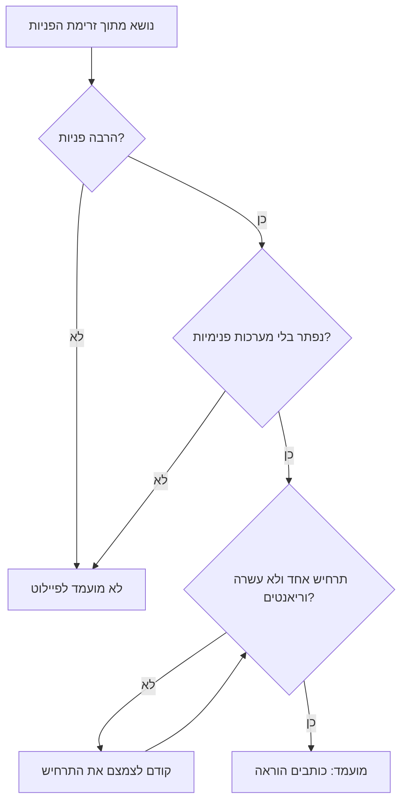
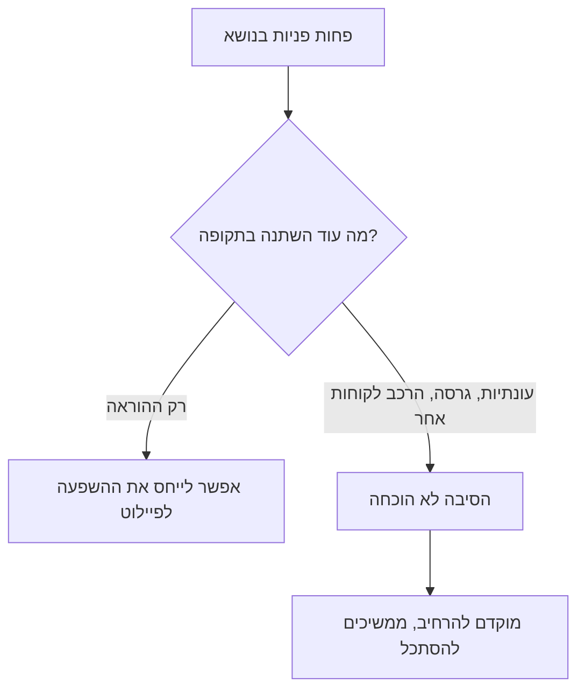

## מבוא

בשלב מסוים בניתי פורטל שירות עצמי: מאמרים מסודרים, חיפוש נעים, קישור במכתבים. כעבור רבעון הפניות לא התמעטו. פורמלית הפורטל עבד; בפועל השתמשו בו אותם שלושה מוקדנים שידעו מה לעשות גם בלעדיו.

מאז אני מסתכל על שירות עצמי אחרת. זה לא עניין של מאמרים ולא של פורטל. זה עניין של כך שהלקוח יוכל לסגור את השאלה שלו בלעדינו — ושל כך שנוכל להוכיח את זה במספרים ולא בתחושה ש"נהיה יותר טוב".

במונחי ITIL 4 זה Shift Left — קירוב הפתרון ככל האפשר למקור הבעיה. בתמיכה זה אומר שתרחיש שלא דורש את המומחיות שלנו יוצא מהתור אל הלקוח, והמומחיות נשארת במה שבאמת דורש אדם. פיילוט על שלושה עד חמישה תרחישים עם מדידה ישרה מועיל יותר מפורטל גדול בלי מדדים.

ב[מפת הדרכים של השנה](/he/blog/support-lead-year-roadmap/) שירות עצמי נמצא ברבעון השלישי — אחרי בסיס הידע ולפני השיחה עם המוצר, וזה לא סדר מקרי.

## למה "פשוט לכתוב הוראות" לא עובד

הדבר הראשון שעולה בדעתנו הוא לקחת מאמרים מבסיס הידע ולפרסם אותם ללקוחות. בדרך כלל זה נגמר בכלום, ויש לכך ארבע סיבות.

**הטקסט לא נכתב בשביל הלקוח.** מאמר פנימי עונה על השאלה של המוקדן: איפה להסתכל, מה לבדוק, איך לאשר. הלקוח צריך משהו אחר — על מה ללחוץ ואיך להבין שזה הצליח. מונחים כמו "רמת לוגים" או "הנפקת תעודה מחדש" ברורים לנו ולא ברורים למי שקורא את ההוראה בפעם הראשונה.

**אין נקודת כניסה.** גם הוראה טובה חסרת תועלת אם הלקוח לא יודע שהיא קיימת. הלקוח מחפש במקום שכואב לו: במייל, בצ'אט, במנוע חיפוש. אם ההוראות יושבות באתר נפרד שאליו מגיעים דרך שלושה קישורים, יגיעו אליו מעטים.

**אין מדידה.** ירידה בזרימה אפשר להסביר בכל דבר: עונתיות, גרסה חדשה, שינוי בהרכב הלקוחות. בלי חלון ומדד שנקבעו מראש, כל תוצאה תפורש לטובת הפיילוט.

**הוראה בלי תחזוקה נרקבת.** המוצר משתנה, הצעדים מתיישנים, ולקוח שלא הסתדר פעם אחת לפי ההוראה לא יאמין בה שוב.

כל ארבע הסיבות הן על דבר אחד: הוראה ללקוח היא מוצר נפרד עם דרישות משלו, לא ייצוא של הבסיס הפנימי.

## בחירת תרחישים לפי נתוני הזרימה

הצעד הראשון של הפיילוט הוא לא לכתוב הוראות אלא לבחור בשביל מה לכתוב אותן. הבסיס לבחירה הוא נתוני הזרימה, לא רצון ולא נוחות.

מסתכלים על ארבעה דברים, ורק השילוב שלהם נותן מועמד טוב:

| קריטריון | השאלה לנתונים | למה זה חשוב |
| --- | --- | --- |
| היקף | כמה פניות בנושא בתקופה | על זרימה גדולה רואים השפעה |
| פשטות | אפשר לפתור בלי גישה למערכות פנימיות | הלקוח לא יוכל לעשות צעד במקומנו |
| חזרתיות | תרחיש אחד או מגוון גרסאות | ההוראה חייבת לכסות את רוב המקרים |
| סיכון טעות | מה יקרה אם הלקוח יעשה לא נכון | מחיר צעד שגוי צריך להיות אפס |

תרחיש שעובר את כל ארבעת המסננים הוא מועמד. תרחיש שעבר שלושה אבל דורש הרשאות ניהול או פעולות בצד שלנו — אינו מועמד, גם אם הוא המוני מאוד: מקומו במנגנון אחר.

כך נראה המיון:

<!-- вилка: ваши сценарии-кандидаты — какие темы попали в топ по объёму и почему выбрали именно их. -->

בדרך כלל בראש הרשימה נמצאים הדברים המשעממים ביותר: שחזור גישה, בדיקת סטטוס פנייה, הגדרות שגרתיות, סיסמאות שנשכחו. זה נורמלי: שירות עצמי מתחיל בתכוף ולא במעניין.

## פורמט ההוראה ללקוח

הוראה ללקוח נבדלת ממאמר בבסיס הידע לא בעומק אלא בנמען. היא צריכה להיבנות כך.

- **כותרת במילים של הלקוח.** לא "שגיאת הזדהות באזור האישי" אלא "האזור האישי לא נפתח אחרי החלפת סיסמה". כך החיפוש ימצא אותה וכך האדם יזהה אותה.
- **בלי אבחון.** ללקוח אין צורך לדעת למה זה קורה; הסיבה היא העסק שלנו. אם בלי הסבר הצעד נראה חסר טעם, מוסיפים משפט אחד ולא פסקה.
- **צעד אחד — פעולה אחת.** רשימה ממוספרת שבה אפשר לבצע כל סעיף בלי לחזור אחורה.
- **בדיקת התוצאה.** אחרי הצעדים — איך לוודא שזה הצליח.
- **מה לעשות אם לא עזר.** מסלול ישיר לתמיכה ורשימת מה לצרף לפנייה. זה השדה החשוב ביותר: הוראה שאחריה האדם נשאר לבד גרועה מאין הוראה.
- **מסלול קצר אליה.** קישור מהמייל, מטופס הפנייה, מהצ'אט — ממקום שבו הלקוח כבר נמצא.

בנפרד — הגרסה. אם במוצר כמה גרסאות או מהדורות, ההוראה חייבת לומר לאיזו מהן היא מיועדת. אחרת הפער הראשון ימחק את האמון.

## אותות של תועלת

פיילוט בלי מדידה הופך לוויכוח על טעם. לכן המדדים נקבעים מראש: מה סופרים, על איזה חלון, לעומת מה.

ארבעה אותות, והם בעלי עוצמה שונה:

1. **פניות בנושא.** מספרן לפני ואחרי — האות הישיר ביותר, וגם הרועש ביותר.
2. **שימוש.** פתיחות של ההוראה, מעברים בקישורים, סימונים של "עזר" או "לא עזר" בתוך העמוד.
3. **פניות חוזרות אחרי ההוראה.** אם הלקוח קרא ובכל זאת הגיע — ההוראה לא עבדה, וזה שווה יותר מכל גידול בפתיחות.
4. **איכות השיחה.** האם לא גדלו הפניות מסוג "שברתי הכל לפי ההוראה שלכם" — כלומר המחיר של צעדים לא מוצלחים.

הזהירות העיקרית בפרשנות: ירידה בזרימה היא סימן ולא הוכחה. באותו חלון יכולות להיות ירידה עונתית, גרסה ששינתה התנהגות, או קבוצת לקוחות אחרת שהגיעה. לכן בדוח הפיילוט נרשמים לא רק המספרים אלא גם מה עוד השתנה בתקופה.

<!-- вилка: измерение до и после — какая метрика, за какое окно, что ещё менялось в этот период. -->

כך בודקים את המסקנה על ההשפעה:

אם יש השפעה אבל היא לא מוסברת על ידי ההוראה, גם זה תוצאה מועילה: היא אומרת שהסיבה האמיתית של הזרימה היתה במקום אחר, ועכשיו רואים אותה.

## קריטריונים להמשך הפיילוט

להרחיב את הפיילוט או לסגור אותו — החלטה שטוב לקבל מראש, לפני שמופיעים המספרים ומתחשק להגן עליהם.

אני מנסח ארבעה תנאים שבהם הפיילוט מתרחב:

- **ההשפעה נמדדה ויציבה.** הירידה בנושא מחזיקה לא שבוע אחד אלא לפחות שתי תקופות בנות השוואה.
- **הלקוחות לא נעשו כועסים יותר.** הפניות מסוג "עשיתי לפי ההוראה והחמרתי את המצב" לא גדלו, והערכה הכללית של האיכות לא ירדה.
- **הידע לא אבד.** המאמר בבסיס הידע עודכן ואומר אותו דבר כמו ההוראה: אחרת סתרנו את עצמנו בשני מקורות.
- **התחזוקה בהישג יד.** למישהו יש שעות לעדכן הוראות בכל שינוי במוצר. אם אין שעות כאלה, מוקדם להרחיב.

אם לפחות תנאי אחד לא מתקיים, הפיילוט לא מתרחב — אבל גם לא בהכרח נסגר: לרוב הוא נשאר על התרחישים הנוכחיים ומלוטשׁ. להתרחב לפני שמחזור העדכון הראשון מכוון זו הדרך הנפוצה ביותר לקבל פורטל מת.

<!-- вилка: критерии, по которым вы решали расширять или сворачивать пилот, и что в итоге сделали. -->

והדבר האחרון. Shift Left לא מבטל את התמיכה ולא מקטין את הערך שלה — הוא מעביר אותה למקום שבו היא נדרשת. לקוח ששחזר גישה בעצמו מגיע אלינו עם שאלה שאנחנו באמת יכולים לענות עליה טוב יותר ממנו. בדיוק זאת המטרה של הפיילוט.
