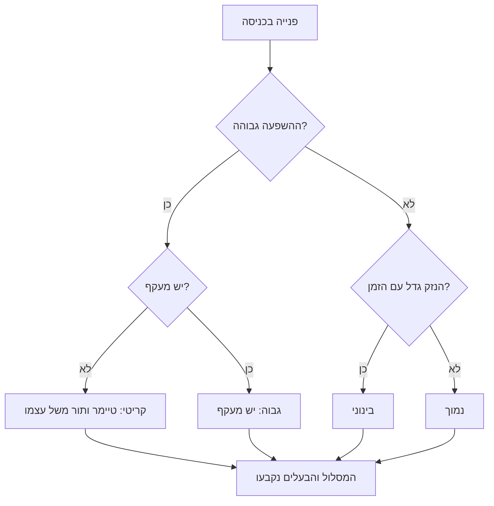
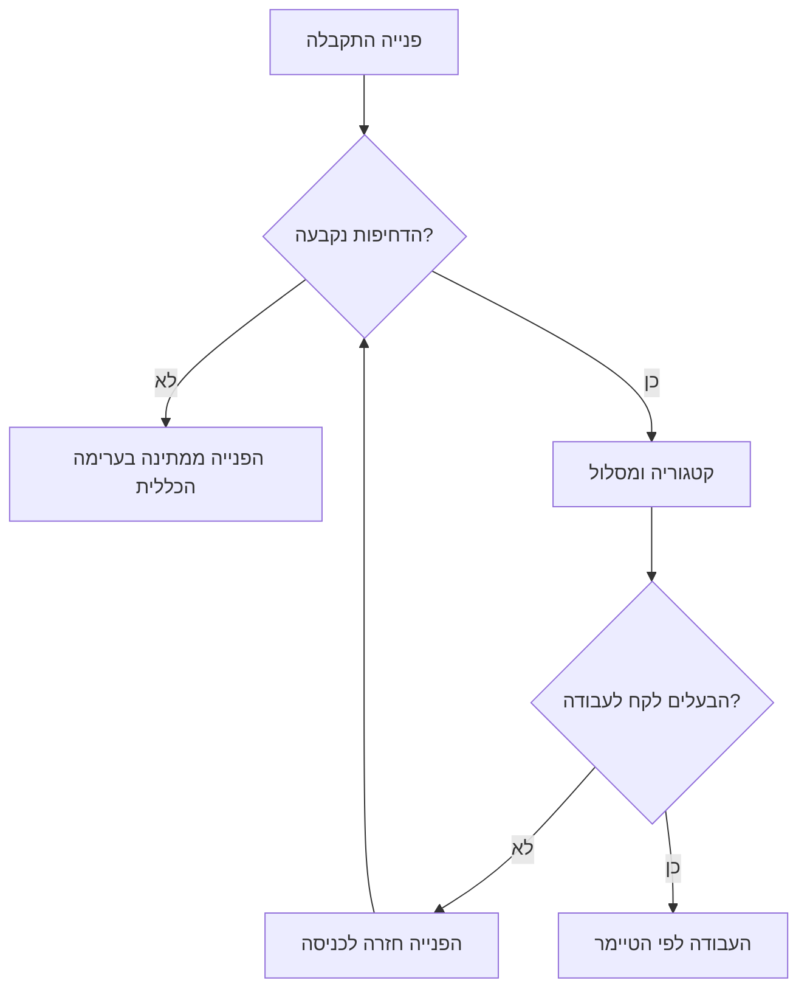

## מבוא

מיון הוא שלוש החלטות שמתקבלות ברגע המגע הראשון עם הפנייה: כמה זה דחוף, איזו פנייה זאת ולמי היא הולכת. שלוש החלטות שלוקחות כמה דקות, וכל שאר חיי הפנייה תלויים בהן.

בחודשים הראשונים בתפקיד מנהל תמיכה לא עסקתי במיון. ליתר דיוק, עסקתי בלי לקרוא לזה כך: פתחתי את הפנייה, קראתי, חשבתי "זה של סשה", העברתי — והשארתי את הדחיפות כפי שהייתה ביצירה. כלומר, אין. כעבור חודש התברר שהתור חי חיים משל עצמו: תקלות, שאלות על התיעוד ובקשות שינוי מעורבות יחד, פניות אינטגרציה תלויות ליד בקשה להחליף חתימה במכתב, והדבר הקריטי צף לא מפני שהוא קריטי אלא מפני שהלקוח התקשר.

המאמר הקודם בסדרה — "מפת השירות ונקודת המוצא: אבחון החודש הראשון" — עסק בלראות את המסלולים ולמדוד את התגובה. המאמר הזה עוסק במה שהופך כמה מסלולים לזרימה מנוהלת: נקודת כניסה שבה פניות מקבלות דחיפות, קטגוריה ובעלים.

הטענה פשוטה: מיון הוא הכניסה היחידה לשירות, וסדר ההחלטות בתוכו אינו מקרי. קודם דחיפות, אחר כך סיווג. מי שמחליף את שני הצעדים האלה מקבל אנליטיקה מסודרת של השריפות של אתמול.

## מה קורה בלי מיון

בלי מיון הזרימה מנוהלת לא בכללים אלא ברמת הקול. מי שכתב בקול רם יותר ראשון בתור; מי שיודע להתקשר ישירות נמצא מחוץ לתור לגמרי.

כך נראה סט התסמינים השגרתי:

- **הכל דחוף.** את הדחיפות קובע מחבר הפנייה, ולגביו השאלה שלו תמיד החשובה ביותר. בתור מגיעות רק פניות "גבוהות", ואי אפשר להבדיל ביניהן.
- **הקו השלישי מוצף בדברים מיותרים.** הוא מקבל הכל, כולל שאלות שיש עליהן תשובה בתיעוד. הפיתוח טובע בתמיכה, התמיכה ממתינה לפיתוח, והמועדים לא זזים באף צד.
- **הקריטי שוקע בזרימה הכללית.** תקלה שנוגעת בכל הלקוחות שוכבת באותה ערימה עם תיקוני קוסמטיקה: אותה עדיפות ואותו סדר טיפול.
- **אין נתונים.** אי אפשר להשיב מתוך הזרימה כמה היו תקלות, כמה בקשות שינוי ואיפה באמת כואב. הקטגוריות ריקות או מלאות ב"אחר".
- **חזרות לא נראות.** פנייה עברה שלושה קווים, חזרה ונפתחה שוב — ואף אחד לא סופר שזה סימן. על כך בהרחבה במאמר "בלי הפרת SLA שקטה: בקרת תור שבועית".
- **מנהל התמיכה שוב מנתב.** כל עוד הניתוב נעשה על ידי האדם הזמין ביותר, השירות נשען עליו לבדו — בדיוק התפקיד שממנו פרשנו במאמר ["גבולות אחריות"](/he/blog/support-lead-boundaries/).

<!-- вилка: пример недели без триажа — что именно происходило с очередью и чем это закончилось. -->

כל תסמין בפני עצמו נראה זוטר. יחד הם נותנים דבר אחד: שירות שאי אפשר לתכנן בו ואי אפשר להבטיח בו.

## קודם דחיפות, אחר כך סיווג

סדר שני הצעדים אינו קפדנות אלא תוצאה של מה שכל אחד מהם מפעיל.

**הדחיפות מפעילה את הטיימר ומציבה בתור.** ברגע שהפנייה נוצרה — הזמן רץ. אם כעבור שעה מתברר שזו תקלה ולא שאלה, הטיימר רץ כבר שעה והפנייה כבר שעה בתור הלא נכון. לכן הדחיפות נקבעת ראשונה, ולפי מה שנראה בכניסה.

**הסיווג בוחר את המסלול ומזין את האנליטיקה.** הקטגוריה עונה לאן הולכים ומה ייספר אחר כך. אפשר לדייק אותה: מוקדן שהעמיק בבעיה כמעט תמיד מדייק את הקטגוריה, וזה תקין.

ההבדל במחיר הטעות מסביר את הסדר. טעות בדחיפות עולה במועד שהוחמץ ובלקוח שאבד, כי היא קובעת מתי אנחנו חייבים לענות. טעות בקטגוריה עולה בשורה בדוח, שאפשר לתקן בסגירה. את ההחלטה הראשונה יקר לתקן, את השנייה — כמעט בחינם. ולכן מה שיקר נעשה ראשון.

יש גם סיבה מעשית. דחיפות מוערכת לפי ההשפעה: כמה אנשים נפגעו והאם יש מעקף. זה נראה מטקסט הפנייה ומהתשובות לשתי שאלות. קטגוריה דורשת הבנה של הסיבה, והסיבה במגע הראשון לעתים קרובות אינה ידועה. לקבוע סיווג ראשון פירושו לנחש את הסיבה בזמן שהלקוח ממתין לתשובה על התוצאה.

שלושה כללים שאני מחזיק בראש בכל מגע ראשון:

1. **הדחיפות נקבעת לפי השפעה, לא לפי טון.** לקוח שכותב בשקט עשוי לדווח על השבתה מלאה. לקוח שכותב באותיות גדולות עשוי לבקש להחליף לוגו.
2. **אפשר להעלות דחיפות בלי נימוק, להוריד — רק עם נימוק.** האסימטריה מגנה מפני אופטימיות: העלאה תמיד בטוחה, הורדה מחייבת לרשום למה החלטנו שזה לא נורא.
3. **דחיפות ריקה אינה "בינונית כברירת מחדל".** שדה שאפשר לא למלא — לא ימולא לעולם. אם לא נבחר ערך, המיון לא הושלם.

## מטריצת הדחיפות והטיימרים

הבסיס להחלטה — מטריצה של שני ממדים: השפעה ודחיפות. השפעה — כמה אנשים ופונקציות נפגעו והאם יש מעקף. דחיפות — האם הנזק גדל עם הזמן או שאפשר לחכות לחלון מתוכנן. שיטה כזאת לקביעת עדיפות מתוארת ב-ITIL 4 (סט שיטות לניהול שירותי IT), והיתרון שלה בכך שאין צורך לדון בכל מקרה מחדש.

כך נראית ההסתעפות שכל פנייה עוברת בכניסה:

המטריצה מצמצמת ויכוח על עדיפות לשתי שאלות שאפשר לענות עליהן בדקה בלי לדעת את הסיבה. מכאן לכל תא יש טיימרים: תגובה ראשונה, עדכון הבא ומועד הסלמה.

| רמה | מה היא אומרת | מה הטיימר קובע |
| --- | --- | --- |
| קריטי | השירות לא עובד לרבים, אין מעקף | תגובה ראשונה ורגע ההסלמה ל-L3 |
| גבוה | נפגעו רבים, אבל קיים מעקף | תגובה ראשונה ומועד פתרון |
| בינוני | נפגע לקוח אחד או פונקציה אחת, נזק מתון | תגובה ראשונה בשעות העבודה |
| נמוך | שאלה או קוסמטיקה, העבודה לפי התוכנית | תגובה לפי סדר התור |

המספרים בטיימרים הם עניין של הסכמה, לא של יצירתיות של מנהל התמיכה. יעד כמו "תגובה ראשונה בתוך 30 דקות" ברמה קריטית אומר שמישהו חייב להיות במקום בזמן הזה, ו-L3 חייב לענות על חלקו בזמן דומה. טיימר שנשען רק על הקו הראשון הוא הבטחה שהקו הראשון לא יכול לקיים לבדו.

<!-- вилка: своя матрица и таймеры по уровням, согласованные с L3. -->

## ניתוב הפנייה

אחרי הדחיפות והקטגוריה צריך להיות לפנייה בעלים. מסלול הוא לא רק "למי" אלא שלושה דברים בבת אחת: מי מוביל, מה מצפים ממנו ובאיזה מועד.

מה נכנס למסלול:

- **אזור** — הקו, המוצר או המערכת שהפנייה שייכת להם;
- **כשר** — האדם או הקבוצה שיש להם גם הסמכות וגם הידע לפתור סוג כזה של משימות;
- **ציפייה** — מה אמור הלקוח לראות ומתי, כולל המקרה "קיבלנו, בודקים, נעדכן עד שעה כזאת";
- **הצעד הבא בכשל** — לאן הפנייה עוברת אם הבעלים לא עמד בזמן.

עובדת שיטה שנראית בהתחלה כבירוקרטיה: המסלול נרשם בשורה אחת בפנייה. לא תיאור ארוך אלא משפט כמו "אזור — אינטגרציה עם הפורטל, מה נבדק — לוגים והרשאות, ממתינים — לתשובת הפיתוח, מועד — לפי טיימר ברמה גבוהה". שורה כזאת עולה דקה בכניסה ומסירה חצי מהשאלות החוזרות בתוך הצוות.

בנפרד על הקווים. המיון לא מחליט מי צודק, הוא מחליט מי ראשון. אם מוקדן בקו הראשון יכול לסגור את הפנייה לבד — הוא סוגר; אם לא — הוא מעביר עם חבילה, ולא עם הטקסט "תסתכל". מסלול בלי חבילה אינו העברת עבודה אלא גלגול אחריות: הפנייה תחזור עם שאלות, והזמן ילך עליהן ולא על הפתרון.

## איפה המיון נשבר

המיון הוא המקום השביר ביותר בשירות, מפני שהוא נעשה מהר ובכניסה, היכן שהמידע המועט ביותר. התקלות השגרתיות נראות ישר במערכת.

- **דחיפות ריקה.** השדה קיים, הערך לא נבחר. זה נרפא לא בשכנוע אלא באיסור: פנייה בלי דחיפות אינה נחשבת כמתקבלת לעבודה.
- **"דחוף" כברירת מחדל.** אם העדיפות היא הפריט הראשון ברשימה או בקליק אחד — כעבור חודש הכל יהיה גבוה. עוזר הסבר בממשק: מה בדיוק משמעות כל רמה, עם דוגמאות.
- **חזרות בין הקווים.** הפנייה הייתה בקו השני, חזרה, ועברה לשלישי. זה לא מהלך עבודה תקין אלא סימן למסלול גרוע או לחבילה ריקה.
- **הפנוי ביותר עוסק במיון.** בדרך כלל מדובר בחדש שלא מזהה סימני תקלה. המיון אינו המשימה הקלה בתמיכה אלא אחת מהאחראיות ביותר: טעות כאן עולה הכי יקר.
- **מיון מחוץ לטיימר.** הזמן שנשקע על מיון הפניות הנכנסות לא נכנס לשום דוח. ואז השירות נראה מהיר על הנייר ואיטי בעיני הלקוח.
- **מיון על אדם אחד.** כל עוד ההחלטות מתקבלות על ידי מוקדן אחד, ובוודאי על ידי מנהל התמיכה, הזרימה נעצרת יחד עם החופשה שלו.

המיון לא עושה את השירות למהיר בעצמו. הוא עושה אותו לצפוי: לכל פנייה יש עדיפות, בעלים ומועד שכל המשתתפים יודעים עליו. צפיות היא מה שמאפשר אחר כך להבטיח ללקוחות מועדים ולא להתבייש. ברגע שזה עובד עולה השאלה הבאה: מי עוקב אחרי זה שהמועדים לא יפוגו בשקט. על כך במאמר "בלי הפרת SLA שקטה: בקרת תור שבועית".
