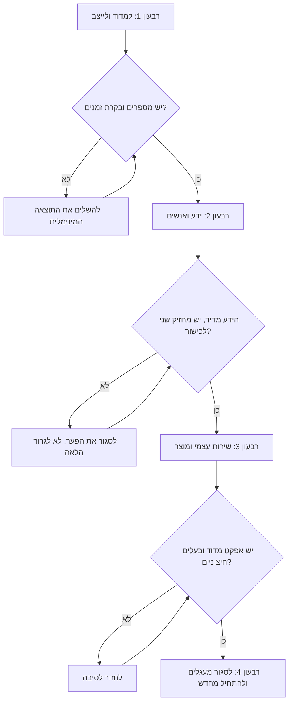

## מבוא

בשנה הראשונה שלי כמנהל תמיכה בניתי תוכנית של תשע־עשרה יוזמות. כעבור שלושה חודשים לא נשארה אף אחת: חלקן נשרפו בעבודה השוטפת, חלקן איבדו משמעות אחרי הנתונים הראשונים, וחלקן פשוט שכחתי. השירות לא נהיה גרוע יותר — הוא פשוט לא השתנה.

המאמר הקודם בסדרה — ["בסיס לפני מטרות"](/he/blog/support-lead-baseline-first/) — עסק בנקודת המוצא ובכיול המטרות עם ההנהלה. המאמר הזה עוסק בצעד הבא: איך מהמטרות המוסכמות נבנה לוח שנה שיש בו מקום גם לעבודה השוטפת וגם לשינויים.

הרעיון המרכזי שאליו הגעתי אחרי כמה שנים כאלה: מפת דרכים היא לא רשימת משאלות אלא רצף. הערך שלה לא במה שנכנס אליה אלא בסדר שבו הדברים קורים ובמה שאסור להתחיל לפני שהקודם נגמר.

## למה תוכניות של עשרים יוזמות לא שורדות

יוזמות כמעט לא נופלות אחת־אחת. הן נופלות יחד, והסיבות משותפות.

- **הכל משתנה בבת אחת.** מיון, בסיס ידע, מדדים, גיוס ו-Shift Left יוצאים לדרך באותו חודש — ואף אחד מהשינויים לא מקבל את תשומת הלב שנדרשת להשקה.
- **לשינויים אין הגדרה של "גמור".** "להטמיע KCS" נשמע כמו משימה אבל לא עונה מתי אפשר לקרוא לעבודה גמורה. משימה לא סגורה חיה שנים, עוברת מרבעון לרבעון ותופסת מקום בסדר היום.
- **שינויים מתחרים בעבודה השוטפת.** התור לא שואל אם יש לכם רבעון של שינויים. השבוע הראשון של תקלות אוכל את הזמן שהוקצה לתהליכים, ומכאן והלאה התוכנית חיה רק במצגת.
- **הצוות מפסיק להאמין ביוזמות.** הניסיון החמישי "סוף סוף להתחיל את בסיס הידע" נתפש כרעש שצריך לעבור. אחרי זה גם יוזמה טובה דורשת מאמץ נוסף להשבת האמון.
- **אין תנועה נראית לעין.** השנה נגמרת ובדומה: אותן פניות, אותם זמנים, ואת מה שעשה מנהל התמיכה אפשר להסביר רק ברשימת פגישות.

תשע־עשרה יוזמות מפסידות לא מפני שהן גרועות. הן מפסידות בלי סדר: לכל אחת בנפרד יש היגיון, לכלל אין.

## ארבעה רבעונים בשנה

שלד עובד לשנה של מנהל תמיכה הוא ארבעה רבעונים, שלכל אחד משימה משלו וסוג תוצאה משלו. לא מפני שלוח שנה כזה יפה, אלא מפני שכל בלוק נשען על התוצרים של זה שלפניו.

### הרבעון הראשון: למדוד ולייצב

משימת הרבעון — להפסיק לנהל בעיוורון ולכבות את השריפות התפעוליות הכבדות.

- **חודש 1: מפת השירות ונקודת המוצא.** דיווח מהמערכת, תיאור הזרימה, הצוואר.
- **חודש 2: מטרות וכיול.** תוצאות ניתנות לבדיקה לשנה, מוסכמות עם ההנהלה בכתב.
- **חודש 3: קו הייצוב הראשון.** מיון במגע ראשון, בקרת זמנים, מסלול הסלמות. לא "הוטמע במלואו" אלא "עובד ולא תלוי במנהל התמיכה".

תנאי סגירה לרבעון: לשירות יש מספרים, למספרים יש הגדרות, להפרות זמנים יש בקרה קבועה, ואתם יכולים לצאת לחופשה של שבועיים בלי שהתור יקרוס.

### הרבעון השני: ידע ואנשים

המשימה — להפוך ידע לנכס ולפרק תלות בנקודה בודדת — בידע ובצוות.

- בסיס ידע לפי KCS (Knowledge-Centered Service — גישה שבה המאמר נכתב ברגע הפתרון ולא אחריו) ותבנית מאמר עם בעלים.
- רשומות לתקלות חוזרות: מזרימת הפניות לרשימה עם בעלים וסטטוסים.
- שיחות 1:1 קבועות, הערכה לפי עובדות נצפות, מטריצת יכולות.

תנאי סגירה: חלק הפתרונות עם הפניה למאמר מדיד ועולה, תקלות חוזרות עברו מהזרימה למרשם, ולכל כישור קריטי יש מחזיק שני.

### הרבעון השלישי: שירות עצמי ומוצר

להוציא חלק מהזרימה מהתמיכה ולהתחיל לדבר עם המוצר בשפת הנתונים.

- פיילוט Shift Left (קירוב הפתרון למשתמש דרך שירות עצמי) עם מדידה ישרה: כמה פניות לא הגיעו לתמיכה.
- מטריצת אינטראקציות: מי מחליט באילו שאלות — מוצר, פיתוח, תפעול.
- כרטיסי בעיה למוצר עם נתונים, סטטוס ובעלים בצד השני.

תנאי סגירה: ערוץ שירות עצמי אחד לפחות עובד עם אפקט מדוד; לכל בעיה שאי אפשר לפתור בתוך התמיכה יש כרטיס ובעלים חיצוני; בסטטוס הכללי יש נתונים ולא "הרבה פניות".

### הרבעון הרביעי: לסגור מעגלים

לדאוג שהשנה הבאה תתחיל מידיעה ולא מדף חלק.

- דרכוני מדדים: מה מודדים, למה, ואיזו פעולה נובעת מערך.
- סטטוס קבוע להנהלה ובקשות החלטה במקום בקשות אמפתיה.
- ניתוחי תקלות blameless וביקורת חוסן: מה יישבר כשלא תהיו.
- דוח שנתי ובסיס חדש — עם היסטוריה מאחוריו, לא מאפס.

תנאי סגירה: לכל מדד יש בעלים ופעולה, לכל תקלה ניתוח בלי שמות ולפחות שינוי אחד במערכת, והשנה הבאה מתחילה בתוכנית ולא באבחון.

איך הרבעונים מתחברים:

<!-- вилка: свои вехи по месяцам — что именно сделано в каждом квартале и какой результат это дало. -->

## כלל הרצף

כלל שאני חוזר אליו בשורה אחת: הרבעון הבא לא מתחיל עד שלרשבון הקודם יש תוצאה. הוא לא נוח — בדיוק הוא מכריח לוותר על משהו מעניין לטובת משהו נחוץ.

מאחוריו ארבע תלויות קונקרטיות:

1. **בלי נקודת מוצא אין מדדי KCS.** חלק הפתרונות עם הפניה למאמר הוא מספר חסר משמעות אם לא ידוע כמה פתרונות יש בכלל ואילו מהם היו אמורים לעבור דרך הבסיס.
2. **בלי בסיס ידע אין Shift Left.** שירות עצמי בלי מאמרים מאומתים מעביר למשתמש חיפוש בזבל. החוויה הראשונה כזאת סוגרת את הערוץ לזמן ארוך.
3. **בלי Shift Left אין שיחה עם המוצר.** כל עוד כל הזרימה נופלת על התמיכה, אין לכם טיעון למוצר: אתם מדברים על כאב ולא על קנה מידה.
4. **בלי מדדים אין דוח שנתי.** דוח מתחושות ומתרשימים יפים לא שורד את שאלת ההבהרה הראשונה.

מה עושים כשהרבעון נכשל — ההמלצה אחת: לא לגרור את הבלוק הבא. הפיתוי מובן — השנה מתקדמת, צריך להדביק. אבל כל חלק במפת הדרכים נשען על הקודם, ופער לא סגור הופך את היוזמה הבאה לקישוט. עדיף להשקיע את תחילת הרבעון הבא בתוצאה המינימלית של הקודם — קטנה אבל אמיתית: מאמר אחד בבסיס הידע עם בעלים, בקרת זמנים אחת, אבן דרך אחת מדודה.

## קצב וחוצצים

מפת דרכים מתה לא מרעיונות גרועים אלא ממחסור בזמן לבצע אותם. לכן בלוח השנה צריכים להיות שמורים שלושה דברים.

- **הזמן של מנהל התמיכה לשינויים.** כלל 40 %: לפחות יומיים בשבוע למה שלא בוער עכשיו. אם כל השבוע הולך לתור, אבני הדרך הרבעוניות לא יקרו לעולם.
- **חוצץ לתקלות.** לתכנן רבעון בלי רזרבה זה לבנות כישלון לתוך התוכנית. אני משאיר בכל חודש שבוע שאני מראש מחשיב כאבוד.
- **נקודת בחינה.** פעם ברבעון — שעה לבנייה מחדש של התוכנית: מה נעשה, מה נדחה, מה מבוטל. לבטל חשוב יותר מאשר לדחות: רשימה של תשע־עשרה סעיפים מתחילה בדיוק מחוסר היכולת למחוק.

<!-- вилка: ваш ритм — сколько времени в неделю уходит на изменения, как выглядит квартальная ревизия. -->

## תוכן הסדרה

הטקסט הזה הוא המאמר הרביעי בסדרה "אסטרטגיית ניהול תמיכה", והוא משמש גם תוכן עניינים: המאמרים יוצאים בבלוקים, והסדר משקף את היגיון התלויות.

**המסגרת האסטרטגית של השנה**

- [חמשת התוצרים של מנהל תמיכה](/he/blog/support-lead-five-results/)
- [גבולות אחריות: מה מנהל התמיכה מחליט בעצמו, מה הוא מאציל וממה הוא פורש](/he/blog/support-lead-boundaries/)
- [בסיס לפני מטרות: למה תוכניות שנתיות קורסות כבר בהתחלה](/he/blog/support-lead-baseline-first/)
- שנה של מנהל תמיכה לפי רבעונים: מפת דרכים לשנים עשר חודש — המאמר הזה

**ייצוב השירות**

- מפת השירות ונקודת המוצא: אבחון החודש הראשון
- מיון במגע ראשון: קטגוריה, דחיפות, מסלול
- אף הפרת SLA שקטה: בקרת תור שבועית
- הסלמה ל-L3: החבילה, ה-OLA ובעל הלקוח

**הידע כמערכת**

- KCS בזרימת העבודה: המאמר נכתב ברגע הפתרון
- תבנית מאמר בבסיס הידע ובעל הבסיס
- תקלות חוזרות: מזרימת הפניות לרשומות עם בעלים
- שירות עצמי כ-Shift Left: פיילוט עם מדידה ישרה

**הצוות: אנשים והתפתחות**

- הקצב של המנהל: כלל 40 %
- שיחות 1:1 שלא הופכות לדוח ולהערכה
- הערכה לפי עובדות נצפות: מדגם QA ושישה קריטריונים
- מטריצת יכולות: סוגרים סיכוני נקודה בודדת
- כושר נשיאה במקום גבורה: חישוב הצורך במהנדסים

**המעגל החיצוני**

- מטריצת אינטראקציות: מי מחליט ובאילו שאלות
- סטטוס להנהלה: מכתב בעמוד אחד וסקירה של שעה
- לבקש החלטות ולא אמפתיה: הסלמה ובקשת משאבים
- ניתוח תקלה blameless: כרונולוגיה בלי שמות
- כרטיס בעיה למוצר שאי אפשר לסגור בלי סטטוס

**מדדים וסגירת השנה**

- מדד בלי פעולה הוא תמונה: דרכון המדד
- ביקורת חוסן: מה יישבר כשלא תהיו
- תשע טעויות של מנהל תמיכה — והדוח השנתי

קישורים נוספים מתווספים עם יציאת המאמרים; שאר הכותרות שומרות על סדרן ומקומן בתוכנית.

## מה נשאר משנה כזאת

מפת דרכים לשנים עשר חודש לא מבטיחה שהכל יצליח. היא מבטיחה משהו אחר: בסוף השנה תוכלו להראות מה השתנה ולמה, במקום להיזכר במה הייתם עסוקים. ארבעה רבעונים הם לא מתודולוגיה נוקשה אלא דרך לא לשנות הכל בבת אחת ולא לנטוש את מה שהתחלתם.

אם צריך משפט אחד מכל הטקסט — קחו את זה: קודם מספרים, אחר כך ידע, אחר כך שירות עצמי, אחר כך המעגל החיצוני. כל השאר הוא פרטי ביצוע שאפשר להתאים לשירות שלכם.
