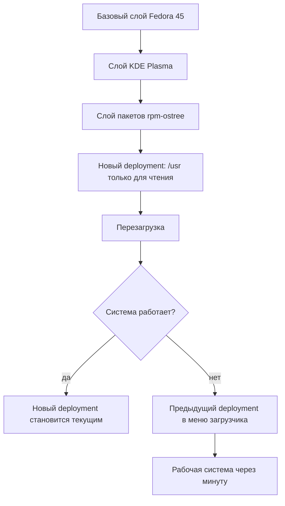
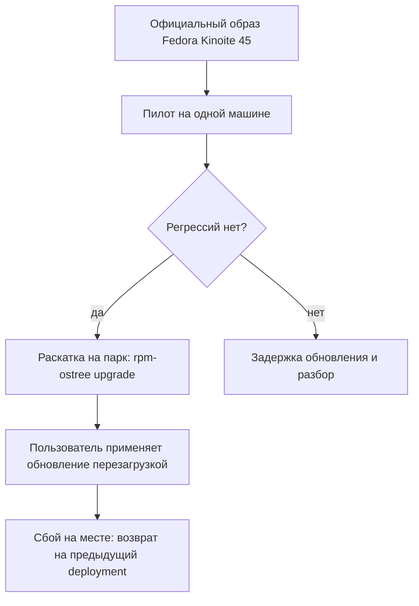

## Введение

Рабочий ноутбук я перевёл на Fedora Kinoite 45 — atomic-редакцию Fedora с KDE Plasma. Причина не в рабочем столе и не в Flatpak. Причина в модели обновления: система ставится не набором пакетов, которые правятся по одному на живой машине, а цельным образом, собранным из слоёв. У этой модели есть следствие, которое для меня важнее любых настроек: бекап-план перестаёт быть процедурой, которую надо не забыть выполнить. Он становится свойством системы.

## Как устроен atomic-релиз

Atomic-система собирается как образ. Снизу — базовый слой Fedora, на нём слой рабочего стола, выше — слой дополнительных пакетов, которые вы добавили сами. Слои собираются на сервере, подписываются и приезжают на машину целиком. Внутри образа `/usr` доступен только для чтения: на работающей системе никто не переписывает системные файлы по одному.

Каждое обновление — это новый deployment: полный набор слоёв, отдельная загрузочная запись и отдельный каталог в `/ostree/deploy`. Предыдущий deployment остаётся на диске, пока его не уберут или не закрепят. Выбор между ними делает загрузчик, а не пакетный менеджер.

Как выглядит путь от слоёв до работающей системы:



Изменяемые каталоги — `/etc` и `/var` — общие для всех deployments. Конфигурация, состояние сервисов и домашние каталоги при переключении остаются на месте. Поэтому возврат на предыдущую версию возвращает систему, а не стирает работу.

Главное отличие от привычной схемы — где происходят изменения. В обычном дистрибутиве обновление — это сотни операций над живой системой: каждый пакет ставится по отдельности, и между первой и последней операцией машина находится в неизвестном состоянии. В atomic-модели всё, что касается системы, происходит на сборочном сервере: там монтируется дерево, накатываются слои, получается один подписанный образ. На машину приезжает результат, а не процесс.

Побочный выигрыш — проверяемость. Подпись и идентификатор сборки позволяют ответить на вопрос, откуда взялась система, а неизменяемый `/usr` мешает тихо изменить бинарник или подложить библиотеку в системный путь. Это не замена антивирусу и не защита от root, но заметно сокращает незаметный дрейф.

## Право на ошибку

Дальше начинается то, ради чего это всё. Пользователь, у которого всегда есть предыдущая версия системы, ошибается спокойнее — и, что важнее, ошибается чаще и полезнее: пробует, откатывается, пробует иначе.

Сломался драйвер после обновления ядра — перезагрузка, предыдущая запись в меню загрузчика, работа продолжается. Не понравился новый Plasma или перестал запускаться виджет — то же самое. Поставили экспериментальный пакет слоем, получили конфликт — `rpm-ostree uninstall` возвращает прежний набор слоёв, а если проблема пришла с обновлением, `rpm-ostree rollback` переключает на предыдущий deployment.

Повседневные команды выглядят так:

```bash
rpm-ostree status                     # текущий и предыдущие deployments
sudo rpm-ostree upgrade               # скачать и подготовить новый
sudo rpm-ostree rollback              # вернуться на предыдущий
sudo rpm-ostree deploy 45.20261028.0  # конкретная версия
sudo rpm-ostree pin 0                 # закрепить рабочий deployment
```

Закрепление — недооценённая деталь. Перед рискованным экспериментом достаточно `pin`: рабочий deployment не будет вычищен сборщиком мусора, и вернуться к нему можно спустя недели.

Разница с обычным дистрибутивом видна на конкретных ситуациях:

| Ситуация | Обычный дистрибутив | Atomic-релиз |
| --- | --- | --- |
| Сбой после обновления | Диагностика, chroot, снапшот или переустановка | Выбор предыдущей записи в загрузчике |
| Прерванное обновление | Половинчатое состояние пакетов | Недоприменённого состояния нет |
| Эксперимент с пакетом | Откат по журналу транзакций | Удаление слоя или возврат deployment |
| Время на возврат | От часа до вечера | Один перезапуск |

Побочный эффект, который я не ожидал: я перестал откладывать обновления «на потом, когда будет время разбираться». Обновление теперь не событие с риском, а обычная операция с известной ценой отката. Обычно ведь как: свежая система — потенциальная проблема, и её отодвигают. Здесь потенциальная проблема ограничена одним перезапуском, и откладывать её незачем.

Отдельный выигрыш — разделение экспериментов и системы. Всё, что нужно попробовать «по-настоящему», живёт в контейнерах Toolbx или Distrobox, в Flatpak и в проектных окружениях, а не в базовой системе. Рабочий стол при этом остаётся чистым: эксперимент удалили — и от него не осталось хвостов в виде библиотек и зависимостей. А если эксперимент всё-таки задел систему, у вас по-прежнему есть предыдущий deployment.

Оговорка, без которой статья была бы нечестной: atomic-релиз защищает систему, а не данные. `/home` — обычная файловая система, и `rm -rf` в ней атомарность не остановит. Домашний каталог, git-репозитории и заметки надо бэкапить отдельно. Atomic снимает риск «сломалась ОС», но не риск «потерялись файлы».

## Что это даёт администратору

Для администратора парка машин выгода не в красоте идеи, а в сокращении классов инцидентов.

1. **Одна версия на всех.** Версия — одно число, а не «у всех по-разному, потому что кто-то обновился в марте». Ответ на вопрос «на какой вы версии?» даёт вывод `rpm-ostree status`, и он же прикладывается к заявке.
2. **Первая линия поддержки без root.** Инструкция «в меню загрузчика выберите предыдущую запись» работает у любого пользователя: без sudo, без удалённого доступа, без выезда. Это снимает самый дорогой класс обращений — «ноутбук не загружается после обновления».
3. **Нет половинчатого состояния.** Пакеты не устанавливаются по одному в живую систему: либо новый deployment целиком, либо старый. Класс инцидентов «обновление прервали на середине» исчезает по построению.
4. **Предсказуемое расследование.** Известны версия, набор слоёв и история deployments. Точка отсчёта «до обновления работало, после нет» получается одной командой, а не археологией по логам.
5. **Управляемый темп обновлений.** Новый образ можно скачать и не применять; можно проверить его на пилотной машине, а при необходимости вернуть конкретную сборку через `rpm-ostree deploy`, а не «последнюю, какая получится».
6. **Меньше дрейфа конфигурации.** `/usr` неизменяем, а изменения системы явные — слой пакета или правка в `/etc`. «Кто-то что-то доустановил полгода назад» видно в `rpm-ostree status`, а не обнаруживается при следующем крупном обновлении.

Как это выглядит при раскатке на парк:



У подхода есть цена, и её лучше знать заранее. Каждый добавленный слой приходится пересобирать на каждом обновлении базы, а конфликты слоёв — это реальная работа, а не редкий случай. Сторонние драйверы и модули DKMS нужно проверять на каждой версии. Flatpak обновляется отдельно и в образ не входит. Названия команд и флагов могут меняться от релиза к релизу — устойчива модель, а не синтаксис. Если нужны корпоративные настройки внутри `/usr`, появляется своя сборка образа и отдельный пайплайн; если нет — хватает официального образа плюс управляемых слоёв. И самое главное: решение о модели надо принять до того, как парк разъехался, а не после.
## Итог

Atomic-релиз не делает систему безотказной. Он делает отказ дешёвым. Предыдущая версия уже лежит на диске и грузится по выбору в меню — значит, любое обновление, любой эксперимент и любая ошибка в настройке стоят одного перезапуска. Пользователь получает право ошибаться без последствий, администратор — предсказуемый парк и первую линию поддержки, которой не нужны права root. Поэтому в моём списке бекап-планов atomic-релиз стоит первым, а не последним.
