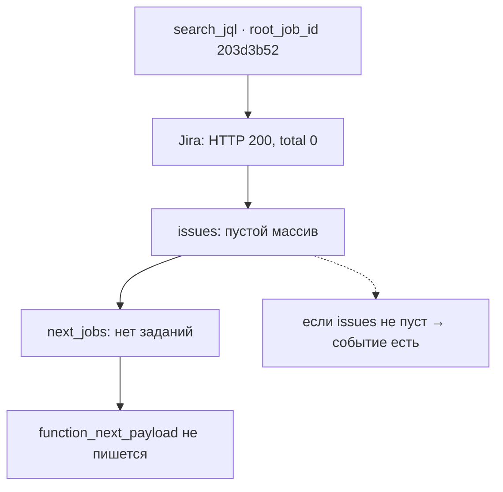

## Симптом

Фича в проде. Тестов зелёных — семьсот сорок семь. Контракт поднят, документация обновлена. Включаю TRACE на живом инстансе, прогоняю запрос — и в логах воркера нет ни одного `function_next_payload`.

Первая мысль любого инженера в этот момент: «код в контейнер не попал».

Как включить TRACE: уровень логирования читается из конфига инстанса, а не из кода (принцип II не просто так). Меняю на `TRACE`, перезапускаю под, отправляю в бота привычную команду с JQL-запросом и жду записи в `journalctl`. Записи нет.

## Шаг 1: а код вообще в контейнере?

Захожу внутрь `localhost/worker:dev`, смотрю файл с хелпером — на месте. Запускаю probe вручную, эмитируя событие из REPL — запись в логе есть, формат правильный.

Вывод: код рабочий, эмиссия рабочая, логгер настроен. Проблема не в сборке.

## Шаг 2: реконструкция каскада

Дальше — искать не код, а данные. Беру `root_job_id` из логов одного запроса и смотрю все задания каскада:

- задание `search_jql` — ровно одно;
- дочерних заданий — ноль;
- событий `function_next_payload` — ноль.

Три нуля. Это уже подозрительно: каскад есть, а детей нет. Функция отработала, но ничего не породила.

## Шаг 3: а что ответила Jira?

Смотрю в том же логе ответ Jira на JQL-запрос. Он выглядит так:

```text
event: jira_search_result
  status: 200
  total: 0
  issues: []
```

HTTP 200, ошибки нет, просто ноль задач. Фильтр `59251`, на котором всё это крутится, оказался пуст. Значит, функция честно вернула `next_jobs: []`, и по требованию FR-007 (пустой список — событие не пишется) — событие и не должно было появиться.

Вот как это выглядит целиком:



## Улики

| Уровень | Что видно | Что значит |
| --- | --- | --- |
| Контейнер | хелпер на месте, probe пишет | код свежий |
| Каскад | 1 задание, 0 детей | функция отработала |
| Jira | `HTTP 200, total: 0` | данных нет |
| Спека | FR-007: пустой список — нет записи | поведения совпадает с требованием |

## Не баг, а пустые данные

Это самый неприятный класс производственных дефектов: все системы работают правильно, а результат выглядит как поломка. Спека была права, код был прав, логгер был прав — не было данных для события.

Урок — сформулирую его как правило: «в логе тишина» не равно «код сломан». Сначала спросите, было ли вообще что логировать. По опыту, в двух случаях из трёх на этой стадии выясняется, что событие писать было не из чего.

И ещё одна деталь, которая сэкономила время: у события всегда есть предшественник. Сначала смотрится ответ внешнего API, потом — построенные из него задания, и только в конце — эмиссия. Если бы я начал с кода эмиссии, то проверил бы больше трёх файлов вместо одной строки в логе Jira.

Второй урок уже про процесс: тест на пустой результат у меня был (тот самый седьмой тест из поста 8), но в проде я про него забыл. Спека помнила, а я — нет.

## Про безопасность логов

В этом TRACE`-логе рядом с полезной строкой лежит ещё две вещи: заголовок `Authorization: Bearer …` с токеном Jira и полный payload задач с ключами и описаниями из реальной боевой доски. Показывает это именно TRACE-режим, который включается на десять минут для расследования.

Отсюда правило, которое я добавил себе в культуру после этой фичи: сырые TRACE-логи не выкладываются никуда — ни в блог, ни в issue tracker. В этой серии всё перефразировано, все идентификаторы заданий и ключи вымышленные.

## Осадочек

Расследование закрыто, дефекта нет. Но остался вопрос, который превратит следующую часть в переделку архитектуры: если функция может не породить заданий — должна ли она вообще молчать?

Тогда казалось, что ответ очевиден. Оказалось — нет.

---

[← Пост 9: `/speckit.analyze`](/ru/dev/blog/sdd-09-analyze-findings/) · [Пост 11: эмиссия переезжает в функции →](/ru/dev/blog/sdd-11-emission-moves-to-functions/)
