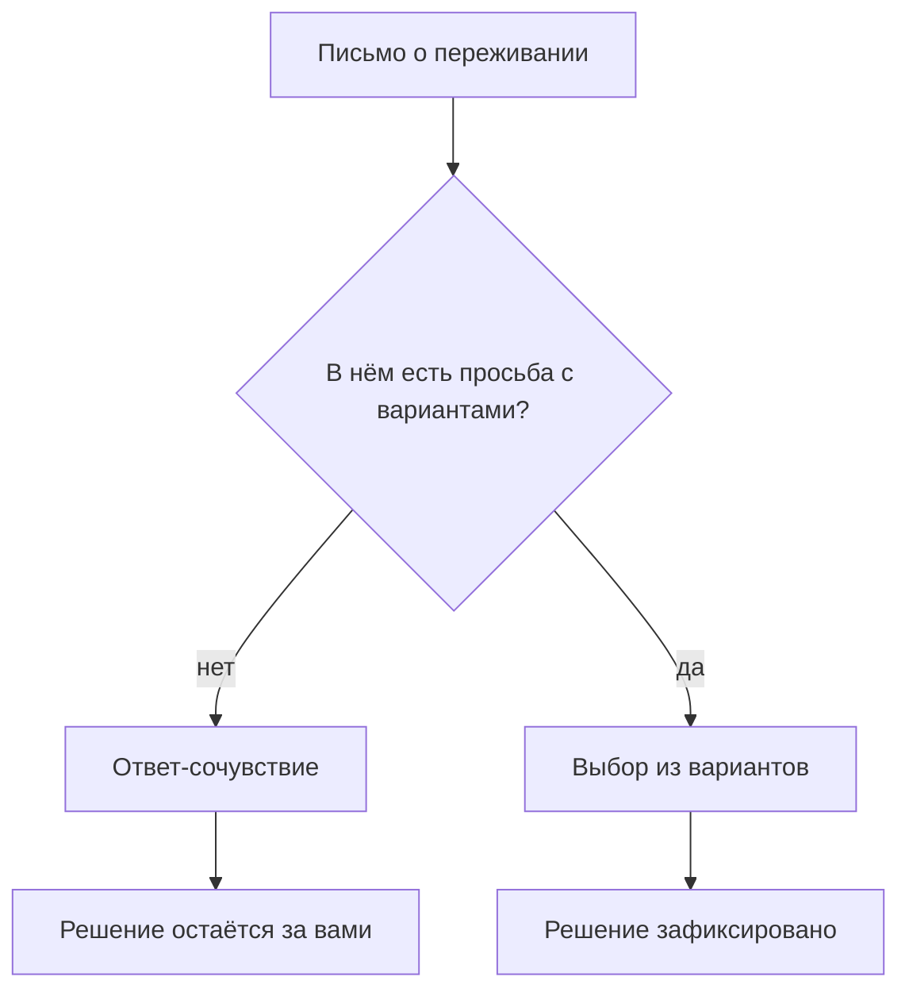
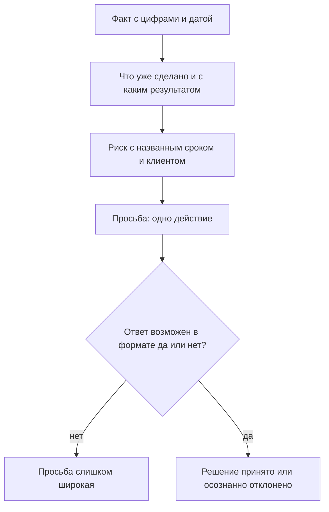

## Введение

Одно из первых писем наверх я написал в состоянии, которое казалось мне полностью оправданным: три недели без выходных, два инцидента подряд, два инженера болеют, и всё это на фоне обещанных сроков. Письмо было длинное, эмоциональное и честное. В ответ я получил одну строчку: «Держись, мы в тебя верим».

Сочувствие — вежливая форма отказа. Не потому, что руководитель чёрствый, а потому, что в таком письме не было просьбы, на которую можно ответить иначе: не было варианта, не было цены, не было срока. Оно было о моём состоянии, а решения принимаются по состоянию сервиса — вещи разные, хоть и связанные.

С тех пор я пишу письма наверх по двум шаблонам. **Эскалация** — когда проблема выходит за пределы сервиса и требует вмешательства с той стороны: факт, что сделано, риск, просьба. **Запрос ресурсов** — когда не хватает часов: данные, следствие, просьба с альтернативами. Разница в предмете, логика одна: превратить переживание в условие задачи, у которого есть ответ.

## Почему «нам нужна помощь» не приводит к решению

На первый взгляд просьба о помощи — самая безобидная форма коммуникации. На практике она ломается о три вещи.

Во-первых, в ней нет предмета спора. Руководитель не может ответить на «нам нужна помощь» — только спросить, какая именно и сколько. То есть работу по формулировке проблемы он получает вместо вас.

Во-вторых, в ней нет выбора. Решение сводится к «помочь или не помочь», а люди в основном выбирают второй вариант, когда цена первого не названа.

В-третьих, она неизменно читается как признание бессилия — так она и написана. Отсюда и «держись»: человеку в тяжёлом состоянии интереснее посочувствовать, чем вдаваться в детали, которых он не знает.

Как это выглядит по цепочке:

Иногда помогают и сочувственные письма — если честно говорить, что это эмоция, а не просьба. Но скорее как исключение и с открытым текстом: «мне нужна поддержка, а не решение, сформулирую к пятнице».

## Шаблон эскалации

Эскалация — это передача проблемы тем, у кого больше полномочий, а не тем, кому больше повезло с должностью. Структура из четырёх блоков.

**Факт.** Что случилось, когда началось, кого касается, какие цифры подтверждают. Без оценок и без прилагательных: «с такого-то числа доля заявок без ответа растёт», а не «ситуация совершенно ужасная».

**Что сделано.** Какие попытки предприняты, что показали. Это блок, который отличает эскалацию от переноса ответственности: видно, что проблема не вывалена наверх, а доведена до момента, где нужны полномочия.

**Риск.** Что будет, если не вмешаться, с гораздо более конкретной привязкой: какой клиент, какой срок, какой норматив. Риск без следствия — это настроение, его не обсуждают.

**Просьба.** Конкретное действие, которое нужно от адресата: решение, доступ, письмо, ресурс, приоритет. Формулируется так, чтобы можно было ответить «да» или «нет».

Как блоки складываются в действие:

Отдельное правило: одна эскалация — один вопрос. Если в письме три просьбы, ответом будет обсуждение самой удобной из них, а остальные тихо исчезнут.

Ещё два коротких правила. Адресат — тот, у кого есть полномочия, а не тот, кто ближе в оргструктуре: письмо руководителю, который сам не владеет вопросом, гарантирует ещё один круг пересылки и потерю доверия обеих сторон. И второе: эскалировать надо до того, как срок истёк. Эскалация после нарушения читается не как управление риском, а как объяснение провала, и обсуждают в ней уже не решение, а виновного.

## Шаблон запроса ресурсов

Этот шаблон тесно связан с расчётом мощности: без него запрос превращается в «дайте человека». Логика из трёх частей.

**Данные.** Цифры за период: объём, сроки, дефицит часов и допущения, на которых это посчитано. Допущения выписаны явно, чтобы их можно было оспорить.

**Следствие.** Что перестанет выполняться без изменений и к какому сроку. Здесь важно говорить в терминах обязательств, а не самочувствия: не «команда не выдержит», а «к такой-то дате перестанет выполняться такой-то норматив».

**Запрос с альтернативами.** Всегда не один вариант, а как минимум два: добавить часы, уменьшить объём, изменить норматив письменно. Наличие альтернатив превращает просьбу в выбор — даже когда руководство выбирает не тот вариант, на который вы рассчитывали.

Формально запрос — это одна страница и приложение. На странице — три блока и дата, к которой нужен ответ; в приложении — расчёт и выгрузки для тех, кто будет его проверять. Смешивать уровни не стоит: руководителю нужен вывод, аналитику — исходные данные, и это разные документы.

Есть и неприятная часть: запрос ресурсов иногда заканчивается отказом. Это нормальный исход, если отказ осознанный и зафиксирован вместе со следствием: тогда при следующем обсуждении вы не начинаете с нуля и не тратите письмо на напоминание.

## Плохо и хорошо на одном кейсе

Самый наглядный способ объяснить разницу — взять одну ситуацию и написать её дважды. Ниже — не готовый текст для копирования, а сравнение формы: две версии одного и того же события.

В плохой версии письмо начинается с фона и эмоции, потом идёт перечисление всего, что происходило, и заканчивается фразой вроде «нам нужно что-то решать». Читатель получает три страницы контекста и ни одного действия.

В хорошей версии та же ситуация описана иначе: одна строка факта с датой, абзац о том, что уже сделано, одна строка риска с конкретным следствием, одна явная просьба с датой, к которой нужен ответ. Объём — треть от первой версии.

Что при этом не меняется: картина проблемы и её серьёзность. Плохое письмо не преувеличено, хорошее не преуменьшено. Меняется только то, что читателю теперь есть что ответить.

<!-- вилка: свои два письма — один и тот же кейс до и после перехода на шаблон. -->

## Чего не писать

Список невелик, но каждую ошибку я встречал десятки раз — и в чужих письмах, и в своих.

- **Обвинения.** «Разработка опять не ответила» — это эмоция, а не факт; замените на сроки и на попытки связаться.
- **Детали без вывода.** Полная хронология без итога заставляет руководителя делать вашу работу: вычитывать главное из тридцати строк.
- **Просьбы без вариантов.** «Нужно больше людей» без альтернатив ставит руководителя перед выбором да/нет, а такой выбор почти всегда заканчивается нет.
- **Ложная срочность.** Если каждое письмо помечено «срочно», через месяц срочным не считается ни одно.
- **Скрытый ультиматум.** «Иначе будем вынуждены…» без конкретного варианта — это давление, и оно читается безошибочно.
- **Просьба не к тому адресату.** Эскалация руководителю, который не владеет вопросом, тратит доверие обеих сторон.

И одно правило для себя: перед отправкой прочитать письмо и ответить на вопрос, какое решение принял бы я, если бы у меня было две минуты. Если ответ не формулируется — письмо ещё не готово.

Шаблоны не делают просьбу мягче и не гарантируют согласия. Они делают другое: превращают разговор об усталости в разговор о приоритетах и ресурсах — а такой разговор может закончиться решением, даже если оно будет отрицательным.
