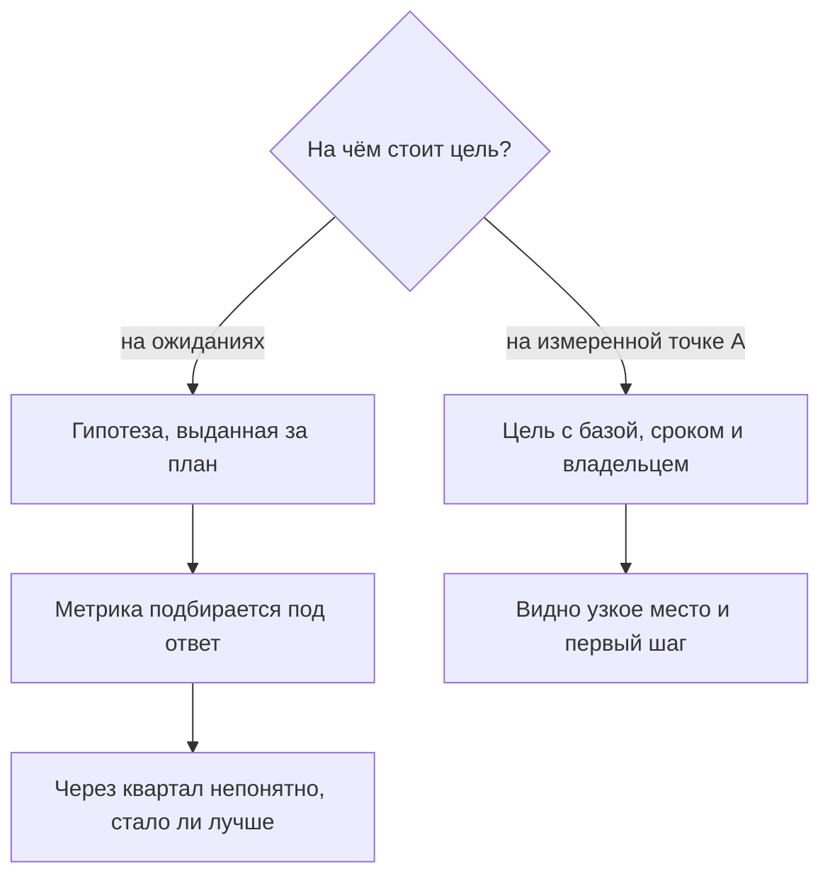
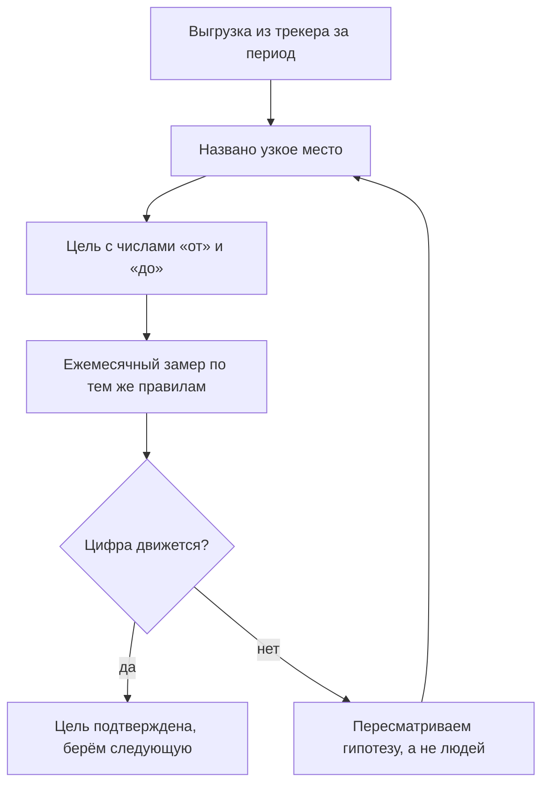

## Введение

В первый рабочий день на позиции лида поддержки у меня было два документа: список ожиданий от руководства и уверенность, что я знаю, как их выполнить. Через месяц выяснилось, что половина ожиданий измерялась не тем, чем я думал, а вторая половина не измерялась никак. Цифры, которые я называл на планёрках, были не состоянием сервиса, а суммой чужих впечатлений.

В предыдущей статье серии — [«Границы ответственности»](/ru/blog/support-lead-boundaries/) — речь шла о том, чтобы освободить время лида от чужих решений. Эта статья о следующем шаге: что делать с освободившимся временем в первые недели, чтобы год не превратился в набор громких обещаний.

Тезис простой и неприятный: цель, поставленная до измерения, — это гипотеза, которая выдаёт себя за план. Она звучит правильно, она нравится руководству, и у неё нет ни одного шанса сработать, потому что никто не знает, от какой точки она отсчитывается.

## Цели в день старта — типовая ошибка

Цели редко придумывает лид в первый день. Обычно они приходят готовыми: из ожиданий руководителя, из описания вакансии, из прошлогоднего плана, из опыта предыдущей компании. «Первый ответ в течение 30 минут», «сократить время решения вдвое», «поднять удовлетворённость клиентов» — всё это звучит как постановка задачи, но по сути является пожеланием.

Почему такие цели не переживают первый месяц:

- **У них нет начала.** Формулировка «сократить время решения вдвое» не содержит числа «от», только «до». Через квартал невозможно сказать, стало ли лучше, — сравнивать не с чем.
- **Они описывают не тот объект.** Время решения, посчитанное средним по всем заявкам, включает те, что месяцами висят в ожидании ответа клиента. Метрика двигается не тогда, когда работает команда, а тогда, когда клиент соизволил ответить.
- **Измеритель подбирается задним числом.** Сначала цель, потом метрика, которая её «подтвердит». Так появляются отчёты, где всё хорошо, и ощущение, что сервис живёт не той жизнью, которую показывают цифры.
- **Первая неудача убивает доверие к плану.** Цифра не сдвинулась за месяц — и вывод делается не «мы не знаем, откуда считаем», а «план не работает, лид не тянет».
- **Команда не видит связи.** Инженер читает «цель года» и не понимает, что из этого меняется в его смене. Цель, которая не превращается в ежедневное действие, живёт только в презентации.

В годовом плане, по которому я работаю, это названо первой типовой ошибкой лида: цель до измерения. Логика её проста — измерять страшно, потому что факт может оказаться хуже, чем ожидания. Поэтому цель ставится первой: она создаёт ощущение контроля. Только контроль этот мнимый.

Как выглядит развилка:

Дальше — что именно меняет измеренная точка А.

## Что меняет точка А

Baseline (в русской практике — базовая линия, точка А) — это измеренное состояние сервиса на входе: сколько заявок приходит, какого они рода, сколько времени проходит до первого ответа и до решения, какая доля решений возвращается, где поток стоит. Не оценка, не ощущение «вроде справляемся», а счёт по событиям из трекера.

Пример, который делает разницу очевидной. Цель «первый ответ за 30 минут» при факте «первый ответ приходит через три дня» — это не цель, это другой сервис с другим штатом и другой очередью. Между фактом и целью лежит не мотивация, а работа: триаж первого касания, дежурства, распределение потока, регламент эскалаций. Цель, поставленная без этого зазора, выбирает не работа, а фантазия — и через месяц выясняется, что двигали не то.

Три функции baseline, которые важны больше самой цифры:

1. **Масштаб.** Он почти всегда отличается от того, что кажется. Нагрузка распределена неравномерно, часть потока — не инциденты, а вопросы и запросы на изменение, и работать с ними нужно по-разному.
2. **Узкое место.** Гипотез о том, что мешает, обычно пять. Факт называет одну — и это экономит квартал.
3. **Проверяемость.** Цель с точкой А звучит иначе: не «ускорить реакцию», а «первый ответ с трёх дней до восьми часов к концу второго квартала». Её можно проверить, оспорить и разбить на шаги.

<!-- вилка: 3–4 фактических значения точки А — MTTA, доля реопенов, доля решений по базе знаний, просроченные заявки. -->

Как замыкается работа с точкой А:

## Baseline из трекера за первый месяц

Первый месяц — единственное время, когда у вас есть право не знать цифр. Дальше это право заканчивается, и каждая формулировка «нам кажется» стоит доверия. Поэтому выгрузка делается сразу и целиком, даже если разбирать её вы будете постепенно.

Что стоит выгрузить в первую очередь:

| Показатель | Что показывает | Зачем в точке А |
| --- | --- | --- |
| Объём и структура потока | Заявок в неделю по категориям: инцидент, вопрос, запрос на изменение | Масштаб и правильная очередь |
| Критичность | Распределение по приоритетам и доля критичных | Где реальный риск, а где шум |
| Время первого ответа | От создания заявки до первого содержательного ответа | Дисциплина реакции, а не занятость |
| Время до решения | От создания до закрытия — с разделением на время в работе и время в ожидании | Работа команды отдельно от ожидания клиента |
| Реопены и возвраты | Доля заявок, открытых повторно | Качество решения, а не скорость закрытия |
| Доля решений по базе знаний | Заявки, закрытые со ссылкой на статью | Зрелость знаний и потенциал самообслуживания |
| Доля эскалаций | Передачи в L2 и L3 | Где ломается маршрут и не хватает компетенций |
| Возраст бэклога | Заявки, висящие дольше норматива | Тихие нарушения, которых не видно в отчётах |
| Нагрузка по инженерам | Распределение заявок и времени | Мощность и одноточечные риски |

Несколько правил, без которых выгрузка превращается в набор несопоставимых чисел:

- **Один период, один источник.** Все показатели считаются за одинаковое окно из одного трекера. Данные из чата, из почты и из памяти в baseline не входят.
- **Определения записаны.** «Первый ответ» — это что именно: шаблонное подтверждение получения или содержательный ответ? Пока определение не зафиксировано, цифру можно трактовать как угодно.
- **Считаем по событиям, а не по текущим статусам.** Заявка, закрытая сегодня, была создана месяц назад; отчёт по текущим статусам этого не покажет.
- **Время в работе и время в ожидании — раздельно.** Иначе виноватым в сроках автоматически становится клиент или, наоборот, команда.
- **Никаких ручных правок.** Как только первая цифра «поправлена, чтобы не выглядело так плохо», весь baseline перестаёт быть аргументом.
- **История важнее месяца.** Если в трекере есть квартал или год, берите их: сезонность в поддержке заметна только на длинном окне. Если данных мало, так и напишите — «выборка за три недели».

<!-- вилка: свои выгрузки — какие поля, за какой период, где хранится таблица. -->

Отдельно стоит посчитать, чего в трекере нет. Обычно это стоимость ручных операций, время на переключение между системами и работа, которая не оставляет заявки: разбор инцидентов в чате, консультации коллег, обучение. Эти цифры baseline не покажет, но именно они объясняют, почему инженер «занят, но заявки не закрываются».

## Калибровка с руководством

Второй месяц — время разговора, и его лучше готовить как защиту проекта, а не как отчёт о проделанном. На входе — выгрузка, на выходе — согласованные цели с числами «от» и «до».

Схема разговора состоит из четырёх шагов:

1. **Факт.** Показываете точку А без прикрас и без оправданий: столько заявок, такие сроки, такие возвраты.
2. **Узкое место.** Называете одну-две причины, подтверждённые данными, а не ощущением.
3. **Вектор.** Предлагаете, что изменится, если сделать конкретные шаги, и какие это цели даёт на год.
4. **Запрос.** Если для вектора нужен ресурс — человек, инструмент, решение руководства, — он называется прямо и в том же разговоре.

Правила, которые я вывел из собственных ошибок в этом разговоре:

- **Приходить с выгрузкой, а не с настроением.** Фраза «команда перегружена» обсуждается, фраза «в очереди висят заявки старше норматива, вот они» — решается.
- **Каждая цель имеет четыре атрибута:** «от», «до», срок и владельца. Цель без владельца — это не цель, а пожелание.
- **Цель, требующая ресурса, содержит запрос ресурса.** Обещать ускорение реакции без изменения штата — способ через квартал объяснять провал.
- **Промежуточные вехи вместо годовых обещаний.** «К концу первого квартала — первый ответ в течение дня, к концу второго — восемь часов» обсуждается легче и проверяется честнее, чем одна цифра на год.
- **Договорённость фиксируется письменно, с датой пересмотра.** Иначе через полгода будет новая версия разговора и новые ожидания.
- **Baseline — не оправдание.** Как только цифры начинают использоваться для объяснения, почему мы медленные, разговор теряет смысл. Они нужны, чтобы показать движение.

Отдельная ловушка — руководитель, который настаивает на цели, недостижимой при текущем ресурсе. Спорить с формулировкой бесполезно: спор идёт о будущем, а аргументы лежат в настоящем. Работает другое — согласиться с направлением и разложить его на вехи с условиями: «к такой-то дате выходим на такую-то цифру при таком-то ресурсе; если ресурса нет, веха сдвигается на столько-то». Так цель остаётся амбициозной, а вы — не человеком, который обещал и не сделал.

<!-- вилка: ваш разговор о целях — что было на входе, какие цели согласовали, какой ресурс запросили. -->

## Что должно остаться после первых двух месяцев

Короткий чек-лист, по которому видно, что старт удался:

- выгрузка из трекера существует и обновляется по одному правилу;
- у каждого показателя записано определение, и спорить о смысле цифры больше не нужно;
- названо узкое место, и оно подтверждено данными, а не авторитетом;
- цели года сформулированы как проверяемые результаты с числами «от» и «до»;
- у каждой цели есть срок, владелец и, если нужно, запрос ресурса;
- договорённость с руководством зафиксирована письменно и имеет дату пересмотра.

Точка А — это не бюрократия и не недоверие к команде. Это способ перестать спорить о том, что происходит, и начать спорить о том, что делать. Следующий шаг — превратить согласованные цели в дорожную карту на двенадцать месяцев: четыре квартала, где каждый следующий опирается на результат предыдущего. Об этом — в следующей статье серии.
