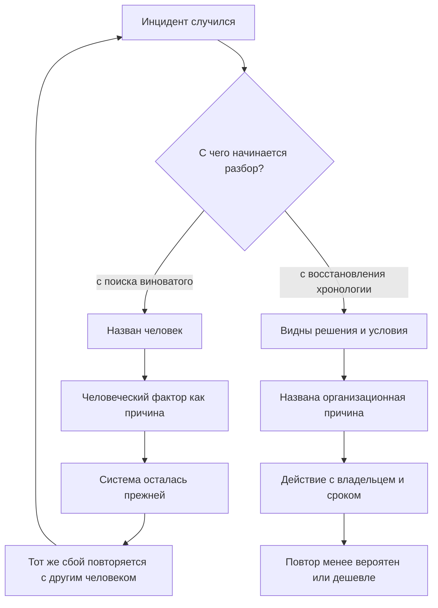
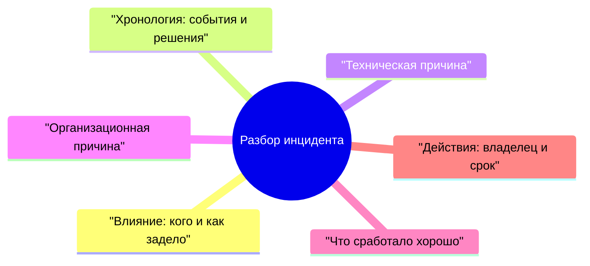

## Введение

Разбор инцидента — редкий момент, когда команда получает право говорить об ошибках вслух. В остальное время ошибка стоит доверия клиента, и люди это помнят. Поэтому разбор с вопроса «кто это сделал» даёт предсказуемое: в следующий раз о проблеме узнают позже, когда её уже нельзя скрыть.

Я провёл достаточно таких встреч, чтобы зафиксировать для себя правило: на разборе обсуждают решения и условия, в которых они принимались, а не людей. Такой разбор называют blameless — разбор без обвинений. Его цель — организационная причина: отсутствующий регламент, неоднозначный признак в мониторинге, нехватка прав, пропущенная проверка перед изменением.

Важно не путать это с безответственностью. «Без имён» относится к прошлому, а не к будущему: у каждого действия после разбора есть владелец и срок. Дальше — почему поиск виноватого не мешает повтору, из чего состоит разбор, как писать хронологию без имён и что делать с действиями после встречи.

Она продолжает внешний контур серии: в «Годе лида по кварталам» разборы стоят в четвёртом квартале — как способ замкнуть цикл, а не как ритуал отчётности.

## Почему поиск виноватого не предотвращает повтор

Виноватый находится почти всегда, и почти всегда это не тот, кто задал условия: дежурный инженер не создавал мониторинг с зелёным статусом и не писал регламент. Он оказался последним в цепочке, где решение выглядело правильным.

Что происходит дальше, если разбор останавливается на фамилии:

- **Найденный виноватый закрывает вопрос.** Дальше обсуждается поведение человека, а не система вокруг него. Встреча заканчивается с ощущением порядка и без единого изменения в регламенте или мониторинге.
- **«Человеческий фактор» ничего не объясняет.** Это не причина, а место, где причина проявилась. Содержательный вопрос: почему решение выглядело правильным в момент, когда его принимали, и почему система не поймала его до клиента.
- **Люди начинают защищаться, а не рассказывать.** Участник забывает упомянуть, что видел предупреждение в чате, потому что это звучит как признание вины. Восстанавливать картину потом дороже, чем провести разбор честно.
- **Система остаётся прежней.** Действие «провести беседу» не меняет ни признак в мониторинге, ни порядок в очереди. Через месяц то же случается с другим дежурным.
- **Следующий инцидент приходит позже.** Команда учится, что о сбое выгодно молчать до последнего. Между проблемой и её признанием появляется задержка, которую никто не измеряет, но все чувствуют.

Круг замыкается так:

Левая ветка приятнее по ощущениям: у неё есть финал и виновник. Правая медленнее на входе — нужно собирать хронологию и признавать, что часть вины лежит на процессах, которые вы же и построили. Зато только она меняет то, от чего зависит повтор.

## Структура разбора

Структура защищает встречу от подмены: без неё обсуждается самое интересное — техническая причина, — а влияние и организационные условия остаются за кадром.

Минимальный состав разбора:

Поля по существу:

- **Влияние.** Кого задело, какие каналы, что было недоступно и сколько это продолжалось. Поле идёт первым не из вежливости: без него разбор превращается в семинар о редкой причине, а ущерб остаётся невысказанным.
- **Хронология.** События и решения по часам систем: заявки, мониторинг, чат дежурства, история изменений. Не по памяти — она выравнивает картину под уже известный финал.
- **Техническая причина.** Цепочка «что сломалось — почему это привело к отказу». Отвечает на вопрос «как», а не «кто», и находится быстрее остальных полей.
- **Организационная причина.** Почему система допускала изменение без проверки, почему признак не попал в мониторинг, почему первая линия не увидела массовость. Это поле задаёт действия, которые предотвращают повтор.
- **Что сработало хорошо.** Обязательное поле, иначе разбор превращается в наказание. Что сократило время восстановления, какая договорённость выдержала. Успешные решения полезно повторять не меньше, чем исправлять неудачные.
- **Действия.** Список с типами, владельцами и датами — отдельный разговор в конце статьи.

Два правила. Разбор проводится в первые рабочие дни, пока хронология собирается по логам, а не по легендам. Ведёт его человек, не участвовавший в восстановлении, — иначе разговор скатывается в пересказ своих действий.

## Хронология без имён

Главная техника blameless-разбора — роли вместо фамилий. Вместо «инженер не проверил срок действия сертификата» в хронологии появляется «дежурный инженер не получил уведомления об истечении сертификата».

Разница не косметическая. Фамилия приклеивает к событию оценку: прочитав её, участники обсуждают, внимателен ли человек, а не то, что он видел на экране. Роль оставляет место для вопроса об условиях — единственного, на который можно ответить действием.

Три причины, по которым роль точнее имени:

1. **Хронология становится проверяемой.** Роль сверяется со сменным графиком и логами; имя тянет за собой воспоминания о человеке, а не о событии.
2. **Люди перестают редактировать себя.** Пока в записи будет фамилия, участник думает о формулировке, а не о фактах.
3. **Организационная причина видна раньше.** Если один и тот же шаг повторяется у разных людей, вопрос «кто виноват» теряет смысл, а вопрос «что общего у этих условий» становится очевидным.

Формат записи я держу из четырёх элементов: момент, событие, что было известно участнику, какое решение принято. Работает не форма, а дисциплина заполнения:

- **Момент — по часам систем.** «Утром» и «сразу после обеда» не восстанавливаются и не сверяются.
- **Событие — факт, без оценки.** «Шлюз вернул ошибку рукопожатия», а не «шлюз вёл себя странно».
- **Что было известно — ключевой элемент.** Решение оценивается вместе с информацией, которая была у человека в тот момент, а не с той, что появилась к разбору.
- **Решение — с вариантами, которые были видны.** Полезно записать не только что сделали, но и что казалось альтернативой.

Отдельно про правки. Согласованная хронология не переписывается: уточнения добавляются отдельной строкой с пометкой. Противоречия между участниками остаются в тексте: два разных воспоминания — факт о процессе, где информация не была общей, а не повод выяснить, кто из двоих прав.

<!-- вилка: фрагмент своей хронологии — 3–5 строк «роль — событие — известное — решение» из реального разбора. -->

## Разобранный пример

Ниже — типовой сценарий, техническая причина в котором скучная, а организационная — нет.

**Влияние.** Клиенты пишут в поддержку, что не получают ответов на письма; остальные каналы работают. Снаружи сервис молчит, хотя заявки в трекере создаются исправно.

**Хронология.** Плановое изменение на шлюзе применяется по регламенту; дежурный инженер видит зелёный статус; в течение смены приходят однотипные жалобы, каждую обрабатывают отдельно; инженер второй линии замечает совпадение времени жалоб с окном изменения.

**Техническая причина.** В цепочке сертификатов остался промежуточный сертификат с истёкшим сроком; часть почтовых серверов на такое рукопожатие реагирует отказом.

**Организационная причина.** У планового изменения не было критерия «канал принимает письмо после изменения»; у мониторинга — проверки бизнес-функции, только доступности порта; у первой линии — признака массовости по одному каналу, поэтому одинаковые заявки прошли как разные.

**Что сработало хорошо.** Инженер второй линии сопоставил время жалоб с окном изменения, и поиск сократился; дежурный сохранял входящие письма, поэтому влияние удалось описать точно.

**Действия.** Синтетическая проверка приёма письма после изменений — владелец в эксплуатации; правило триажа «однотипные заявки по одному каналу сводятся в один инцидент» — владелец в поддержке; проверка цепочки сертификатов в регламенте изменения — владелец в инфраструктуре.

Такой разбор занимает меньше часа, и основное время уходит не на техническую причину, а на разговор о том, почему три команды не имели общей картины.

<!-- вилка: свой инцидент — влияние, хронология в три строки, организационная причина, что сработало. -->

## Судьба действий

Самая частая проблема разбора — не качество выводов, а то, что решения не выполняются. Причины обычно одни и те же, и почти все они управляемые.

- **Владелец — человек, а не команда.** «Команда должна наладить мониторинг» не имеет владельца, а значит, и срока. Формулировка «эту проверку делает инженер эксплуатации, срок — такая-то дата» имеет.
- **Срок — дата, а не квартал.** «В следующем квартале» звучит как обязательство, но не является им.
- **Действие живёт в общем трекере.** Отдельный документ про инциденты читают один раз — на том же разборе. Действие в обычной очереди задач получает приоритет и видимость.
- **Действий немного.** Пять-семь строк на разбор — предел, после которого часть не выполнится.
- **У действия есть тип.** Устранить причину, ускорить обнаружение, ускорить восстановление, снизить влияние — четыре разные задачи, и одновременно они почти не решаются. Иногда дешевле не предотвращать сбой, а сократить время его обнаружения.
- **Статус — на следующем разборе.** Первые минуты каждой встречи уходят на прошлые действия: сделано, в работе, просрочено. Просроченное обсуждается как организационная причина — срок был нереалистичный или приоритет не дан, — а не как вопрос дисциплины.

<!-- вилка: как вы ведёте действия после разборов — где они лежат, как проверяется статус, что было с первым разбором. -->

Разбор без имён не делает команду мягче — он делает её быстрее: люди приходят с фактами, а не с защитной версией событий, и организационная причина находится на первой встрече, а не на третьей. Хронология без имён — не вежливость, а инструмент: она позволяет обсуждать условия, которые создали ошибку, и менять именно их.

Дальше в серии — «Карточка проблемы для продукта, которую не закрыть без статуса»: о том, что делать с причинами, которые нельзя исправить внутри поддержки.
