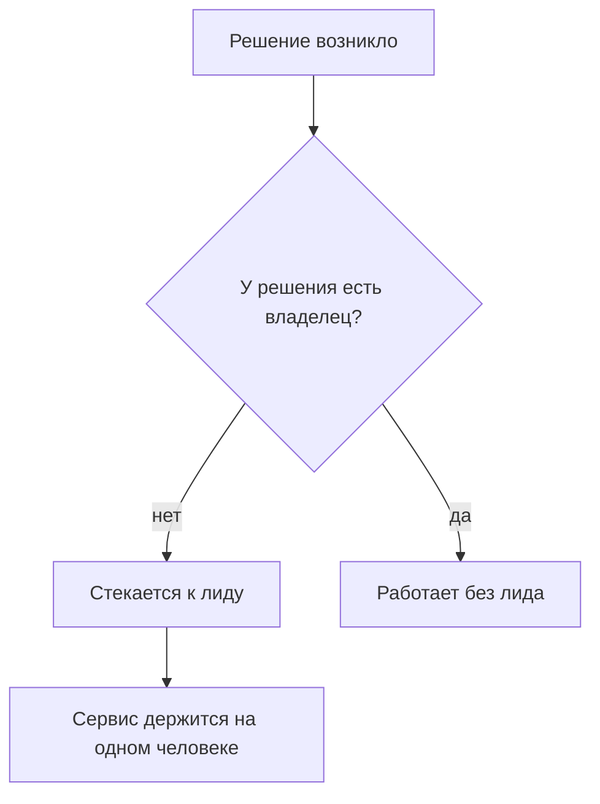
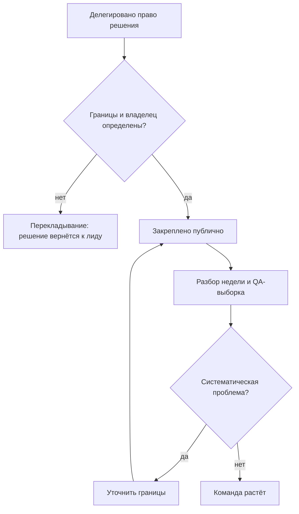

## Введение

Первые недели на позиции лида поддержки я помню одной картинкой: день съеден чужими решениями. Инженер приходит согласовать приоритет, разработчик — уточнить, кто скажет клиенту о переносе, руководитель — спросить, почему зависла заявка. К вечеру выясняется, что работу, ради которой существует лид, я не сделал.

Проблема не в трудоголизме и не в нехватке времени. Проблема в том, что у роли нет зафиксированных границ. Лид без границ превращается в единственного диспетчера: всё проходит через него, ничего не движется без него, и любая его болезнь или отпуск останавливает сервис. В предыдущей статье серии — [«Пять результатов работы лида поддержки»](/ru/blog/support-lead-five-results/) — я разобрал, чем работа лида отличается от работы диспетчера по существу. Здесь — про механику, которая защищает это различие на практике: три списка, из годового плана, по которому я работаю. Что я решаю сам, что делегирую и от чего отказываюсь.

Прежде чем разбирать списки, посмотрим на механику без них. Решения, у которых нет владельца, стекаются к самому доступному человеку. Самый доступный человек в поддержке — лид.

Дальше — как перевести это со ступеньки «стекается к лиду» на рельсы «работает без лида»: сначала заметить симптомы, затем составить три списка и превратить их в договор с руководством.

## Симптомы размытых границ

Размытые границы не объявляют себя. Они проявляются в повседневности, и стоит свериться с коротким списком симптомов:

- **Эскалации по умолчанию.** Каждый нестандартный тикет рано или поздно оказывается у лида — не потому, что инженер не может его решить, а потому, что «так принято». Триггер эскалации — не сложность, а неопределённость: «я не знаю, чьё это решение».
- **Лид — обязательный согласующий.** Обещание клиенту, перенос срока, доступ к системе, изменение регламента — всё требует вашей подписи. Пока вы в отпуске, эти операции просто не происходят.
- **Решения живут в чатах и голосом.** Через неделю никто не помнит, кто и почему решил отдать заявку на доработку. Споры перезапускаются с нуля, и арбитром снова оказываетесь вы.
- **День уходит на тактику.** Разбор зависших заявок и ответы на «а как быть с этим?» съедают день, а на процессы, качество и людей времени не остаётся. При этом формально вы «всё успеваете» — просто не делаете свою работу.
- **Команда не решает без вас даже мелочи.** Инженер может закрыть тикет сам, но всё равно спрашивает — не потому, что не знает ответа, а потому, что однажды за самостоятельность уже получил разброс. Так воспитывается беспомощность, которую потом же и ругают.

<!-- вилка: 2–3 симптома из собственной практики — что именно съедало день до введения списков. -->

За этими симптомами стоит одна и та же механика. И важно видеть её обратную сторону: границы — это не забор между вами и командой, а контракт доверия. Инженер готов брать решения только там, где понимает, где его права заканчиваются и кто его подстрахует. Чем прозрачнее границы, тем больше решений команда готова взять на себя — и тем меньше ваших подписей нужно сервису, чтобы работать.

## Список «решаю сам»

Первый список — решения, которые остаются у лида. Принцип отбора простой: остаются решения, цена ошибки которых высока или которые задают правила для всех.

- **Спорная критичность.** Когда инженеры расходятся в оценке, решение принимает лид: от него зависят таймеры реакции и порядок очереди.
- **Обещания клиенту за рамками регламента.** Компенсации, перенос сроков, исключения из SLA — всё, что создаёт обязательства, которых нет в договоре или регламенте.
- **Состав команды и распределение по проектам.** Кто на какой линии работает, кого брать на проект, кто дежурит.
- **Правила игры.** Регламенты, приоритеты очереди, критерии качества: их меняет тот, кто отвечает за результат.
- **Эскалация наверх.** Когда проблема выходит за пределы сервиса — на уровень руководства — решение о том, как и когда поднимать, остаётся за лидом.

Полезный тест для каждого пункта: «могу ли я объяснить, почему это решение не может принять инженер?» Если объяснение сводится к «я так привык», пункт переезжает в список «делегирую».

Ориентир по объёму: список «решаю сам» помещается на одну-две строки. Если он длиннее десяти пунктов, вы перепутали лидерство с контролем — и вернули себе все симптомы из предыдущего раздела.

<!-- вилка: ваш список «решаю сам» — 3–5 пунктов из практики. -->

## Список «делегирую»

Второй список — то, что уходит в команду. Здесь главная ошибка — путать делегирование задачи с делегированием права решения. «Разберись с тикетом» — это задача: инженер разбирается, а решение всё равно приносит вам. Делегирование звучит иначе: «тикет твой. Ты выбираешь маршрут и говоришь клиенту, что дальше. Я оставляю себе только критичность».

Разница между этими двумя формулировками — вся разница между диспетчером и лидом.

Что уходит в список «делегирую»:

- разбор тикетов в пределах регламента — включая нестандартные, если цена ошибки умеренная;
- коммуникацию с клиентом по типовым ситуациям: статусы, переносы в рамках SLA, уточнения;
- дежурства и распределение потока внутри смены;
- наставничество и приём новых инженеров;
- подготовку регулярных статусов и отчётов.

У каждого делегированного решения должны быть две вещи: **границы** (что инженер решает сам, в каком случае эскалирует и кому) и **владелец** (именно человек, а не «команда»). Делегирование без границ — не делегирование, а перекладывание: решение всё равно вернётся к вам, только позже и с испорченным контекстом.

Как устроен рабочий цикл делегирования:

И ещё одно правило, которое легко пропустить: право решения закрепляется публично. Если вы договорились с инженером один на один, через неделю очередь вернётся к вам — остальные-то не в курсе. Формулировка «по этим вопросам теперь идёте к Ане, не ко мне» должна прозвучать на общем разборе и быть видимой в регламенте.

Дальше начинается часть, о которой обычно забывают: делегирование не заканчивается в момент передачи. У каждого делегированного блока нужны точки контроля — не потому, что вы не доверяете, а потому, что у решения должен быть владелец и у вас, и у инженера. Достаточно лёгкого ритма: разбор нескольких делегированных решений на еженедельном разборе и QA-выборка, которая показывает качество решений независимо от того, кто их принимал. Если в выборке появляется систематическая проблема — это не повод забрать решение назад, а повод уточнить границы: вероятно, они были сформулированы размыто.

И удержите себя от обратного хода. Первые ошибки в делегированной зоне неизбежны, и соблазн «ладно, вернём как было» огромный. Но каждый возврат решения учит команду одному: границы — это декорация, настоящие решения всё равно у вас.

<!-- вилка: что вы делегировали за последний месяц и как объявили это команде. -->

## Список «отказываюсь»

Третий список — самый трудный. Отказаться — значит сознательно уйти из роли, которая давала ощущение контроля. В годовом плане таких ролей названы две, и обе знакомы каждому лиду:

- **Единственный диспетчер.** Тикеты маршрутизируются триажем и матрицей, а не мной. Пока маршрутизация — моя личная функция, сервис держится на одном человеке, а триаж не развивается.
- **Обязательный согласующий.** У типовых операций — регламент вместо моей подписи. Если операция типовая, она должна выполняться без меня; если не типовая — она в списке «решаю сам».

Можно добавить и третью роль, менее очевидную:

- **Самый компетентный эксперт по каждому продукту.** Если самая глубокая экспертиза в команде — вы, то ваш отпуск — инцидент, а ваш уход — катастрофа. Задача лида — чтобы критичная экспертиза была минимум у двоих; это отдельная работа с матрицей компетенций, и она заслуживает отдельной статьи серии.

Почему список «отказываюсь» труднее остальных: отказ не выглядит достижением. Договорённость «я больше не согласовываю переносы в рамках SLA» со стороны похожа на «лид расслабился». Держаться здесь помогает одна мысль: вы не теряете контроль — вы переносите его из своей головы в систему. Регламенты, триаж, матрица взаимодействий, владельцы решений — это и есть контроль, который не зависит от вашего самочувствия и графика.

Сообщение команде — критичный шаг, и его стоит делать прямым текстом: что именно вы перестаёте делать, с какой даты, что делать в спорных случаях и кто подстраховывает в переходный период. Молчаливый отказ (просто перестал отвечать) читается командой как обида или каприз.

Переходный период стоит спланировать так же честно, как сам отказ. Первые недели после сообщения — не время доказывать твёрдость: если инженер застрял в спорном случае, лучше один раз решить вместе с ним и обсудить это на разборе, чем заставлять сервис ждать. Полезно также договориться об обратном ходе: какие события легитимно возвращают функцию к вам (например, уход двух инженеров подряд или провал норматива подхвата) и как это фиксируется. Отказ без условий возврата выглядит догмой, а с условиями — управляемым решением.

<!-- вилка: формулировка сообщения команде — что вы перестаёте делать, с какой даты, куда идти в спорных случаях. -->

## Договор с руководством

Три списка работают, когда они существуют не в голове, а в документе, который виден и согласован с руководством. Это не бюрократия, а три конкретные выгоды.

Во-первых, руководство знает, какие решения ждать от вас, а какие — от команды. Нет сценария «почему это согласование ушло к инженеру?» — потому что есть документ, где это написано.

Во-вторых, делегирование получает защиту. Когда инженер принимает решение в своих границах, это не самоволье, а исполнение договора. Без документа любая ошибка делегированного решения читается как «надо было согласовать с лидом» — и список «делегирую» тихо умирает.

В-третьих, отказ от ролей перестаёт быть «лид расслабился». «Я больше не диспетчер и не согласующий» — это зафиксированная стратегия с объяснением, где теперь живут эти функции, а не каприз.

Форма проще, чем кажется: страница текста или таблица с тремя колонками. Плюс ревизия раз в квартал, и она должна быть содержательной: какие пункты переехали между списками (делегированное устояло — значит, можно отказываться от следующей роли), где границы оказались размытыми на практике, какие решения стали типовыми и заслуживают регламента вместо вашего согласования. Ревизия без переездов — признак, что списки существуют только на бумаге.

Важно понимать место этого списка в году. Списки границ — не бытовая оптимизация, а часть стратегической рамки: они нужны до того, как вы начнёте мерить baseline и договариваться о целях. Нельзя строить годовую дорожную карту, если половина вашего времени уходит на чужие решения — измерения будут врать, а цели — подстраиваться под хаос. Об этом — следующая статья серии.

И последнее. Границы — это не про то, чтобы делать меньше. Это про то, чтобы ценность лида концентрировалась там, где её не может создать никто другой: правила игры, споры о критичности, развитие людей, контракт с руководством. Всё остальное — чья-то возможность вырасти, которую вы отбираете, решая за других.