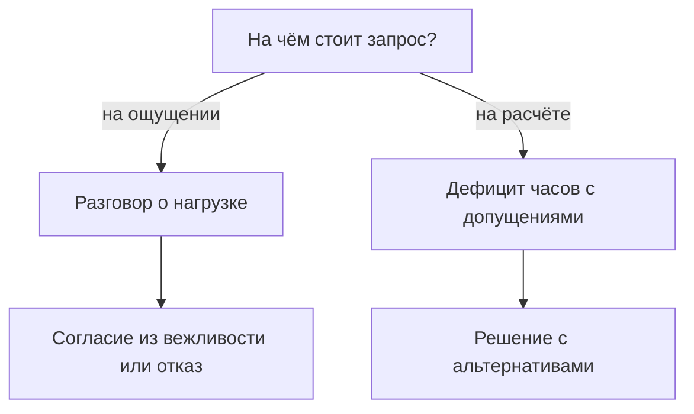
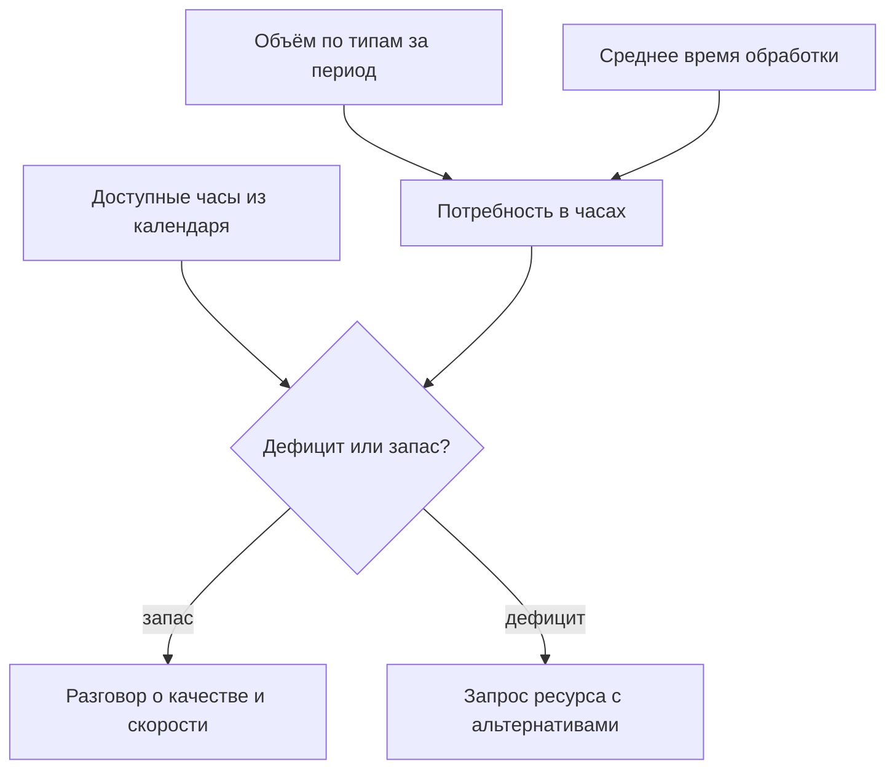

## Введение

Первый запрос на нового инженера я написал в тоне, который казался мне убедительным: команда перегружена, люди работают на пределе, нужен ещё один человек. Ответ руководителя был вежливым и убийственным: «Принесите расчёт». Расчёта не было. Были три истории про тяжёлую неделю и обида человека, который честно старается.

Через год я принёс тот же запрос в другом виде: одна страница, несколько чисел, два явных допущения и три варианта решения. Разговор занял пятнадцать минут и закончился решением. Изменился не руководитель и не бюджет — изменился формат: перегрузка превратилась в дефицит часов, который можно проверить, оспорить и закрыть.

Тезис статьи простой: потребность в людях — это формула мощности, а не ощущение перегрузки. В формуле три части: объём работы, среднее время на единицу и доступные часы. Пока она не посчитана, любой разговор о найме — переговоры о доверии к лиду, а не о ресурсах. Доверие — плохой фундамент для штатного расписания.

Считать приходится от измеренной точки А. Без выгрузки из трекера формула собирается из тех же ощущений, только в виде таблицы. Как устроена точка А, я разбирал в статье «Baseline раньше целей»; здесь считаем, что она уже есть.

## Почему «мы перегружены» не работает

Фраза «мы перегружены» честная, и именно поэтому с ней так трудно спорить. Проблема не в честности, а в том, что из неё нельзя вывести действие.

- **Она не различает причину.** Перегрузка бывает от объёма, от типа потока, от ожидания ответа клиента, от потерь на переключениях между системами, от того, что половина смены уходит на согласования. Лечится каждое по-разному: наймом, триажем, автоматизацией, изменением процесса. Слово «перегружены» не говорит, какое из пяти.
- **У неё нет масштаба.** Одинаково звучит у команды из трёх человек и из десяти: тяжёлые недели есть у всех, и руководитель не может отличить норму от аномалии.
- **Она не проверяется и не оспаривается.** С ощущением можно только согласиться или не согласиться — то есть поверить или не поверить. Проверить нечего, поэтому разговор быстро переходит на личности.
- **В ней нет альтернатив.** Просьба звучит как «дайте человека», и решение сводится к бинарному выбору: да или нет. Отказ после такой просьбы выглядит как отказ от проблемы, а не как выбор приоритета.
- **Она обесценивается от повтора.** Каждый месяц одна и та же фраза превращается в фон, а фон не обсуждают.
- **У неё есть цена для лида.** Один отказ на «мы перегружены» учит не просить, и дальше команда тянет нагрузку молча — пока не начнёт уходить.

Есть и вторая сторона: руководитель, который соглашается на «перегружены» без расчёта, покупает себе проблему. Через месяц появляется человек, а очередь не сокращается — потому что причина была не в количестве людей. После двух таких историй доверие к запросам падает уже у обеих сторон.

Поэтому я строю запрос не как жалобу, а как развилку с проверяемыми ответвлениями:

Дальше — как устроен расчёт, который делает разговор коротким.

## Формула мощности

Формула на одну строку выглядит почти унизительно просто: потребность в часах равна объёму работы, умноженному на среднее время на единицу. Доступные часы берутся из календаря. Разница между первым и вторым — и есть дефицит, с которым идут к руководству.

Ошибки почти никогда не в арифметике. Они во входных данных, поэтому разбирать надо именно их.

- **Объём.** Считается по событиям из трекера за один и тот же период, с разбивкой по типам: инцидент, вопрос, запрос на изменение. Почта, чат и «ещё были звонки» в объём не входят — иначе число нельзя будет повторить. Окно должно быть длинным: месяц показывает случайную неделю, квартал — сезонность.
- **Среднее время.** Это время обработки, а не время жизни заявки. Ожидание ответа клиента, ожидание релиза и ожидание согласования считаются отдельно: команда не тратит на них часы, но трекер складывает их в общий срок. Кроме разбора, в обработку входит коммуникация, перепроверка и переключение между системами — то, чего в заявке не видно.
- **Доступные часы.** Не «столько-то человек в штате», а календарь: кто в отпуске, кто на обучении, кто занят проектом, кто дежурит. Об этом следующий раздел, потому что именно здесь расчёт чаще всего и рушится.
- **Единицы.** Всё в инженер-часах за одну и ту же неделю. Как только одна часть в часах, а другая в заявках, формула перестаёт складываться, и спор возвращается.

Полезная проверка на устойчивость — пересчитать формулу без самой тяжёлой недели периода. Если дефицит исчез, речь идёт не о мощности, а о пике: его закрывают буфером и очерёдностью, а не наймом. Если дефицит остался — это структурная нехватка часов, и она не рассосётся сама.

Отдельно стоит сказать, чего формула не даёт. Она не показывает потребность «до человека»: результат зависит от допущений, а допущение про среднее время — величина, которая сама меняется. Она даёт порядок величины и, что важнее, показывает, какие допущения нужно оспорить. Если руководитель не согласен с числом, у нас есть предмет разговора: какое из трёх слагаемых он считает другим и почему.

Как формула превращается в решение:

## Календарь доступности

Доступные часы — самая недооценённая часть формулы. Штат умножить на сорок часов в неделю легко, но полученное число не имеет отношения к работе: часть этих часов уже продана заранее.

Что вычитается из номинала:

- отпуска и больничные — не «по факту», а по графику на год вперёд;
- обучение, наставничество и приём новых инженеров;
- проектные обязательства: внедрения, миграции, разовые интеграции;
- дежурства, если они забирают человека из очереди, а не идут поверх неё;
- регулярные встречи и разборы;
- потери на переключение между заявками и системами.

Последний пункт обычно самый спорный, и правильно: он не виден в трекере, и каждый сервис оценивает его по-своему. Я не беру коэффициент с потолка, а вывожу его из сверки: сколько часов по календарю было доступно и сколько заявок реально закрыто. Полученную долю потерь я показываю рядом с расчётом как отдельное допущение — с ним можно спорить, но нельзя делать вид, что потерь нет.

Отдельно про сезонность. Пик отпусков известен в январе, а перегрузка в июле каждый год выглядит как сюрприз. Календарь доступности на двенадцать месяцев — единственный способ увидеть провал заранее и либо сдвинуть инициативы, либо взять временный ресурс, либо честно предупредить о сроках.

Календарь полезен и без запроса на найм. Видно, в какие месяцы лучше не запускать инициативы, где нужен временный ресурс на проект и когда отпуск лида не обвалит очередь. Половина срывов сроков объясняется не ленью, а тем, что план на год составлялся без календаря.

<!-- вилка: свой календарь доступности — как считаются отпуска, проектные обязательства и потери на переключение, какой коэффициент потерь получился по сверке. -->

## Нормативы внутри расчёта

Внутренние нормативы — та часть картины, которую легко забыть, потому что они не про объём, а про форму обслуживания.

Норматив вроде «подхват за пятнадцать минут в рабочие часы» — это не пожелание, а зарезервированные часы. Кто-то должен в любой момент бросить текущую заявку и взяться за новую; значит, его нельзя ставить на длинную задачу, и его мощность в очереди меньше номинальной. Таймеры реакции устроены так же: чем строже норматив, тем больше часов уходит не на работу, а на готовность к работе.

Отсюда два вывода, которые меняют разговор о найме.

Первый: норматив и мощность — связанные величины, и менять надо одну из них. Если часов не хватает, вариантов ровно два — добавить часы или изменить норматив. Обещание сохранить норматив без часов выполняется героизмом конкретных людей, и героизм — не ресурс, потому что не масштабируется и заканчивается выгоранием.

Второй: расчёт показывает, какие нормативы дороже всего. Иногда выясняется, что строгий таймер реакции на все типы заявок стоит больше, чем весь остальной сервис, — и сужение норматива до критичных категорий освобождает часы без найма и без потери качества там, где оно нужно.

<!-- вилка: ваши нормативы — подхват, таймеры реакции — и сколько часов они стоят по расчёту; какие нормативы пересматривались. -->

## Запрос ресурсов по данным

У запроса, который срабатывает, три части: данные, следствие, варианты.

**Данные.** Одна страница: объём по типам, среднее время, доступные часы, дефицит с указанием периода и источников. Допущения выписаны отдельно, чтобы их можно было оспорить по одному, а не целиком.

**Следствие.** Что произойдёт, если ничего не менять: какие нормативы перестанут выполняться, какие заявки уйдут в просрочку, какие инициативы встанут. Не «будет плохо», а «к такой-то дате перестанет выполняться такой-то норматив». Это самая неудобная часть, и её пропускают чаще всего: без следствия запрос читается как просьба, а не как выбор.

**Варианты.** Запрос без альтернатив — это ультиматум, даже если он написан вежливо. Их обычно три, и они редко исключают друг друга:

1. **Добавить часы.** Наём, подряд, временное усиление на пик.
2. **Уменьшить объём.** Самообслуживание, база знаний, отсечение потока, который не должен доходить до инженеров.
3. **Изменить норматив.** Сознательно и письменно, с объяснением, что именно перестаёт выполняться.

Разговор с руководителем я строю как выбор из этих трёх, а не как просьбу о первом. Иногда выбирают второй вариант, и это нормальный результат: запрос ресурсов и запрос найма — разные вещи. Плохой исход только один — «оставим как есть» без изменения норматива: тогда решение принято, но ответственность за него не зафиксирована.

И последнее, что делает запрос рабочим: дата пересмотра. «Возвращаемся к вопросу через квартал, смотрим, сдвинулся ли дефицит» — это часть решения, а не вежливость. Без неё разговор заканчивается согласием или отказом, а через полгода начинается заново с нуля и с теми же эмоциями.

<!-- вилка: свой расчёт и пример запроса — что было на входе, какие варианты предложены, что выбрало руководство. -->

Формула мощности не делает лида сильнее и не отменяет неприятных разговоров. Она делает другое: превращает нагрузку в предмет управления. Пока дефицит часов не посчитан, единственный доступный инструмент — героизм команды, а он заканчивается. Следующая статья серии — о том, как договориться с соседними командами, чтобы часть этого объёма вообще не доходила до поддержки: взаимодействия без матрицы держатся на личных договорённостях и памяти.