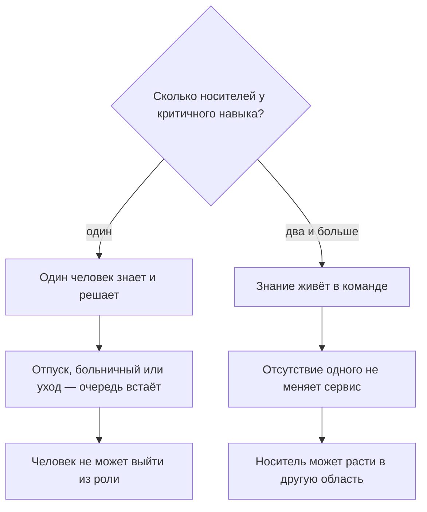
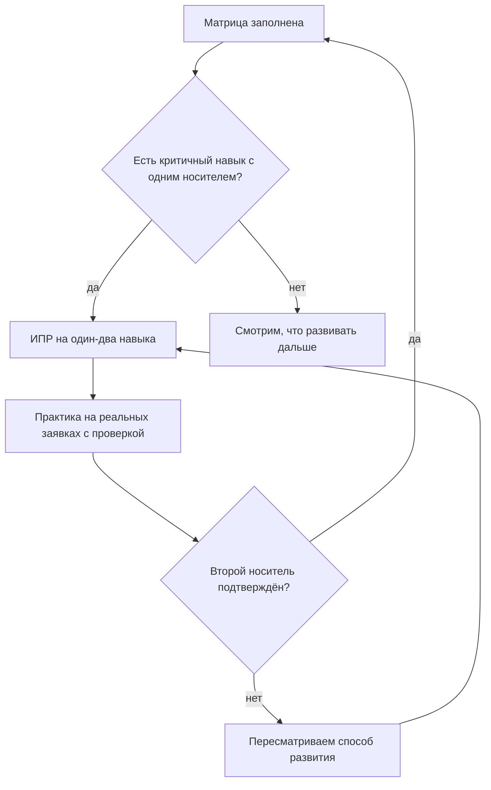

## Введение

Первый раз это случилось в самый неудачный момент: единственный человек, который знал, как устроен один из продуктов, ушёл в отпуск. Двадцать минут спустя выяснилось, что никто в команде не может ни воспроизвести проблему, ни объяснить клиенту, что происходит, и очередь встала не из-за нагрузки, а из-за отсутствия одного человека.

С тех пор я считаю знание не общим достоянием команды, а свойством конкретных людей: у каждого навыка есть носители, и если носитель один, то речь не о компетенции, а о зависимости. Матрица компетенций — простая таблица «навыки × люди × уровни» — делает эту зависимость видимой до того, как она случится.

Тезис статьи короткий: одноточечный риск обнаруживается почти бесплатно, а стоит дороже всего. И статья она про то, как устроена матрица, какой норматив я держу и как из неё получается план развития, а не отчёт для галочки.

## Одноточечный риск

Одноточечный риск — ситуация, в которой критичный для сервиса навык существует в единственном экземпляре. Пока этот человек работает, всё выглядит хорошо: он быстрый, он знает себе цену и он единственный, к кому идут с трудными заявками.

Ломается это одинаково во всех случаях, отличается только повод: отпуск, больничный, декрет, увольнение, переход в другую команду. И последствия у этого риска две: сервис и человек.

Сервис получает очередь без хозяина и клиентов, которым некому объяснить ситуацию. Человек получает роль, из которой нельзя выйти: он не может нормально уйти в отпуск, потому что без него всё рушится; его проекты всегда висят на нём; и следующее повышение обсуждается с оговоркой, что его некем заменить.

Схематично развилка выглядит так:

<!-- вилка: свои точки риска — навыки, которые держатся на одном человеке. -->

Отдельно стоит назвать то, что риском не считается. Редкий навык, который нужен раз в год и решается через внешнего вендора или разработку, может спокойно жить в одном экземпляре: держать второе полное знание о нём дороже, чем терпеть редкое ожидание.

## Матрица: навыки × люди × уровни

Матрица — таблица с двумя осями: по строкам — навыки, по столбцам — люди, в клетках — уровень владения. Без уровней матрица превращается в список галочек, поэтому шкала нужна, но простая — обычно четыре ступени.

| Уровень | Что значит | Что можно поручить |
| --- | --- | --- |
| 1 | Знает теорию, нужна поддержка | Простые заявки по инструкции, под проверкой |
| 2 | Решает типовое сам | Типовой поток и дежурства |
| 3 | Решает нестандартное и объясняет другому | Сложные заявки и наставничество |
| 4 | Владеет направлением и задаёт правила | Развитие навыка в команде и решения по нему |

Навыки для матрицы берутся не из должностной инструкции, а из работы: продукты, с которыми работает поддержка, типы проблем — отсеивание багов от вопросов конфигурации, инструменты — трекер, логи, тестовое окружение — и отдельно навыки работы с людьми: письменная коммуникация и разбор инцидентов. Список из тридцати навыков заполнят за неделю и забудут через месяц; рабочий размер — тот, где каждый навык кто-то действительно может потерять.

Как не превратить заполнение в бюрократию:

- **Ставить уровень по готовности доверить работу, а не по самооценке.** Вопрос не «насколько ты хорош», а «могу ли я отдать этому человеку такую заявку без проверки».
- **Заполнять вдвоём.** Инженер ставит свою оценку, лид — свою, обсуждается только расхождение.
- **Не смешивать с оценкой результата.** Матрица — про возможности, а не про то, хорошо ли человек работал в этом квартале.
- **Не делать выводов по одной клетке.** Уровень в клетке — гипотеза, которая проверяется реальной работой, в том числе QA-выборкой.

<!-- вилка: фрагмент своей матрицы — 4–6 навыков и 3–4 человека. -->

Самое ценное в матрице — даже не сама таблица, а разговор, который приходится вести при заполнении: почти каждый раз обнаруживается навык, где лид был уверен в двух носителях, а на деле один из них не решал такие заявки ни разу.

## Норматив «уровень 3+ у двух человек»

Норматив, который я держу, звучит так: у каждого критичного навыка должно быть не меньше двух человек уровня 3 и выше. Не два человека вообще, а два человека, которые могут решать нестандартное без вашего участия.

Почему именно два и именно третий уровень:

- **Два носителя — это минимум для отсутствия.** Один в отпуске, второй на месте — сервис не меняется.
- **Третий уровень — это граница самостоятельности.** Уровни 1 и 2 полезны, но в аварии они не заменят: они требуют проверки, то есть требуют третьего.
- **Два — это ещё и проверка знания.** Человек, который единственный знает, не ошибается в глазах команды: некому его поправить. Второй носитель создаёт взаимную проверку.

Следствие из норматива неприятное: он требует времени от сильных. Второй носитель появляется не тогда, когда первый расскажет, а когда второй сам решает несколько сложных заявок, а первый проверяет. Это не обучение по видео, а работа со страховкой, и её надо планировать в нагрузке, а не на словах.

## ИПР на 1–2 навыка

ИПР — индивидуальный план развития, короткая форма на одного человека: какие навыки развиваем, что человек будет делать, как и когда проверим результат. Из матрицы он получается сам, если действовать ограниченно.

Ограничение первое: один-два навыка. План из семи пунктов не выполняется, потому что у инженера есть ещё восемь часов заявок в день. Два навыка реальны, потому что в них можно вложить внимание.

Ограничение второе: у каждого навыка есть способ проверки. Не «изучить продукт», а «самостоятельно закрыть три сложных заявки по продукту и разобрать одну на общем разборе» — так развитие проверяется той же работой, а не самоотчётом.

Ограничение третье — срок и роли. В ИПР участвуют трое: сам инженер, наставник — обычно один из носителей навыка — и лид, который отвечает за то, чтобы у инженера было время и заявки нужного типа. Без третьего пункта план остаётся пожеланием.

Связь матрицы и развития замыкается в цикл:

<!-- вилка: пример ИПР из своей практики — навык, шаг, способ проверки. -->

## Пересмотр матрицы

Матрица стареет быстро: люди учат новые продукты и забывают старые, команда меняется, приоритеты сдвигаются. Поэтому раз в квартал она пересматривается — не переписывается заново, а сверяется: где появился второй носитель, где появилась новая дыра, где норматив выполнен на бумаге, но не в жизни.

Пересмотр полезно связывать с наймом. Если матрица показывает, что второй носитель нужен по редкому навыку, а в компании такого человека нет, — задача переходит из развития в найм или в привлечение со стороны. И наоборот: иногда дыра закрывается не человеком, а правилом — если инструкция хороша, второй носитель может оказаться не нужен.

И последнее. Матрица не является документом про людей. Она про способность сервиса работать без конкретного человека — и это меняет тон разговора: инженер не «слаб» в навыке с уровнем 1, просто это ещё не его направление; а профессионал с уровнем 4 не обязан учить всех — но если он единственный, риск создаёт именно он, независимо от квалификации.
