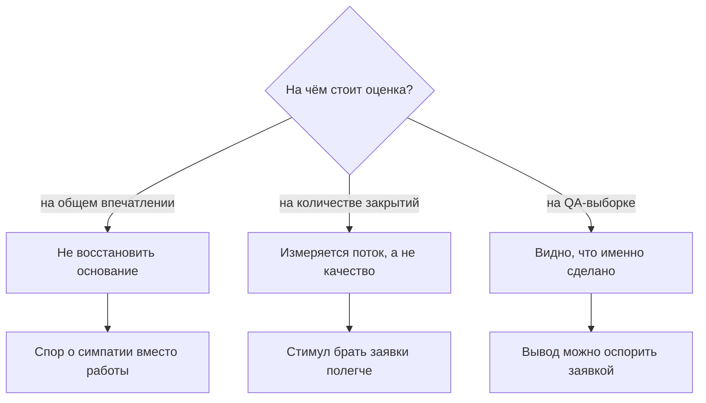
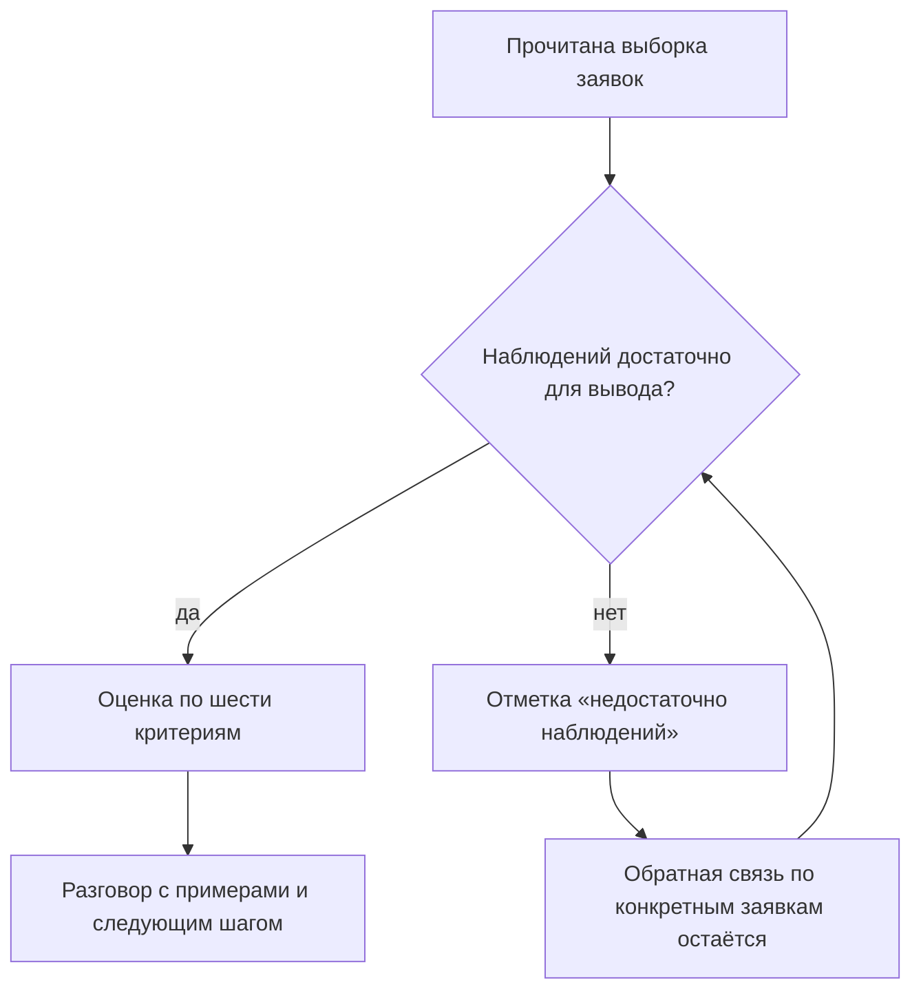

## Введение

Первые оценки в роли лида я ставил по впечатлению и стеснялся этого. Впечатление складывалось из последних десяти разговоров, из того, кто громче жалуется на сложность, из того, чьи заявки случайно попадались мне на глаза. Формально это была оценка по фактам — я же читал заявки. На самом деле факты были выбраны памятью, а не выборкой, и об этом знал каждый в команде.

Тезис, который я теперь считаю обязательным: инженера оценивают по наблюдаемым фактам из QA-выборки, а не по количеству закрытий и не по общему ощущению. Выборка — не бюрократия, а способ сделать разговор о качестве повторяемым: одни и те же критерии, один и тот же порядок, возможность оспорить вывод конкретной заявкой.

Эта статья — про четыре части этой конструкции: почему привычные способы не работают, как устроена выборка, что такое чек-лист шести критериев и когда честный вывод — «недостаточно наблюдений».

## Почему «на глаз» и по закрытиям не работает

Количество закрытий выглядит как метрика, потому что оно есть в трекере и всегда свежее. Но оно измеряет поток, а не человека.

- **Поток распределён неравномерно.** Кто-то в этот период брал типовые быстрые заявки, кто-то — тяжёлые, с воспроизведением и перепиской. При одинаковом качестве цифры у них будут разными, и не в пользу второго.
- **Закрытие — событие, а не качество.** Тикет можно закрыть с формальным ответом, и счётчик это оценит так же, как настоящую работу.
- **Оценка по счётчику создаёт стимул.** Люди начинают выбирать заявки полегче и закрывать побыстрее — то есть делать ровно то, за что потом придётся извиняться перед клиентами.
- **Впечатление невоспроизводимо.** Через месяц ни вы, ни инженер не восстановите, почему вывод был именно таким. А разговор, который нельзя восстановить, слышится как «мне так кажется».

Схема развилки выглядит так: у оценки может быть один из трёх оснований, и только третье переживает проверку.

Дальше — как устроена третья ветка.

## QA-выборка

Выборка — это несколько закрытых заявок за период, прочитанных целиком: переписка клиента, комментарии внутри, история смены статусов и итоговое решение. Не только текст ответа клиенту — именно история, потому что в ней видны остановки, лишние итерации и то, был ли следующий шаг назван.

Правила, без которых выборка превращается в охоту на ведьм:

- **Случайность с покрытием.** Заявки берутся не «интересные мне», а по сетке: разные инженеры, разные категории, разные уровни критичности. Иначе в выборку попадают только ссоры с клиентами.
- **Пачкой, а не построчно.** Ни один вывод не делается по одной заявке. Разбор идёт пачкой, и повторяющийся паттерн виден только в ней.
- **Те же критерии каждый раз.** Если критерии меняются под случай, сравнивать нечего.
- **Читает не только лид.** Второй человек в роли оценщика — самая дешёвая гарантия того, что оценка не отражает ваши отношения с инженером.
- **Сначала факт, потом разговор.** Вывод формулируется до встречи, а не в ходе неё.

<!-- вилка: свой размер выборки и правила отбора — сколько заявок, откуда, кто ещё читает. -->

Важно, что выборка — не проверка на ошибку. Её задача — увидеть, как выглядит работа, а не поймать за руку. Если задача формулируется как «найти, за что снизить», люди узнают это быстрее, чем вы закончите первый квартал.

## Чек-лист шести критериев

Каждая прочитанная заявка оценивается по шести критериям по шкале 0/1/2. Шкала сознательно грубая: 0 — не сделано или сделано так, что пришлось бы переделывать; 1 — сделано, но с оговорками; 2 — сделано так, что заявку можно показывать как пример. Пять баллов из десяти создают иллюзию точности и спор о единицах, а не о работе.

| Критерий | Что наблюдается в заявке | Что значит «2» |
| --- | --- | --- |
| Понимание проблемы | Воспроизведение, уточнения, формулировка сути | Клиент подтвердил, что проблему поняли верно |
| Полнота решения | Устранена причина, а не только симптом | Заявка не вернулась и возвращаться не должна |
| Коммуникация | Ясность, следующий шаг, ожидания по времени | Клиенту не нужен повторный вопрос «что дальше» |
| Соблюдение процесса | Категория, критичность, сроки, маршрут | Процесс помог, а не мешал |
| Работа со знаниями | Ссылка на статью, вклад в базу знаний | Решение зафиксировано, им сможет воспользоваться другой |
| Передача и эскалация | Пакет контекста, владелец, что уже проверено | Следующий не переспрашивал ничего |

Отдельно про критерий работы со знаниями: речь не о количестве написанных статей. KCS (Knowledge-Centered Service — подход, в котором статья пишется в момент решения задачи, а не после) в выборке виден иначе: осталась ли в заявке ссылка, по которой следующий человек решит ту же проблему быстрее.

Зачем именно шесть, а не двадцать: каждый критерий должен быть виден в заявке глазами, без дополнительных опросов. Двадцать критериев дают красивую таблицу и никакой оценки — человек не может держать в голове двадцать требований, поэтому любое детальное оценивание сводится к двум-трем критериям, которые в данном месяце кажутся важными.

<!-- вилка: сверьте формулировки шести критериев со §6.2 годового плана — здесь они даны в рабочем виде. -->

И ещё одно: балл не суммируется в одну цифру «качества». Сумма шести критериев скрывает профиль: инженер с отличной коммуникацией и слабым решением не станет «средним» — у него разные сильные стороны, и работать с ними надо по-разному.

## Отметка «недостаточно наблюдений»

Самая полезная часть конструкции — возможность не делать вывод. Иногда выборка просто мала: человек был в отпуске, вышел недавно, весь период провёл на дежурстве с однотипными заявками. Вывести оценку из такого материала значит выдумать её.

Это не пробел процесса, а его штатный результат. Как он читается:

Три правила, которые держат эту отметку честной.

- **Она не заменяет обратную связь.** Даже при недостатке наблюдений конкретную заявку можно разобрать: что было хорошо, что переделали бы.
- **Она не должна становиться привычкой.** Если по одному и тому же человеку она висит третью выборку подряд, дело не в выборке, а в распределении потока.
- **Вывод из количества закрытий не делается никогда.** Нельзя подменить отсутствие наблюдений цифрой из трекера — это ровно то, от чего мы уходили.

## Разговор об оценке

Оценка существует не для того, чтобы её поставили, а для того, чтобы после неё что-то изменилось. Поэтому разговор строится по тем же критериям, что и выборка, и начинается с самооценки.

Порядок, который у меня работает:

1. **Самооценка по тем же шести критериям.** Человек читает свои заявки и ставит баллы.
2. **Сверка расхождений.** Обсуждаются не баллы, а случаи, где оценки разошлись сильно.
3. **Одна-две заявки — как пример, не как приговор.** Пример должен быть узнаваемым, но не унизительным.
4. **Один следующий шаг.** Не список из семи пунктов, а одно изменение в работе до следующей выборки.

<!-- вилка: обезличенный пример разговора — что было в выборке, что разошлось и чем закончилось. -->

Отдельно стоит договориться, что оценка по наблюдаемым фактам не равна аттестации. Это инструмент развития и разговор о качестве: если инженер впервые слышит о своих слабых местах в момент, когда от него ждут цифру для ежегодного пересмотра зарплаты, — виновата не выборка, а то, что ею не пользовались весь год.
