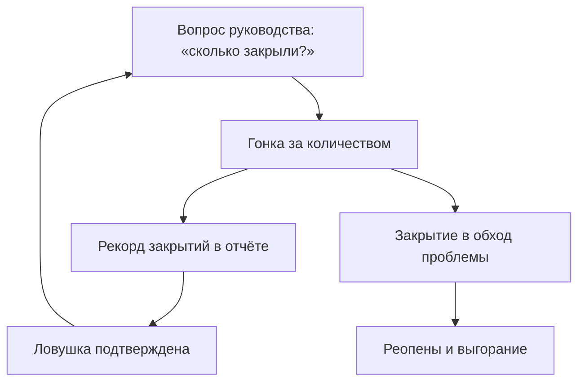
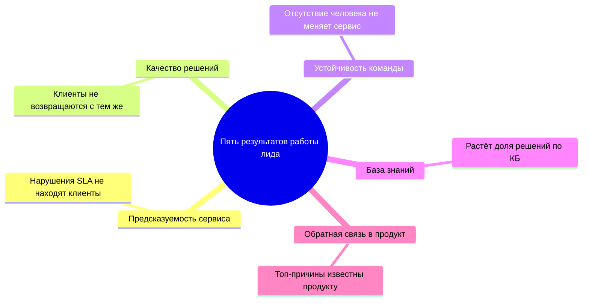
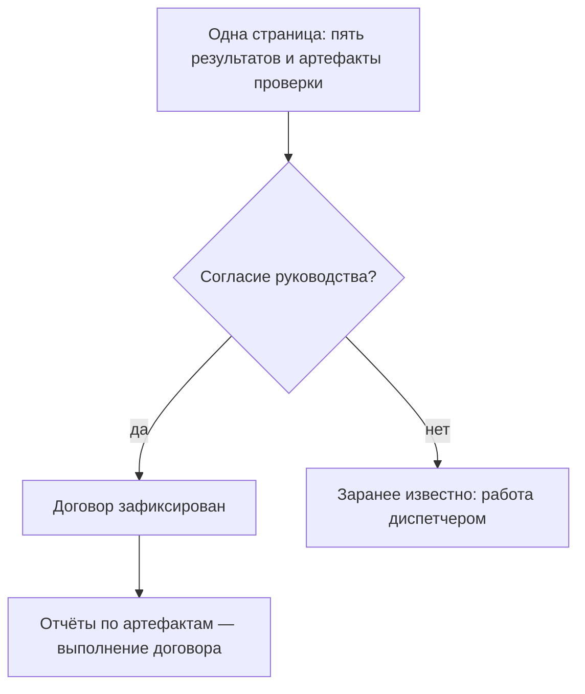

## Введение

Это первая статья серии о том, как выстроить поддержку как управляемый сервис. Серия следует логике года работы лида: сначала стратегическая рамка — что вообще является результатом, — затем операционные процессы, знания, команда, внешний контур и метрики.

Когда я спрашиваю у руководителей поддержки, чем измеряется их работа, чаще всего слышу одно и то же: количество закрытых заявок, среднее время ответа, размер очереди. Это удобные цифры — их видно в трекере каждую минуту, и они складываются в ощущение «система работает». Но это цифры деятельности, а не результата.

Работа лида поддержки измеряется не тем, сколько заявок прошло через сервис, а тем, что изменилось в сервисе за счёт его работы. Я сформулировал для себя пять таких результатов: предсказуемость сервиса, качество решений, устойчивость команды, база знаний и обратная связь в продукт. Каждый из них можно проверить — не идеальной метрикой из учебника, а конкретным артефактом, который либо есть, либо нет.

Если вы не можете назвать пять результатов своей работы — вы работаете диспетчером. Диспетчер тоже нужен, но его цена определяется количеством обработанных заявок. Лид должен стоить дороже, и эта статья — о том, чем именно.

## Ловушка «сделано больше — значит хорошо»

Самая коварная ловушка в нашей профессии выглядит так: квартал закрывается рекордом закрытых заявок, команда работает на пределе, отчёт выглядит великолепно. А через месяц вы обнаруживаете, что доля повторно открытых заявок выросла, клиентов стало больше раздражаться, а инженеры выгорают — потому что «закрыть любой ценой» означает закрывать в обход проблемы: без выяснения причины, без записи в базу знаний, без честного разговора с клиентом.

Знакомая картина? И у неё есть системная причина: когда единственная понятная метрика — «сделано больше», команда оптимизирует именно её. Всё, что не попадает в эту метрику — качество, знания, предупреждение проблем, — становится «невидимым» и по умолчанию приносится в жертву.

Хуже всего то, что ловушка самоподдерживается. Рекорд закрытий попадает в отчёт, руководство довольно, лид получает подтверждение, что всё делает правильно — и в следующем квартале команда снова гонится за количеством. Исправлять последствия — реопены, повторные обращения, выгорание — придётся тому же лиду, но уже без ресурса: время потрачено на гонку за цифрой. Разорвать этот круг можно только одним способом — договориться о других результатах до того, как цифры стали целью.

Как замыкается этот круг:

Заметьте: никто не выбирает эту ловушку сознательно. Она возникает сама — из отчётности, которую удобно собрать, из вопросов руководства «сколько закрыли за неделю?», из привычки измерять то, что измеряется легко. Противоядие одно: заранее определить, какие результаты на самом деле нужны от сервиса, и договориться об их проверке. Именно это — пять результатов, о которых дальше.

## Пять результатов работы лида

Обзор пяти результатов — у каждого своё направление работы и свой наблюдаемый признак:

### 1. Предсказуемость сервиса

Предсказуемость — это когда клиент, инженер и руководство знают, что и когда произойдёт с заявкой. Заявка с критичной проблемой получает таймер реакции; эскалация в L3 уходит с понятным пакетом и договорённостью о сроке; SLA-нарушение не «случается», а прогнозируется заранее — и клиент предупреждён до того, как срок истёк.

Разница между сервисом с регламентом и предсказуемым сервисом видна в первый же сбой. В первом случае регламент есть, но живёт в документе: заявка с горящим сроком лежит в общей очереди, эскалация заменяется сообщением «передали профильной команде», и клиент узнаёт о нарушении первым. Во втором случае регламент встроен в работу: критичность назначена при первом касании, срок виден в очереди каждый день, риск нарушения — повод для действия, а не для надежды.

Признак, по которому результат видно: нарушения SLA не находят клиенты. Если о просрочке вы узнаёте от разгневанного письма, а не из своего еженедельного обзора очереди, — предсказуемости пока нет, есть только регламент на бумаге.

### 2. Качество решений

Заявка закрывается решением, а не «не воспроизводится» и не «попробуйте перезагрузить». Инженер понимает причину, фиксирует её и сообщает клиенту, что именно сделано и почему больше не повторится.

Здесь важно не спутать закрытие с решением. Закрытие — это событие в трекере; решение — состояние клиента: проблема ушла, клиент понимает, что произошло, и знает, что делать, если увидит похожие симптомы. Их часто путают, потому что в трекере выглядит одинаково, а измеряется первое в разы проще. Но доверие клиента зарабатывается именно вторым: человек, который дважды описал одну и ту же проблему и дважды получил «попробуйте ещё раз», не станет третьим разом писать в поддержку — он напишет руководству вашего клиента.

Признак: клиенты не возвращаются с той же проблемой. Формально — низкая доля реопенов, фактически — QA-выборка, где инженер по нескольким заявкам подтверждает: причина найдена, решение полное, ответ клиенту понятен.

### 3. Устойчивость команды

Сервис переживает отпуск, болезнь и увольнение ключевого человека без просадки. Знания распределены: критичный навык есть минимум у двух человек, любой входящий тикет кто-то подхватывает за 15 минут — не потому что «дежурит герой», а потому что это норма, проверяемая расчётом.

Одноточечный риск — самый дешёвый в обнаружении и самый дорогой при событии. Пока носитель критичного знания на месте, всё работает и кажется, что проблема надумана. Затем он уходит — в отпуск, в другую компанию, в выгорание — и вместе с ним уходит то, чему не учили: как настраивается интеграция, почему падает очередь, куда смотреть при странной ошибке. Сервис не падает мгновенно; он медленно гниёт месяцами, пока знание восстанавливается методом проб и ошибок.

Признак: отсутствие одного человека не меняет ни скорость, ни качество сервиса. Если ваш единственный специалист по интеграциям уходит в отпуск и очередь по интеграциям встаёт — устойчивости нет, есть точка отказа с именем и фамилией.

### 4. База знаний

Решения накапливаются и переиспользуются. Инженер, встретив знакомую проблему, ищет в базе, а не в памяти коллег; найдя неточность — исправляет статью. База растёт в момент решения, а не «когда-нибудь в свободное время».

Последняя оговорка важнее, чем кажется. «Напишем статью, когда разгрузимся» — это обещание, которое не исполняется никогда: разгрузки не будет, а контекст решения — симптомы, версии, подводные камни — стирается из памяти за считанные дни. Статья, написанная через месяц, восстанавливается по памяти и теряет самое ценное — детали, которые и делают её применимой. Поэтому единственный рабочий момент для базы знаний — само решение тикета: нашёл в базе — использовал; не нашёл — написал, пока держишь проблему в голове.

Признак: растёт доля заявок, решённых по базе знаний. И вторая, менее очевидная: новые инженеры выходят на рабочую скорость быстрее — им не нужно годами впитывать опыт через рядом сидящего наставника.

### 5. Обратная связь в продукт

Поддержка — единственная команда, которая знает реальные проблемы клиентов в объёме и с контекстом. Но список «у нас всё плохо» продукт игнорирует — и справедливо: без масштаба («сколько клиентов»), цены («сколько часов поддержки»), обхода и конкретного предложения это не данные, а настроение. Обратная связь работает, когда повторяющиеся проблемы превращаются в карточки с данными: сколько клиентов затронуто, сколько часов поддержки съедено, какой есть обходной путь, что предлагаем. И у каждой карточки появляется статус — принято, отложено, отклонено.

Без этой петли поддержка обречена обслуживать одни и те же проблемы вечно — и тратить на них растущий объём команды. С этой петлёй каждая системная проблема получает шанс уйти из потока навсегда: исправлена в продукте или покрыта обходом и инструкцией.

Признак: топ-причины квартала известны продукту, часть из них исправлена или получила обход. Поддержка перестаёт быть «страдателем» и становится источником данных, на которые опирается развитие.

## Как проверить каждый результат

Проверяемость — ключевое свойство всех пяти. Не идеальная метрика, а артефакт, по которому раз в месяц можно ответить на вопрос: стало лучше или хуже?

| Результат | Артефакт проверки |
| --- | --- |
| Предсказуемость | Еженедельный контроль очереди по фильтрам рисков; журнал SLA-нарушений с причинами — каждое нарушение разъяснено, а не «сгорело» |
| Качество решений | QA-выборка заявок по чек-листу; доля реопенов — как грубый сигнал, а не как оценка инженера |
| Устойчивость команды | Матрица компетенций: критичный навык уровня 3+ минимум у двух людей; аудит живучести — «что сломается, когда меня не будет» |
| База знаний | Доля решений по базе знаний; доля статей, обновлённых за квартал |
| Обратная связь | Карточки проблем со статусами продукта; квартальный отчёт топ-причин |

Обратите внимание: ни один артефакт не требует идеальных данных или дорогих систем. Журнал нарушений — это записи в трекере; QA-выборка — час в неделю на несколько заявок; карточка проблемы — документ на страницу. Проверяемость достигается дисциплиной, а не инфраструктурой.

Второй практический вопрос — кто и как часто проверяет. Раз в месяц достаточно: реже — результаты теряются в шуме, чаще — проверка становится ритуалом ради самого ритуала. Проверять должен сам лид: это не аудит сверху, а его собственный инструмент управления. И один жёсткий запрет: артефакты не должны превращаться в отчётность. Как только таблица «результат → артефакт» начинает заполняться «для руководства», она умирает — люди заполняют её так, чтобы не было вопросов, и она перестаёт показывать правду. Эти артефакты — рабочие инструменты лида, которые показывают руководству только выводы, а не сырые таблицы.

И наоборот: если артефакта нет — результата нет. Не «плохо измеряется», а нет. Нельзя управлять тем, что нельзя проверить; честнее признать «этого мы пока не делаем», чем докладывать о результате, которого не существует.

## Пять результатов как контракт с руководством

Самое важное назначение этого списка — не самоанализ, а договор. Пять результатов — это мой контракт с руководством: вот что я обещаю производить, вот как каждый результат проверяется, вот по каким артефактам вы сможете увидеть это в конце года.

Этот разговор стоит провести в первые месяцы работы, до калибровки целей по метрикам. Иначе ловушка «сделано больше» вернётся — теперь уже в форме KPI, который вам поставят вместо вас. Практически это выглядит так: вы приходите с одной страницей — пять результатов, у каждого признак и артефакт проверки, — и спрашиваете: «Согласны ли вы, что через год сервис должен отличаться именно этим?» Согласие фиксируется, и у вас появляется легитимность: теперь ежемесячные отчёты о предсказуемости и знаниях — это не «отписка вместо цифр», а выполнение договора.

Обе ветки этого разговора:

Руководство, которое согласилось с пятью результатами, больше не спрашивает «сколько закрыли» — оно спрашивает «что стало предсказуемее» и «какие проблемы ушли в продукт». Если же согласия нет — это тоже ценный сигнал: вам заранее известно, как будут оценивать вашу работу, и вы можете осознанно решать, готовы ли вы работать диспетчером.

Второе следствие: эти же пять результатов становятся каркасом года. Стабилизация сервиса — это предсказуемость. Знания и самообслуживание — база знаний. Оценка и развитие команды — устойчивость и качество. Разборы инцидентов и карточки проблем — обратная связь в продукт. В следующей статье серии — о границах ответственности: что лид делает сам, что делегирует и от чего отказывается сознательно.
