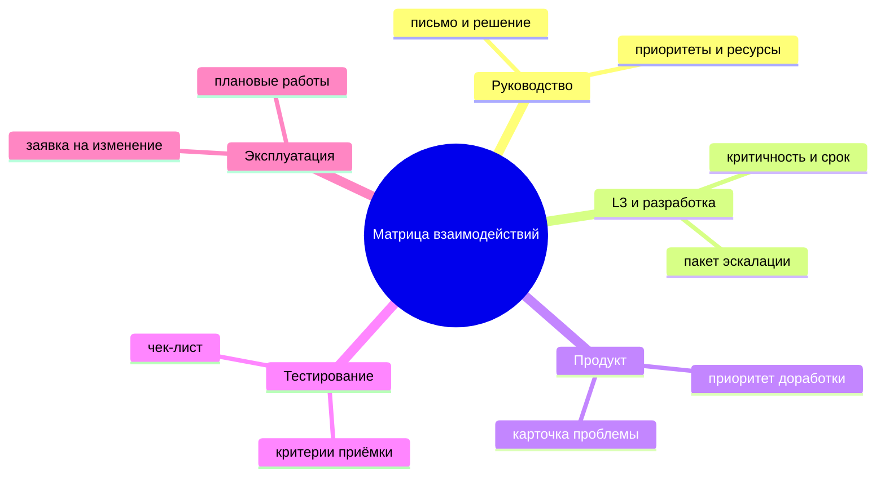
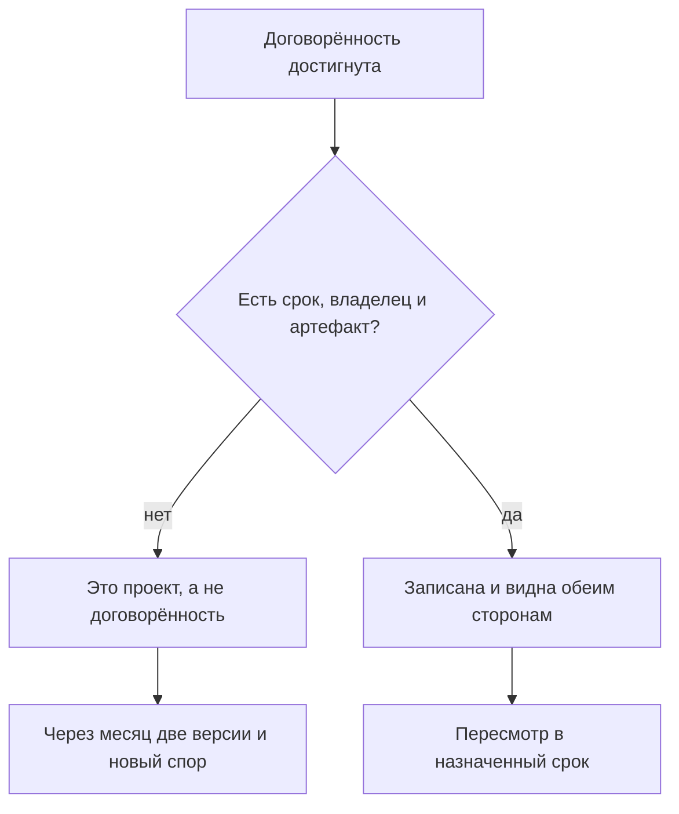

## Введение

Больше всего времени у меня уходило не на заявки, а на выяснение отношений с соседними командами. Разработка ждала от поддержки воспроизведения бага, поддержка ждала от разработки исправления, продукт ждал от всех сразу оценки сроков, руководство ждало от меня объяснений, почему всё вместе буксует. При этом каждый был по-своему прав и никто не был виноват.

Причина не в людях, а в допущении, которое все делают молча: что смежные команды читают мысли. Что всем очевидно, кто принимает решение о переносе релиза; что ясно, куда идёт заявка, которая не нашла бага; что понятно, чей ответ ждёт клиент. Ничего из этого не очевидно. Как только допущение проверяется на практике, начинается вежливая борьба за то, кто кому что должен.

Матрица взаимодействий — это таблица, которая заменяет чтение мыслей: кто принимает решения по каким вопросам, через какой канал это происходит и какой артефакт остаётся после. А правило «проект договорённости» дополняет её: у каждой договорённости есть срок, владелец и артефакт — иначе её просто нет.

Оба инструмента — часть внешнего контура в годовом плане, о котором речь шла в статье «Год лида по кварталам». Здесь — механика: как устроена матрица и как она вытаскивает из трясины конкретный разговор.

## Типовые трения

Трения с соседями редко бывают уникальными. За пару лет я собрал четыре повторяющихся сюжета — по одному на каждый важный контур.

**С руководством — ожидания против ресурса.** Руководство ставит цель, исходя из благих пожеланий клиентов, а поддержка знает цену этой цели в часах. Трение не в том, что цель плохая, а в том, что цена обсуждается после обещания. Итог — лид вынужден либо объяснять провал, либо тянуть героизмом.

**С L3 и разработкой — кто держит мяч.** Заявка уходит на третью линию, возвращается с «не воспроизводится», уходит обратно с логами, возвращается с «нужно видео». Пока таких передач три-четыре, всё выглядит как рабочая суета. Когда их десятки, меняется другое: заявка стареет, клиент злится, а формально никто не нарушает сроков, потому что в момент передачи таймер не идёт.

**С продуктом — язык боли и язык масштаба.** Поддержка приходит с историями конкретных клиентов, продукт отвечает приоритетами квартала. Обе стороны правы, и обе уходят неудовлетворёнными: у поддержки нет аргумента, кроме эмоционального, у продукта нет картины, сколько таких историй на самом деле.

**С тестированием и эксплуатацией — граница ответственности за качество.** Кто проверяет обходной путь, кто отвечает за то, что после релиза вырос поток обращений, кто сообщает клиентам о плановых работах. В обычном режиме это неважно, в инциденте — критично, и разбираться в инциденте поздно.

<!-- вилка: 2–3 своих примера трений — с кем, из-за чего, чем заканчивалось. -->

Во всех четырёх сюжетах общий элемент: вопрос «кто решает» не имеет ответа, записанного до конфликта. Дальше — как этот ответ фиксируется.

## Матрица взаимодействий

Матрица строится на четыре колонки: контур, вопросы, владелец решения, канал и артефакт. Строк — столько, сколько контуров, с которыми у сервиса есть регулярный обмен.

Для моего сервиса это выглядит так:

| Контур | Вопросы, которые он решает | Владелец решения | Канал и артефакт |
| --- | --- | --- | --- |
| Руководство | Приоритеты года, ресурсы, исключения из правил | Руководитель | Письмо на страницу и решение в нём |
| L3 и разработка | Критичность, причина дефекта, срок исправления | Технический лид контура | Пакет эскалации в трекере |
| Продукт | Приоритет доработки, включение в релиз | Владелец продукта | Карточка проблемы с данными |
| Тестирование | Критерии приёмки, регрессии | Тест-лид | Чек-лист приёмки |
| Эксплуатация | Плановые работы, доступы, окружения | Дежурный эксплуатации | Заявка на изменение |

Ключевое в таблице — не список контуров, а две вещи, которых обычно нигде нет: **имя владельца** и **артефакт**. Без имени решение «на уровне команды» не принимает никто, и через неделю вопрос возвращается к лиду поддержки — как к самому заинтересованному. Без артефакта решение живёт в чате до первого пересказа.

Канал и артефакт — не одно и то же, и путать их дорого. Канал — это где разговор происходит: почта, трекер, встреча. Артефакт — это что после него осталось: запись, документ, пункт регламента. Разговор в правильном канале без артефакта так же бесполезен, как документ, о котором никто не знает: через две недели в трекере будут ссылаться на «мы же обсуждали» без единого следа обсуждения.

По форме матрица похожа на RACI (матрица ответственности: кто выполняет, кто отвечает, кого консультируют, кого информируют), но задача у неё уже. RACI распределяет роли внутри одного проекта, а матрица взаимодействий отвечает на вопрос, который в проекте не задаётся: где граница между двумя разными сервисами и кто держит решение на стыке.

Как матрица выглядит в виде обзора:

Заполнять матрицу лучше не в одиночку. По каждой строке я сажусь с владельцем с той стороны и задаю три вопроса: какие решения по этому контуру ты принимаешь без меня, что тебе нужно от поддержки, чтобы принять их быстро, и какой артефакт останется после. Первые два вопроса дают содержание, третий — след, по которому потом видно, что договорённость существует, а не просто была озвучена.

<!-- вилка: своя матрица — контуры, владельцы, артефакты; что оказалось сюрпризом при заполнении. -->

## Правило «проект договорённости»

Договорённости рассыпаются не потому, что их нарушают злонамеренно, а потому, что они остаются проектом: «мы согласовали, что заявки с такими симптомами идут сразу в разработку». Согласовали где? Когда? Кто именно? До какого срока это действует? Если ответов нет, через месяц каждый будет помнить свою версию, и обе версии будут добросовестными.

Правило звучит так: у договорённости есть срок, владелец и артефакт — иначе её нет. Не потому, что нужна бюрократия, а потому, что без трёх элементов её невозможно ни проверить, ни пересмотреть, ни закончить.

- **Срок.** Договорённость — не закон на века, а рабочая гипотеза на период. Дата пересмотра снимает страх соглашаться: через квартал можно передумать без обвинений.
- **Владелец.** Человек, а не команда. Не «разработка решает критичность», а «критичность подтверждает такой-то инженер, в его отсутствие — его заместитель».
- **Артефакт.** Ссылка на запись в трекере, страница в базе знаний, пункт регламента, шаблон письма. Артефакт — это место, где договорённость живёт без нашего участия.

Как это правило работает на практике:

<!-- вилка: пример провала без артефакта — что договорились, как рассыпалось, что изменили. -->

Отдельно про пересмотр. Дата в календаре — не формальность: именно она превращает договорённость из обещания в управляемый объект. На пересмотре три вопроса: работает ли, что изменилось с тех пор, продолжаем или меняем. Без этого ритуала договорённости живут годами после того, как перестали быть верными, и мешают договариваться заново.

## Не обещать за другие команды

Самый дорогой навык в этом контуре — научиться не обещать за третью сторону. Клиент спрашивает: «Когда будет исправлено?» У лида поддержки два плохих ответа и один хороший.

Плохой первый — назвать дату, которую придумал сам. Через две недели выясняется, что приоритет поменялся, и виноватой оказывается поддержка, хотя она всего лишь была вежливой. Плохой второй — сказать «не знаю, это не к нам»: формально честно, для клиента — отказ от ответственности за собственный сервис.

Хороший ответ состоит из трёх частей: что известно точно, кто владелец вопроса на той стороне, когда будет следующее обновление. «Дефект подтверждён, исправление в работе у команды X, владелец вопроса — такой-то; следующее обновление — в среду, даже если новостей не будет». Это всё ещё обещание, но обещание про собственную коммуникацию, а не про чужой срок.

Есть и вторая часть навыка — не обещать и внутри. Когда инженер говорит клиенту «сейчас всё сделаем», а решение зависит от трёх команд, обещание разваливается в тот же день. Здесь помогает та же формула, только короче: что известно, кто владелец, когда обновление.

С матрицей этот навык становится техническим, а не характерным. Если в строке матрицы написано, что критичность подтверждает конкретный инженер на той стороне, то ответ клиенту уже не требует импровизации: я беру строку и говорю по ней. Без матрицы тот же ответ каждый раз собирается заново и зависит от того, насколько удачно сложился день.

## Внедрение без ещё одного документа

Главный риск матрицы — стать пятым документом в папке, который никто не открывает. Я видел это не раз: таблица красивая, на общем собрании представлена, через месяц никто не помнит, где она лежит.

Что удерживает её живой:

- **Она в одном месте с работой.** Ссылка на строку матрицы — в шаблоне эскалации, в карточке проблемы, в письме руководству. Тогда матрица читается в момент, когда нужна, а не на отдельном тренинге.
- **Она короткая.** Пять-семь строк, которые используются, лучше тридцати, которые описывают идеальный мир.
- **Она пересматривается на тех же встречах, где принимаются решения.** Раз в квартал — десять минут на общем разборе: какие строки устарели, где владелец сменился, какая договорённость истекла.
- **Она начинается с одной строки.** Самый работающий способ — выбрать один контур, где трение дороже всего, и заполнить только его. Второй контур добавится сам, когда первый начнёт экономить время.

Учить матрице отдельно не нужно — и это главный признак, что она живая. Если инженер при эскалации открывает шаблон и видит там поля из матрицы, он осваивает её за две недели без тренинга. Если же для неё нужен отдельный курс, значит таблица описывает мир, в котором никто не работает.

Что матрица не решает. Она не заменит доверия и не отменит того, что людям придётся разговаривать. Она убирает худший вид разговора — тот, в котором сначала выясняют, кто вообще должен был решать. После этого остаётся разговор по существу, и он, как правило, короткий.

И последнее, что стоит держать в голове: матрица — не про распределение вины, а про распределение решений. Строка «владелец — продукт» не означает «за это отвечает продукт, а мы умываем руки»: за качество ответа клиенту по-прежнему отвечает поддержка, а за приоритет — продукт. Как только эта разница теряется, матрица превращается в способ отфутболивать заявки, и доверие к ней исчезает быстрее, чем она успевает прижиться.

<!-- вилка: как матрица живёт у вас — где лежит, как часто пересматривается, что изменилось после внедрения. -->