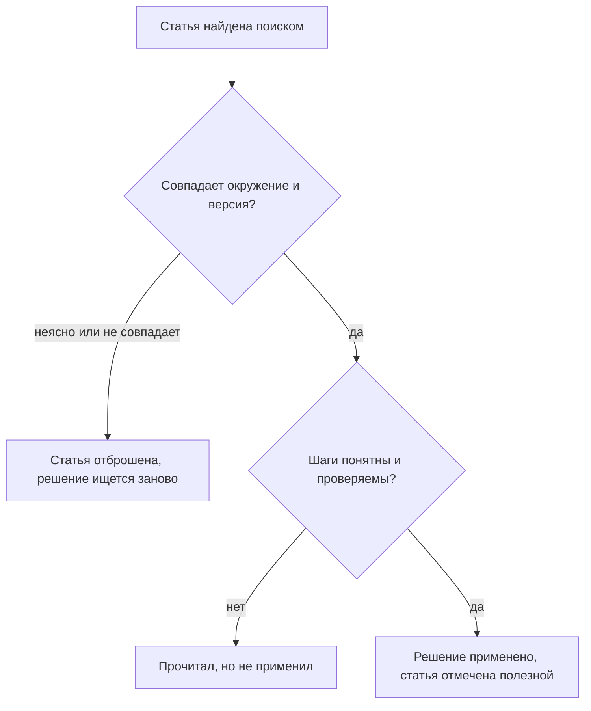
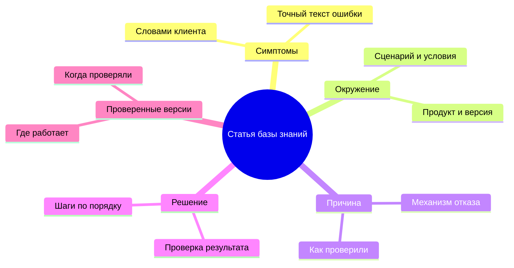

## Введение

Когда я предложил команде навести порядок в базе знаний, первая реакция была предсказуемой: «я не умею писать». Люди, которые каждый день объясняют клиентам сложные вещи простыми словами, были уверены, что статья — это литература, а литература — не их работа.

Через полгода те же люди писали статьи за десять минут и не считали это отдельной задачей. Изменилось не их отношение к тексту — изменился формат. Вместо чистого листа появился шаблон: пять блоков, каждый со своим вопросом. Когда знаешь, что первый блок — это симптомы словами клиента, а последний — версии, на которых решение проверено, писать становится нечем: остаётся только вспомнить, что было.

В статье «KCS в рабочем потоке: статья пишется в момент решения» речь шла о том, чтобы статья появлялась внутри тикета. Эта статья — о том, что именно в ней должно быть, чтобы черновик из тикета через месяц кто-то смог использовать повторно.

## Почему статьи в свободной форме не переиспользуются

Свободная форма кажется демократичной: пиши как думаешь, главное — по существу. На практике у неё три системных дефекта, и ни один не лечится призывом «пишите лучше».

**Поиск не находит.** Поиск работает по словам, а слова в свободном тексте — авторские. Инженер ищет «не открывается личный кабинет», статья называется «Проблема с авторизацией после обновления», а внутри — рассказ про токены. Совпадений нет, выдача пуста, и человек идёт в чат.

**Структуру не с чем сверить.** Читатель не может быстро ответить на свои вопросы: это про мою версию? Это про мой сценарий? Где проверить, что помогло? Он читает всё подряд или не читает вовсе — и в обоих случаях не доверяет результату.

**Версии не проверены.** Свободный текст не заставляет указать, на чём решение проверено. Статья живёт годами; продукт меняется; читатель применяет инструкцию к другой версии, получает другой результат и делает вывод, что база врёт.

За этими дефектами стоит одна причина: автор пишет для себя. Он помнит контекст, в котором разбирался, и не описывает его, потому что для него он очевиден. Читатель приходит через месяц или через год, контекста не знает и не может восстановить его по тексту. Шаблон заставляет автора ответить на вопросы, которые он сам себе не задавал.

Все три дефекта — про одно: читатель не может принять решение, применима ли статья к его случаю. Вот как выглядит его путь по свободной статье:

Любой блок шаблона ниже закрывает один из поворотов этой развилки. Поэтому шаблон — не бюрократия, а способ сократить число выходов «не применил».

## Шаблон статьи КБ

Шаблон, к которому я пришёл, состоит из пяти блоков. Он короткий намеренно: чем больше полей, тем меньше шансов, что их заполнят в тикете.

Теперь по блокам — что в них писать и что обычно пишут вместо этого.

| Блок | Вопрос, на который отвечает | Типичная ошибка заполнения |
| --- | --- | --- |
| Симптомы | Что видит клиент и какими словами он это называет | Пересказ терминами системы вместо фраз пользователя |
| Окружение | При каких условиях воспроизводится | «У всех» или отсутствие версии продукта |
| Причина | Почему это происходит | Название ошибки вместо механизма |
| Решение | Что сделать по шагам | Один абзац вместо последовательности с проверкой |
| Проверенные версии | Где решение действительно работает | «Актуально» без даты и без списка версий |

Несколько правил, которые я добавляю к шаблону:

- **Симптомы — словами клиента.** Не «ошибка авторизации», а то, что человек набрал бы в поиске: «после смены пароля не пускает в личный кабинет».
- **Окружение — только то, что влияет.** Перечислять всё подряд бессмысленно; нужны те два-три параметра, которые меняют исход.
- **Причина — механизм, а не ярлык.** «Просроченный сертификат на прокси» объясняет, почему помогло именно это решение, и позволяет читателю узнать ту же причину в другом симптоме.
- **Решение — шагами и с проверкой.** Последний шаг всегда отвечает на вопрос «как понять, что получилось».
- **Версии — обязательны.** Без них статья, которая не устаревает, существует только в мечтах.

<!-- вилка: ваши обязательные поля шаблона — что вы добавили к пяти блокам под свой продукт. -->

## Разобранный пример

Шаблон легко принять на словах и трудно применить. Поэтому в обучении я показываю не пустой шаблон, а одну статью, разобранную до конца: где симптом звучит как фраза клиента, где окружение сужено до параметров, которые действительно влияли, где причина объяснена механизмом, а в конце — версии, на которых решение проверено.

Что видно в хорошем разборе:

- **Симптом и причина — разные вещи.** В примере они не совпадают, и именно поэтому статья находится по словам клиента, а не по названию технологии.
- **Решение объясняет, а не только предписывает.** Читатель понимает, почему шаг нужен; если шаг не сработал, он может догадаться, где искать дальше.
- **Проверка результата отделена от шага.** «Перезапустить сервис» — шаг; «убедиться, что в журнале больше нет ошибки подключения» — проверка.
- **Границы применимости названы.** В разборе видно, в каком случае решение не поможет и что делать тогда.

<!-- вилка: обезличенный реальный пример статьи КБ целиком по шаблону — одна статья из вашей базы, приведённая целиком. -->

Для разбора стоит брать не самую сложную статью, а ту, на которую команда ссылается чаще всего. Именно её все читают в спешке, именно в ней ошибка формата стоит дороже всего — и именно на ней видно, зачем нужны блоки, которые обычно пропускают.

Разбор полезен ещё и тем, что снимает главный страх: статья по шаблону пишется быстрее свободного текста. Не нужно придумывать композицию и подбирать слова — нужно ответить на пять вопросов, ответы на которые у автора уже есть.

## Владелец КБ без отдельной ставки

Шаблон решает проблему структуры, но не решает проблему времени. Статьи стареют, дублируются, теряют актуальность — и кто-то должен это замечать. В статье «KCS в рабочем потоке» это роль владельца базы знаний; здесь — что именно она означает на практике, без отдельной ставки в штате.

Владелец базы знаний — это инженер с выделенными часами в неделю и мандатом менять чужие статьи. Его работа состоит из четырёх повторяющихся действий:

1. **Ревизия по сигналам.** Не «перечитать всё», а посмотреть, что произошло с базой за период: какие статьи открывали, какие отметили как неполезные, где появились дубли, что перестало открываться вообще.
2. **Слияние и чистка.** Две статьи про одно и то же — это хуже, чем одна: читатель выбирает неверную. Дубли сливаются, устаревшее уходит в архив.
3. **Правки авторам.** Владелец не переписывает всё сам; он возвращает автору конкретное замечание: «в статье про VPN не хватает версии клиента, добавь, пожалуйста».
4. **Структура.** Категории, названия, перекрёстные ссылки — то, что делает поиск работоспособным и что не видно ни в одном отдельном тикете.

Ключевое ограничение: у владельца не может быть больше одной-двух задач, кроме линии. Если он одновременно «главный по базе» и «главный по эскалациям», база будет обрабатываться по остаточному принципу — то есть никогда.

<!-- вилка: частота ревизии и её формат — раз в неделю или раз в две, по какому списку, сколько времени занимает. -->

И последнее, что я понял про владельца: роль работает только вместе с лидом. Владелец видит проблемы, но не всегда имеет право менять процесс — например, потребовать от команды отмечать полезность статьи. Такие решения остаются за лидом, и это ещё один повод держать разбор базы в регулярном ритме, а не в режиме пожара.

Шаблон, разбор и владелец — три вещи, которые превращают черновики из тикетов в базу, которой пользуются. Следующий шаг — заняться тем, что в базе повторяется чаще всего: повторяющимися проблемами и записями с владельцем.
