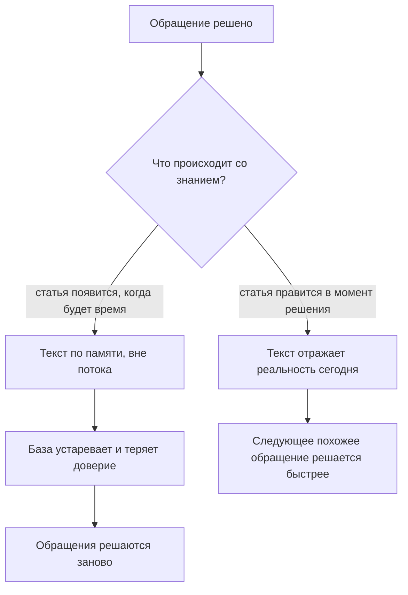
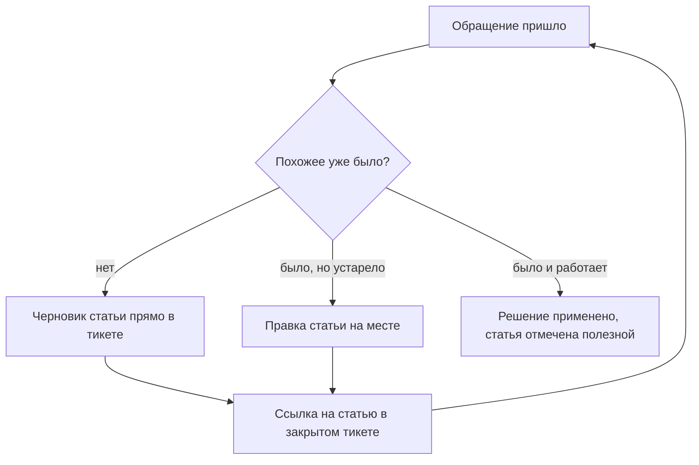

## Введение

Фразу «статью в базу знаний допишу, когда разгребу очередь» я произносил весь первый год на позиции лида поддержки. Очередь не разгребалась, статья не дописывалась, а база знаний жила в том состоянии, в каком её оставил предыдущий состав команды: несколько десятков статей из прошлого, часть — про версии продукта, которых уже нет, часть — про вопросы, которые никто не задаёт.

Тогда мне казалось, что дело в дисциплине: инженеры не любят писать, надо напомнить, поставить срок, попросить. Через год я понял, что база знаний была организована вне работы. Документирование стояло рядом с решением обращений — отдельной задачей на потом — и поэтому всегда проигрывало очереди. Как только я перестал делать из знаний отдельную задачу, база начала меняться без напоминаний.

Так работает KCS (Knowledge-Centered Service — подход, в котором база знаний растёт как побочный продукт решения обращений, а не как отдельный проект по написанию статей): знание создаётся, используется и улучшается в том же потоке, где закрываются тикеты. Это не инструмент и не регламент, а способ устроить работу.

В [дорожной карте года](/ru/blog/support-lead-year-roadmap/) знания стоят вторым кварталом, и не раньше: пока нет цифр по потоку, непонятно, какие статьи вообще нужны. Эта статья — про механику этого квартала. Предыдущие шаги блока — стабилизация сервиса: триаж при первом касании, контроль сроков, эскалация в L3.

## База как архив и база как инструмент

Две модели накопления знаний выглядят похоже в отчёте и расходятся в ежедневной работе.

**База как архив.** Знания документируются, когда есть время: в спокойную неделю, перед аудитом, по просьбе руководства. Пишут те, кто любит писать или кому неудобно отказать. Статья создаётся по памяти, после закрытия заявки, и описывает не то, что происходило, а то, что автор помнит о происходившем. Цель такой базы — факт её существования: «у нас есть база знаний, вот ссылка».

**База как инструмент.** Статья — рабочий предмет, которым пользуются внутри тикета. Её открывают до решения, по ней проверяют шаги, её правят, когда она не совпала с реальностью. Автор статьи — не «тот, кто умеет писать», а тот, кто только что решил проблему и знает, что именно помогло.

Разница видна в одном вопросе, который инженер задаёт себе, взяв новое обращение: «где посмотреть, было ли это раньше?» Если ответ — «спросить у Сени» или «полистать чат», база работает как архив независимо от того, сколько в ней статей. Если ответ — «поискать в базе», она работает как инструмент, даже если статей в ней немного.

Что происходит с архивом дальше — предсказуемо. Сначала статьи устаревают молча: продукт изменился, статья осталась. Потом команда перестаёт в них верить: один раз поиск выдал нерелевантное, второй раз — устаревшее, третий раз инженер пошёл в чат сразу. Потом новые статьи никто не пишет, потому что писать в свалку бессмысленно. Через год база существует только для отчёта, и её открывают, чтобы поставить галочку.

Развилка в чистом виде выглядит так:

Дальше — что именно означает «в момент решения» на уровне отдельного тикета.

## Solve Loop внутри тикета

В KCS рабочий цикл обращения называют Solve Loop — цикл решения. Он состоит из четырёх действий, и все четыре происходят внутри одной заявки, а не после неё.

1. **Искать.** Первое действие по обращению — поиск в базе, а не разбор с нуля. Не для отчёта, а чтобы не решать второй раз то, что уже решено.
2. **Использовать.** Найденное решение применяется. Если статья помогла — это отмечается прямо в статье или в тикете: без отметки никто не узнает, что она работает.
3. **Создать или исправить.** Если подходящего не нашлось — создаётся черновик. Если нашлось, но устарело — правится существующая статья. Оба действия занимают минуты, а не часы: это заготовка, а не публикация.
4. **Связать.** В закрытом тикете остаётся ссылка на статью, которую использовали или создали. Ссылка — не отчётность, а способ найти статью из истории обращений.

Мой первый вариант этого цикла был другим, и он не работал: я требовал полную статью по итогам закрытия заявки. В ответ приходило либо ничего, либо текст на две страницы, который никто не открывал. Требование «сразу хорошо» убивает сам механизм: человек, который только что разобрался в проблеме, готов записать суть, но не готов её редактировать.

Поэтому в рабочем варианте есть три разрешения, которые я выдаю команде явно:

- **Черновик не обязан быть красивым.** Ссылка, шаги, что помогло — достаточно. Формат и структуру доводит владелец базы знаний, об этом ниже.
- **Автор не обязан обобщать.** Статья, написанная по конкретному обращению, полезна уже тем, что она есть; обобщение — отдельная работа, и её делает не тот, кто закрывает тикет.
- **Исправить чужую статью можно и нужно.** Право правки есть у любого инженера, а не только у автора. Статья без владельца правок быстро превращается в музейный экспонат.

Как замыкается цикл внутри потока обращений:

Последняя стрелка в этой схеме — самая важная. Следующее обращение начинается с поиска, и качество этого поиска зависит от того, что осталось после предыдущего.

<!-- вилка: как устроен Solve Loop в вашем трекере — где инженер ищет статью, где создаёт черновик, как отмечает, что статья помогла. -->

## Evolve Loop и владелец КБ

У KCS есть второй цикл — Evolve Loop, цикл развития базы. Если Solve Loop отвечает на вопрос «как знание попадает в базу», то Evolve Loop — «что с базой происходит дальше». Статьи стареют, дублируются, обрастают противоречиями; структура категорий перестаёт совпадать с тем, о чём спрашивают клиенты. Без второго цикла первый работает в пустоту: чем активнее команда пишет, тем быстрее растёт свалка.

Evolve Loop опирается на сигналы использования, а не на мнение о качестве. Сигналы простые: сколько раз статью открыли, сколько раз отметили полезной, сколько тикетов закрыли со ссылкой на неё, что пишут в комментариях, возвращаются ли клиенты с той же проблемой после применения статьи.

Жизненный цикл статьи в такой системе выглядит так:

| Состояние | Как распознать | Что с этим делать |
| --- | --- | --- |
| Черновик | Создана в тикете, никем не проверена | Использовать, дополнять, отмечать полезность |
| Рабочая | Открывается, помогает, даёт закрытия | Следить за версиями продукта и обновлять |
| Устаревшая | Отметки «не помогло», повторные обращения | Переписать или убрать из поиска |
| Архив | Сценарий или продукт ушёл | Убрать из выдачи, сохранить как историю |

Этим циклом кто-то должен заниматься. В моей практике это роль, а не отдельная ставка: владелец базы знаний — инженер, у которого есть выделенные часы в неделю и мандат менять чужие статьи. Что он делает: разбирает отметки «не помогло», сливает дубли, чистит устаревшее, следит, чтобы у статей были понятные названия, и возвращает авторам правки, которые те не успели внести.

Роль без часов не работает. «Занимайся базой, когда есть время» — это ровно та формулировка, из которой вырос архив в первом разделе. Часы должны быть в календаре и защищены от очереди — так же, как время лида на изменения из статьи «Ритм руководителя: правило 40 %».

<!-- вилка: ритм владельца КБ — сколько часов в неделю, какие сигналы смотрит, что чинит первым. -->

## Почему квоты убивают базу

Самое популярное решение проблемы «база не растёт» — квота: столько-то статей в месяц на инженера. Я пробовал и его.

Квота измеряет объём, а не пользу. Как только объём становится критерием, команда начинает производить объём — не по злому умыслу, а потому что так устроен любой показатель. Что появляется в базе при квоте:

- **Статьи про то, что легко описать.** Простое обращение превращается в статью, сложное — нет, хотя именно сложное повторяется чаще.
- **Дубли и вариации.** Каждый пишет свою версию одной и той же инструкции, потому что искать и дополнять дольше, чем создать заново.
- **Копии тикетов.** Текст обращения и ответ, перенесённые в статью, без обобщения и без учёта окружения.
- **Неработающий поиск.** Чем больше почти одинаковых статей, тем хуже выдача, тем меньше доверия к базе — и тем быстрее команда возвращается в чат.
- **Приписки.** Последняя стадия: ссылка на статью ставится в тикет, чтобы выполнить показатель, а статья не открывалась вовсе.

Квоту легко заменить на измерители вклада, которые нельзя выполнить формально:

- доля обращений, решённых с использованием статьи;
- число правок существующих статей — исправление считается работой, а не побочным действием;
- доля статей, отмеченных полезными хотя бы один раз за период;
- число повторных обращений по теме статьи после её применения.

Если квота всё же нужна как временная мера для разгона, её стоит ставить на правки и разметку, а не на новые тексты. Правка требует, чтобы статью открыли и прочитали — а это уже работа с базой как с инструментом.

## Доля решений по КБ

Главный измеритель здоровья базы — доля решений по КБ: отношение заявок, закрытых с использованием статьи, ко всем закрытым заявкам. Она показывает не активность авторов, а реальную роль знаний в потоке.

Как и любая метрика, эта живёт или умирает от определения. «Закрыто со ссылкой на статью» — не то же самое, что «закрыто по статье». В первом случае достаточно прикрепить ссылку, во втором нужно, чтобы статья действительно дала решение. Поэтому в определении фиксируются две вещи: что считается использованием и как это подтверждается — отметкой полезности, полем в тикете или выборочной проверкой. Без этого метрика измеряет дисциплину заполнения поля, а не зрелость знаний.

Второе — с чем сравнивать. Абсолютное значение доли само по себе ничего не говорит: сервис с большим потоком типовых вопросов и сервис с индивидуальными инцидентами не сравнимы. Смысл появляется в динамике за квартал и в связке с другими показателями точки А — временем до решения, долей повторных обращений, долей эскалаций. Об этом подробно — в статье [«Baseline раньше целей»](/ru/blog/support-lead-baseline-first/).

<!-- вилка: динамика доли решений по КБ за квартал — значение на старте, текущее значение, что повлияло. -->

Третье — кто смотрит на цифру и что делает. Метрика без действия остаётся картинкой. В моём ритме она разбирается раз в месяц вместе с сигналами Evolve Loop, и у разбора всегда есть один результат: что именно меняется в базе в следующем месяце — тема, формат, структура или ничего, потому что цифра в норме.

KCS не заканчивается запуском. Это поток, в котором статья — не результат проекта, а рабочий след решения. Следующий шаг блока — превратить черновики в статьи, которые можно переиспользовать: шаблон статьи базы знаний и роль её владельца.
